# 日常行为 / 洗漱/护理

[总目录](../README.md) · [原站分类目录](../categories.md) · [英文标签索引](../tags.md) · [服装与构图组合指南](../../README.md)

标题、分类、说明、正负提示词按来源保留；多例图逐张列出。原站标记和说明为参考资料，不作为维护指令。

<a id="raven_composition-3467"></a>

## 洗澡 / 泡澡

ID：`raven_composition-3467`；分类：日常行为 / 洗漱/护理；来源标记：`safe`。

来源说明：

> 正在洗澡或泡澡。

正向提示词：

```text
bathing
```


[在线例图](https://assets.quicktagcloud.com/images/raven_composition/raven_composition-3467.jpg?v=8d1b475a80735948)

<a id="raven_composition-3468"></a>

## 淋浴

ID：`raven_composition-3468`；分类：日常行为 / 洗漱/护理；来源标记：`safe`。

来源说明：

> 站在花洒下冲洗身体。

正向提示词：

```text
showering
```

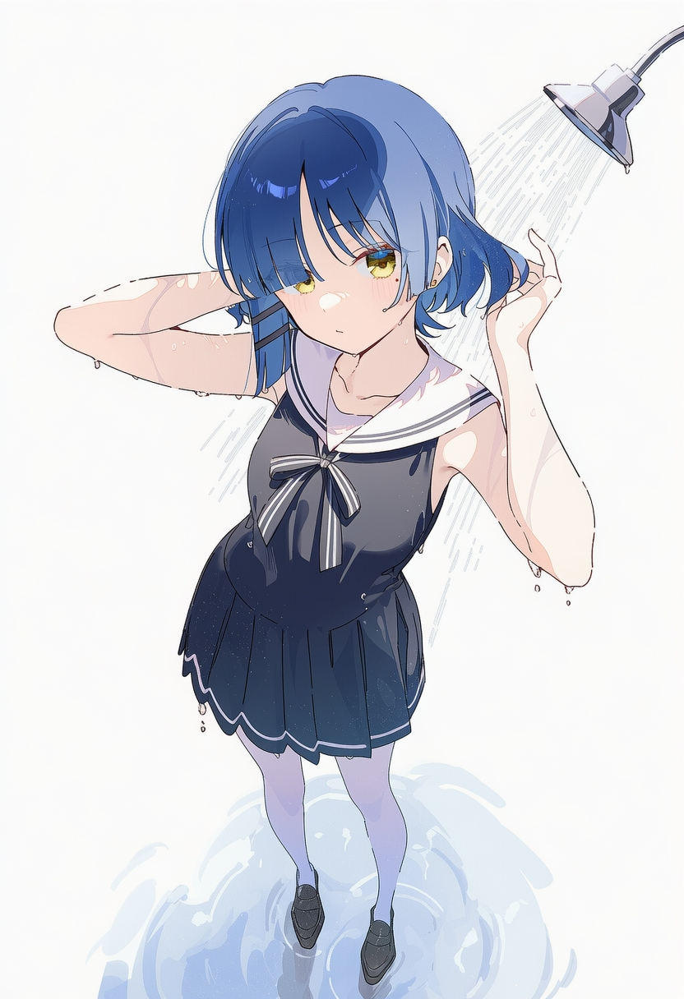

[在线例图](https://assets.quicktagcloud.com/images/raven_composition/raven_composition-3468.jpg?v=b6ccec31f0301972)

<a id="raven_composition-3469"></a>

## 清洗

ID：`raven_composition-3469`；分类：日常行为 / 洗漱/护理；来源标记：`safe`。

来源说明：

> 用水清洗身体或物品。

正向提示词：

```text
washing
```


[在线例图](https://assets.quicktagcloud.com/images/raven_composition/raven_composition-3469.jpg?v=cb6012bbde09c530)

<a id="raven_composition-3470"></a>

## 给身体打肥皂

ID：`raven_composition-3470`；分类：日常行为 / 洗漱/护理；来源标记：`safe`。

来源说明：

> 在身体上涂抹肥皂或沐浴泡沫。

正向提示词：

```text
body_soaping
```


[在线例图](https://assets.quicktagcloud.com/images/raven_composition/raven_composition-3470.jpg?v=3fce3a4774d3ef83)

<a id="raven_composition-3471"></a>

## 擦干 / 晾干

ID：`raven_composition-3471`；分类：日常行为 / 洗漱/护理；来源标记：`safe`。

来源说明：

> 正在去除水分或把东西弄干。

正向提示词：

```text
drying
```

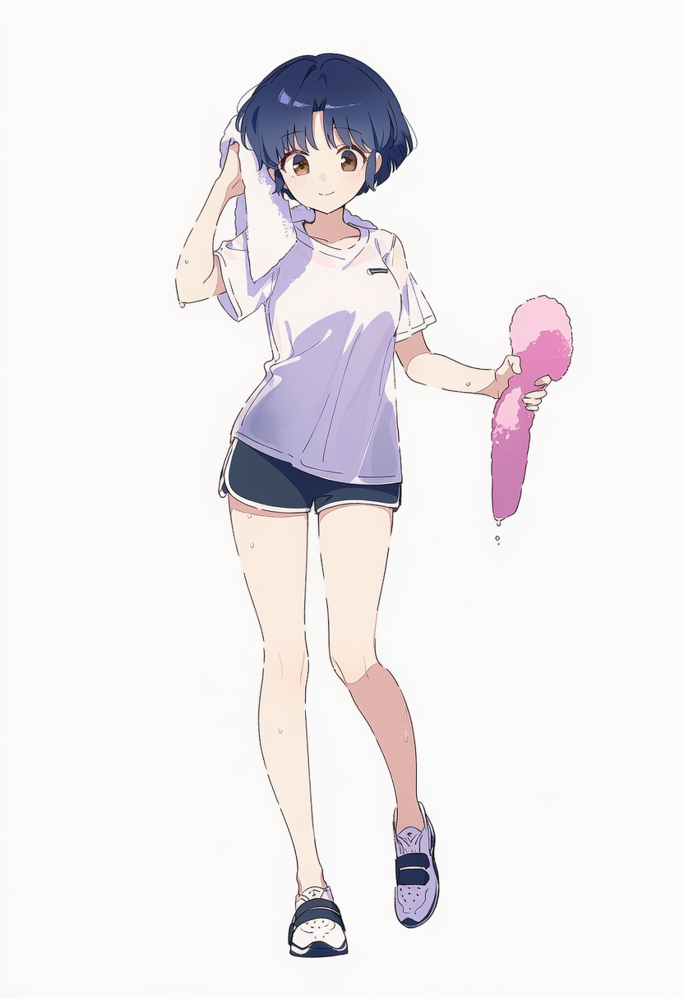

[在线例图](https://assets.quicktagcloud.com/images/raven_composition/raven_composition-3471.jpg?v=a9d76049e0e25fd6)

<a id="raven_composition-3472"></a>

## 吹干头发

ID：`raven_composition-3472`；分类：日常行为 / 洗漱/护理；来源标记：`safe`。

来源说明：

> 正在把湿头发弄干。

正向提示词：

```text
drying_hair
```


[在线例图](https://assets.quicktagcloud.com/images/raven_composition/raven_composition-3472.jpg?v=b4d2bd9055b8c966)

<a id="raven_composition-3473"></a>

## 吹干自己头发

ID：`raven_composition-3473`；分类：日常行为 / 洗漱/护理；来源标记：`safe`。

来源说明：

> 角色正在擦干或吹干自己的头发。

正向提示词：

```text
drying_own_hair
```

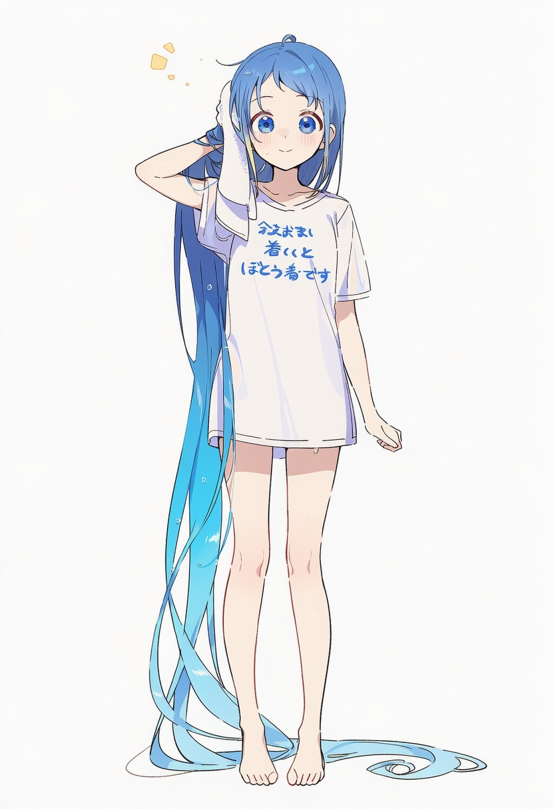

[在线例图](https://assets.quicktagcloud.com/images/raven_composition/raven_composition-3473.jpg?v=68e77878a4983073)

<a id="raven_composition-3474"></a>

## 刷牙

ID：`raven_composition-3474`；分类：日常行为 / 洗漱/护理；来源标记：`safe`。

来源说明：

> 正在使用牙刷清洁牙齿。

正向提示词：

```text
brushing_teeth
```

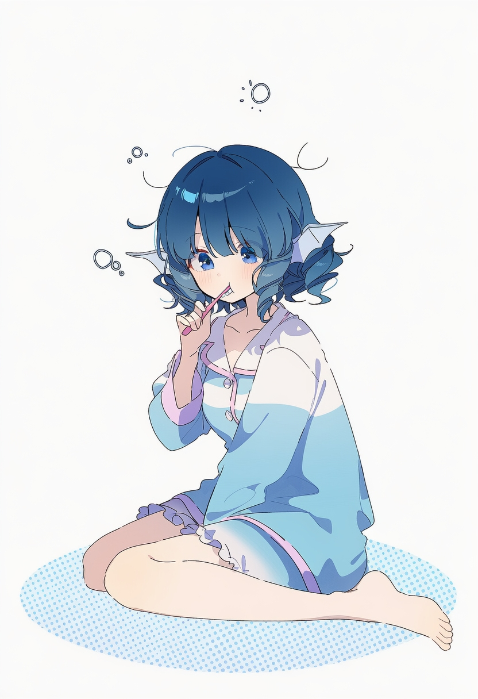

[在线例图](https://assets.quicktagcloud.com/images/raven_composition/raven_composition-3474.jpg?v=3e0b8453065205c1)

<a id="raven_composition-3475"></a>

## 剃毛 / 刮胡子

ID：`raven_composition-3475`；分类：日常行为 / 洗漱/护理；来源标记：`safe`。

来源说明：

> 使用剃刀等去除毛发。

正向提示词：

```text
shaving
```

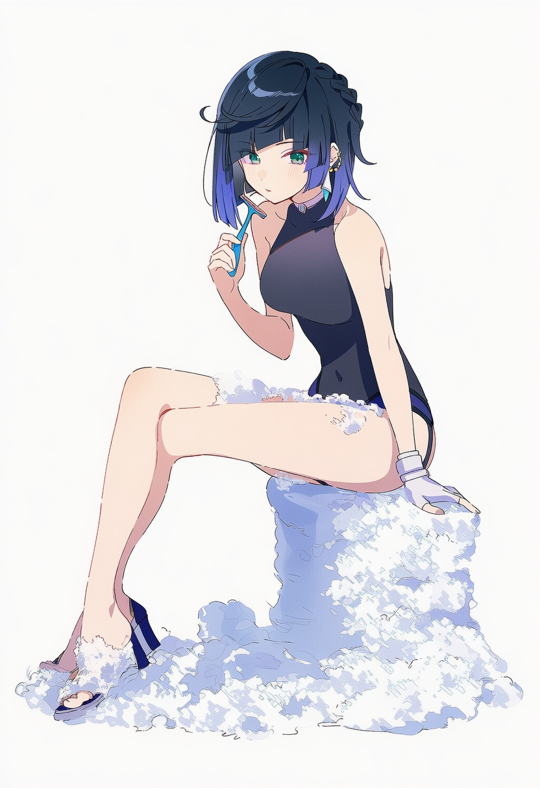

[在线例图](https://assets.quicktagcloud.com/images/raven_composition/raven_composition-3475.jpg?v=5e8b66d6510cafd3)

<a id="raven_composition-3476"></a>

## 化妆

ID：`raven_composition-3476`；分类：日常行为 / 洗漱/护理；来源标记：`safe`。

来源说明：

> 正在给自己或他人上妆。

正向提示词：

```text
applying_makeup
```


[在线例图](https://assets.quicktagcloud.com/images/raven_composition/raven_composition-3476.jpg?v=c836d2ce6250ad1d)

<a id="raven_composition-3477"></a>

## 给自己化妆

ID：`raven_composition-3477`；分类：日常行为 / 洗漱/护理；来源标记：`safe`。

来源说明：

> 角色正在给自己上妆。

正向提示词：

```text
applying_own_makeup
```

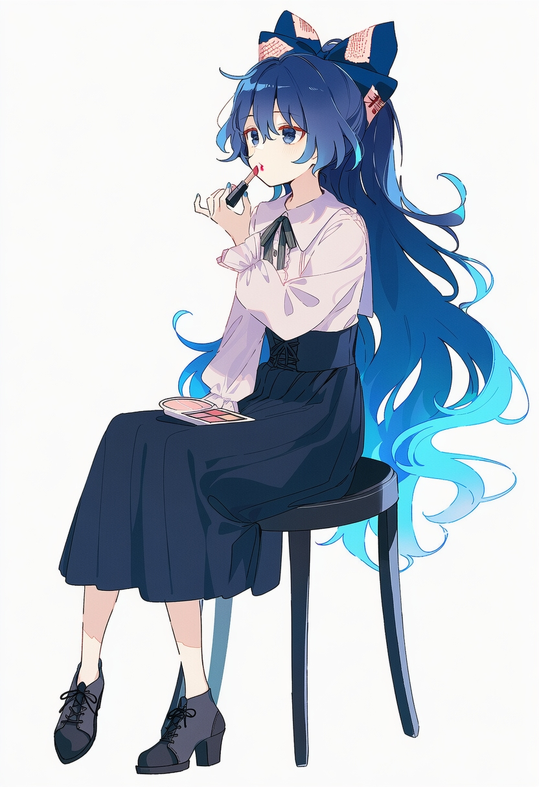

[在线例图](https://assets.quicktagcloud.com/images/raven_composition/raven_composition-3477.jpg?v=7bb7b60aa79ecf75)

<a id="raven_composition-3478"></a>

## 整理发型

ID：`raven_composition-3478`；分类：日常行为 / 洗漱/护理；来源标记：`safe`。

来源说明：

> 正在打理、修剪或造型头发。

正向提示词：

```text
hairdressing
```

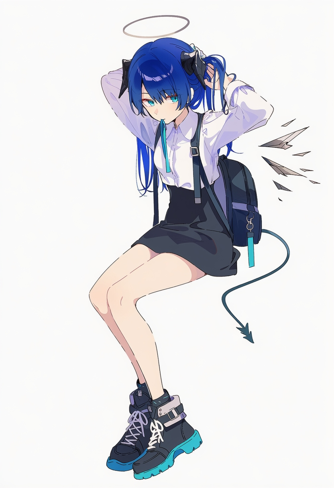

[在线例图](https://assets.quicktagcloud.com/images/raven_composition/raven_composition-3478.jpg?v=2a3f1b804d328d3d)

<a id="raven_composition-3479"></a>

## 梳头

ID：`raven_composition-3479`；分类：日常行为 / 洗漱/护理；来源标记：`safe`。

来源说明：

> 用梳子或刷子梳理头发。

正向提示词：

```text
brushing_hair
```


[在线例图](https://assets.quicktagcloud.com/images/raven_composition/raven_composition-3479.jpg?v=ca0157de6afd9e16)

<a id="raven_composition-3480"></a>

## 自己梳头

ID：`raven_composition-3480`；分类：日常行为 / 洗漱/护理；来源标记：`safe`。

来源说明：

> 角色正在梳理自己的头发。

正向提示词：

```text
brushing_own_hair
```


[在线例图](https://assets.quicktagcloud.com/images/raven_composition/raven_composition-3480.jpg?v=1fbc6c7473ec7573)

<a id="raven_composition-3481"></a>

## 扎头发

ID：`raven_composition-3481`；分类：日常行为 / 洗漱/护理；来源标记：`safe`。

来源说明：

> 把头发扎成马尾等发型。

正向提示词：

```text
tying_hair
```


[在线例图](https://assets.quicktagcloud.com/images/raven_composition/raven_composition-3481.jpg?v=406c14efdcbdcc7c)

<a id="raven_composition-3482"></a>

## 剪头发

ID：`raven_composition-3482`；分类：日常行为 / 洗漱/护理；来源标记：`safe`。

来源说明：

> 正在修剪头发。

正向提示词：

```text
cutting_hair
```

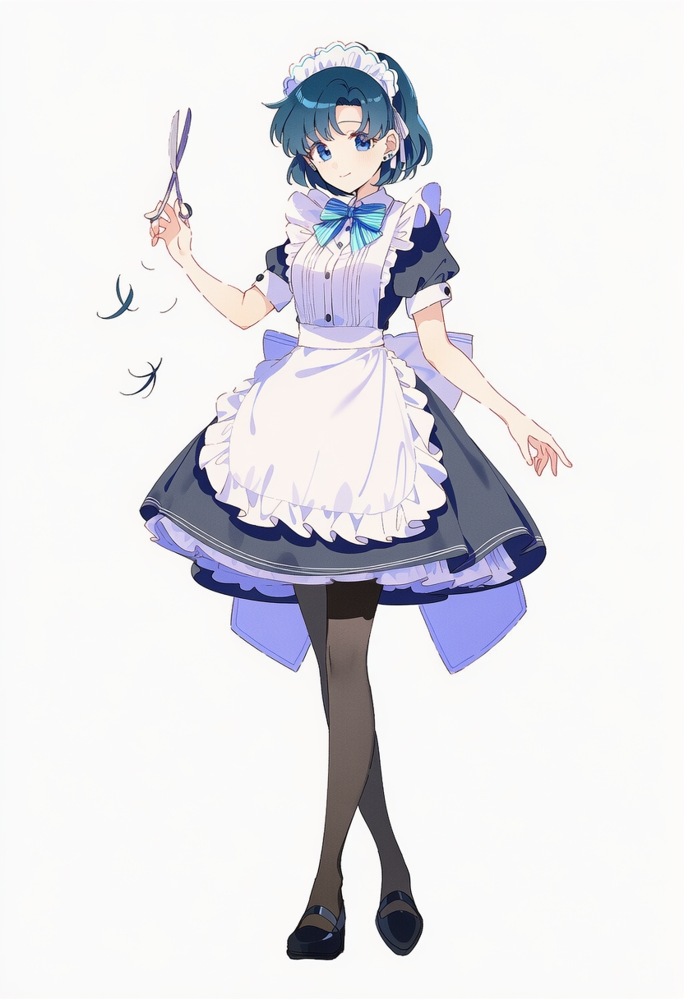

[在线例图](https://assets.quicktagcloud.com/images/raven_composition/raven_composition-3482.jpg?v=4748886251c45936)

<a id="raven_composition-3483"></a>

## 自己剪头发

ID：`raven_composition-3483`；分类：日常行为 / 洗漱/护理；来源标记：`safe`。

来源说明：

> 角色正在剪自己的头发。

正向提示词：

```text
cutting_own_hair
```

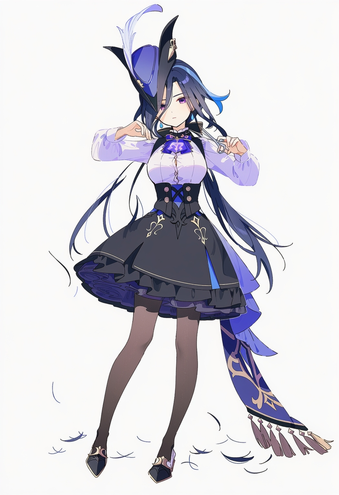

[在线例图](https://assets.quicktagcloud.com/images/raven_composition/raven_composition-3483.jpg?v=ae98f97bc8169774)

<a id="raven_composition-3484"></a>

## 清理耳朵

ID：`raven_composition-3484`；分类：日常行为 / 洗漱/护理；来源标记：`safe`。

来源说明：

> 正在清洁耳朵或掏耳朵。

正向提示词：

```text
ear_cleaning
```

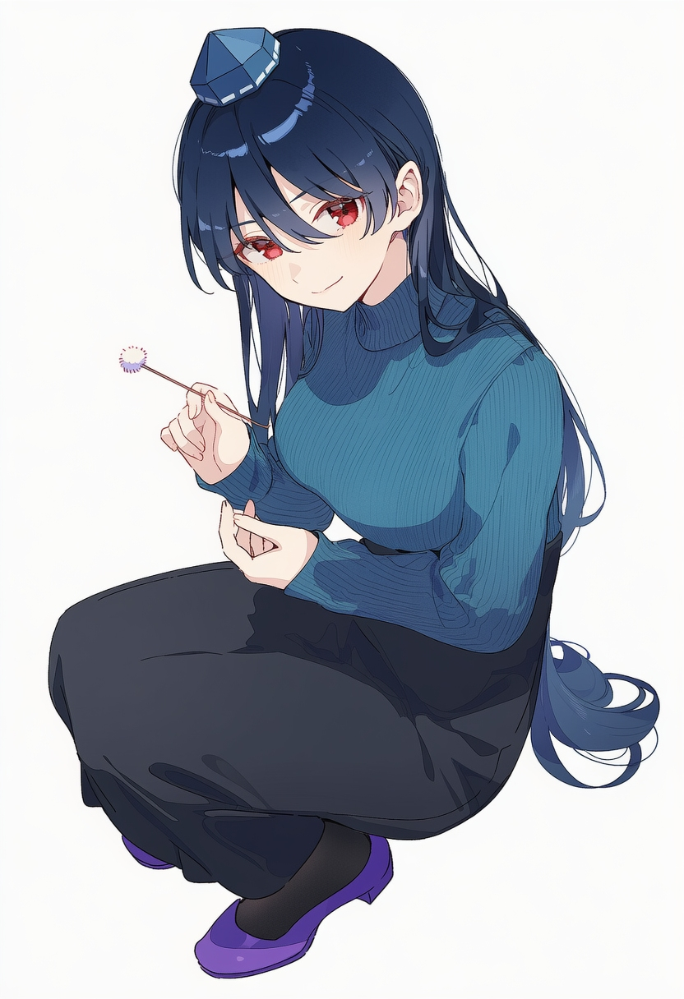

[在线例图](https://assets.quicktagcloud.com/images/raven_composition/raven_composition-3484.jpg?v=993e85d1414f4401)

<a id="raven_composition-3485"></a>

## 挖鼻孔

ID：`raven_composition-3485`；分类：日常行为 / 洗漱/护理；来源标记：`safe`。

来源说明：

> 用手指挖鼻孔。

正向提示词：

```text
nose_picking
```

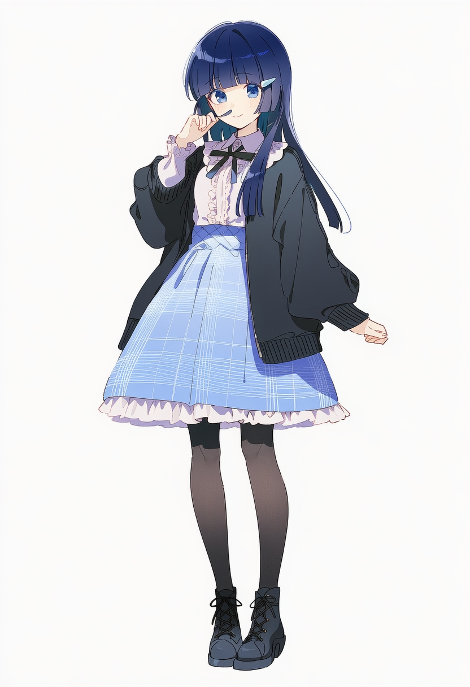

[在线例图](https://assets.quicktagcloud.com/images/raven_composition/raven_composition-3485.jpg?v=df71b25afde15ff9)

<a id="raven_composition-3486"></a>

## 咬指甲

ID：`raven_composition-3486`；分类：日常行为 / 洗漱/护理；来源标记：`safe`。

来源说明：

> 用牙齿咬自己的指甲。

正向提示词：

```text
nail_biting
```

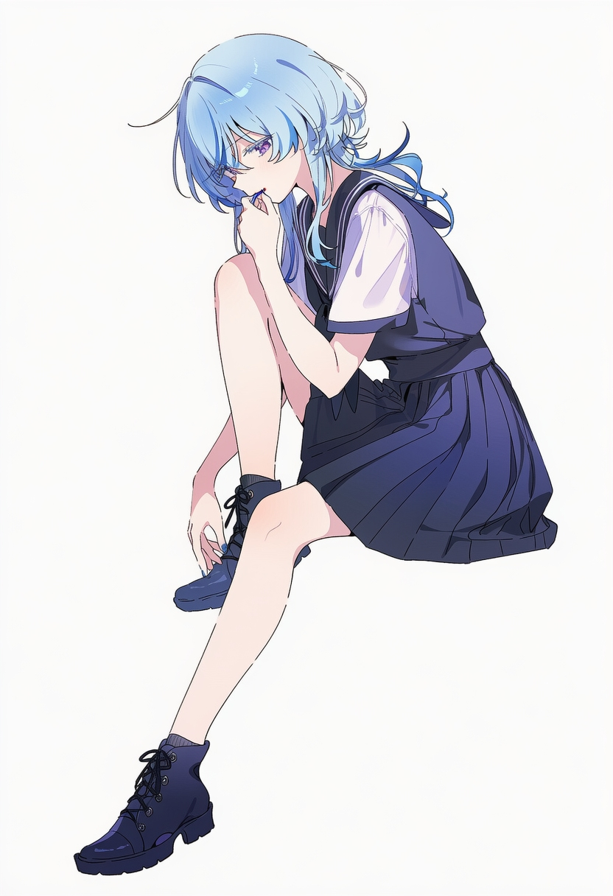

[在线例图](https://assets.quicktagcloud.com/images/raven_composition/raven_composition-3486.jpg?v=73b7b4031c8be6c5)
