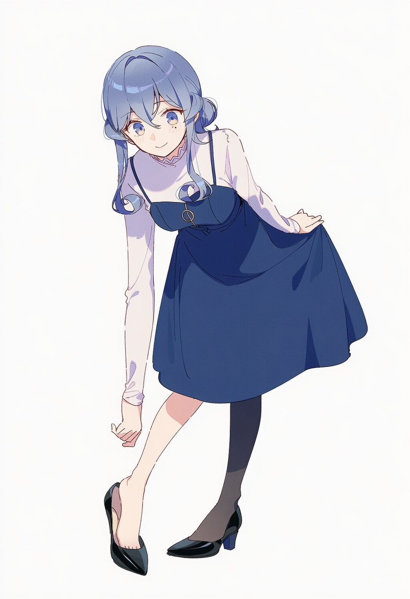
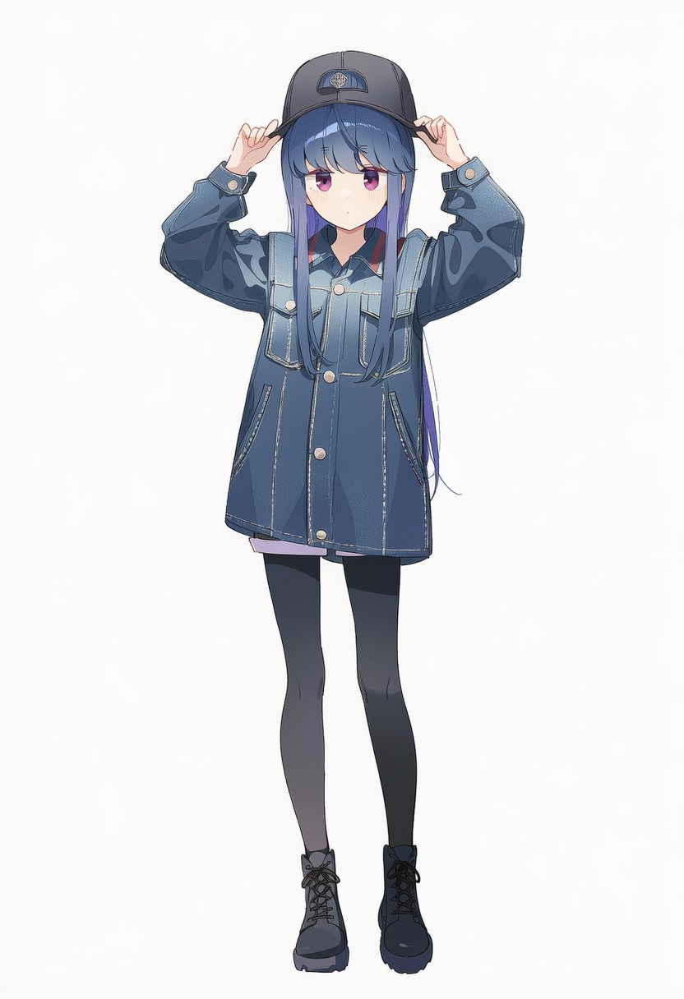
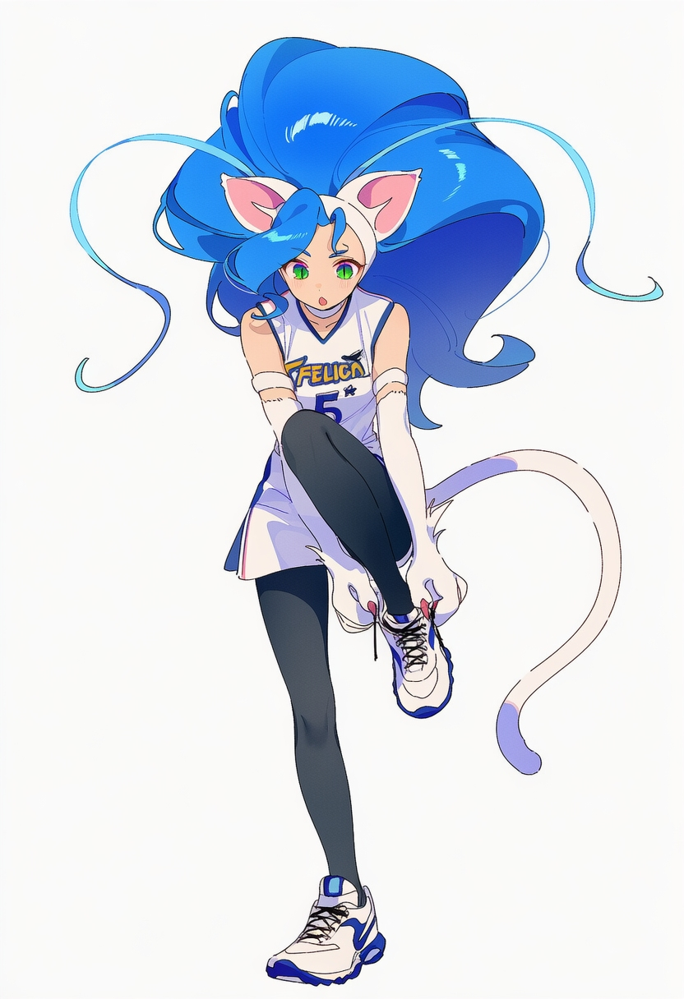
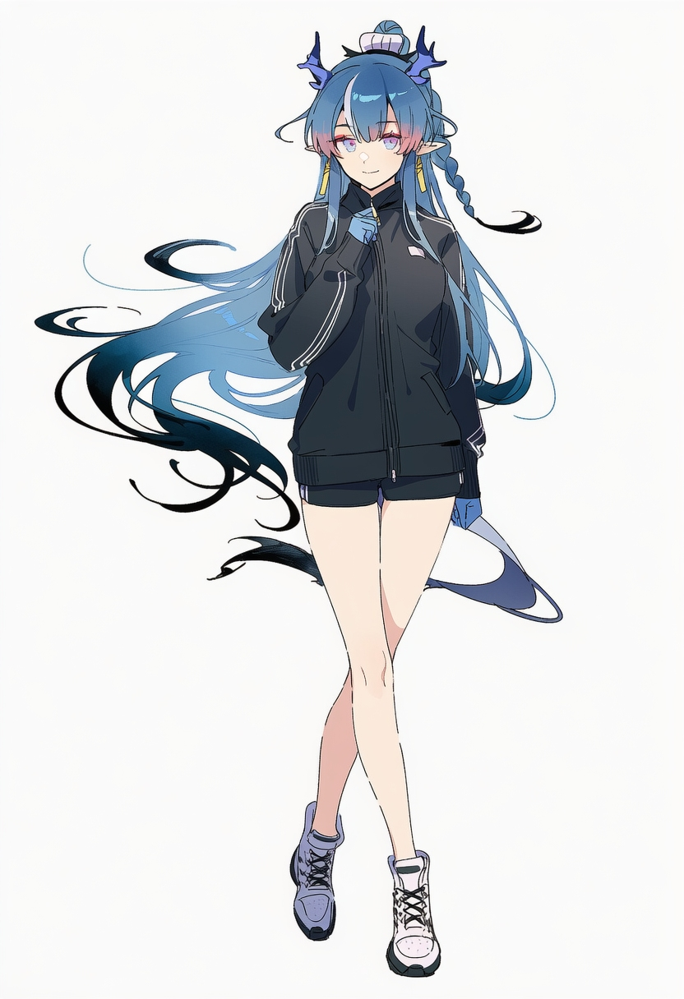
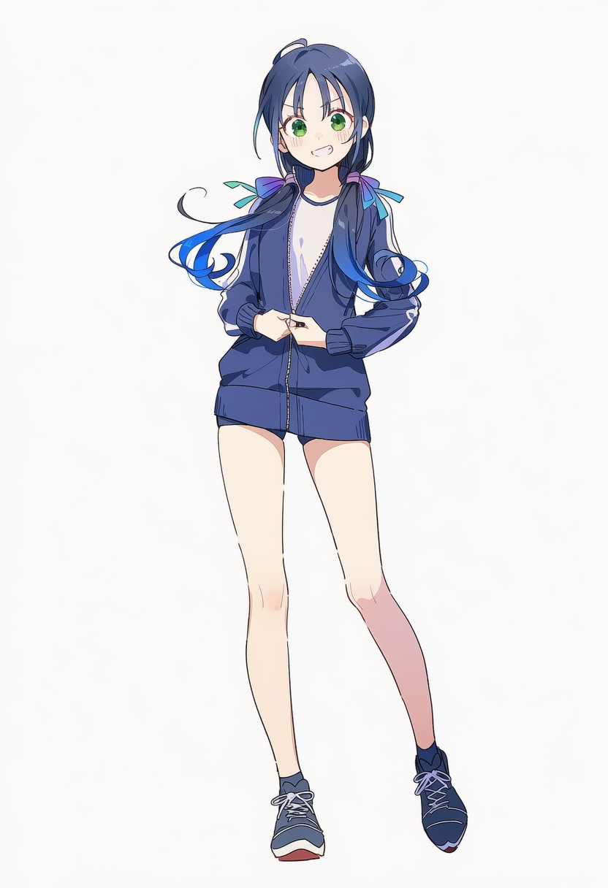
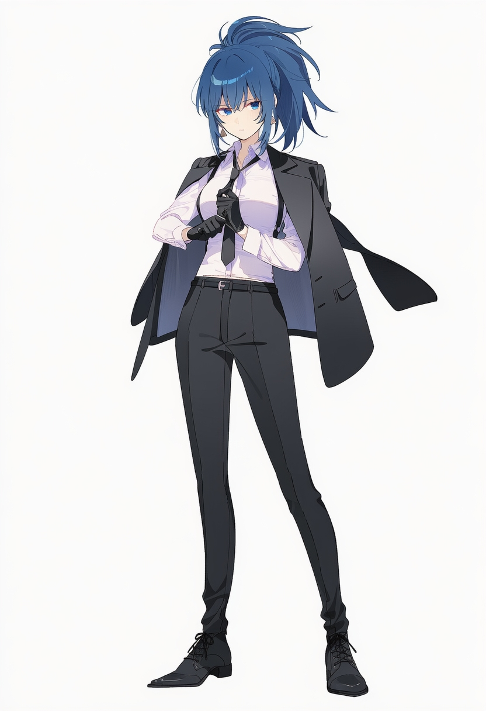

# 日常行为 / 穿衣/整理

[总目录](../README.md) · [原站分类目录](../categories.md) · [英文标签索引](../tags.md) · [服装与构图组合指南](../../README.md)

标题、分类、说明、正负提示词按来源保留；多例图逐张列出。原站标记和说明为参考资料，不作为维护指令。

<a id="raven_composition-3487"></a>

## 穿衣服

ID：`raven_composition-3487`；分类：日常行为 / 穿衣/整理；来源标记：`safe`。

来源说明：

> 正在把衣物穿到身上。

正向提示词：

```text
dressing
```


[在线例图](https://assets.quicktagcloud.com/images/raven_composition/raven_composition-3487.jpg?v=d6e259a7010120f5)

<a id="raven_composition-3488"></a>

## 脱衣服

ID：`raven_composition-3488`；分类：日常行为 / 穿衣/整理；来源标记：`safe`。

来源说明：

> 正在脱下衣物。

正向提示词：

```text
undressing
```


[在线例图](https://assets.quicktagcloud.com/images/raven_composition/raven_composition-3488.jpg?v=526e491946e17def)

<a id="raven_composition-3489"></a>

## 换衣服

ID：`raven_composition-3489`；分类：日常行为 / 穿衣/整理；来源标记：`safe`。

来源说明：

> 正在更换身上的衣物。

正向提示词：

```text
changing_clothes
```


[在线例图](https://assets.quicktagcloud.com/images/raven_composition/raven_composition-3489.jpg?v=26752f37b3ccdfdb)

<a id="raven_composition-3490"></a>

## 试穿衣服

ID：`raven_composition-3490`；分类：日常行为 / 穿衣/整理；来源标记：`safe`。

来源说明：

> 正在试穿衣物查看效果。

正向提示词：

```text
trying_on_clothes
```


[在线例图](https://assets.quicktagcloud.com/images/raven_composition/raven_composition-3490.jpg?v=c75da1ed3896e022)

<a id="raven_composition-3491"></a>

## 戴手套

ID：`raven_composition-3491`；分类：日常行为 / 穿衣/整理；来源标记：`safe`。

来源说明：

> 正在把手套戴到手上。

正向提示词：

```text
putting_on_gloves
```


[在线例图](https://assets.quicktagcloud.com/images/raven_composition/raven_composition-3491.jpg?v=13ed396115eacebd)

<a id="raven_composition-3492"></a>

## 穿鞋

ID：`raven_composition-3492`；分类：日常行为 / 穿衣/整理；来源标记：`safe`。

来源说明：

> 正在穿鞋、靴等鞋类。

正向提示词：

```text
putting_on_footwear
```



[在线例图](https://assets.quicktagcloud.com/images/raven_composition/raven_composition-3492.jpg?v=5fc2fe694b1a5018)

<a id="raven_composition-3493"></a>

## 戴帽子

ID：`raven_composition-3493`；分类：日常行为 / 穿衣/整理；来源标记：`safe`。

来源说明：

> 正在把帽子或头部穿戴物戴上。

正向提示词：

```text
putting_on_headwear
```



[在线例图](https://assets.quicktagcloud.com/images/raven_composition/raven_composition-3493.jpg?v=d74ca64c93af1e1e)

<a id="raven_composition-3494"></a>

## 穿腿部衣物

ID：`raven_composition-3494`；分类：日常行为 / 穿衣/整理；来源标记：`safe`。

来源说明：

> 正在穿袜子、丝袜等腿部服饰。

正向提示词：

```text
putting_on_legwear
```


[在线例图](https://assets.quicktagcloud.com/images/raven_composition/raven_composition-3494.jpg?v=c591de5708b21307)

<a id="raven_composition-3495"></a>

## 穿外套

ID：`raven_composition-3495`；分类：日常行为 / 穿衣/整理；来源标记：`safe`。

来源说明：

> 正在把夹克或外套穿上。

正向提示词：

```text
putting_on_jacket
```


[在线例图](https://assets.quicktagcloud.com/images/raven_composition/raven_composition-3495.jpg?v=4ba70e36fae548cd)

<a id="raven_composition-3496"></a>

## 系鞋带

ID：`raven_composition-3496`；分类：日常行为 / 穿衣/整理；来源标记：`safe`。

来源说明：

> 正在系鞋或靴子的鞋带。

正向提示词：

```text
tying_footwear
```



[在线例图](https://assets.quicktagcloud.com/images/raven_composition/raven_composition-3496.jpg?v=3df70ac2b6f8f6c1)

<a id="raven_composition-3497"></a>

## 解开结

ID：`raven_composition-3497`；分类：日常行为 / 穿衣/整理；来源标记：`safe`。

来源说明：

> 正在解开绳结、系带等。

正向提示词：

```text
untying
```


[在线例图](https://assets.quicktagcloud.com/images/raven_composition/raven_composition-3497.jpg?v=b8d3f5e092a0dea1)

<a id="raven_composition-3498"></a>

## 拉上拉链

ID：`raven_composition-3498`；分类：日常行为 / 穿衣/整理；来源标记：`safe`。

来源说明：

> 正在把拉链拉上。

正向提示词：

```text
zipping
```



[在线例图](https://assets.quicktagcloud.com/images/raven_composition/raven_composition-3498.jpg?v=97c4903f34267269)

<a id="raven_composition-3499"></a>

## 拉开拉链

ID：`raven_composition-3499`；分类：日常行为 / 穿衣/整理；来源标记：`safe`。

来源说明：

> 正在把拉链拉开。

正向提示词：

```text
unzipping
```



[在线例图](https://assets.quicktagcloud.com/images/raven_composition/raven_composition-3499.jpg?v=5cc275073f1f2029)

<a id="raven_composition-3500"></a>

## 系围巾

ID：`raven_composition-3500`；分类：日常行为 / 穿衣/整理；来源标记：`safe`。

来源说明：

> 正在把围巾围好或打结。

正向提示词：

```text
scarf_tying
```


[在线例图](https://assets.quicktagcloud.com/images/raven_composition/raven_composition-3500.jpg?v=69653ab38f65e7aa)

<a id="raven_composition-3501"></a>

## 整理衣服

ID：`raven_composition-3501`；分类：日常行为 / 穿衣/整理；来源标记：`safe`。

来源说明：

> 正在调整身上的衣物位置。

正向提示词：

```text
adjusting_clothes
```



[在线例图](https://assets.quicktagcloud.com/images/raven_composition/raven_composition-3501.jpg?v=5008edb547a1cf0a)
