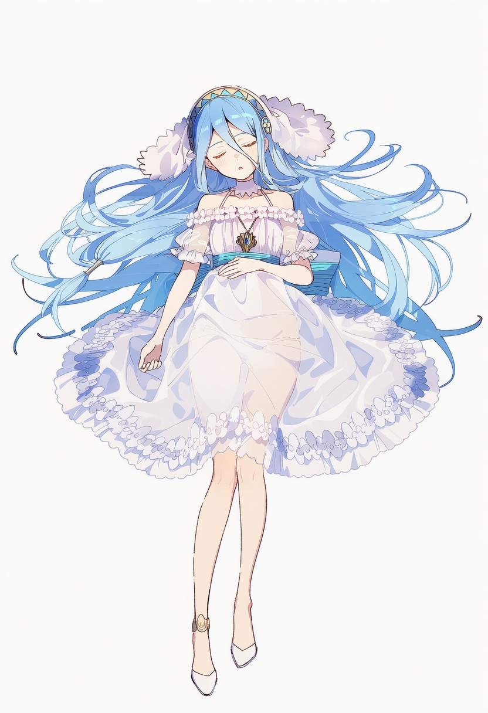
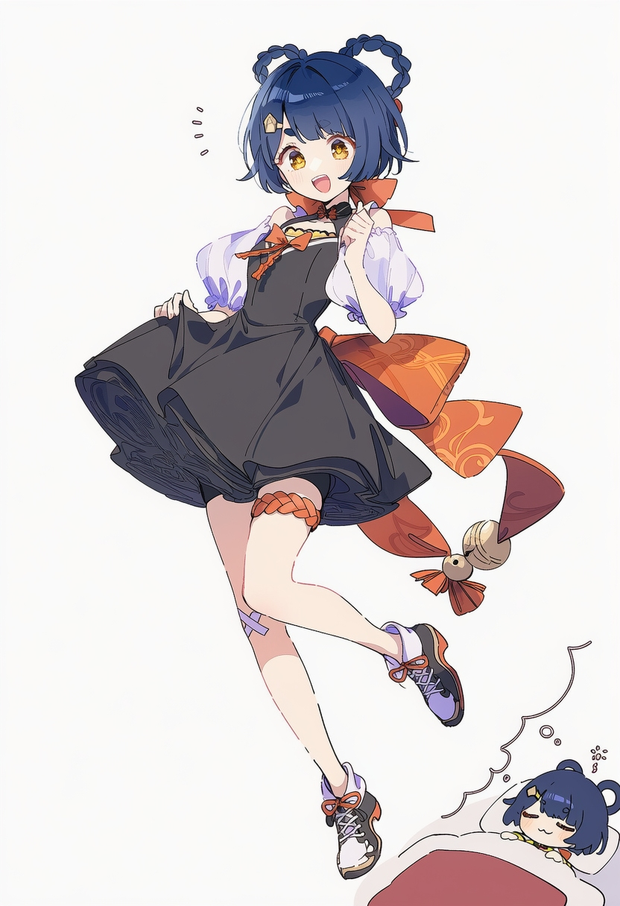
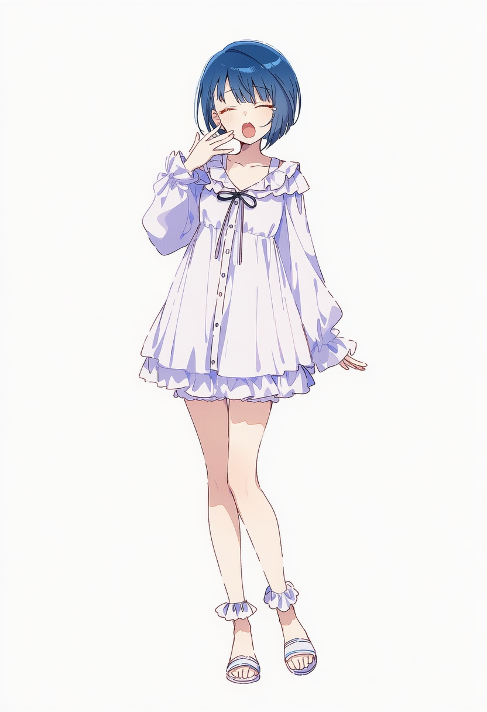
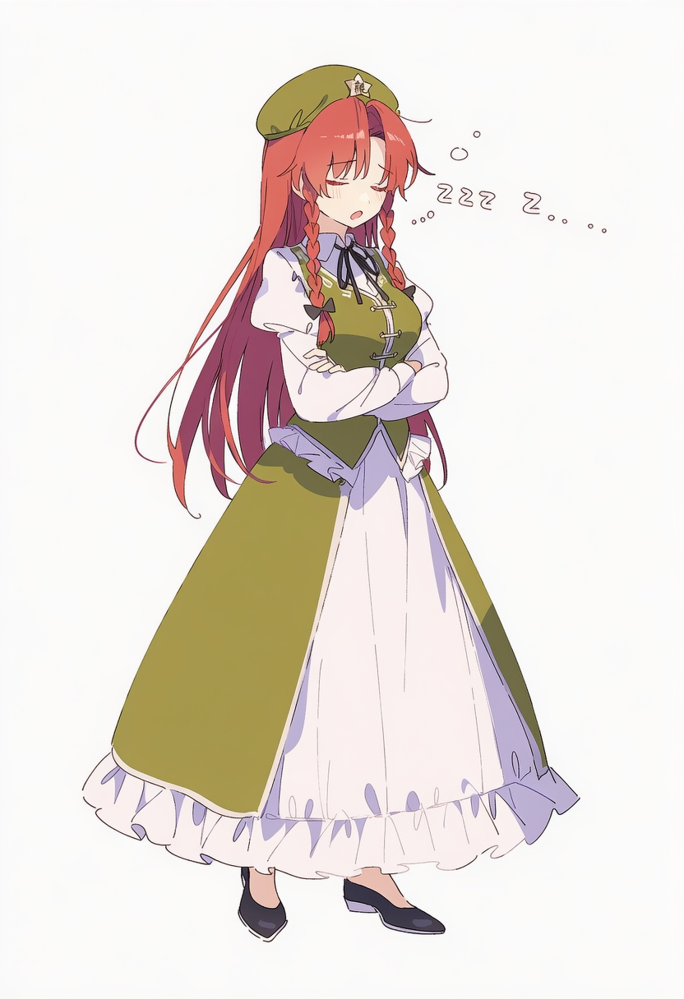
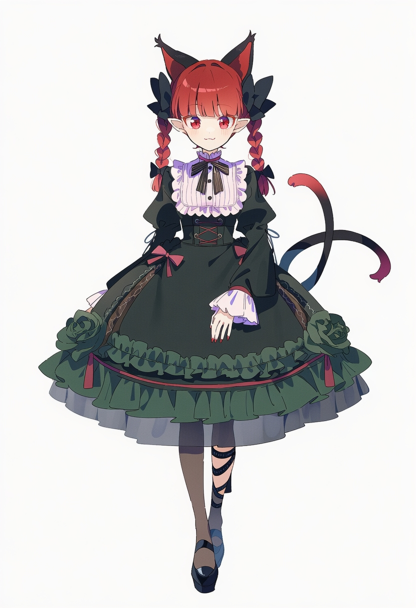

# 日常行为 / 休息/睡眠

[总目录](../README.md) · [原站分类目录](../categories.md) · [英文标签索引](../tags.md) · [服装与构图组合指南](../../README.md)

标题、分类、说明、正负提示词按来源保留；多例图逐张列出。原站标记和说明为参考资料，不作为维护指令。

<a id="raven_composition-3502"></a>

## 睡觉

ID：`raven_composition-3502`；分类：日常行为 / 休息/睡眠；来源标记：`safe`。

来源说明：

> 角色处于睡眠状态。

正向提示词：

```text
sleeping
```



[在线例图](https://assets.quicktagcloud.com/images/raven_composition/raven_composition-3502.jpg?v=996af15671f8970f)

<a id="raven_composition-3503"></a>

## 做梦

ID：`raven_composition-3503`；分类：日常行为 / 休息/睡眠；来源标记：`safe`。

来源说明：

> 画面表现角色正在梦境中或做梦。

正向提示词：

```text
dreaming
```



[在线例图](https://assets.quicktagcloud.com/images/raven_composition/raven_composition-3503.jpg?v=f051b2cd85796746)

<a id="raven_composition-3504"></a>

## 打哈欠

ID：`raven_composition-3504`；分类：日常行为 / 休息/睡眠；来源标记：`safe`。

来源说明：

> 张嘴打哈欠，常表示困倦。

正向提示词：

```text
yawning
```



[在线例图](https://assets.quicktagcloud.com/images/raven_composition/raven_composition-3504.jpg?v=0767f65325caa718)

<a id="raven_composition-3505"></a>

## 休息

ID：`raven_composition-3505`；分类：日常行为 / 休息/睡眠；来源标记：`safe`。

来源说明：

> 角色正在放松休息。

正向提示词：

```text
resting
```


[在线例图](https://assets.quicktagcloud.com/images/raven_composition/raven_composition-3505.jpg?v=45aa7b08d78d9d49)

<a id="raven_composition-3506"></a>

## 晒太阳

ID：`raven_composition-3506`；分类：日常行为 / 休息/睡眠；来源标记：`safe`。

来源说明：

> 躺着或坐着享受阳光。

正向提示词：

```text
sunbathing
```


[在线例图](https://assets.quicktagcloud.com/images/raven_composition/raven_composition-3506.jpg?v=9ce883e7889dcc36)

<a id="raven_composition-3507"></a>

## 说梦话

ID：`raven_composition-3507`；分类：日常行为 / 休息/睡眠；来源标记：`safe`。

来源说明：

> 睡眠中开口说话。

正向提示词：

```text
sleep_talking
```



[在线例图](https://assets.quicktagcloud.com/images/raven_composition/raven_composition-3507.jpg?v=55da7a1c5e1469aa)

<a id="raven_composition-3508"></a>

## 等待

ID：`raven_composition-3508`；分类：日常行为 / 休息/睡眠；来源标记：`safe`。

来源说明：

> 角色正在等待某人或某件事。

正向提示词：

```text
waiting
```



[在线例图](https://assets.quicktagcloud.com/images/raven_composition/raven_composition-3508.jpg?v=6c65ec7b8f9db19b)

<a id="raven_composition-3509"></a>

## 坐立不安

ID：`raven_composition-3509`；分类：日常行为 / 休息/睡眠；来源标记：`safe`。

来源说明：

> 因紧张或无聊做反复的小动作。

正向提示词：

```text
fidgeting
```


[在线例图](https://assets.quicktagcloud.com/images/raven_composition/raven_composition-3509.jpg?v=7c9ab1d664c08e82)
