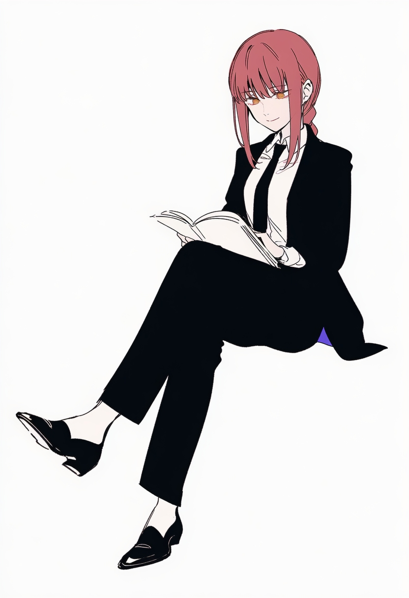

# 日常行为 / 学习/工作/交流

[总目录](../README.md) · [原站分类目录](../categories.md) · [英文标签索引](../tags.md) · [服装与构图组合指南](../../README.md)

标题、分类、说明、正负提示词按来源保留；多例图逐张列出。原站标记和说明为参考资料，不作为维护指令。

<a id="raven_composition-3510"></a>

## 阅读

ID：`raven_composition-3510`；分类：日常行为 / 学习/工作/交流；来源标记：`safe`。

来源说明：

> 正在看书、纸张或文字内容。

正向提示词：

```text
reading
```


[在线例图](https://assets.quicktagcloud.com/images/raven_composition/raven_composition-3510.jpg?v=bfac72e8e5d457e4)

<a id="raven_composition-3511"></a>

## 书写

ID：`raven_composition-3511`；分类：日常行为 / 学习/工作/交流；来源标记：`safe`。

来源说明：

> 正在用笔等进行书写。

正向提示词：

```text
writing
```


[在线例图](https://assets.quicktagcloud.com/images/raven_composition/raven_composition-3511.jpg?v=ed8fba9d4726d12a)

<a id="raven_composition-3512"></a>

## 学习

ID：`raven_composition-3512`；分类：日常行为 / 学习/工作/交流；来源标记：`safe`。

来源说明：

> 正在学习、复习或做功课。

正向提示词：

```text
studying
```


[在线例图](https://assets.quicktagcloud.com/images/raven_composition/raven_composition-3512.jpg?v=df90c0b6abcfcebd)

<a id="raven_composition-3513"></a>

## 教学

ID：`raven_composition-3513`；分类：日常行为 / 学习/工作/交流；来源标记：`safe`。

来源说明：

> 正在向别人讲解或教授内容。

正向提示词：

```text
teaching
```



[在线例图](https://assets.quicktagcloud.com/images/raven_composition/raven_composition-3513.jpg?v=de4376b13122c4e0)

<a id="raven_composition-3514"></a>

## 工作

ID：`raven_composition-3514`；分类：日常行为 / 学习/工作/交流；来源标记：`safe`。

来源说明：

> 角色正在进行工作。

正向提示词：

```text
working
```


[在线例图](https://assets.quicktagcloud.com/images/raven_composition/raven_composition-3514.jpg?v=c6e700661fe01c7a)

<a id="raven_composition-3515"></a>

## 编程

ID：`raven_composition-3515`；分类：日常行为 / 学习/工作/交流；来源标记：`safe`。

来源说明：

> 正在写代码或进行程序开发。

正向提示词：

```text
programming
```


[在线例图](https://assets.quicktagcloud.com/images/raven_composition/raven_composition-3515.jpg?v=3eaa21af2eebf4be)

<a id="raven_composition-3516"></a>

## 打字

ID：`raven_composition-3516`；分类：日常行为 / 学习/工作/交流；来源标记：`safe`。

来源说明：

> 正在键盘等设备上输入文字。

正向提示词：

```text
typing
```


[在线例图](https://assets.quicktagcloud.com/images/raven_composition/raven_composition-3516.jpg?v=a610c3f0dfb463e7)

<a id="raven_composition-3517"></a>

## 发消息

ID：`raven_composition-3517`；分类：日常行为 / 学习/工作/交流；来源标记：`safe`。

来源说明：

> 正在用手机等设备发送文字消息。

正向提示词：

```text
text_messaging
```


[在线例图](https://assets.quicktagcloud.com/images/raven_composition/raven_composition-3517.jpg?v=a6824b2753d5c012)

<a id="raven_composition-3518"></a>

## 说话

ID：`raven_composition-3518`；分类：日常行为 / 学习/工作/交流；来源标记：`safe`。

来源说明：

> 角色正在交谈或讲话。

正向提示词：

```text
talking
```


[在线例图](https://assets.quicktagcloud.com/images/raven_composition/raven_composition-3518.jpg?v=16bdd3ef31f95b41)

<a id="raven_composition-3519"></a>

## 耳语

ID：`raven_composition-3519`；分类：日常行为 / 学习/工作/交流；来源标记：`safe`。

来源说明：

> 压低声音小声说话。

正向提示词：

```text
whispering
```


[在线例图](https://assets.quicktagcloud.com/images/raven_composition/raven_composition-3519.jpg?v=0668d1cedca1434d)

<a id="raven_composition-3520"></a>

## 思考

ID：`raven_composition-3520`；分类：日常行为 / 学习/工作/交流；来源标记：`safe`。

来源说明：

> 角色正在思考问题。

正向提示词：

```text
thinking
```


[在线例图](https://assets.quicktagcloud.com/images/raven_composition/raven_composition-3520.jpg?v=ea5c400ff5b4c9bc)

<a id="raven_composition-3521"></a>

## 专注

ID：`raven_composition-3521`；分类：日常行为 / 学习/工作/交流；来源标记：`safe`。

来源说明：

> 角色正在集中注意力做某件事。

正向提示词：

```text
concentrating
```


[在线例图](https://assets.quicktagcloud.com/images/raven_composition/raven_composition-3521.jpg?v=596c5e0a6f18fbce)

<a id="raven_composition-3522"></a>

## 寻找

ID：`raven_composition-3522`；分类：日常行为 / 学习/工作/交流；来源标记：`safe`。

来源说明：

> 正在寻找物品、人物或信息。

正向提示词：

```text
searching
```


[在线例图](https://assets.quicktagcloud.com/images/raven_composition/raven_composition-3522.jpg?v=e7ae2845efc52a2f)

<a id="raven_composition-3523"></a>

## 录制

ID：`raven_composition-3523`；分类：日常行为 / 学习/工作/交流；来源标记：`safe`。

来源说明：

> 正在录音、录像或记录内容。

正向提示词：

```text
recording
```


[在线例图](https://assets.quicktagcloud.com/images/raven_composition/raven_composition-3523.jpg?v=8805adfebf579b7f)

<a id="raven_composition-3524"></a>

## 画画

ID：`raven_composition-3524`；分类：日常行为 / 学习/工作/交流；来源标记：`safe`。

来源说明：

> 正在绘制图画。

正向提示词：

```text
drawing
```


[在线例图](https://assets.quicktagcloud.com/images/raven_composition/raven_composition-3524.jpg?v=8a757da02b316dfd)

<a id="raven_composition-3525"></a>

## 素描 / 草绘

ID：`raven_composition-3525`；分类：日常行为 / 学习/工作/交流；来源标记：`safe`。

来源说明：

> 正在快速画草图或素描。

正向提示词：

```text
sketching
```


[在线例图](https://assets.quicktagcloud.com/images/raven_composition/raven_composition-3525.jpg?v=6ed99117d1ebe0b6)

<a id="raven_composition-3526"></a>

## 绘画

ID：`raven_composition-3526`；分类：日常行为 / 学习/工作/交流；来源标记：`safe`。

来源说明：

> 正在使用颜料作画。

正向提示词：

```text
painting
```


[在线例图](https://assets.quicktagcloud.com/images/raven_composition/raven_composition-3526.jpg?v=644efbbe5f3d74fb)

<a id="raven_composition-3527"></a>

## 测量

ID：`raven_composition-3527`；分类：日常行为 / 学习/工作/交流；来源标记：`safe`。

来源说明：

> 正在测量尺寸或长度。

正向提示词：

```text
measuring
```


[在线例图](https://assets.quicktagcloud.com/images/raven_composition/raven_composition-3527.jpg?v=681982d46aa5db4c)

<a id="raven_composition-3528"></a>

## 计算

ID：`raven_composition-3528`；分类：日常行为 / 学习/工作/交流；来源标记：`safe`。

来源说明：

> 正在进行数学或数值计算。

正向提示词：

```text
calculating
```


[在线例图](https://assets.quicktagcloud.com/images/raven_composition/raven_composition-3528.jpg?v=d34af5628f69e83a)

<a id="raven_composition-3529"></a>

## 同时做多件事

ID：`raven_composition-3529`；分类：日常行为 / 学习/工作/交流；来源标记：`safe`。

来源说明：

> 角色同时进行多个任务。

正向提示词：

```text
multitasking
```


[在线例图](https://assets.quicktagcloud.com/images/raven_composition/raven_composition-3529.jpg?v=0b35e0b0b11abd9b)
