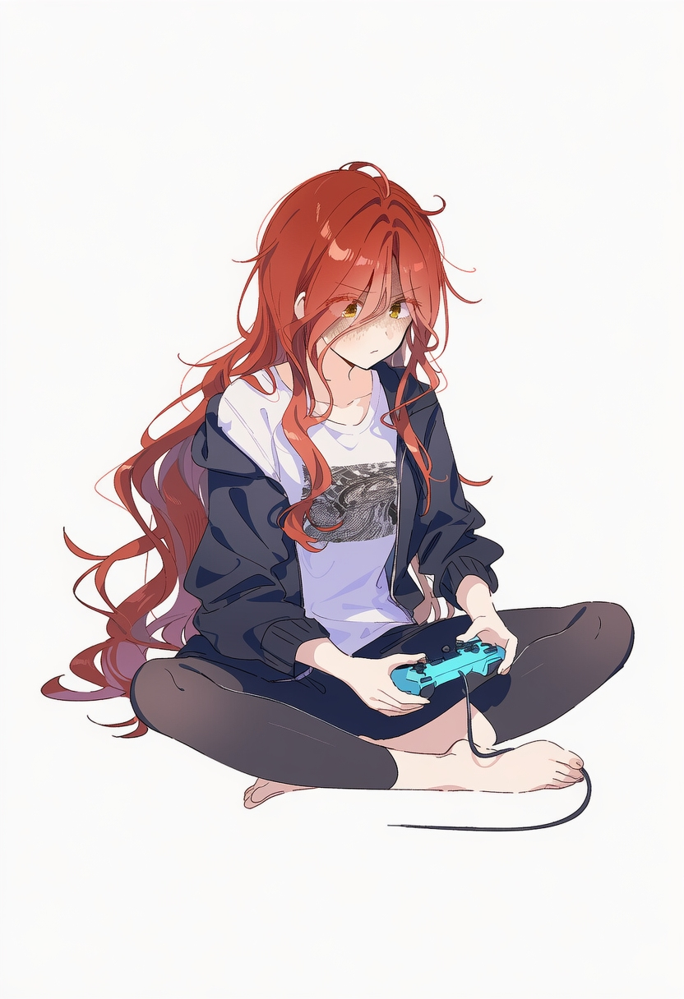
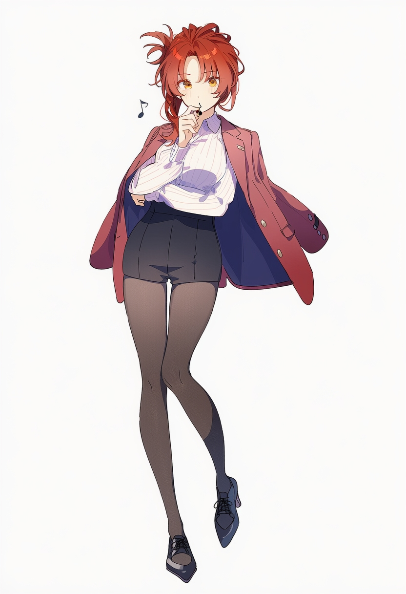
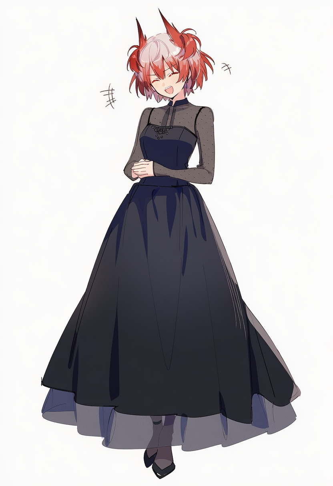
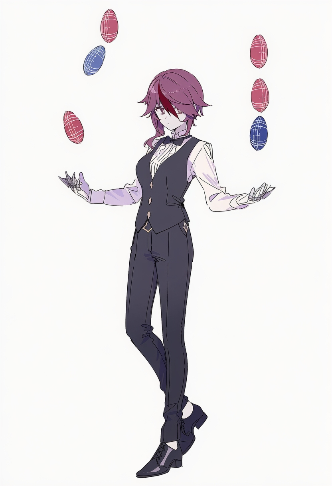
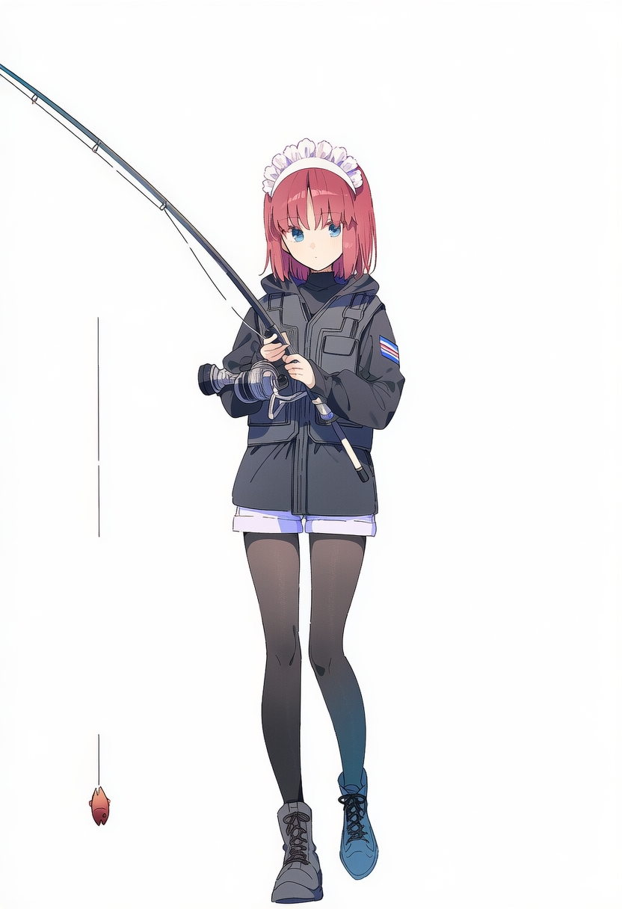
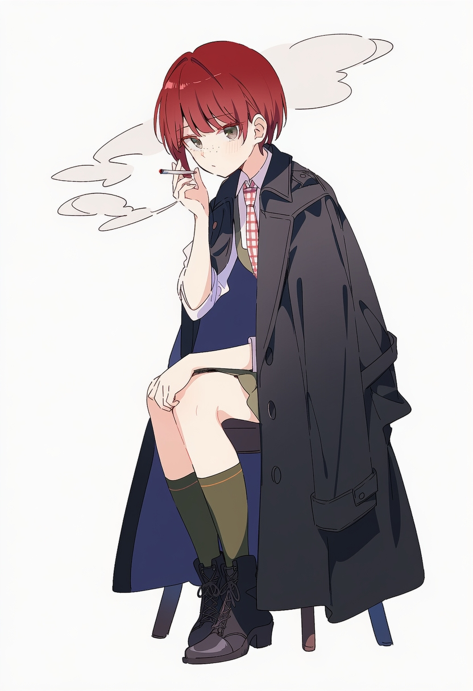

# 日常行为 / 娱乐/兴趣/社交

[总目录](../README.md) · [原站分类目录](../categories.md) · [英文标签索引](../tags.md) · [服装与构图组合指南](../../README.md)

标题、分类、说明、正负提示词按来源保留；多例图逐张列出。原站标记和说明为参考资料，不作为维护指令。

<a id="raven_composition-3546"></a>

## 玩耍

ID：`raven_composition-3546`；分类：日常行为 / 娱乐/兴趣/社交；来源标记：`safe`。

来源说明：

> 角色正在玩或参与娱乐活动。

正向提示词：

```text
playing
```


[在线例图](https://assets.quicktagcloud.com/images/raven_composition/raven_composition-3546.jpg?v=3890a418b79c1141)

<a id="raven_composition-3547"></a>

## 玩游戏

ID：`raven_composition-3547`；分类：日常行为 / 娱乐/兴趣/社交；来源标记：`safe`。

来源说明：

> 正在进行桌游、牌类等游戏。

正向提示词：

```text
playing_games
```


[在线例图](https://assets.quicktagcloud.com/images/raven_composition/raven_composition-3547.jpg?v=a3253089a31643ff)

<a id="raven_composition-3548"></a>

## 玩电子游戏

ID：`raven_composition-3548`；分类：日常行为 / 娱乐/兴趣/社交；来源标记：`safe`。

来源说明：

> 正在使用游戏机或电脑玩电子游戏。

正向提示词：

```text
playing_video_games
```



[在线例图](https://assets.quicktagcloud.com/images/raven_composition/raven_composition-3548.jpg?v=e204a443aa5357e2)

<a id="raven_composition-3549"></a>

## 演奏乐器

ID：`raven_composition-3549`；分类：日常行为 / 娱乐/兴趣/社交；来源标记：`safe`。

来源说明：

> 正在演奏某种乐器。

正向提示词：

```text
playing_instrument
```


[在线例图](https://assets.quicktagcloud.com/images/raven_composition/raven_composition-3549.jpg?v=085dbf3c904c276b)

<a id="raven_composition-3550"></a>

## 进行体育运动

ID：`raven_composition-3550`；分类：日常行为 / 娱乐/兴趣/社交；来源标记：`safe`。

来源说明：

> 正在参加体育活动。

正向提示词：

```text
playing_sports
```


[在线例图](https://assets.quicktagcloud.com/images/raven_composition/raven_composition-3550.jpg?v=b0614a95d605fcf2)

<a id="raven_composition-3551"></a>

## 观看

ID：`raven_composition-3551`；分类：日常行为 / 娱乐/兴趣/社交；来源标记：`safe`。

来源说明：

> 正在观看某个对象或事件。

正向提示词：

```text
watching
```


[在线例图](https://assets.quicktagcloud.com/images/raven_composition/raven_composition-3551.jpg?v=aaf4180a1c5207df)

<a id="raven_composition-3552"></a>

## 看电视

ID：`raven_composition-3552`；分类：日常行为 / 娱乐/兴趣/社交；来源标记：`safe`。

来源说明：

> 正在观看电视节目。

正向提示词：

```text
watching_television
```


[在线例图](https://assets.quicktagcloud.com/images/raven_composition/raven_composition-3552.jpg?v=21cc266c45836d58)

<a id="raven_composition-3553"></a>

## 唱歌

ID：`raven_composition-3553`；分类：日常行为 / 娱乐/兴趣/社交；来源标记：`safe`。

来源说明：

> 正在开口歌唱。

正向提示词：

```text
singing
```


[在线例图](https://assets.quicktagcloud.com/images/raven_composition/raven_composition-3553.jpg?v=e94f5164976c5fc9)

<a id="raven_composition-3554"></a>

## 吹口哨

ID：`raven_composition-3554`；分类：日常行为 / 娱乐/兴趣/社交；来源标记：`safe`。

来源说明：

> 用嘴吹出哨声。

正向提示词：

```text
whistling
```



[在线例图](https://assets.quicktagcloud.com/images/raven_composition/raven_composition-3554.jpg?v=f7a919b95c94a63c)

<a id="raven_composition-3555"></a>

## 大笑

ID：`raven_composition-3555`；分类：日常行为 / 娱乐/兴趣/社交；来源标记：`safe`。

来源说明：

> 正在明显发笑。

正向提示词：

```text
laughing
```



[在线例图](https://assets.quicktagcloud.com/images/raven_composition/raven_composition-3555.jpg?v=2a1dcb788d27e0f9)

<a id="raven_composition-3556"></a>

## 咯咯笑

ID：`raven_composition-3556`；分类：日常行为 / 娱乐/兴趣/社交；来源标记：`safe`。

来源说明：

> 轻声、连续地笑。

正向提示词：

```text
giggling
```


[在线例图](https://assets.quicktagcloud.com/images/raven_composition/raven_composition-3556.jpg?v=88228ef57f4547aa)

<a id="raven_composition-3557"></a>

## 欢呼

ID：`raven_composition-3557`；分类：日常行为 / 娱乐/兴趣/社交；来源标记：`safe`。

来源说明：

> 正在为某人或某事加油欢呼。

正向提示词：

```text
cheering
```


[在线例图](https://assets.quicktagcloud.com/images/raven_composition/raven_composition-3557.jpg?v=7f45dc87de000175)

<a id="raven_composition-3558"></a>

## 鼓掌

ID：`raven_composition-3558`；分类：日常行为 / 娱乐/兴趣/社交；来源标记：`safe`。

来源说明：

> 双手反复拍击表示赞赏或庆祝。

正向提示词：

```text
clapping
```


[在线例图](https://assets.quicktagcloud.com/images/raven_composition/raven_composition-3558.jpg?v=c296cbc9f148e5b9)

<a id="raven_composition-3559"></a>

## 杂耍抛接

ID：`raven_composition-3559`；分类：日常行为 / 娱乐/兴趣/社交；来源标记：`safe`。

来源说明：

> 连续抛接多个物体。

正向提示词：

```text
juggling
```



[在线例图](https://assets.quicktagcloud.com/images/raven_composition/raven_composition-3559.jpg?v=56a2d2452139fcbd)

<a id="raven_composition-3560"></a>

## 钓鱼

ID：`raven_composition-3560`；分类：日常行为 / 娱乐/兴趣/社交；来源标记：`safe`。

来源说明：

> 使用鱼竿等进行钓鱼。

正向提示词：

```text
fishing
```



[在线例图](https://assets.quicktagcloud.com/images/raven_composition/raven_composition-3560.jpg?v=df8e7c69a8c03db7)

<a id="raven_composition-3561"></a>

## 露营

ID：`raven_composition-3561`；分类：日常行为 / 娱乐/兴趣/社交；来源标记：`safe`。

来源说明：

> 正在进行露营活动。

正向提示词：

```text
camping
```


[在线例图](https://assets.quicktagcloud.com/images/raven_composition/raven_composition-3561.jpg?v=ef5ba75d4a0f75a7)

<a id="raven_composition-3562"></a>

## 打保龄球

ID：`raven_composition-3562`；分类：日常行为 / 娱乐/兴趣/社交；来源标记：`safe`。

来源说明：

> 正在进行保龄球运动。

正向提示词：

```text
bowling
```


[在线例图](https://assets.quicktagcloud.com/images/raven_composition/raven_composition-3562.jpg?v=ab675a7e633f34fa)

<a id="raven_composition-3563"></a>

## 约会

ID：`raven_composition-3563`；分类：日常行为 / 娱乐/兴趣/社交；来源标记：`safe`。

来源说明：

> 角色处于约会场景或活动中。

正向提示词：

```text
dating
```


[在线例图](https://assets.quicktagcloud.com/images/raven_composition/raven_composition-3563.jpg?v=103d3fd552686c5e)

<a id="raven_composition-3564"></a>

## 祈祷

ID：`raven_composition-3564`；分类：日常行为 / 娱乐/兴趣/社交；来源标记：`safe`。

来源说明：

> 双手合拢等进行祈祷。

正向提示词：

```text
praying
```


[在线例图](https://assets.quicktagcloud.com/images/raven_composition/raven_composition-3564.jpg?v=f69917441b8ccee2)

<a id="raven_composition-3565"></a>

## 吸烟

ID：`raven_composition-3565`；分类：日常行为 / 娱乐/兴趣/社交；来源标记：`safe`。

来源说明：

> 正在吸香烟、烟斗等。

正向提示词：

```text
smoking
```



[在线例图](https://assets.quicktagcloud.com/images/raven_composition/raven_composition-3565.jpg?v=4e80808b1b1a8e11)
