# 身体配饰 / 不固定部位

[总目录](../README.md) · [原站分类目录](../categories.md) · [英文标签索引](../tags.md) · [服装与构图组合指南](../../README.md)

标题、分类、说明、正负提示词按来源保留；多例图逐张列出。原站标记和说明为参考资料，不作为维护指令。

<a id="raven_composition-3566"></a>

## 首饰

ID：`raven_composition-3566`；分类：身体配饰 / 不固定部位；来源标记：`safe`。

来源说明：

> 泛指角色佩戴的珠宝首饰。

正向提示词：

```text
jewelry
```

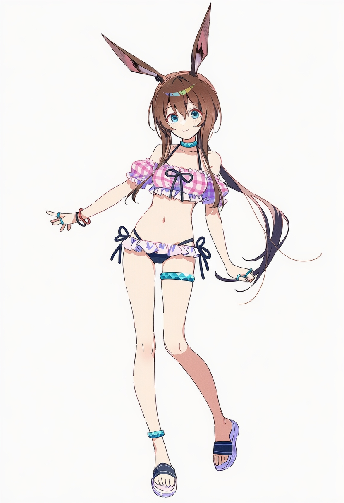

[在线例图](https://assets.quicktagcloud.com/images/raven_composition/raven_composition-3566.jpg?v=3fb168f7c98a1e5e)

<a id="raven_composition-3567"></a>

## 身体珠宝

ID：`raven_composition-3567`；分类：身体配饰 / 不固定部位；来源标记：`safe`。

来源说明：

> 直接装饰在身体上的珠宝或宝石。

正向提示词：

```text
body_jewelry
```

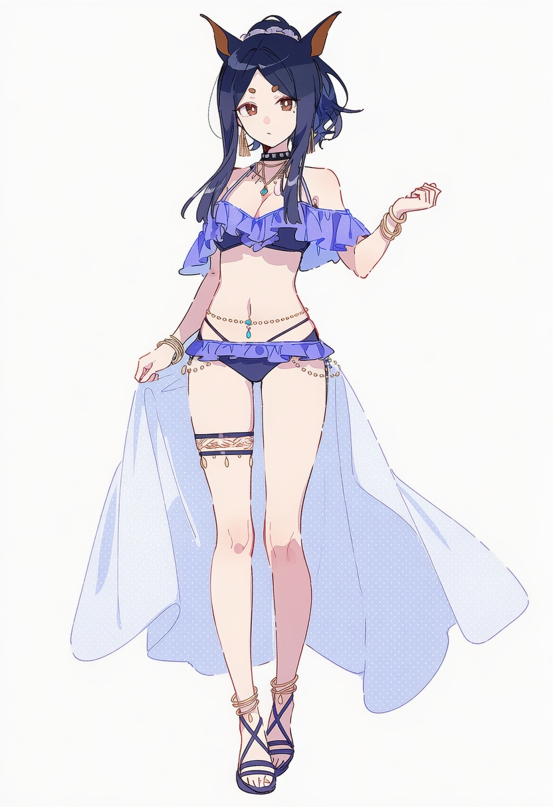

[在线例图](https://assets.quicktagcloud.com/images/raven_composition/raven_composition-3567.jpg?v=af0cb0c5a031e1b3)

<a id="raven_composition-3568"></a>

## 装饰扣

ID：`raven_composition-3568`；分类：身体配饰 / 不固定部位；来源标记：`safe`。

来源说明：

> 衣物或配饰上的明显扣件。

正向提示词：

```text
buckle
```

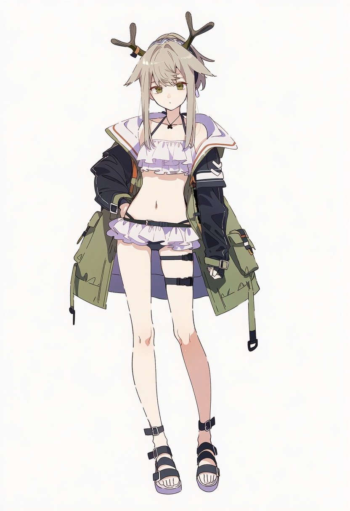

[在线例图](https://assets.quicktagcloud.com/images/raven_composition/raven_composition-3568.jpg?v=908d83745bffa368)

<a id="raven_composition-3569"></a>

## 饰带 / 宽腰带

ID：`raven_composition-3569`；分类：身体配饰 / 不固定部位；来源标记：`safe`。

来源说明：

> 宽布带围在腰部或斜跨身体。

正向提示词：

```text
sash
```

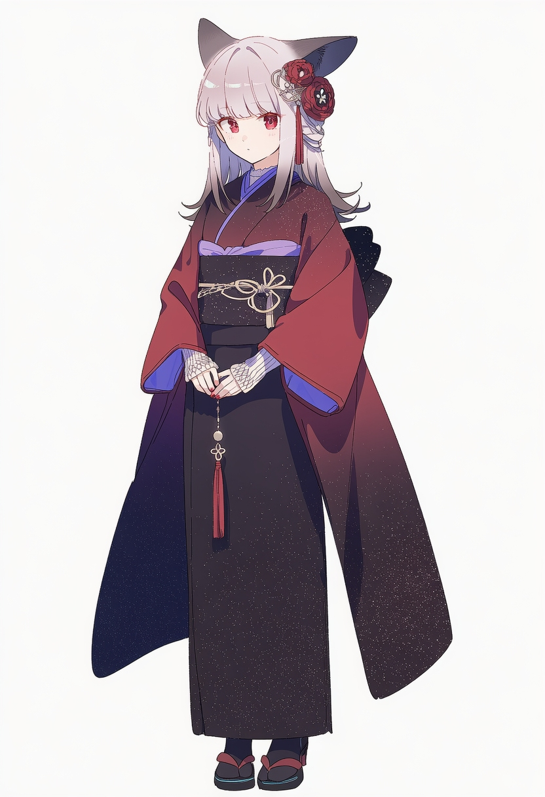

[在线例图](https://assets.quicktagcloud.com/images/raven_composition/raven_composition-3569.jpg?v=f928a373d25ee5e6)

<a id="raven_composition-3570"></a>

## 黑色饰带

ID：`raven_composition-3570`；分类：身体配饰 / 不固定部位；来源标记：`safe`。

来源说明：

> 黑色 sash；纯颜色款只留这一种代表。

正向提示词：

```text
black_sash
```

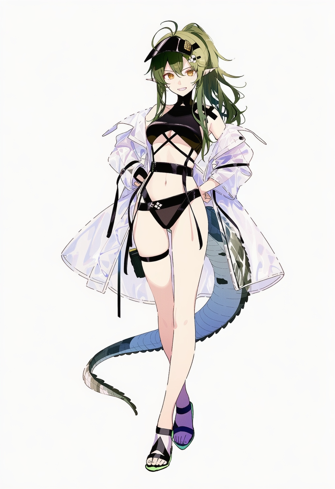

[在线例图](https://assets.quicktagcloud.com/images/raven_composition/raven_composition-3570.jpg?v=f1ff819223918337)

<a id="raven_composition-3571"></a>

## 印花饰带

ID：`raven_composition-3571`；分类：身体配饰 / 不固定部位；来源标记：`safe`。

来源说明：

> 带明显印花图案的 sash。

正向提示词：

```text
print_sash
```

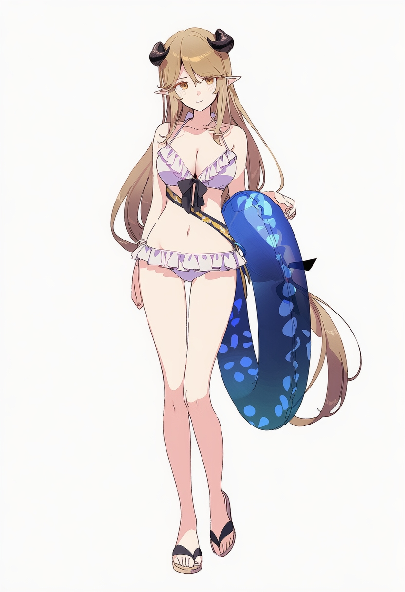

[在线例图](https://assets.quicktagcloud.com/images/raven_composition/raven_composition-3571.jpg?v=dba0a8091a305c06)

<a id="raven_composition-3572"></a>

## 条纹饰带

ID：`raven_composition-3572`；分类：身体配饰 / 不固定部位；来源标记：`safe`。

来源说明：

> 带条纹图案的 sash。

正向提示词：

```text
striped_sash
```

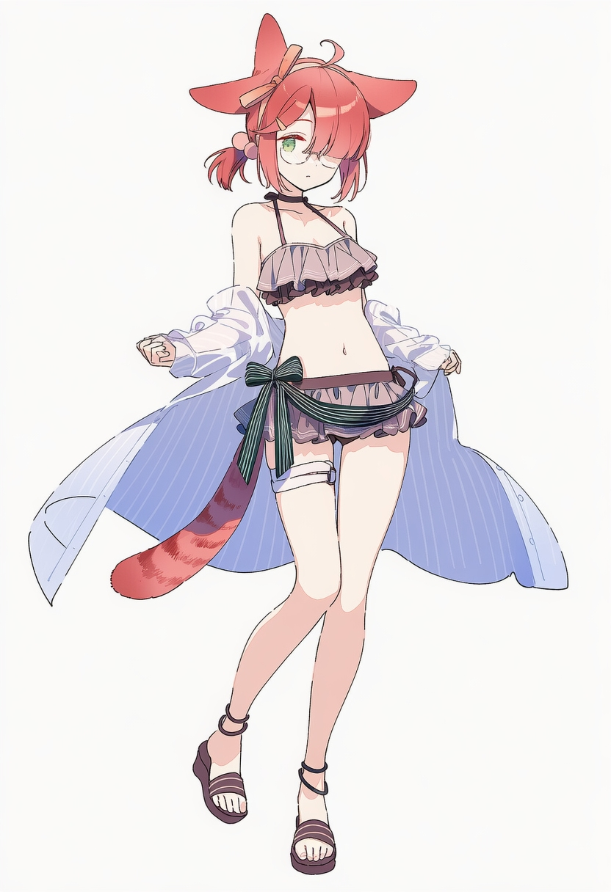

[在线例图](https://assets.quicktagcloud.com/images/raven_composition/raven_composition-3572.jpg?v=d976be96f97ec91b)

<a id="raven_composition-3573"></a>

## 竖条纹饰带

ID：`raven_composition-3573`；分类：身体配饰 / 不固定部位；来源标记：`safe`。

来源说明：

> 带竖向条纹的 sash。

正向提示词：

```text
vertical-striped_sash
```

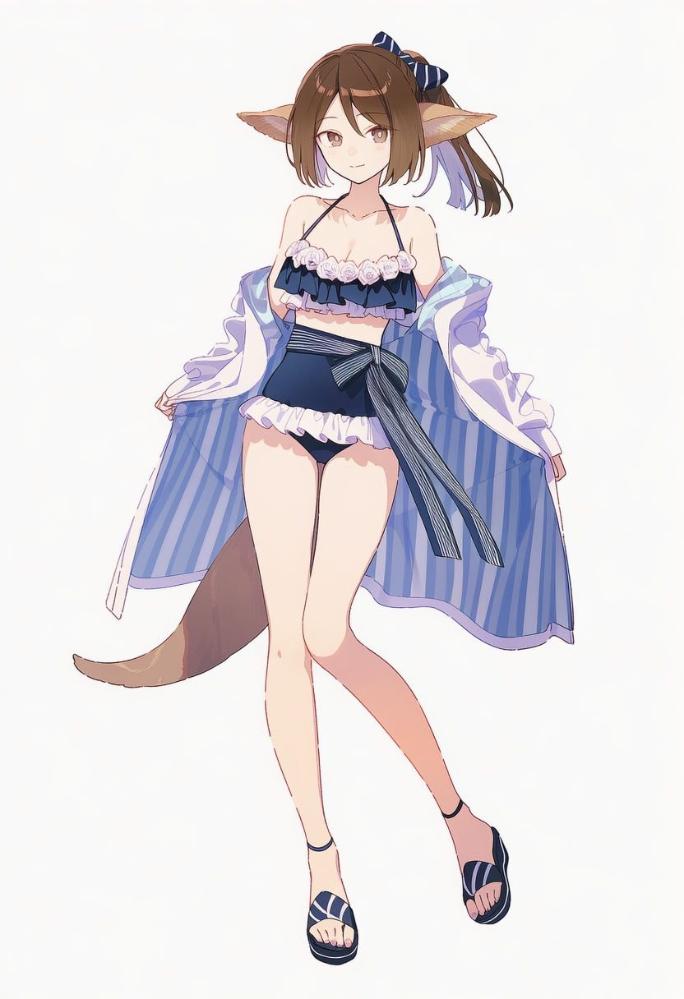

[在线例图](https://assets.quicktagcloud.com/images/raven_composition/raven_composition-3573.jpg?v=72f3355ae0eef7a1)

<a id="raven_composition-3574"></a>

## 注连绳

ID：`raven_composition-3574`；分类：身体配饰 / 不固定部位；来源标记：`safe`。

来源说明：

> 粗绳式装饰，可环绕腰部或身体。

正向提示词：

```text
shimenawa
```

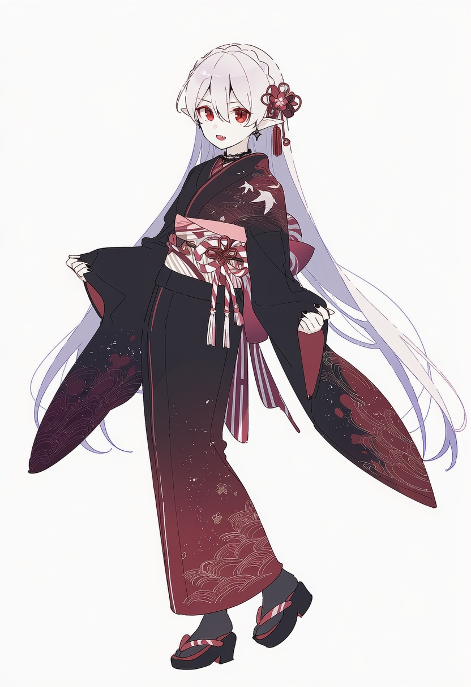

[在线例图](https://assets.quicktagcloud.com/images/raven_composition/raven_composition-3574.jpg?v=e5b72853e976ba73)

<a id="raven_composition-3575"></a>

## 包

ID：`raven_composition-3575`；分类：身体配饰 / 不固定部位；来源标记：`safe`。

来源说明：

> 泛指随身携带的包。

正向提示词：

```text
bag
```

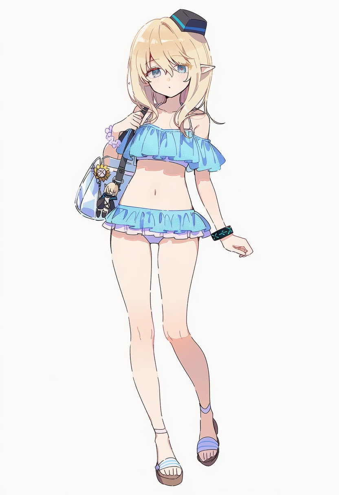

[在线例图](https://assets.quicktagcloud.com/images/raven_composition/raven_composition-3575.jpg?v=98c25425a4abe568)

<a id="raven_composition-3576"></a>

## 动物造型包

ID：`raven_composition-3576`；分类：身体配饰 / 不固定部位；来源标记：`safe`。

来源说明：

> 做成动物外形或动物脸的包。

正向提示词：

```text
animal_bag
```

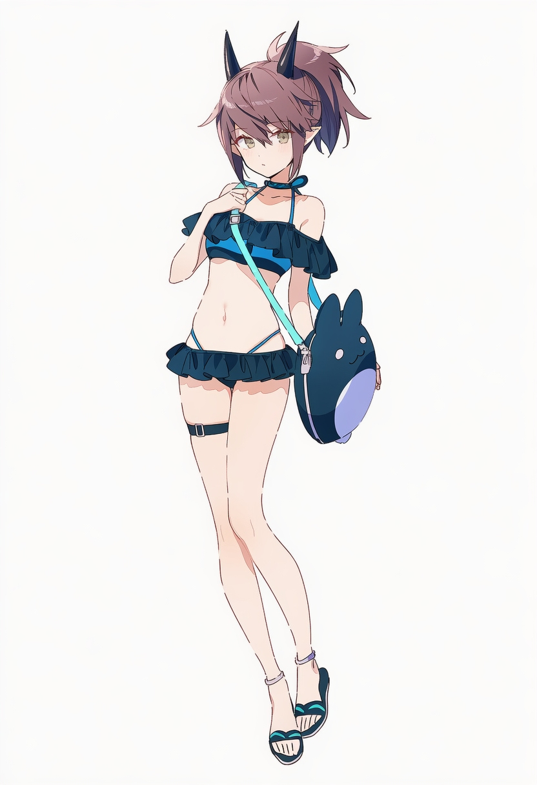

[在线例图](https://assets.quicktagcloud.com/images/raven_composition/raven_composition-3576.jpg?v=8de9f110882005cb)

<a id="raven_composition-3577"></a>

## 熊熊包

ID：`raven_composition-3577`；分类：身体配饰 / 不固定部位；来源标记：`safe`。

来源说明：

> 熊造型的包。

正向提示词：

```text
bear_bag
```

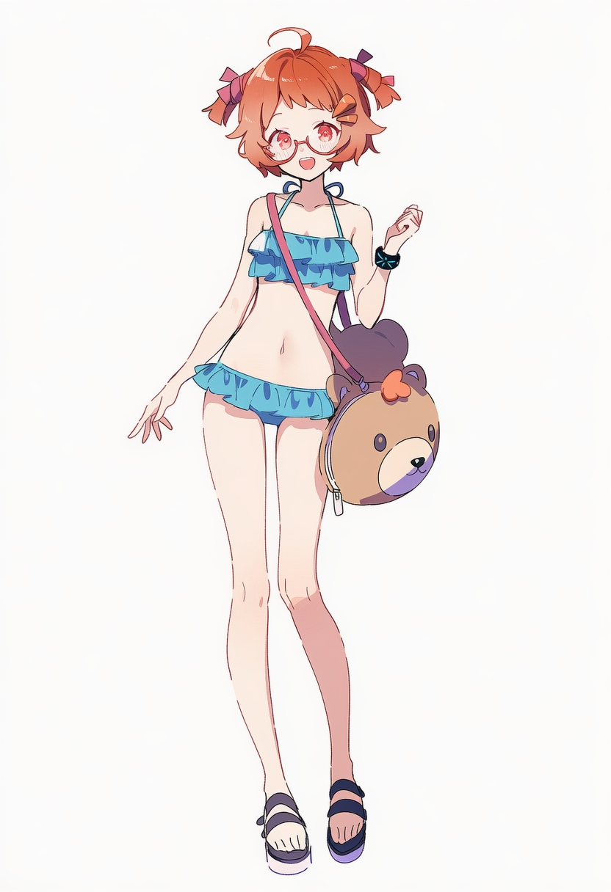

[在线例图](https://assets.quicktagcloud.com/images/raven_composition/raven_composition-3577.jpg?v=2f7a3e99688f3ff5)

<a id="raven_composition-3578"></a>

## 学生包

ID：`raven_composition-3578`；分类：身体配饰 / 不固定部位；来源标记：`safe`。

来源说明：

> 学校场景常见的学生书包。

正向提示词：

```text
school_bag
```

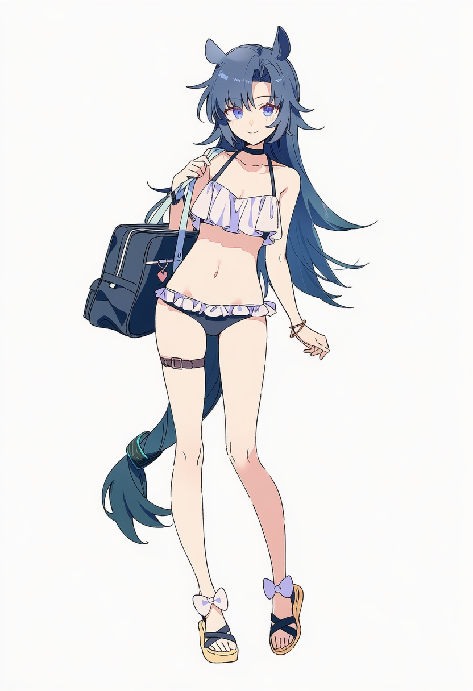

[在线例图](https://assets.quicktagcloud.com/images/raven_composition/raven_composition-3578.jpg?v=bd611f688cc4ff77)

<a id="raven_composition-3579"></a>

## 小包 / 收纳袋

ID：`raven_composition-3579`；分类：身体配饰 / 不固定部位；来源标记：`safe`。

来源说明：

> 小型软质收纳包。

正向提示词：

```text
pouch
```

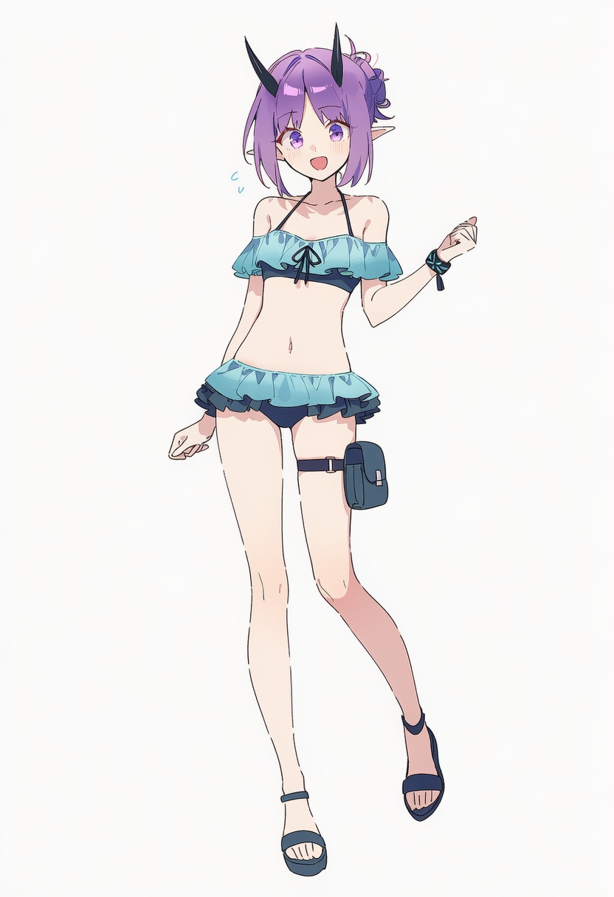

[在线例图](https://assets.quicktagcloud.com/images/raven_composition/raven_composition-3579.jpg?v=8faf23944f667d59)

<a id="raven_composition-3580"></a>

## 食物主题包

ID：`raven_composition-3580`；分类：身体配饰 / 不固定部位；来源标记：`safe`。

来源说明：

> 做成食物造型或带食物主题的包。

正向提示词：

```text
food-themed_bag
```

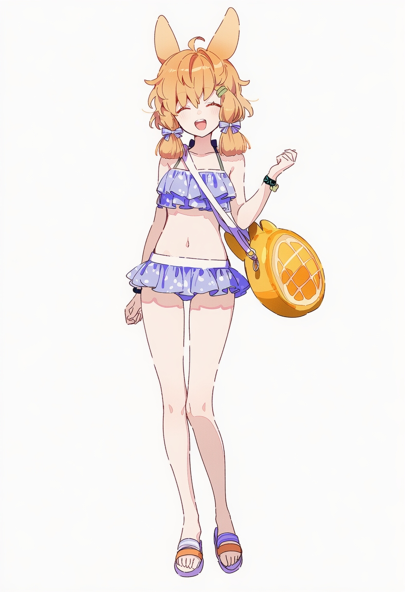

[在线例图](https://assets.quicktagcloud.com/images/raven_composition/raven_composition-3580.jpg?v=b92401323ca1ee71)
