# 身体配饰 / 肩部

[总目录](../README.md) · [原站分类目录](../categories.md) · [英文标签索引](../tags.md) · [服装与构图组合指南](../../README.md)

标题、分类、说明、正负提示词按来源保留；多例图逐张列出。原站标记和说明为参考资料，不作为维护指令。

<a id="raven_composition-3581"></a>

## 肩斜绶带

ID：`raven_composition-3581`；分类：身体配饰 / 肩部；来源标记：`safe`。

来源说明：

> 从肩部斜跨到腰侧的饰带。

正向提示词：

```text
shoulder_sash
```

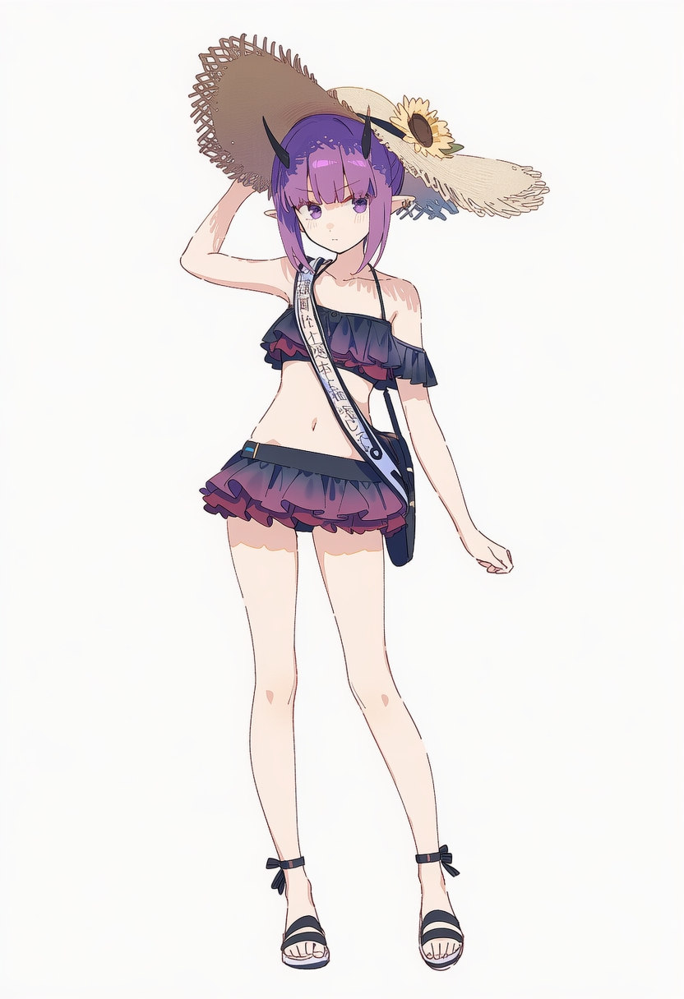

[在线例图](https://assets.quicktagcloud.com/images/raven_composition/raven_composition-3581.jpg?v=f06e6ec346b05716)

<a id="raven_composition-3582"></a>

## 流苏肩章

ID：`raven_composition-3582`；分类：身体配饰 / 肩部；来源标记：`safe`。

来源说明：

> 军礼服常见的装饰性肩章。

正向提示词：

```text
epaulettes
```

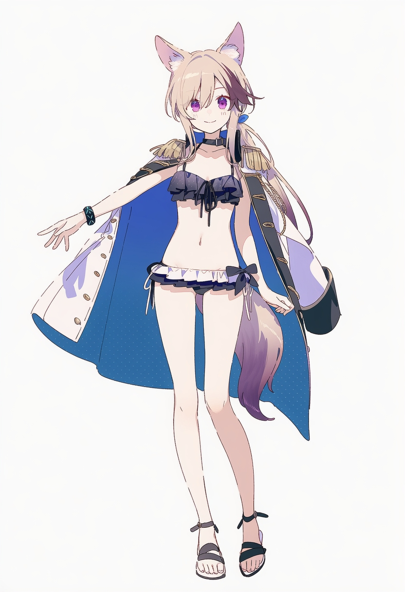

[在线例图](https://assets.quicktagcloud.com/images/raven_composition/raven_composition-3582.jpg?v=c2fd0acf77948703)

<a id="raven_composition-3583"></a>

## 单侧肩章

ID：`raven_composition-3583`；分类：身体配饰 / 肩部；来源标记：`safe`。

来源说明：

> 只有一边肩膀佩戴装饰肩章。

正向提示词：

```text
single_epaulette
```

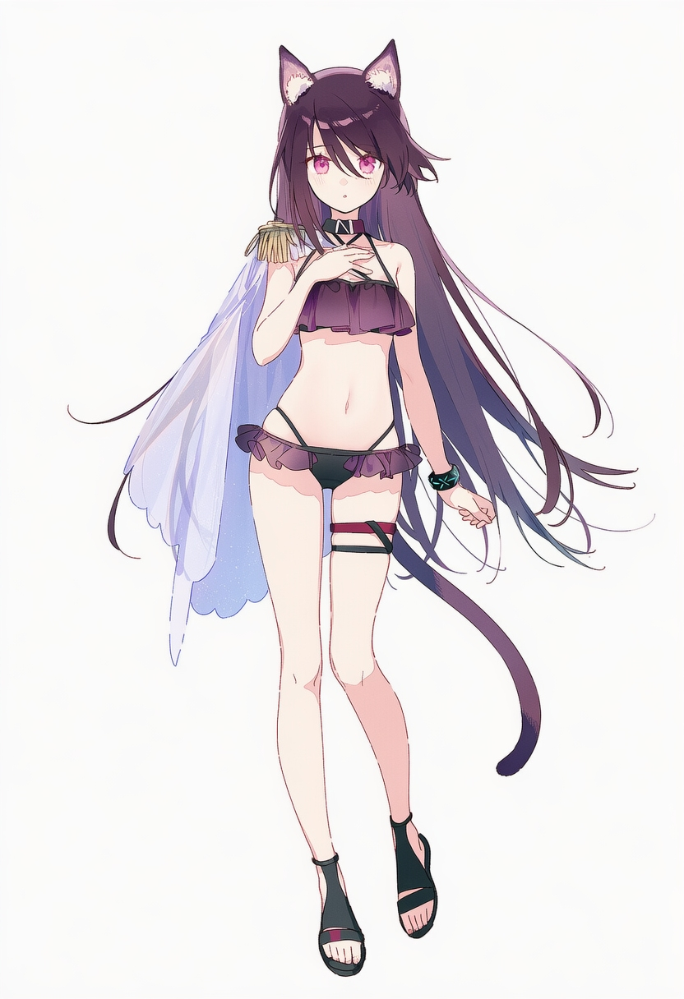

[在线例图](https://assets.quicktagcloud.com/images/raven_composition/raven_composition-3583.jpg?v=0cb0cd9d9f445c6b)

<a id="raven_composition-3584"></a>

## 肩章牌

ID：`raven_composition-3584`；分类：身体配饰 / 肩部；来源标记：`safe`。

来源说明：

> 肩部的长方形军衔肩章。

正向提示词：

```text
shoulder_boards
```

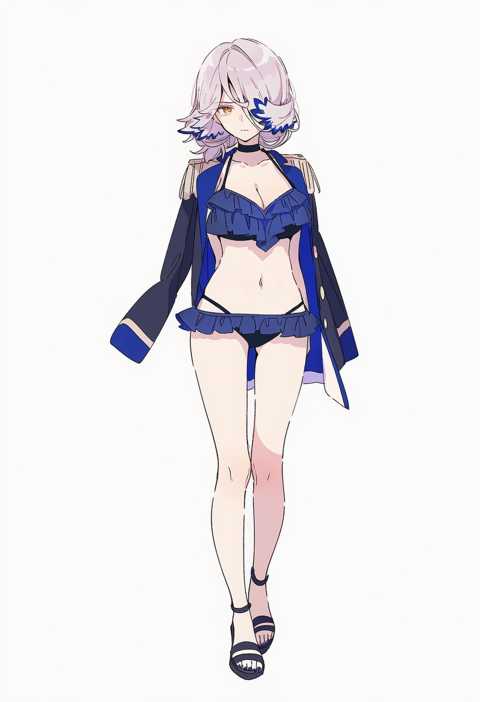

[在线例图](https://assets.quicktagcloud.com/images/raven_composition/raven_composition-3584.jpg?v=cf2692c5acd554d1)

<a id="raven_composition-3585"></a>

## 军礼饰绳

ID：`raven_composition-3585`；分类：身体配饰 / 肩部；来源标记：`safe`。

来源说明：

> 从肩部垂下的军礼装饰绳。

正向提示词：

```text
aiguillette
```

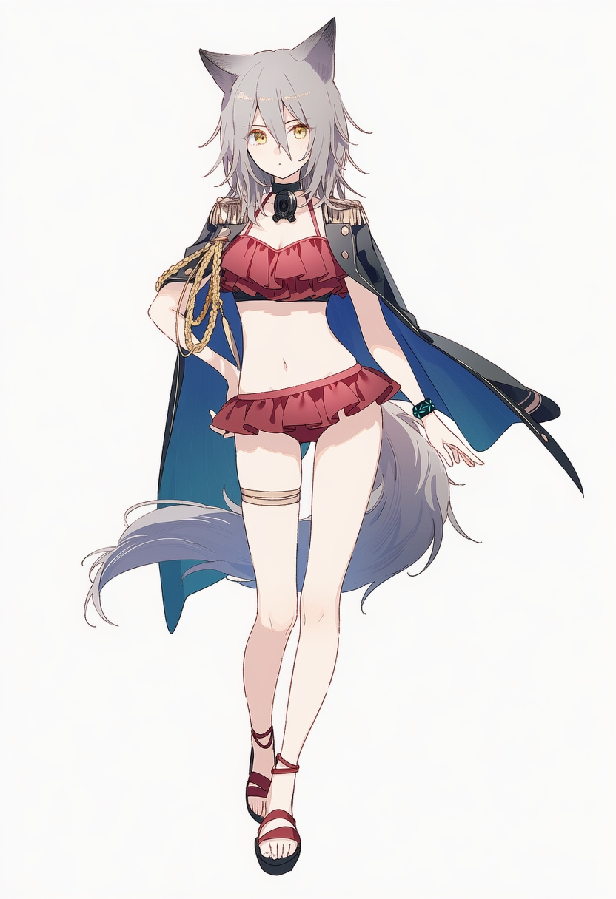

[在线例图](https://assets.quicktagcloud.com/images/raven_composition/raven_composition-3585.jpg?v=fbacb1e06c247f62)

<a id="raven_composition-3586"></a>

## 编织绶带

ID：`raven_composition-3586`；分类：身体配饰 / 肩部；来源标记：`safe`。

来源说明：

> 绕过肩部的编织军礼绶带。

正向提示词：

```text
fourragere
```

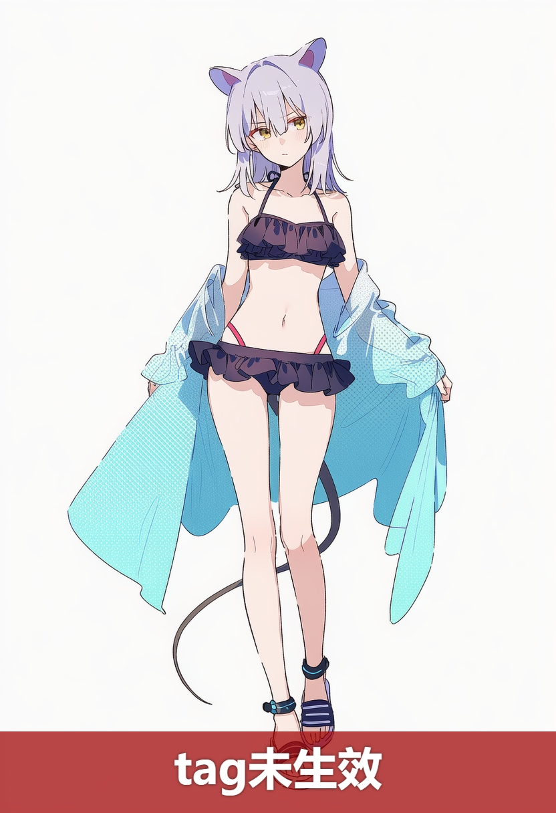

[在线例图](https://assets.quicktagcloud.com/images/raven_composition/raven_composition-3586.jpg?v=11035636ff2d752b)

<a id="raven_composition-3587"></a>

## 斜挎弹带

ID：`raven_composition-3587`；分类：身体配饰 / 肩部；来源标记：`safe`。

来源说明：

> 斜跨胸前的带状配件。

正向提示词：

```text
bandolier
```

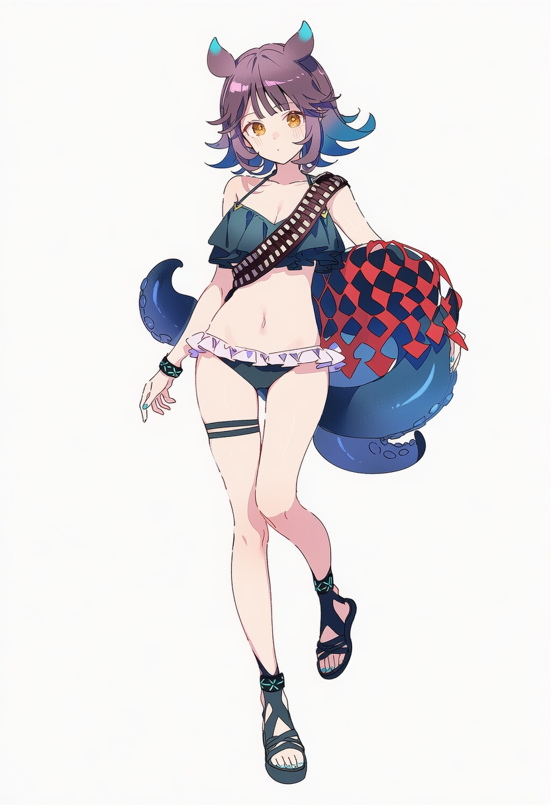

[在线例图](https://assets.quicktagcloud.com/images/raven_composition/raven_composition-3587.jpg?v=a5cdef01cc23a4fb)

<a id="raven_composition-3588"></a>

## 背带

ID：`raven_composition-3588`；分类：身体配饰 / 肩部；来源标记：`safe`。

来源说明：

> 从肩部连接裤腰的背带。

正向提示词：

```text
suspenders
```

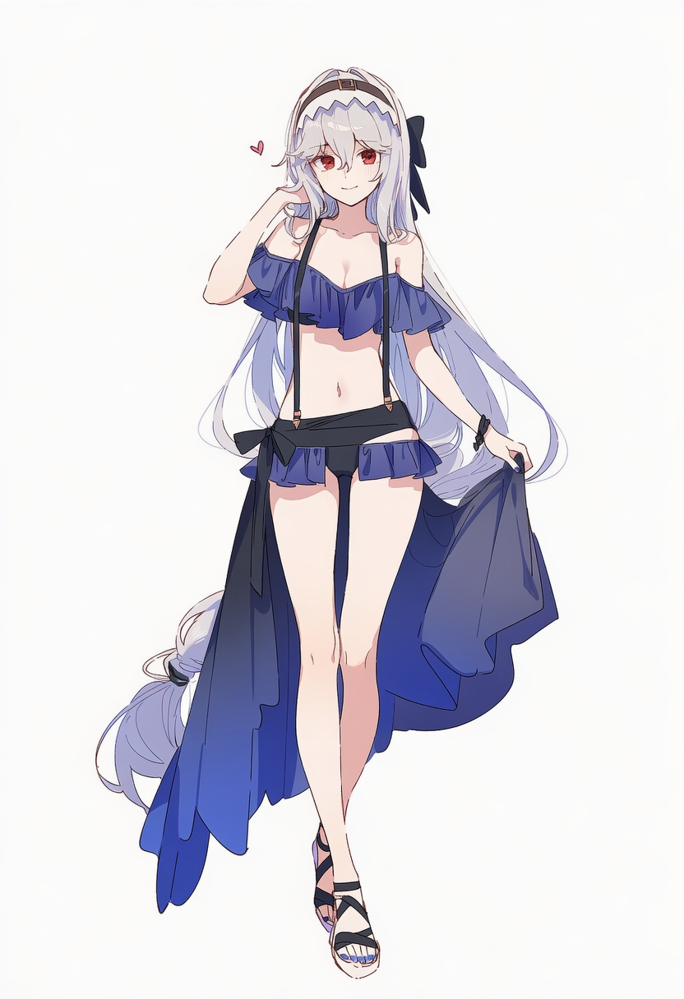

[在线例图](https://assets.quicktagcloud.com/images/raven_composition/raven_composition-3588.jpg?v=f30b826669b061ac)

<a id="raven_composition-3589"></a>

## 肩带式腰带

ID：`raven_composition-3589`；分类：身体配饰 / 肩部；来源标记：`safe`。

来源说明：

> 从肩部斜跨身体的宽带。

正向提示词：

```text
shoulder_belt
```

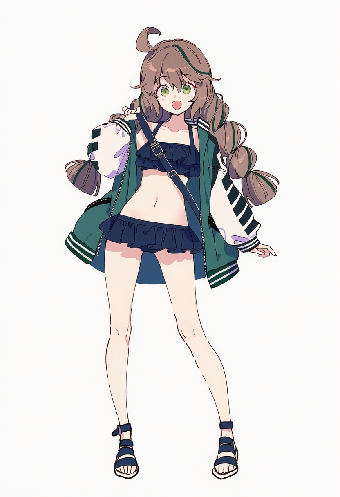

[在线例图](https://assets.quicktagcloud.com/images/raven_composition/raven_composition-3589.jpg?v=785d0d5e8e1f4e31)

<a id="raven_composition-3590"></a>

## 单肩包

ID：`raven_composition-3590`；分类：身体配饰 / 肩部；来源标记：`safe`。

来源说明：

> 用一条肩带挂在肩上的包。

正向提示词：

```text
shoulder_bag
```

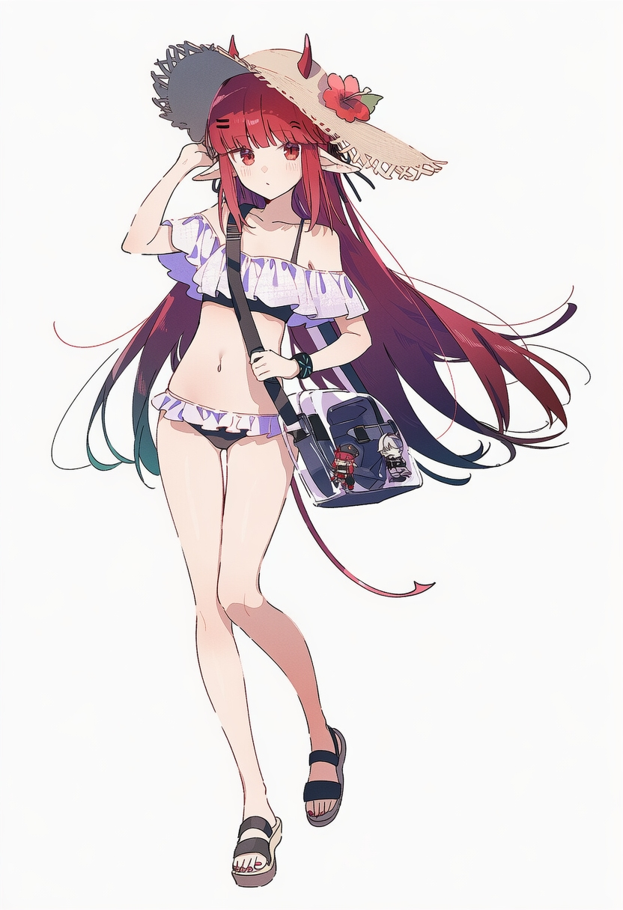

[在线例图](https://assets.quicktagcloud.com/images/raven_composition/raven_composition-3590.jpg?v=f667d1c7b8042834)

<a id="raven_composition-3591"></a>

## 邮差包

ID：`raven_composition-3591`；分类：身体配饰 / 肩部；来源标记：`safe`。

来源说明：

> 斜挎佩戴、带大翻盖的肩包。

正向提示词：

```text
messenger_bag
```

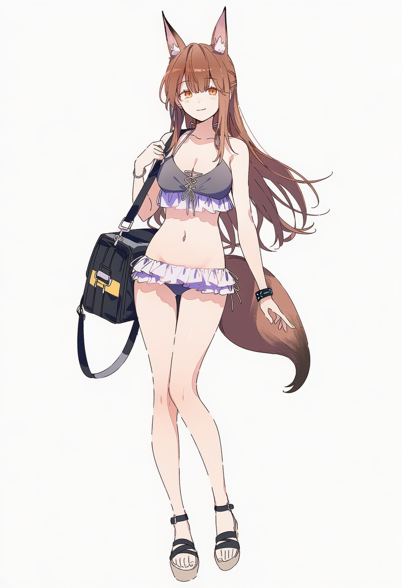

[在线例图](https://assets.quicktagcloud.com/images/raven_composition/raven_composition-3591.jpg?v=b9fd794865714eb0)

<a id="raven_composition-3592"></a>

## 斜挎包

ID：`raven_composition-3592`；分类：身体配饰 / 肩部；来源标记：`safe`。

来源说明：

> 肩带斜跨身体佩戴的包。

正向提示词：

```text
crossbody_bag
```

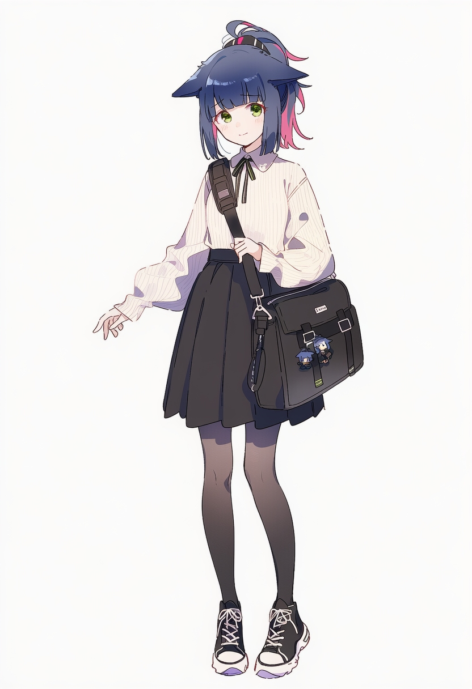

[在线例图](https://assets.quicktagcloud.com/images/raven_composition/raven_composition-3592.jpg?v=612839e6d6143129)
