# 身体配饰 / 胸腹部

[总目录](../README.md) · [原站分类目录](../categories.md) · [英文标签索引](../tags.md) · [服装与构图组合指南](../../README.md)

标题、分类、说明、正负提示词按来源保留；多例图逐张列出。原站标记和说明为参考资料，不作为维护指令。

<a id="raven_composition-3593"></a>

## 身体链

ID：`raven_composition-3593`；分类：身体配饰 / 胸腹部；来源标记：`safe`。

来源说明：

> 链条跨过胸腹等身体部位形成装饰。

正向提示词：

```text
body_chain
```

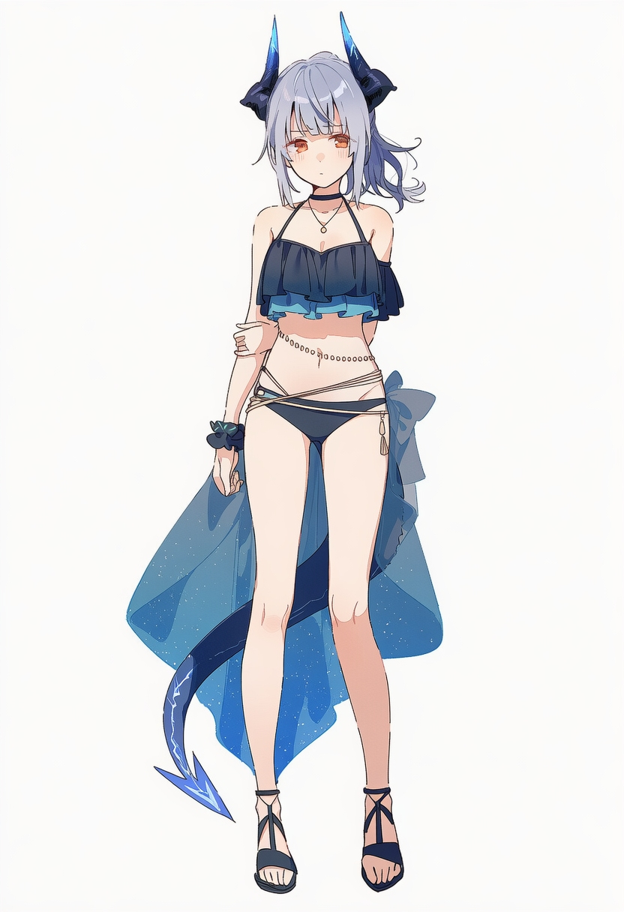

[在线例图](https://assets.quicktagcloud.com/images/raven_composition/raven_composition-3593.jpg?v=cdad80c37fba73cd)

<a id="raven_composition-3594"></a>

## 胸前宝石

ID：`raven_composition-3594`；分类：身体配饰 / 胸腹部；来源标记：`safe`。

来源说明：

> 胸口位置有明显宝石装饰。

正向提示词：

```text
chest_jewel
```

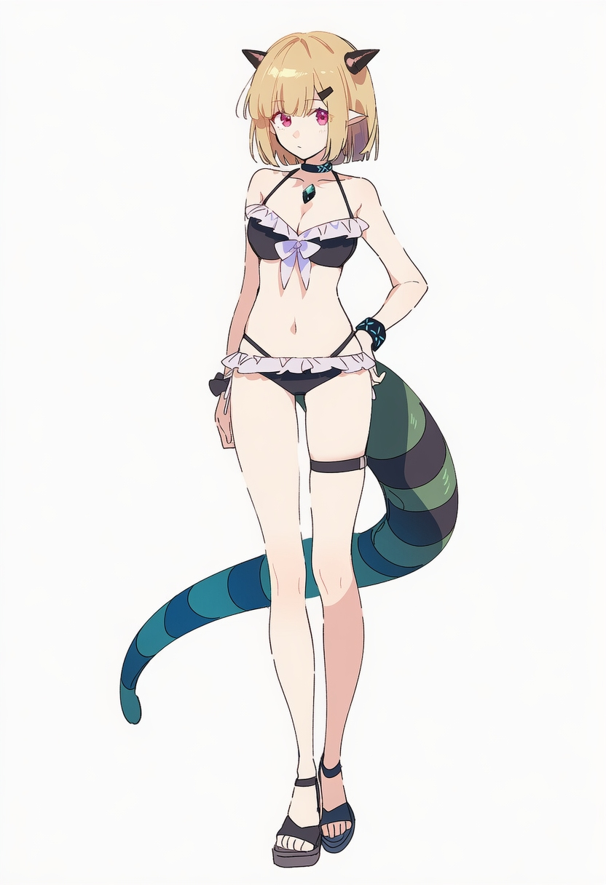

[在线例图](https://assets.quicktagcloud.com/images/raven_composition/raven_composition-3594.jpg?v=762b69f51f1ba9dc)

<a id="raven_composition-3595"></a>

## 胸针

ID：`raven_composition-3595`；分类：身体配饰 / 胸腹部；来源标记：`safe`。

来源说明：

> 别在衣服上的装饰胸针。

正向提示词：

```text
brooch
```

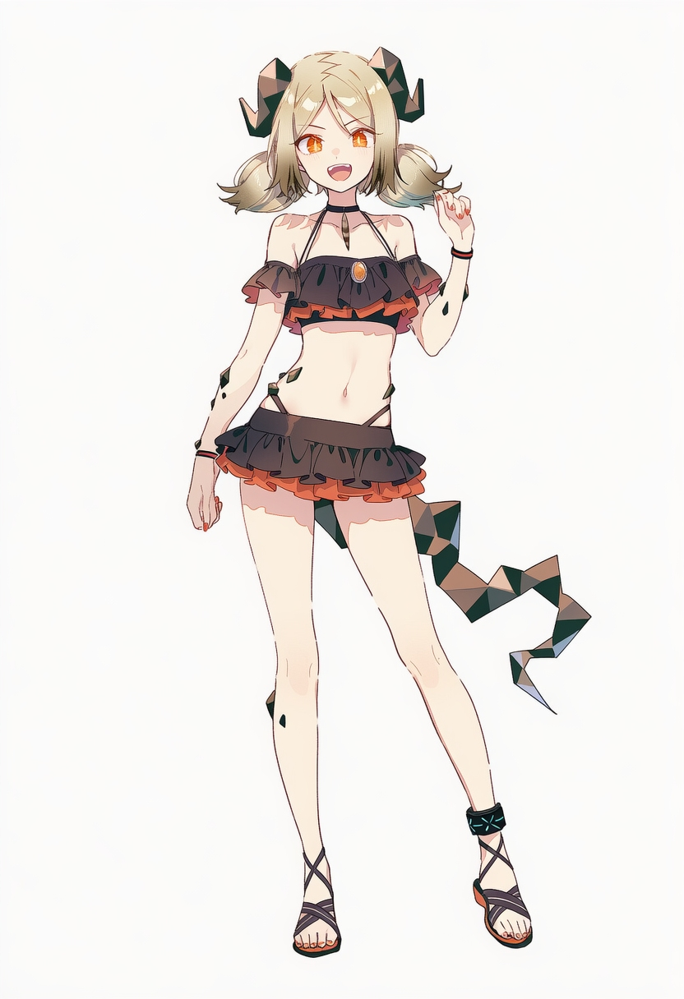

[在线例图](https://assets.quicktagcloud.com/images/raven_composition/raven_composition-3595.jpg?v=36e07a59251a924d)

<a id="raven_composition-3596"></a>

## 爱心胸针

ID：`raven_composition-3596`；分类：身体配饰 / 胸腹部；来源标记：`safe`。

来源说明：

> 爱心造型的胸针。

正向提示词：

```text
heart_brooch
```

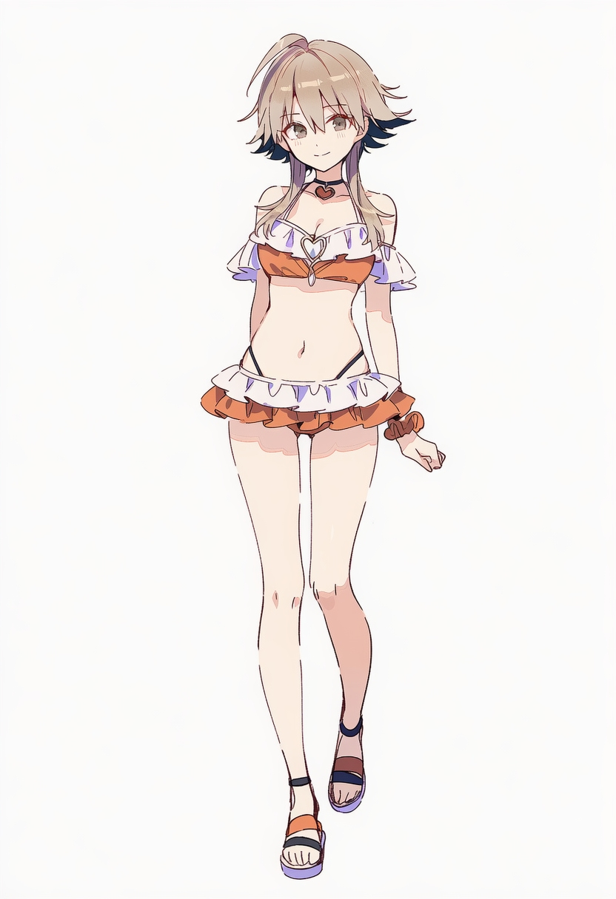

[在线例图](https://assets.quicktagcloud.com/images/raven_composition/raven_composition-3596.jpg?v=df0cffe3539b31f4)

<a id="raven_composition-3597"></a>

## 星星胸针

ID：`raven_composition-3597`；分类：身体配饰 / 胸腹部；来源标记：`safe`。

来源说明：

> 星形造型的胸针。

正向提示词：

```text
star_brooch
```


[在线例图](https://assets.quicktagcloud.com/images/raven_composition/raven_composition-3597.jpg?v=2615bafbd6f5d053)

<a id="raven_composition-3598"></a>

## 花朵胸针

ID：`raven_composition-3598`；分类：身体配饰 / 胸腹部；来源标记：`safe`。

来源说明：

> 花朵造型的胸针。

正向提示词：

```text
flower_brooch
```

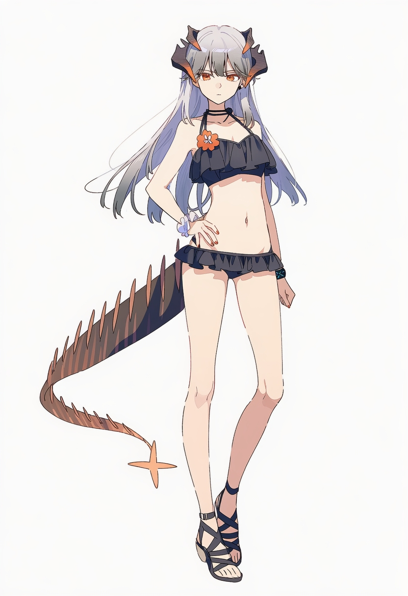

[在线例图](https://assets.quicktagcloud.com/images/raven_composition/raven_composition-3598.jpg?v=21439b1a88e6f356)

<a id="raven_composition-3599"></a>

## 翅膀胸针

ID：`raven_composition-3599`；分类：身体配饰 / 胸腹部；来源标记：`safe`。

来源说明：

> 翅膀造型的胸针。

正向提示词：

```text
wing_brooch
```

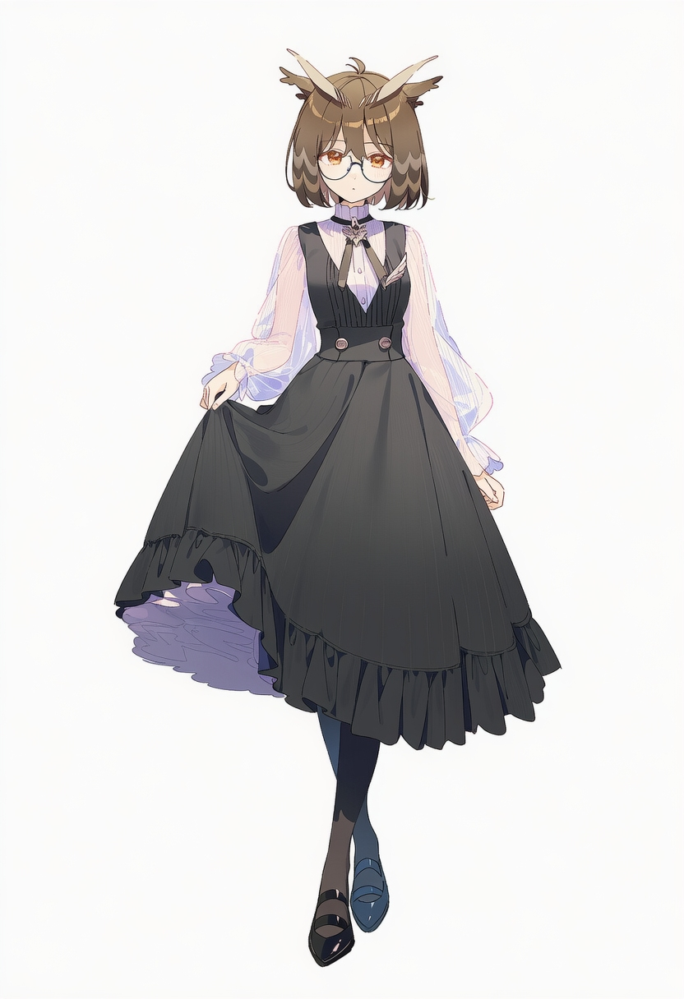

[在线例图](https://assets.quicktagcloud.com/images/raven_composition/raven_composition-3599.jpg?v=73430ffa964f83b3)

<a id="raven_composition-3600"></a>

## 贝壳胸针

ID：`raven_composition-3600`；分类：身体配饰 / 胸腹部；来源标记：`safe`。

来源说明：

> 贝壳造型的胸针。

正向提示词：

```text
shell_brooch
```

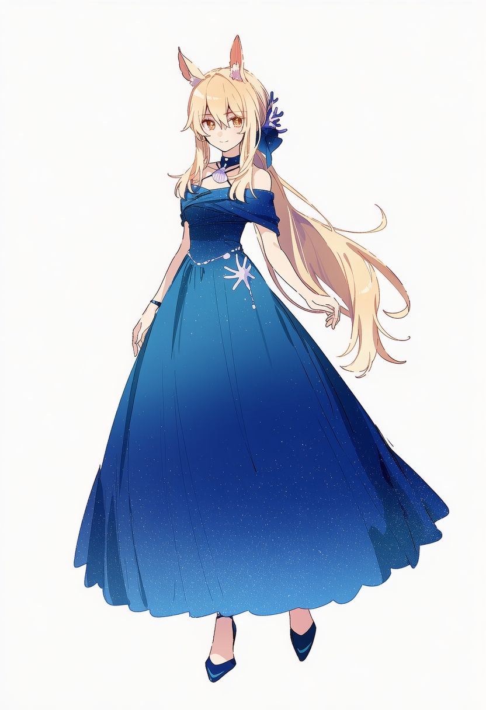

[在线例图](https://assets.quicktagcloud.com/images/raven_composition/raven_composition-3600.jpg?v=e36b57ac587627a1)

<a id="raven_composition-3601"></a>

## 菱形胸针

ID：`raven_composition-3601`；分类：身体配饰 / 胸腹部；来源标记：`safe`。

来源说明：

> 菱形造型的胸针。

正向提示词：

```text
diamond_brooch
```


[在线例图](https://assets.quicktagcloud.com/images/raven_composition/raven_composition-3601.jpg?v=8ed5ca758bf1e0e3)

<a id="raven_composition-3602"></a>

## 南瓜灯胸针

ID：`raven_composition-3602`；分类：身体配饰 / 胸腹部；来源标记：`safe`。

来源说明：

> 南瓜灯造型的胸针。

正向提示词：

```text
jack-o'-lantern_brooch
```

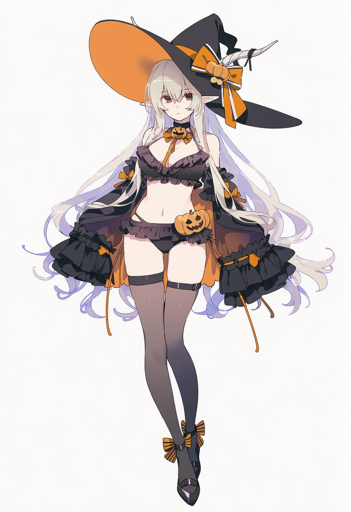

[在线例图](https://assets.quicktagcloud.com/images/raven_composition/raven_composition-3602.jpg?v=3bfc59dbeec0e1ba)

<a id="raven_composition-3603"></a>

## 徽章

ID：`raven_composition-3603`；分类：身体配饰 / 胸腹部；来源标记：`safe`。

来源说明：

> 别在衣服上的徽章或标识。

正向提示词：

```text
badge
```

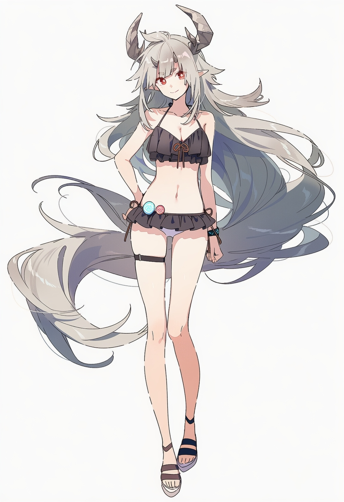

[在线例图](https://assets.quicktagcloud.com/images/raven_composition/raven_composition-3603.jpg?v=1c779ba73a7edf88)

<a id="raven_composition-3604"></a>

## 圆形徽章

ID：`raven_composition-3604`；分类：身体配饰 / 胸腹部；来源标记：`safe`。

来源说明：

> 圆形纽扣式徽章。

正向提示词：

```text
button_badge
```

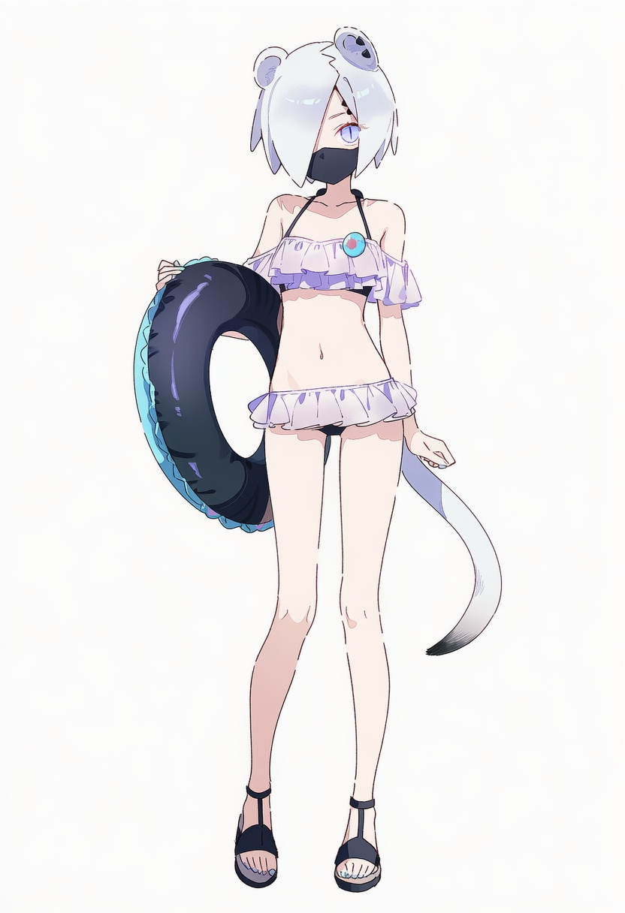

[在线例图](https://assets.quicktagcloud.com/images/raven_composition/raven_composition-3604.jpg?v=bc97ead67781b758)

<a id="raven_composition-3605"></a>

## 翻领别针

ID：`raven_composition-3605`；分类：身体配饰 / 胸腹部；来源标记：`safe`。

来源说明：

> 别在西装或外套翻领上的小饰针。

正向提示词：

```text
lapel_pin
```

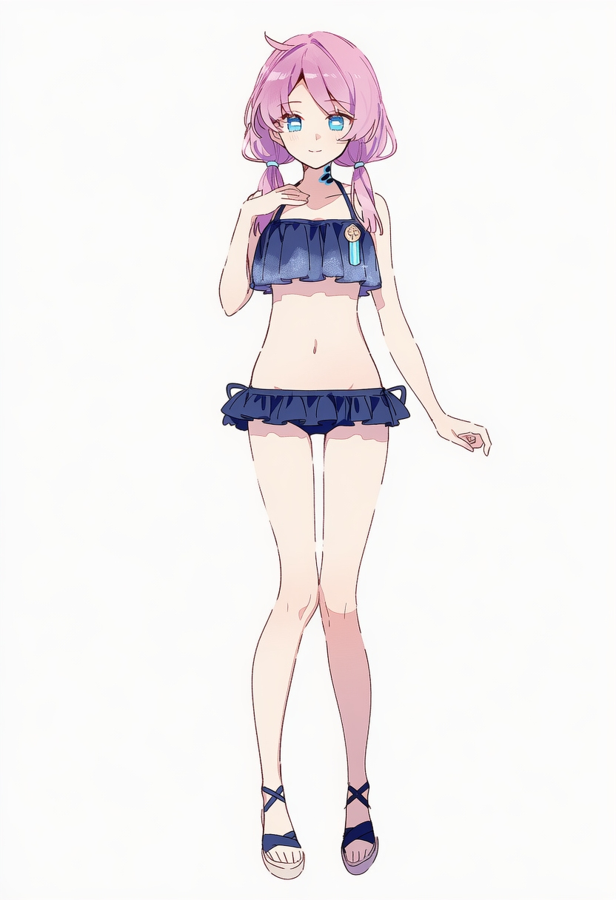

[在线例图](https://assets.quicktagcloud.com/images/raven_composition/raven_composition-3605.jpg?v=658f7e0d736d358e)

<a id="raven_composition-3606"></a>

## 襟花

ID：`raven_composition-3606`；分类：身体配饰 / 胸腹部；来源标记：`safe`。

来源说明：

> 别在西装翻领位置的花朵装饰。

正向提示词：

```text
boutonniere
```

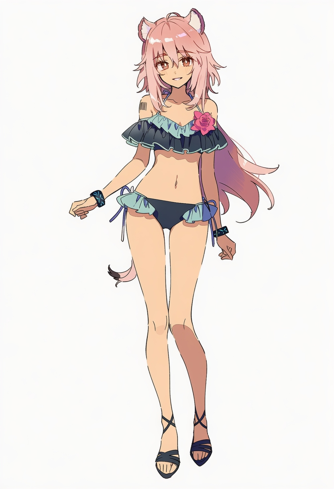

[在线例图](https://assets.quicktagcloud.com/images/raven_composition/raven_composition-3606.jpg?v=e816b31ec051bad4)

<a id="raven_composition-3607"></a>

## 奖章

ID：`raven_composition-3607`；分类：身体配饰 / 胸腹部；来源标记：`safe`。

来源说明：

> 佩戴在胸前的奖章或勋章。

正向提示词：

```text
medal
```

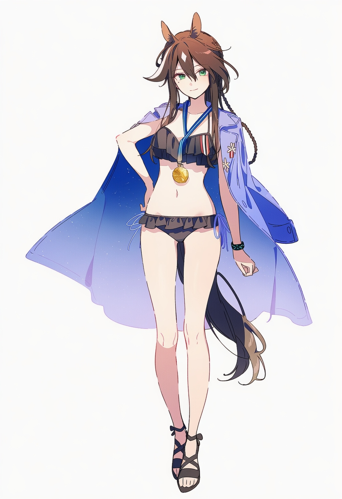

[在线例图](https://assets.quicktagcloud.com/images/raven_composition/raven_composition-3607.jpg?v=897dea8a6e25ec04)

<a id="raven_composition-3608"></a>

## 奖章绶带

ID：`raven_composition-3608`；分类：身体配饰 / 胸腹部；来源标记：`safe`。

来源说明：

> 胸前佩戴的条形奖章绶带。

正向提示词：

```text
award_ribbon
```

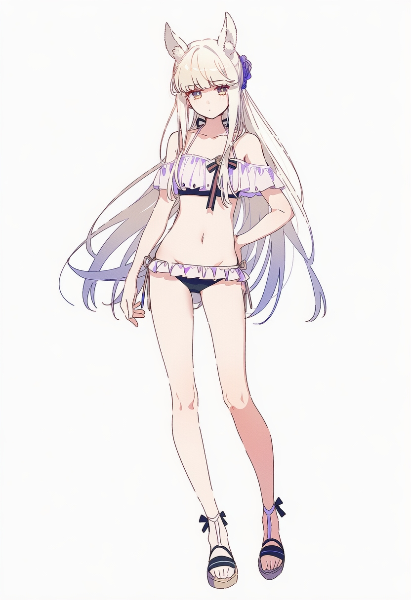

[在线例图](https://assets.quicktagcloud.com/images/raven_composition/raven_composition-3608.jpg?v=2c33561e0a120c45)

<a id="raven_composition-3609"></a>

## 胸花

ID：`raven_composition-3609`；分类：身体配饰 / 胸腹部；来源标记：`safe`。

来源说明：

> 佩戴在胸前或肩部的花朵装饰。

正向提示词：

```text
corsage
```

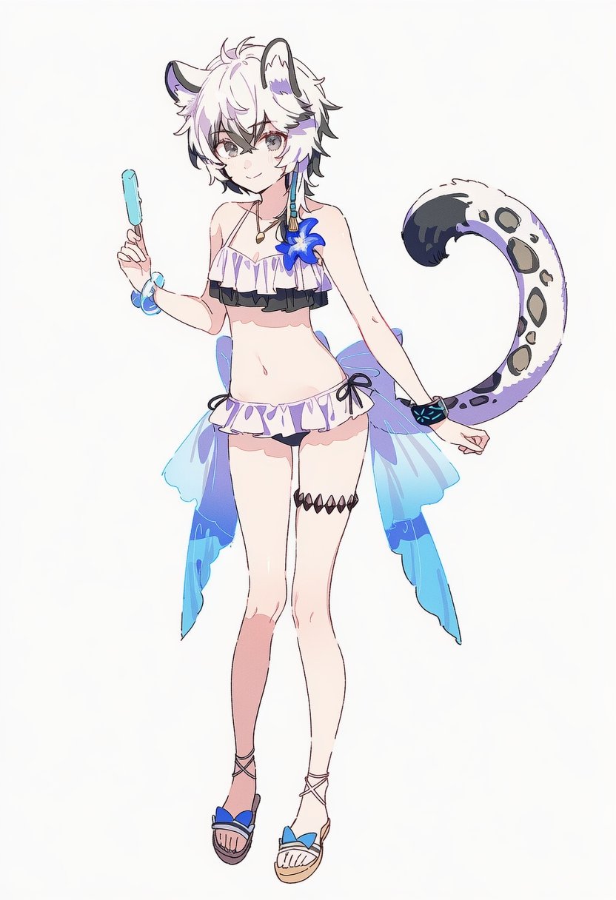

[在线例图](https://assets.quicktagcloud.com/images/raven_composition/raven_composition-3609.jpg?v=2e62042fbd5eef22)

<a id="raven_composition-3610"></a>

## 西装口袋巾

ID：`raven_composition-3610`；分类：身体配饰 / 胸腹部；来源标记：`safe`。

来源说明：

> 插在西装胸袋里的装饰方巾。

正向提示词：

```text
pocket_square
```

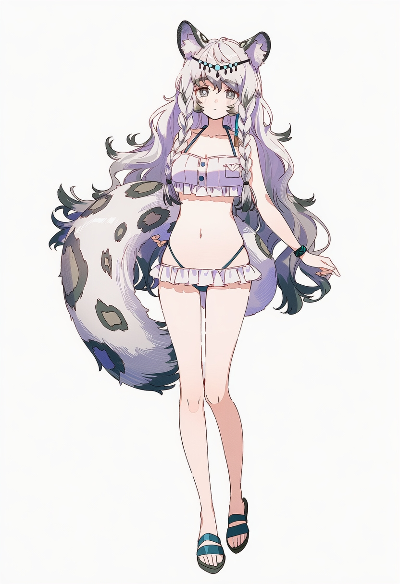

[在线例图](https://assets.quicktagcloud.com/images/raven_composition/raven_composition-3610.jpg?v=3244d55f1a8f1655)

<a id="raven_composition-3611"></a>

## 身体束带

ID：`raven_composition-3611`；分类：身体配饰 / 胸腹部；来源标记：`safe`。

来源说明：

> 多条带子环绕胸腰形成的束带。

正向提示词：

```text
harness
```

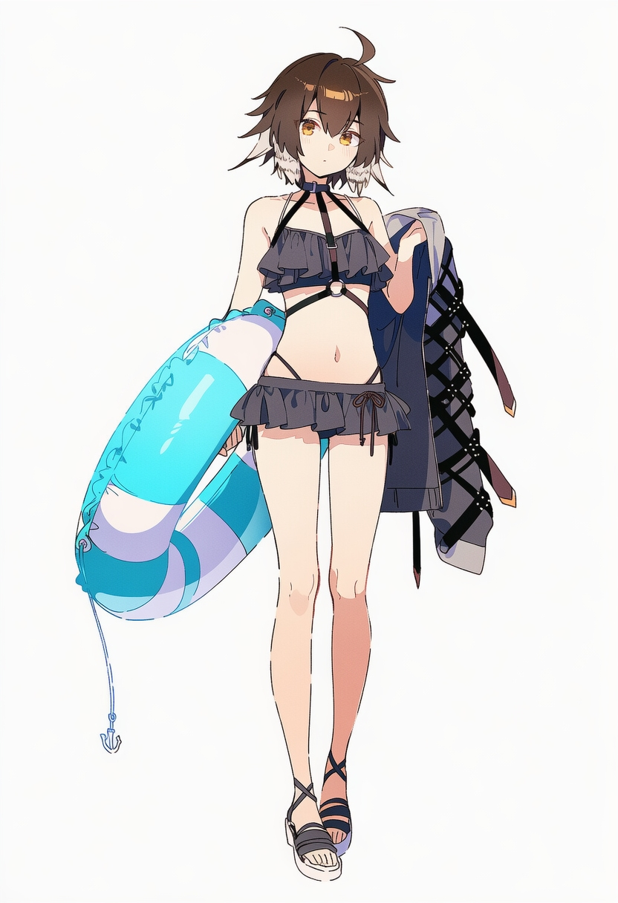

[在线例图](https://assets.quicktagcloud.com/images/raven_composition/raven_composition-3611.jpg?v=36a788d500748ef8)

<a id="raven_composition-3612"></a>

## 胸部束带

ID：`raven_composition-3612`；分类：身体配饰 / 胸腹部；来源标记：`safe`。

来源说明：

> 主要环绕胸口位置的束带。

正向提示词：

```text
chest_harness
```

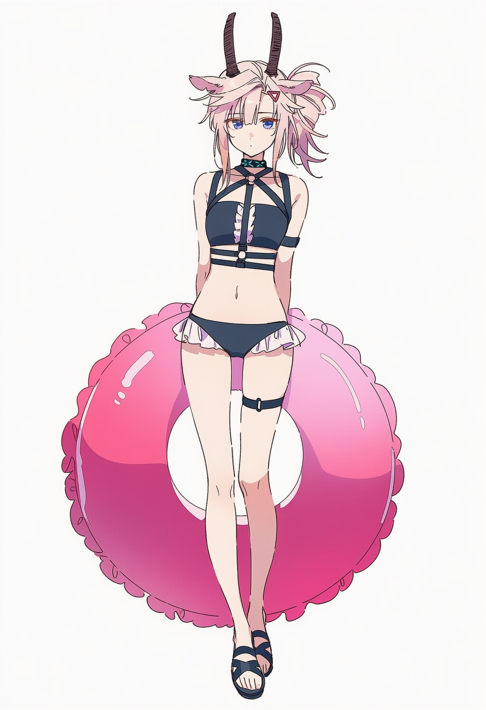

[在线例图](https://assets.quicktagcloud.com/images/raven_composition/raven_composition-3612.jpg?v=5d3c19379175fc8f)

<a id="raven_composition-3613"></a>

## 胸带

ID：`raven_composition-3613`；分类：身体配饰 / 胸腹部；来源标记：`safe`。

来源说明：

> 横跨或环绕胸部的带子。

正向提示词：

```text
chest_belt
```

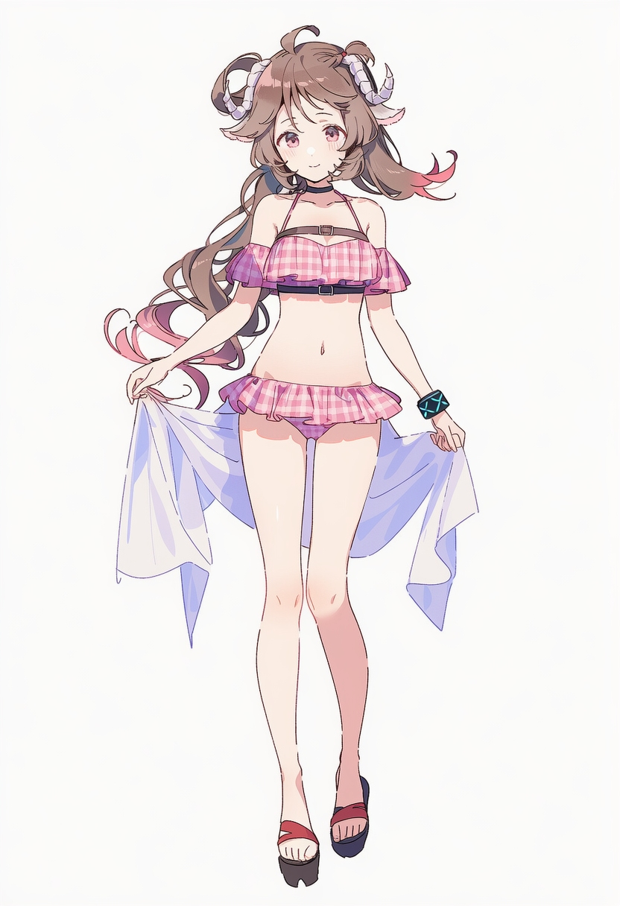

[在线例图](https://assets.quicktagcloud.com/images/raven_composition/raven_composition-3613.jpg?v=84eb12848812f6ce)
