# 身体配饰 / 腰部

[总目录](../README.md) · [原站分类目录](../categories.md) · [英文标签索引](../tags.md) · [服装与构图组合指南](../../README.md)

标题、分类、说明、正负提示词按来源保留；多例图逐张列出。原站标记和说明为参考资料，不作为维护指令。

<a id="raven_composition-3616"></a>

## 腰链 / 腹链

ID：`raven_composition-3616`；分类：身体配饰 / 腰部；来源标记：`safe`。

来源说明：

> 环绕腰部或腹部佩戴的装饰链。

正向提示词：

```text
belly_chain
```

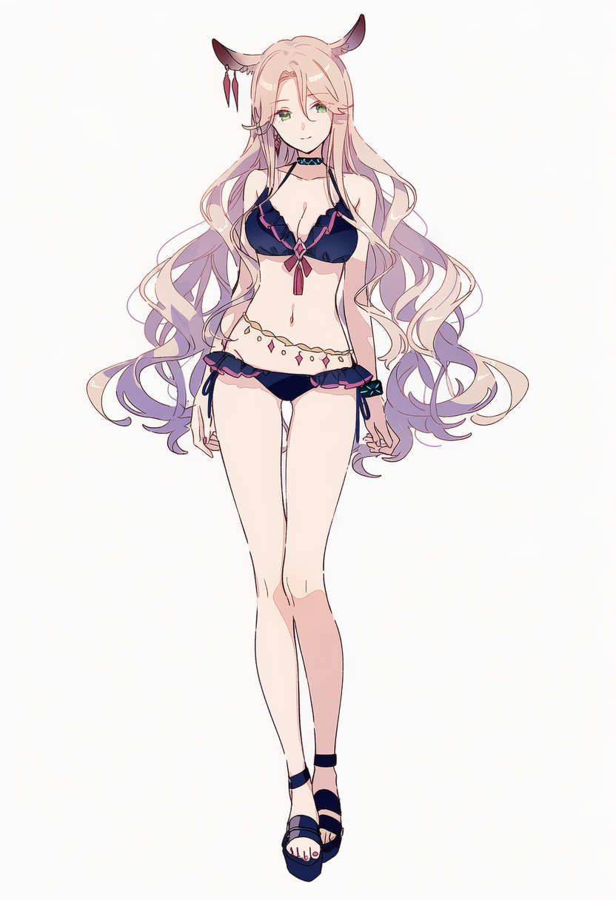

[在线例图](https://assets.quicktagcloud.com/images/raven_composition/raven_composition-3616.jpg?v=9881f44df24d34a7)

<a id="raven_composition-3617"></a>

## 腰带

ID：`raven_composition-3617`；分类：身体配饰 / 腰部；来源标记：`safe`。

来源说明：

> 泛指围在腰部的腰带。

正向提示词：

```text
belt
```

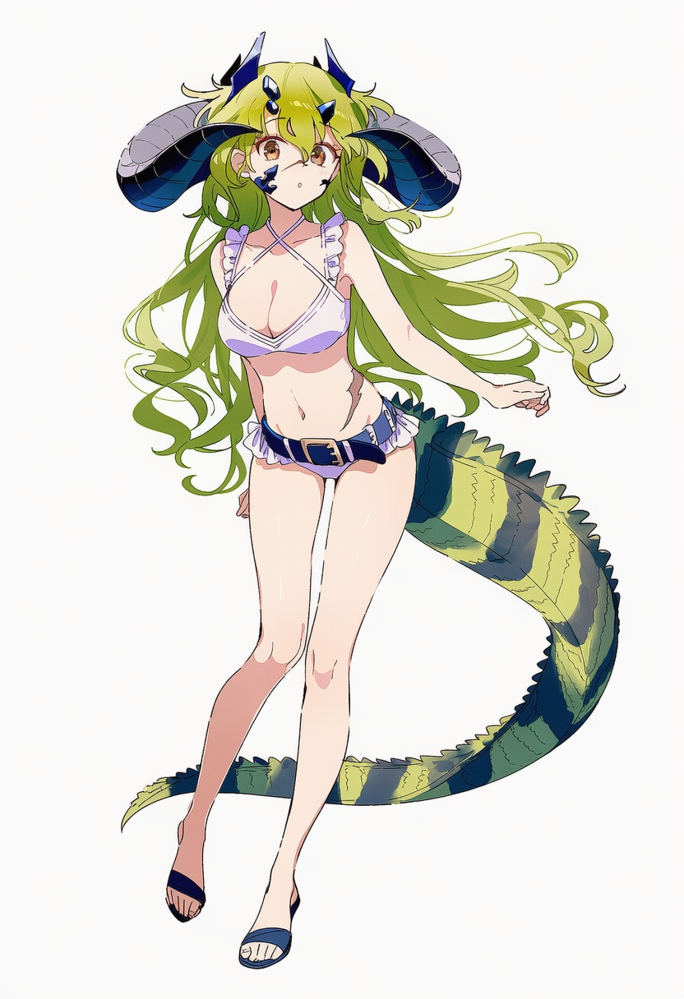

[在线例图](https://assets.quicktagcloud.com/images/raven_composition/raven_composition-3617.jpg?v=3b7e585669221504)

<a id="raven_composition-3618"></a>

## 黑色腰带

ID：`raven_composition-3618`；分类：身体配饰 / 腰部；来源标记：`safe`。

来源说明：

> 黑色腰带；纯颜色款只留这一种代表。

正向提示词：

```text
black_belt
```

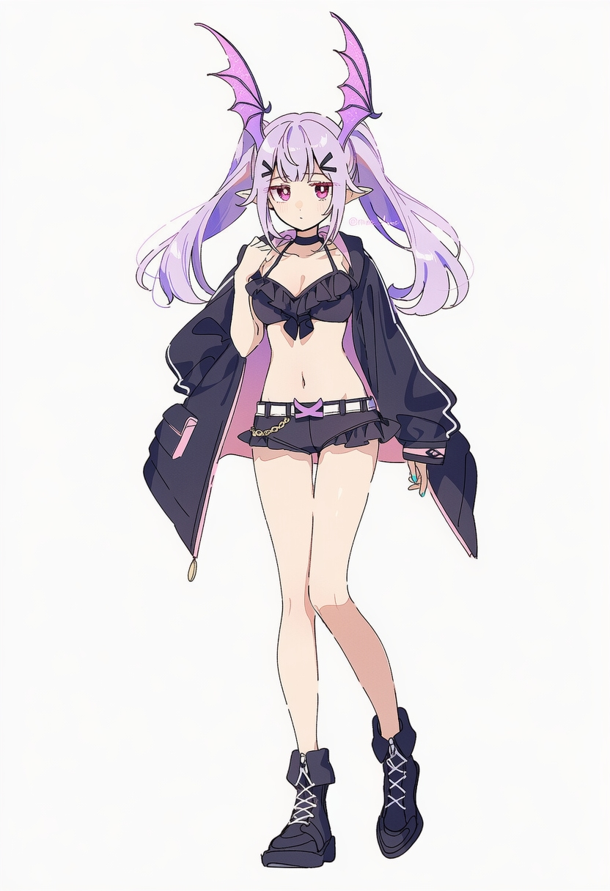

[在线例图](https://assets.quicktagcloud.com/images/raven_composition/raven_composition-3618.jpg?v=e719abd6117a31aa)

<a id="raven_composition-3619"></a>

## 腰带扣

ID：`raven_composition-3619`；分类：身体配饰 / 腰部；来源标记：`safe`。

来源说明：

> 腰带正面的明显扣件。

正向提示词：

```text
belt_buckle
```

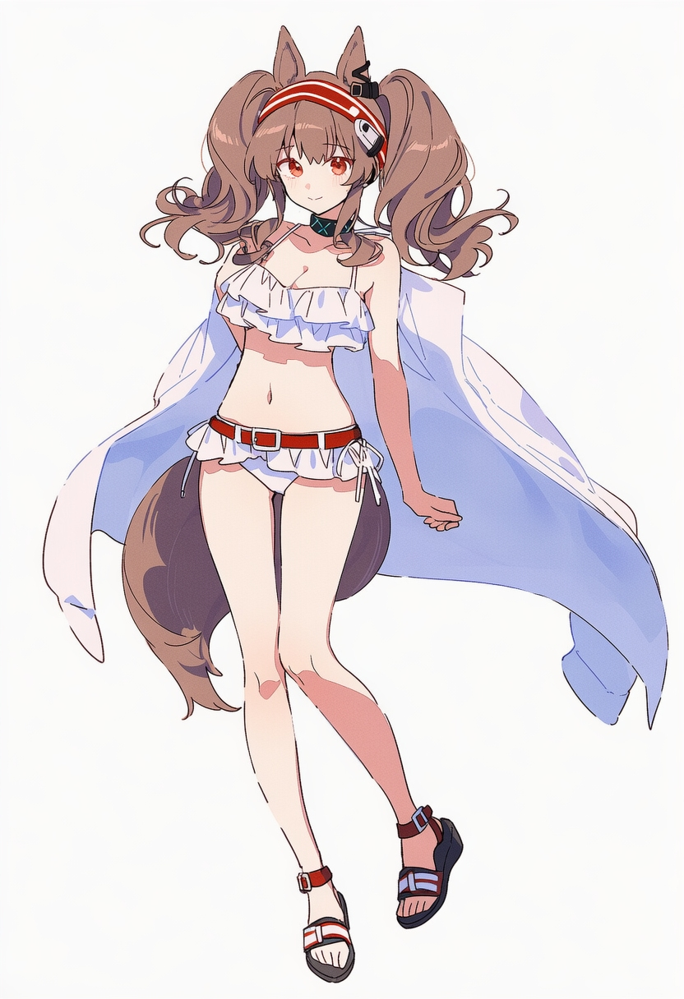

[在线例图](https://assets.quicktagcloud.com/images/raven_composition/raven_composition-3619.jpg?v=ca5761196d4f030a)

<a id="raven_composition-3620"></a>

## 链条腰带

ID：`raven_composition-3620`；分类：身体配饰 / 腰部；来源标记：`safe`。

来源说明：

> 主要由链条构成的腰带。

正向提示词：

```text
chain_belt
```

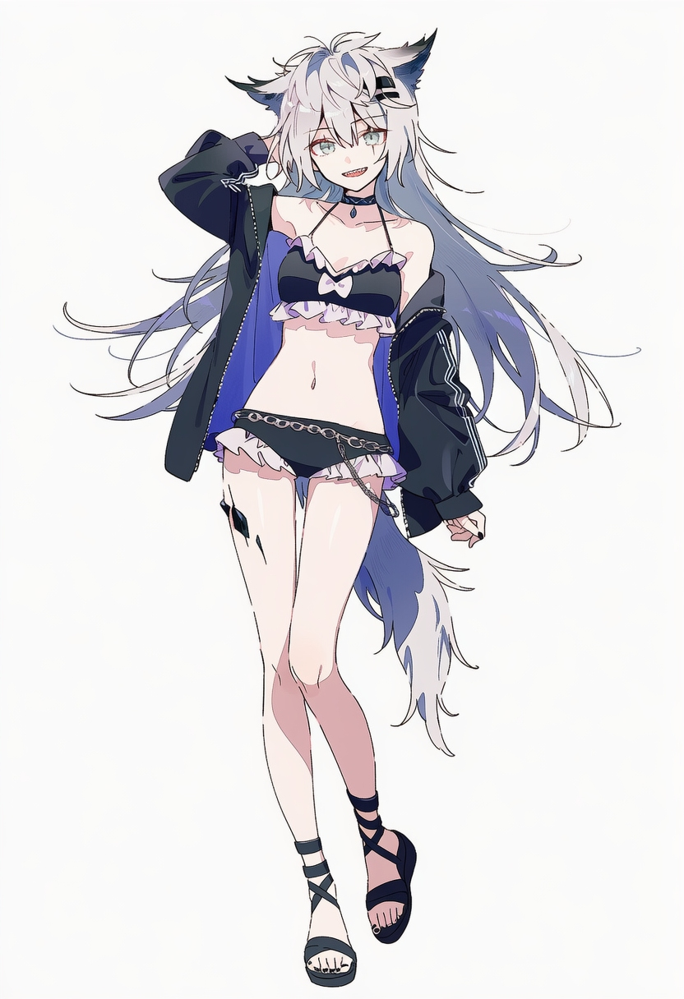

[在线例图](https://assets.quicktagcloud.com/images/raven_composition/raven_composition-3620.jpg?v=4c4ca3815f92229d)

<a id="raven_composition-3621"></a>

## 松垮腰带

ID：`raven_composition-3621`；分类：身体配饰 / 腰部；来源标记：`safe`。

来源说明：

> 腰带明显松垮地挂在腰间。

正向提示词：

```text
loose_belt
```

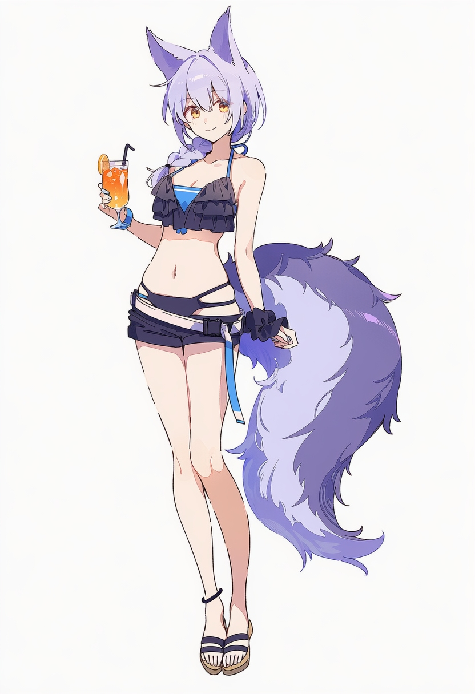

[在线例图](https://assets.quicktagcloud.com/images/raven_composition/raven_composition-3621.jpg?v=dcbb7ef82c52ac61)

<a id="raven_composition-3622"></a>

## 多条腰带

ID：`raven_composition-3622`；分类：身体配饰 / 腰部；来源标记：`safe`。

来源说明：

> 同时佩戴多条腰带。

正向提示词：

```text
multiple_belts
```

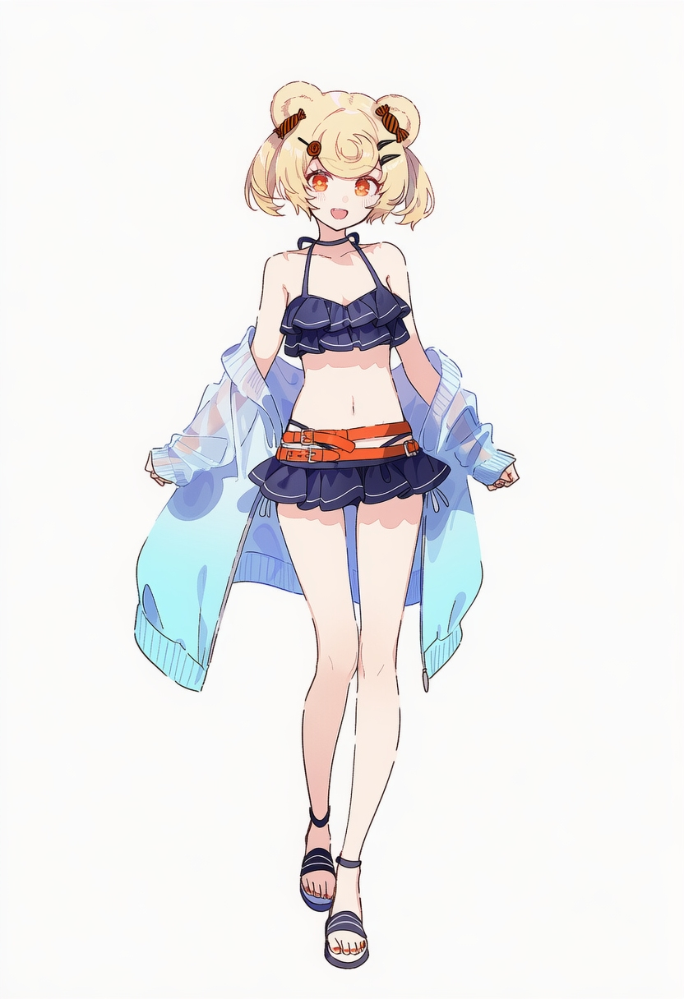

[在线例图](https://assets.quicktagcloud.com/images/raven_composition/raven_composition-3622.jpg?v=e394468edee1ef9a)

<a id="raven_composition-3623"></a>

## 大量腰带

ID：`raven_composition-3623`；分类：身体配饰 / 腰部；来源标记：`safe`。

来源说明：

> 身上佩戴夸张数量的腰带。

正向提示词：

```text
too_many_belts
```

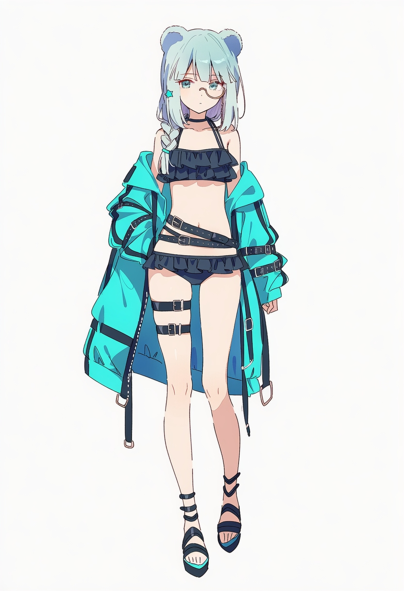

[在线例图](https://assets.quicktagcloud.com/images/raven_composition/raven_composition-3623.jpg?v=1be4ea184cb3f73d)

<a id="raven_composition-3624"></a>

## 铆钉腰带

ID：`raven_composition-3624`；分类：身体配饰 / 腰部；来源标记：`safe`。

来源说明：

> 带大量铆钉装饰的腰带。

正向提示词：

```text
studded_belt
```

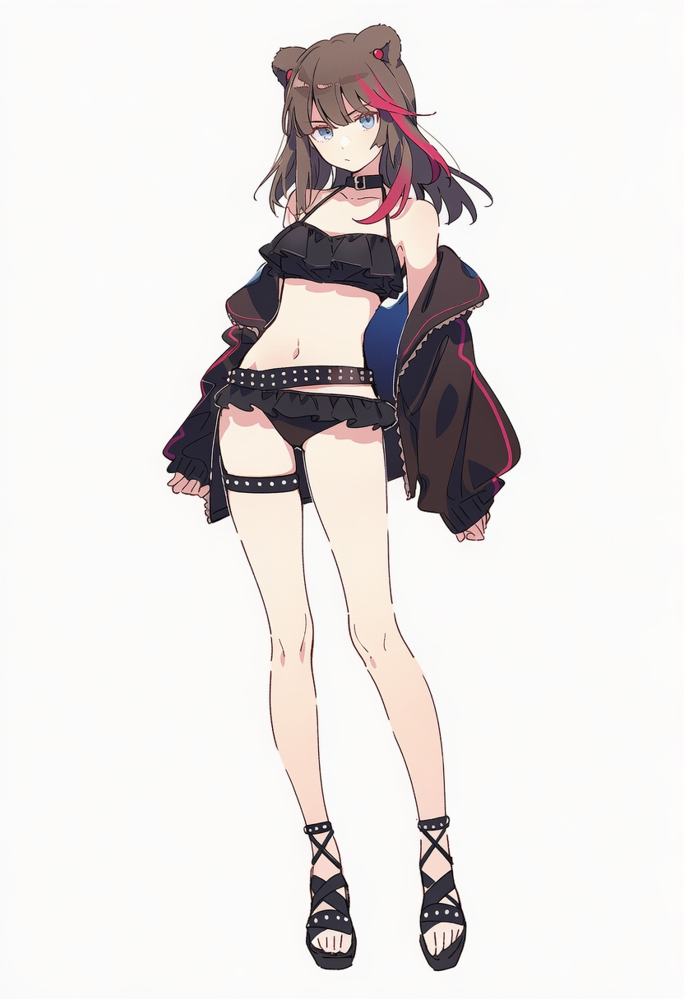

[在线例图](https://assets.quicktagcloud.com/images/raven_composition/raven_composition-3624.jpg?v=db9934619edaa73f)

<a id="raven_composition-3625"></a>

## O环腰带

ID：`raven_composition-3625`；分类：身体配饰 / 腰部；来源标记：`safe`。

来源说明：

> 腰带上带明显圆形金属环。

正向提示词：

```text
o-ring_belt
```

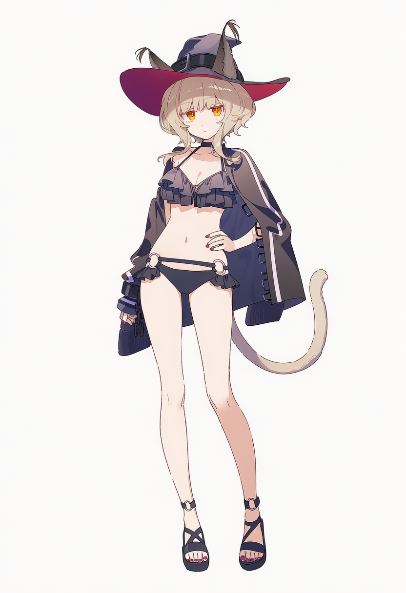

[在线例图](https://assets.quicktagcloud.com/images/raven_composition/raven_composition-3625.jpg?v=c6c6d67124a27d0d)

<a id="raven_composition-3626"></a>

## 腰部蝴蝶结

ID：`raven_composition-3626`；分类：身体配饰 / 腰部；来源标记：`safe`。

来源说明：

> 腰部位置有明显蝴蝶结装饰。

正向提示词：

```text
waist_bow
```

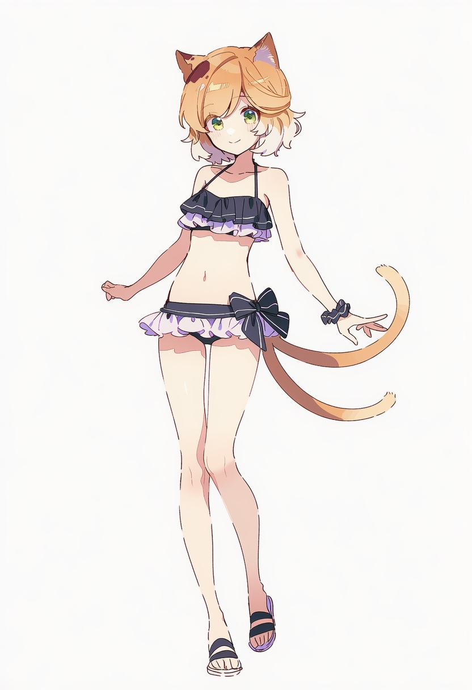

[在线例图](https://assets.quicktagcloud.com/images/raven_composition/raven_composition-3626.jpg?v=cb19d7ee2ed50946)

<a id="raven_composition-3627"></a>

## 腰披

ID：`raven_composition-3627`；分类：身体配饰 / 腰部；来源标记：`safe`。

来源说明：

> 从腰部垂下的小披布或装饰披片。

正向提示词：

```text
waist_cape
```

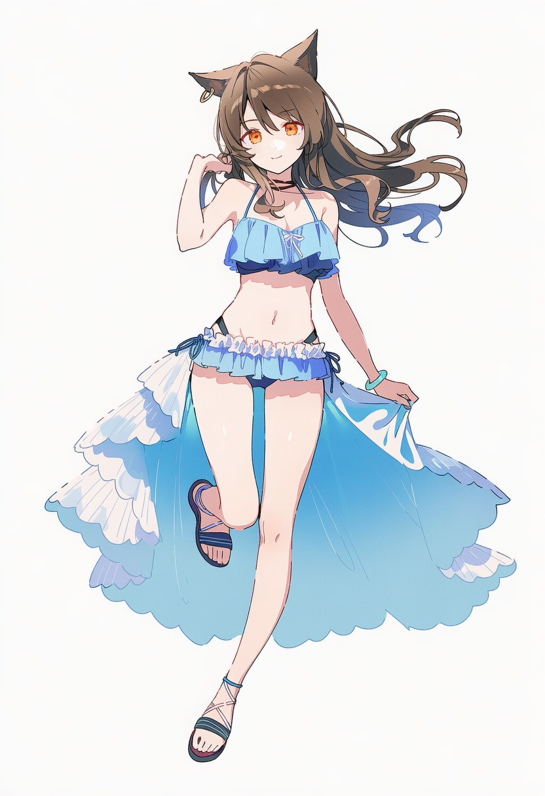

[在线例图](https://assets.quicktagcloud.com/images/raven_composition/raven_composition-3627.jpg?v=3e0e256396026dc7)

<a id="raven_composition-3628"></a>

## 腰部饰带

ID：`raven_composition-3628`；分类：身体配饰 / 腰部；来源标记：`safe`。

来源说明：

> 明确围在腰部的宽布带。

正向提示词：

```text
waist_sash
```

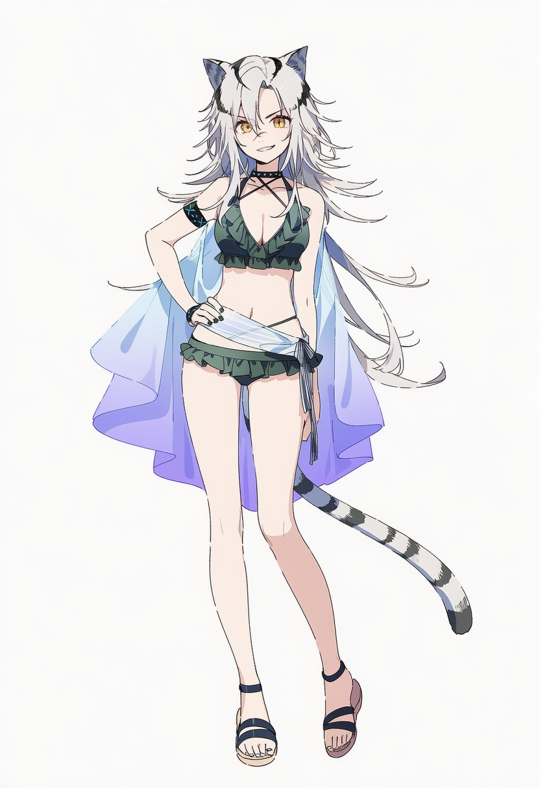

[在线例图](https://assets.quicktagcloud.com/images/raven_composition/raven_composition-3628.jpg?v=10ee36c7cfaa68b2)

<a id="raven_composition-3629"></a>

## 腰带 / Obi

ID：`raven_composition-3629`；分类：身体配饰 / 腰部；来源标记：`safe`。

来源说明：

> 和服外侧使用的宽腰带。

正向提示词：

```text
obi
```

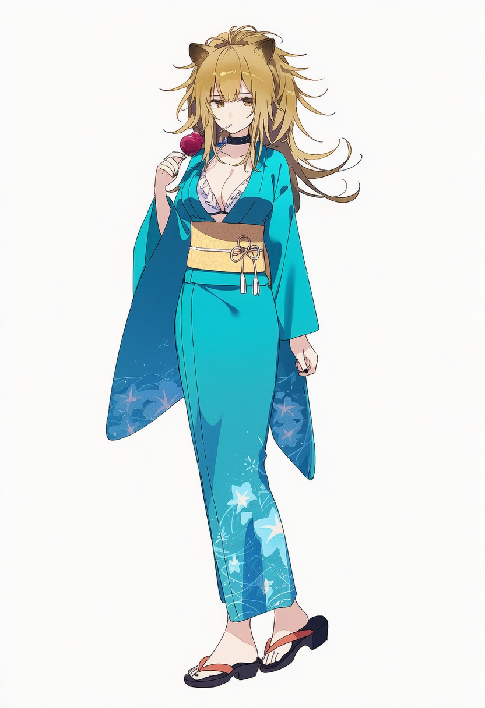

[在线例图](https://assets.quicktagcloud.com/images/raven_composition/raven_composition-3629.jpg?v=a21b810f918c54cc)

<a id="raven_composition-3630"></a>

## 带扬

ID：`raven_composition-3630`；分类：身体配饰 / 腰部；来源标记：`safe`。

来源说明：

> 从 Obi 上缘露出的装饰布。

正向提示词：

```text
obiage
```

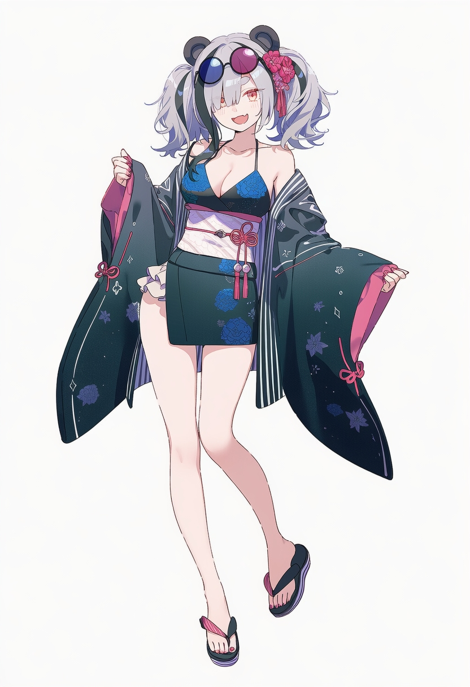

[在线例图](https://assets.quicktagcloud.com/images/raven_composition/raven_composition-3630.jpg?v=0ce9c8c480c50ce6)

<a id="raven_composition-3631"></a>

## 带締

ID：`raven_composition-3631`；分类：身体配饰 / 腰部；来源标记：`safe`。

来源说明：

> 系在 Obi 外侧的细装饰绳。

正向提示词：

```text
obijime
```

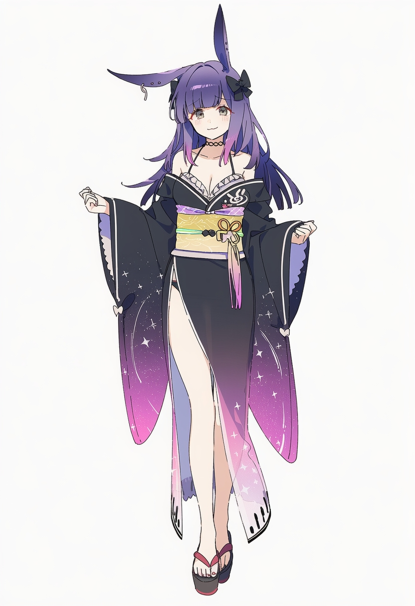

[在线例图](https://assets.quicktagcloud.com/images/raven_composition/raven_composition-3631.jpg?v=a097a7e33b3e2524)

<a id="raven_composition-3632"></a>

## 吊袜腰带

ID：`raven_composition-3632`；分类：身体配饰 / 腰部；来源标记：`safe`。

来源说明：

> 腰部佩戴并连接吊袜带的腰带。

正向提示词：

```text
garter_belt
```

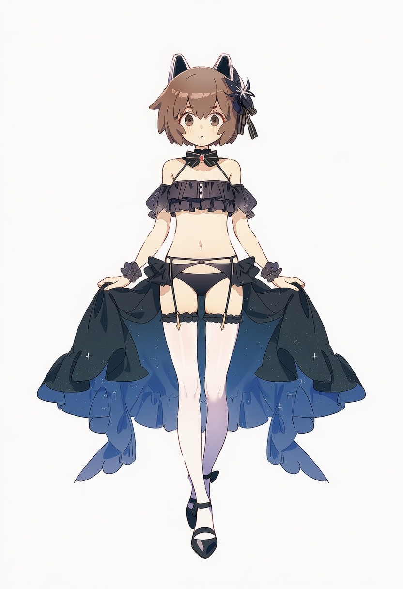

[在线例图](https://assets.quicktagcloud.com/images/raven_composition/raven_composition-3632.jpg?v=2bf4b422ed0cb54e)

<a id="raven_composition-3633"></a>

## 腰带小包

ID：`raven_composition-3633`；分类：身体配饰 / 腰部；来源标记：`safe`。

来源说明：

> 固定在腰带上的小型收纳包。

正向提示词：

```text
belt_pouch
```

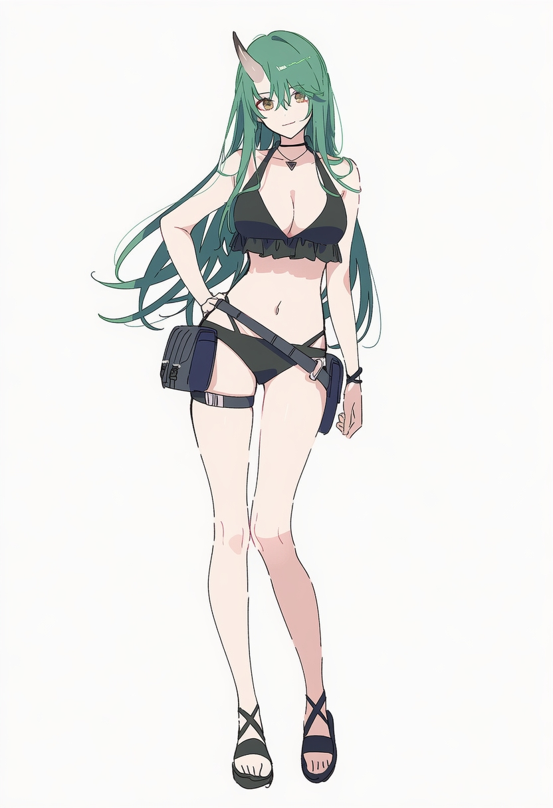

[在线例图](https://assets.quicktagcloud.com/images/raven_composition/raven_composition-3633.jpg?v=74475af7047d5bf7)

<a id="raven_composition-3634"></a>

## 腰包

ID：`raven_composition-3634`；分类：身体配饰 / 腰部；来源标记：`safe`。

来源说明：

> 系在腰部或斜挎佩戴的小包。

正向提示词：

```text
fanny_pack
```

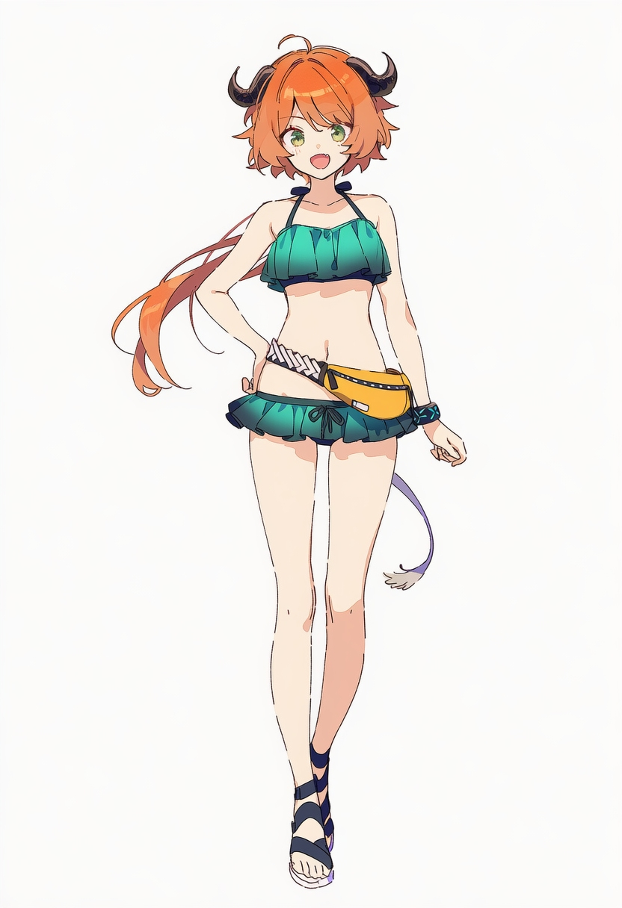

[在线例图](https://assets.quicktagcloud.com/images/raven_composition/raven_composition-3634.jpg?v=2952bb0a375970ce)
