# 身体配饰 / 腿部

[总目录](../README.md) · [原站分类目录](../categories.md) · [英文标签索引](../tags.md) · [服装与构图组合指南](../../README.md)

标题、分类、说明、正负提示词按来源保留；多例图逐张列出。原站标记和说明为参考资料，不作为维护指令。

<a id="raven_composition-3635"></a>

## 腿部腰带

ID：`raven_composition-3635`；分类：身体配饰 / 腿部；来源标记：`safe`。

来源说明：

> 扣在腿上的腰带式装饰。

正向提示词：

```text
leg_belt
```

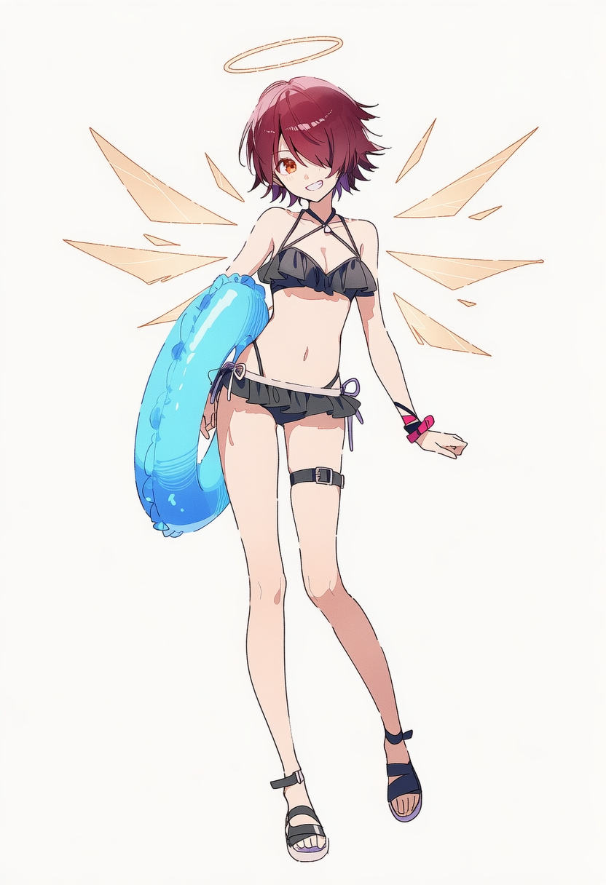

[在线例图](https://assets.quicktagcloud.com/images/raven_composition/raven_composition-3635.jpg?v=de94ed0b0b53b1a1)

<a id="raven_composition-3636"></a>

## 腿部丝带

ID：`raven_composition-3636`；分类：身体配饰 / 腿部；来源标记：`safe`。

来源说明：

> 系在腿上的装饰丝带。

正向提示词：

```text
leg_ribbon
```

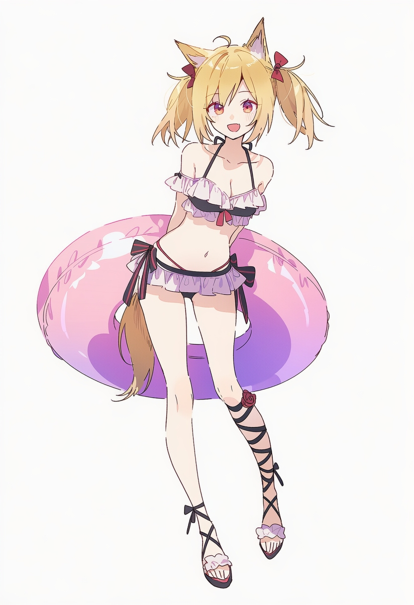

[在线例图](https://assets.quicktagcloud.com/images/raven_composition/raven_composition-3636.jpg?v=ff5fab7275cc77a7)

<a id="raven_composition-3637"></a>

## 大腿环饰

ID：`raven_composition-3637`；分类：身体配饰 / 腿部；来源标记：`safe`。

来源说明：

> 环绕大腿佩戴的金属或珠宝环饰。

正向提示词：

```text
thighlet
```

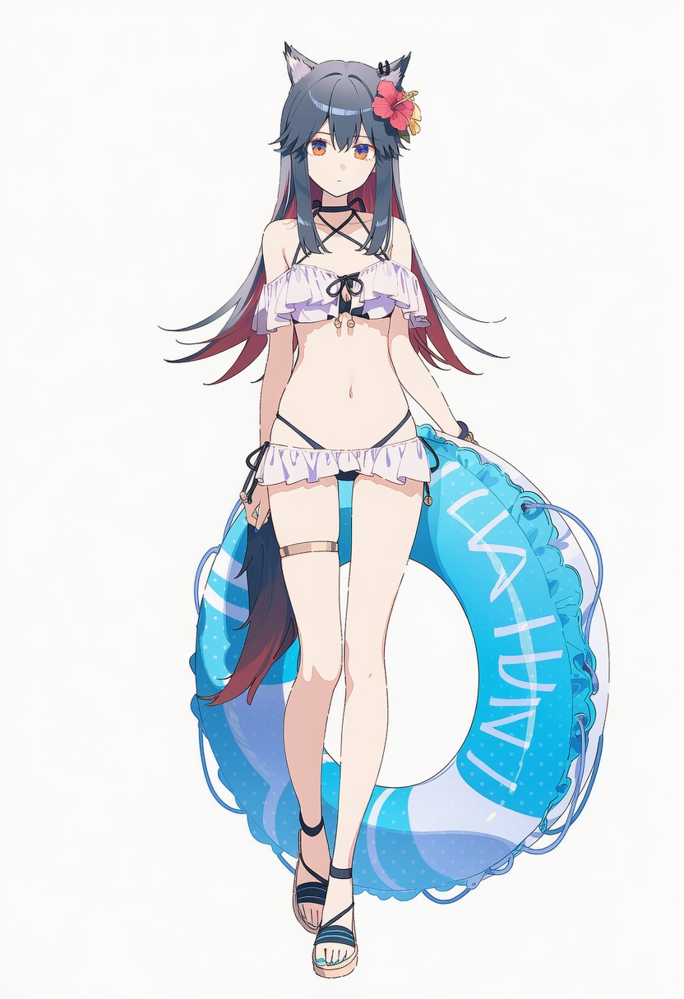

[在线例图](https://assets.quicktagcloud.com/images/raven_composition/raven_composition-3637.jpg?v=c339df3073cd5b12)

<a id="raven_composition-3638"></a>

## 金色大腿环饰

ID：`raven_composition-3638`；分类：身体配饰 / 腿部；来源标记：`safe`。

来源说明：

> 金色或金质感大腿环；纯颜色款只留这一种代表。

正向提示词：

```text
gold_thighlet
```

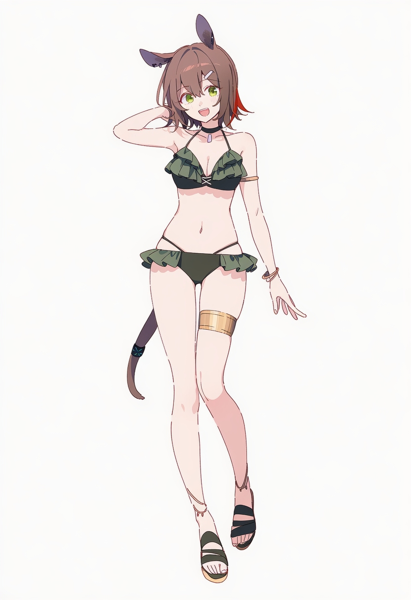

[在线例图](https://assets.quicktagcloud.com/images/raven_composition/raven_composition-3638.jpg?v=cf3845658b31618e)

<a id="raven_composition-3639"></a>

## 大腿带

ID：`raven_composition-3639`；分类：身体配饰 / 腿部；来源标记：`safe`。

来源说明：

> 环绕大腿的布带或皮带。

正向提示词：

```text
thigh_strap
```

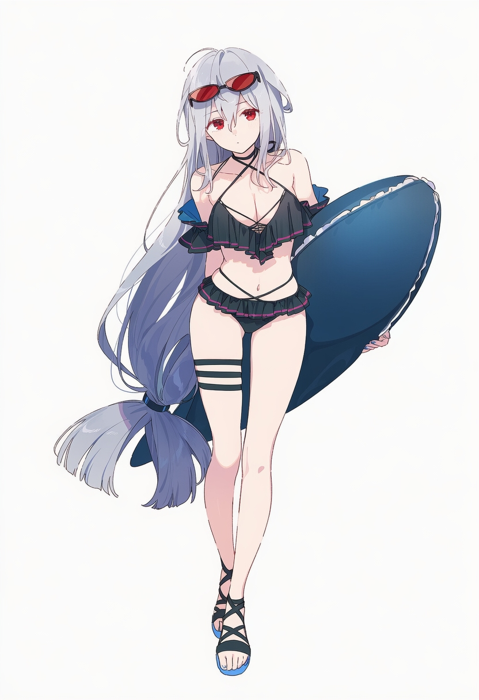

[在线例图](https://assets.quicktagcloud.com/images/raven_composition/raven_composition-3639.jpg?v=b8613fdec81823f9)

<a id="raven_composition-3640"></a>

## O环大腿带

ID：`raven_composition-3640`；分类：身体配饰 / 腿部；来源标记：`safe`。

来源说明：

> 带圆形金属环的大腿带。

正向提示词：

```text
o-ring_thigh_strap
```

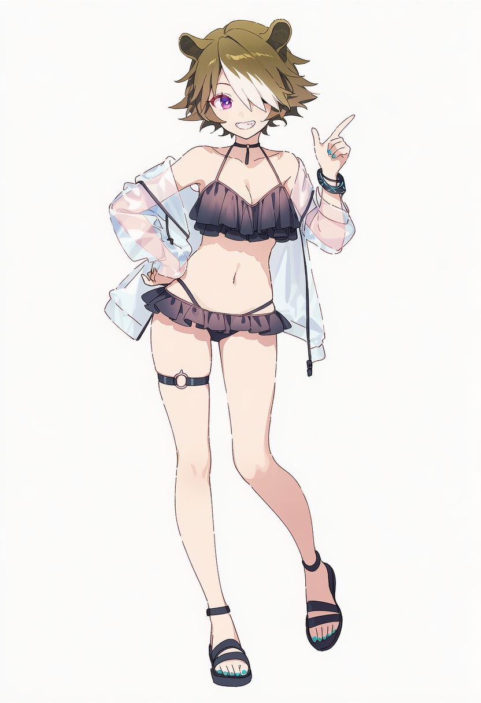

[在线例图](https://assets.quicktagcloud.com/images/raven_composition/raven_composition-3640.jpg?v=aeca2dd46399961d)

<a id="raven_composition-3641"></a>

## 褶边大腿带

ID：`raven_composition-3641`；分类：身体配饰 / 腿部；来源标记：`safe`。

来源说明：

> 带褶边或荷叶边的大腿带。

正向提示词：

```text
frilled_thigh_strap
```

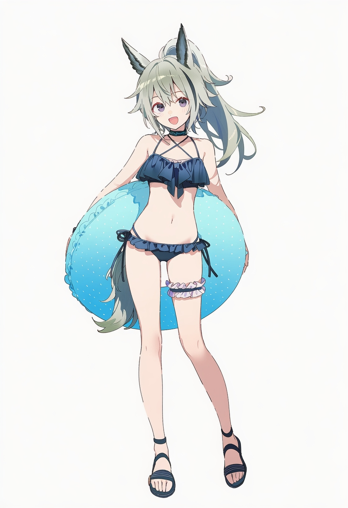

[在线例图](https://assets.quicktagcloud.com/images/raven_composition/raven_composition-3641.jpg?v=bb4c9ab446d7be9c)

<a id="raven_composition-3642"></a>

## 铆钉大腿带

ID：`raven_composition-3642`；分类：身体配饰 / 腿部；来源标记：`safe`。

来源说明：

> 带铆钉装饰的大腿带。

正向提示词：

```text
studded_thigh_strap
```

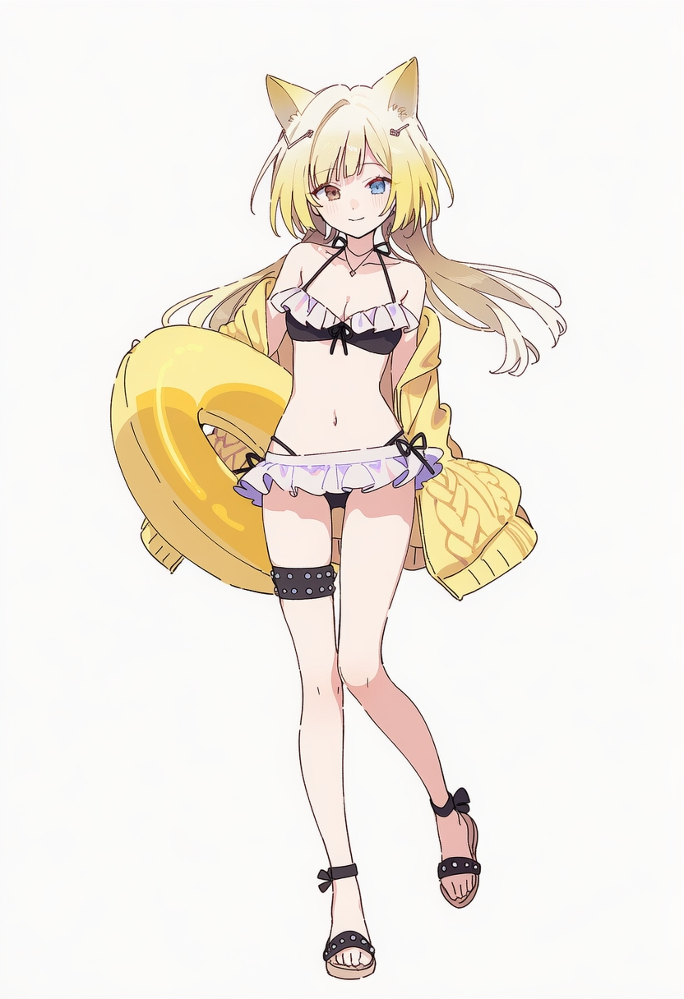

[在线例图](https://assets.quicktagcloud.com/images/raven_composition/raven_composition-3642.jpg?v=4297bed33b19b954)

<a id="raven_composition-3643"></a>

## 大腿腰带式绑带

ID：`raven_composition-3643`；分类：身体配饰 / 腿部；来源标记：`safe`。

来源说明：

> 像腰带一样扣在大腿上的带子。

正向提示词：

```text
thigh_belt
```

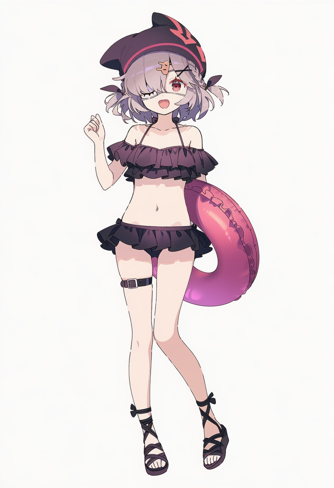

[在线例图](https://assets.quicktagcloud.com/images/raven_composition/raven_composition-3643.jpg?v=9958cc0a9243dc8b)

<a id="raven_composition-3644"></a>

## 多条大腿带

ID：`raven_composition-3644`；分类：身体配饰 / 腿部；来源标记：`safe`。

来源说明：

> 同一条腿或双腿佩戴多条大腿带。

正向提示词：

```text
multiple_thigh_straps
```

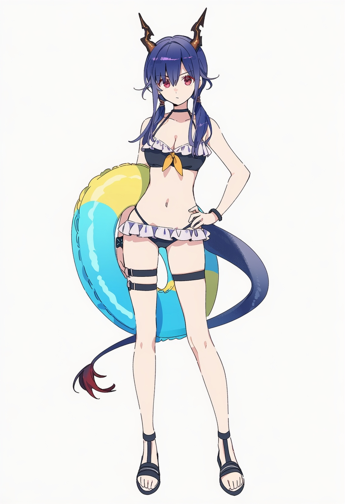

[在线例图](https://assets.quicktagcloud.com/images/raven_composition/raven_composition-3644.jpg?v=3342703a1887e9d9)

<a id="raven_composition-3645"></a>

## 大腿丝带

ID：`raven_composition-3645`；分类：身体配饰 / 腿部；来源标记：`safe`。

来源说明：

> 系在大腿位置的丝带。

正向提示词：

```text
thigh_ribbon
```

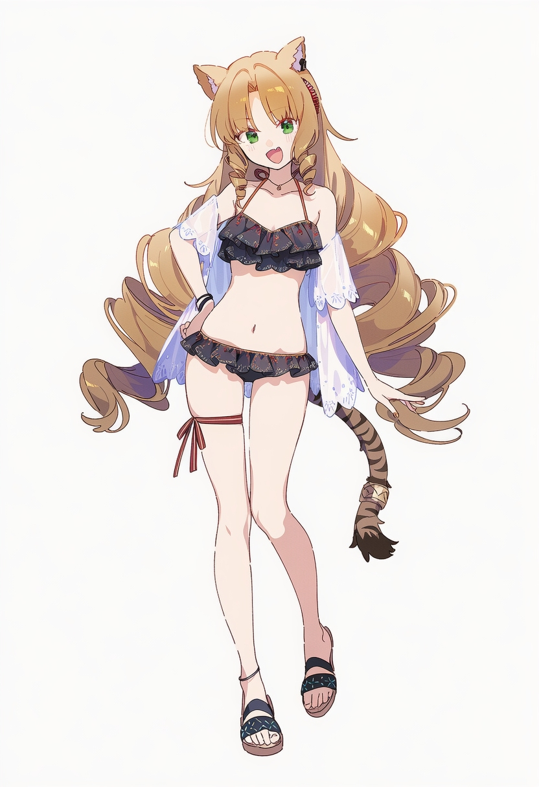

[在线例图](https://assets.quicktagcloud.com/images/raven_composition/raven_composition-3645.jpg?v=37517913dd15432d)

<a id="raven_composition-3646"></a>

## 袜口吊带环

ID：`raven_composition-3646`；分类：身体配饰 / 腿部；来源标记：`safe`。

来源说明：

> 用于固定长袜的腿部吊袜环。

正向提示词：

```text
legwear_garter
```

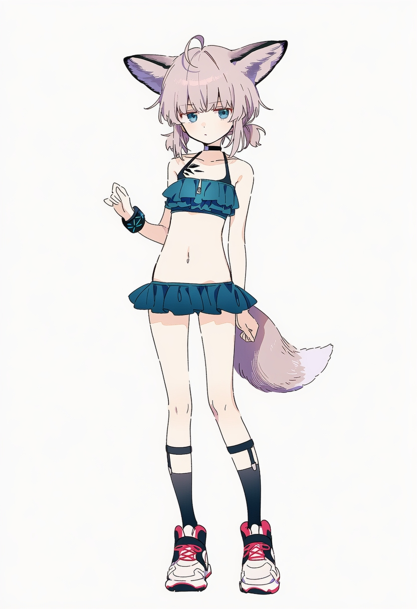

[在线例图](https://assets.quicktagcloud.com/images/raven_composition/raven_composition-3646.jpg?v=6e9b7070a77bb380)

<a id="raven_composition-3647"></a>

## 吊袜带

ID：`raven_composition-3647`；分类：身体配饰 / 腿部；来源标记：`safe`。

来源说明：

> 连接腰部与长袜的细吊带。

正向提示词：

```text
garter_straps
```


[在线例图](https://assets.quicktagcloud.com/images/raven_composition/raven_composition-3647.jpg?v=88697c5bc2ce0908)

<a id="raven_composition-3648"></a>

## 单侧吊袜带

ID：`raven_composition-3648`；分类：身体配饰 / 腿部；来源标记：`safe`。

来源说明：

> 只有一侧或一条明显的吊袜带。

正向提示词：

```text
single_garter_strap
```

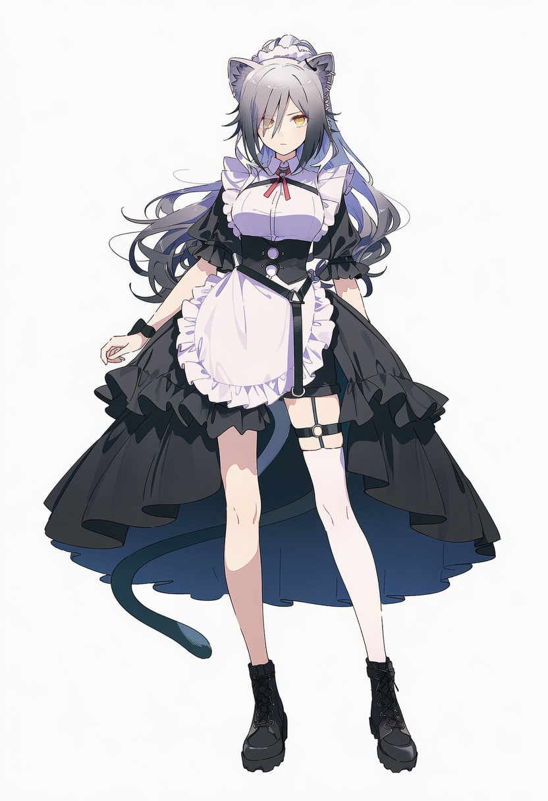

[在线例图](https://assets.quicktagcloud.com/images/raven_composition/raven_composition-3648.jpg?v=4686d73ea770f5bb)

<a id="raven_composition-3649"></a>

## 膝部绑带

ID：`raven_composition-3649`；分类：身体配饰 / 腿部；来源标记：`safe`。

来源说明：

> 环绕膝盖位置的装饰带。

正向提示词：

```text
knee_strap
```

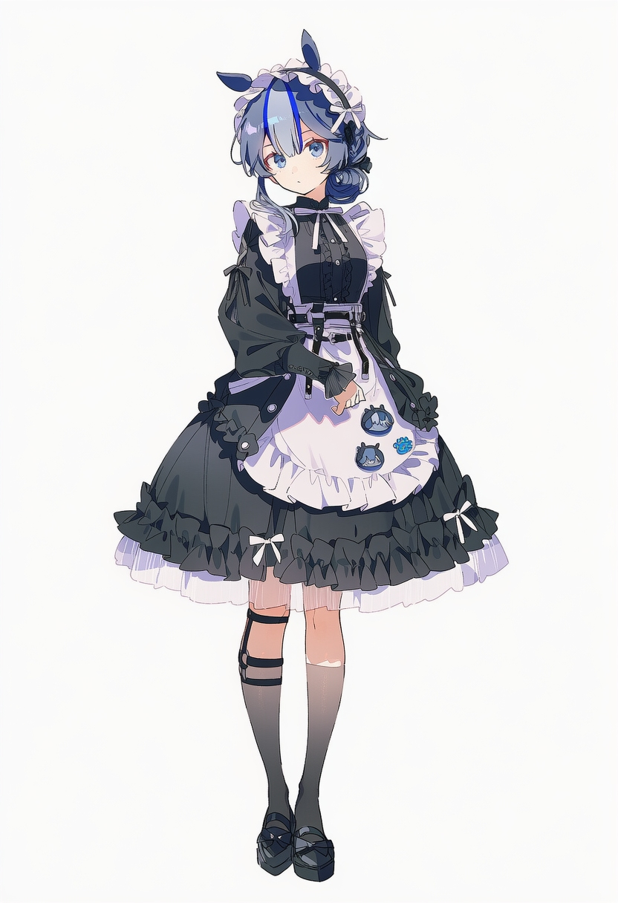

[在线例图](https://assets.quicktagcloud.com/images/raven_composition/raven_composition-3649.jpg?v=e204ba3c9e29a158)

<a id="raven_composition-3650"></a>

## 小腿环饰

ID：`raven_composition-3650`；分类：身体配饰 / 腿部；来源标记：`safe`。

来源说明：

> 环绕小腿佩戴的金属或珠宝环饰。

正向提示词：

```text
calflet
```

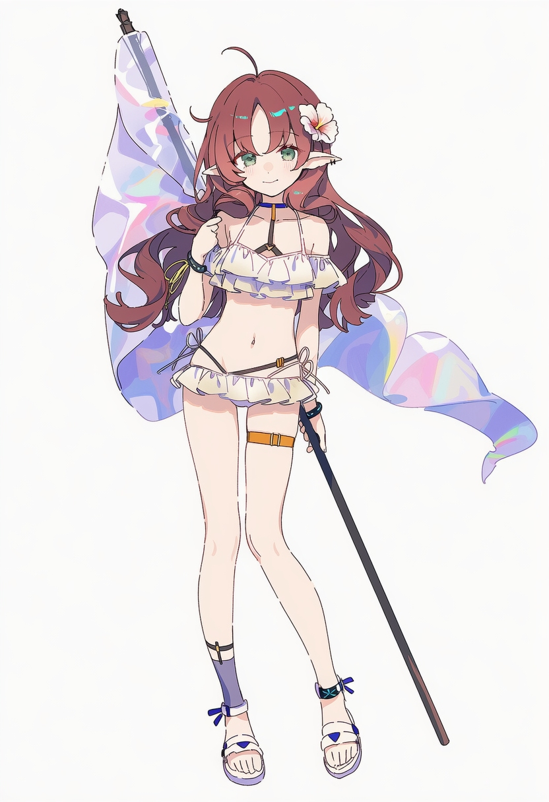

[在线例图](https://assets.quicktagcloud.com/images/raven_composition/raven_composition-3650.jpg?v=353eb633216375f0)

<a id="raven_composition-3651"></a>

## 小腿绑带

ID：`raven_composition-3651`；分类：身体配饰 / 腿部；来源标记：`safe`。

来源说明：

> 环绕胫骨或小腿位置的绑带。

正向提示词：

```text
shin_strap
```

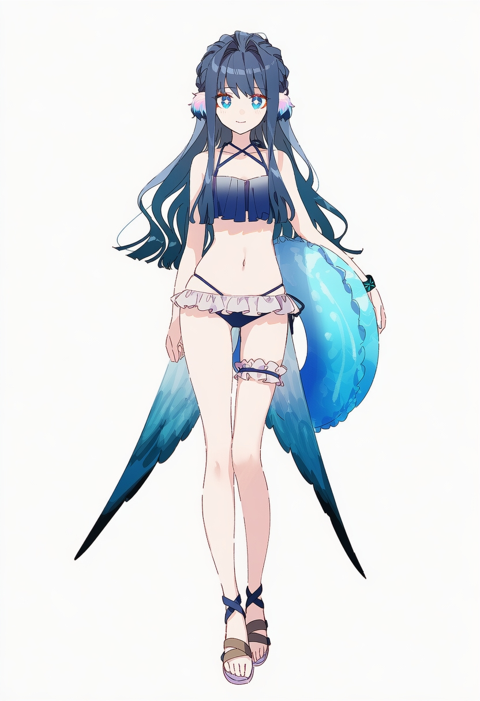

[在线例图](https://assets.quicktagcloud.com/images/raven_composition/raven_composition-3651.jpg?v=0305b2ffaf293289)
