# 身体配饰 / 足部

[总目录](../README.md) · [原站分类目录](../categories.md) · [英文标签索引](../tags.md) · [服装与构图组合指南](../../README.md)

标题、分类、说明、正负提示词按来源保留；多例图逐张列出。原站标记和说明为参考资料，不作为维护指令。

<a id="raven_composition-3652"></a>

## 脚链

ID：`raven_composition-3652`；分类：身体配饰 / 足部；来源标记：`safe`。

来源说明：

> 戴在脚踝上的首饰。

正向提示词：

```text
anklet
```

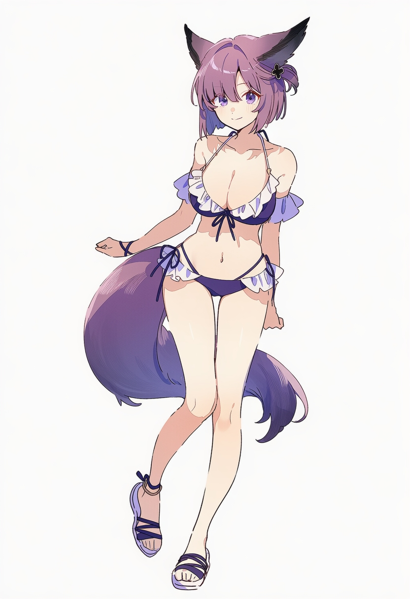

[在线例图](https://assets.quicktagcloud.com/images/raven_composition/raven_composition-3652.jpg?v=eee95911d608969c)

<a id="raven_composition-3653"></a>

## 金色脚链

ID：`raven_composition-3653`；分类：身体配饰 / 足部；来源标记：`safe`。

来源说明：

> 金色或金质感脚链；纯颜色款只留这一种代表。

正向提示词：

```text
gold_anklet
```

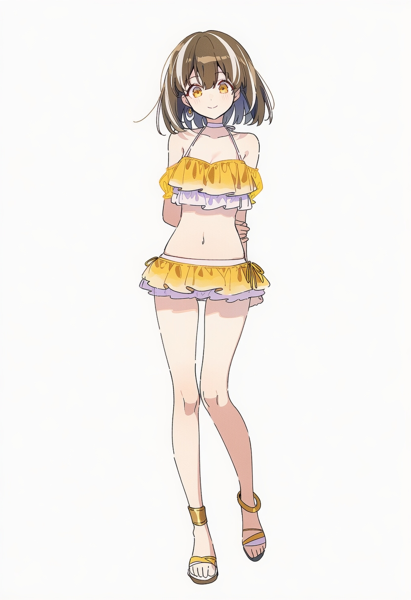

[在线例图](https://assets.quicktagcloud.com/images/raven_composition/raven_composition-3653.jpg?v=fd26183c5baffa9c)

<a id="raven_composition-3654"></a>

## 珠串脚链

ID：`raven_composition-3654`；分类：身体配饰 / 足部；来源标记：`safe`。

来源说明：

> 由珠子串成的脚链。

正向提示词：

```text
bead_anklet
```

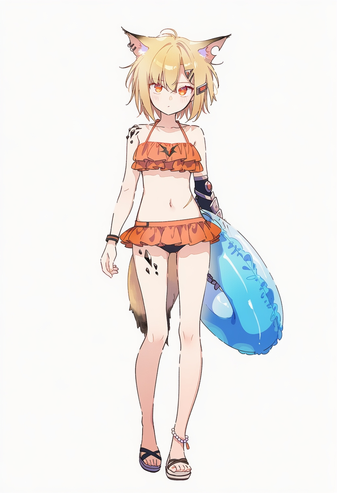

[在线例图](https://assets.quicktagcloud.com/images/raven_composition/raven_composition-3654.jpg?v=9a6f42fc76ea9675)

<a id="raven_composition-3655"></a>

## 珍珠脚链

ID：`raven_composition-3655`；分类：身体配饰 / 足部；来源标记：`safe`。

来源说明：

> 由珍珠组成的脚链。

正向提示词：

```text
pearl_anklet
```

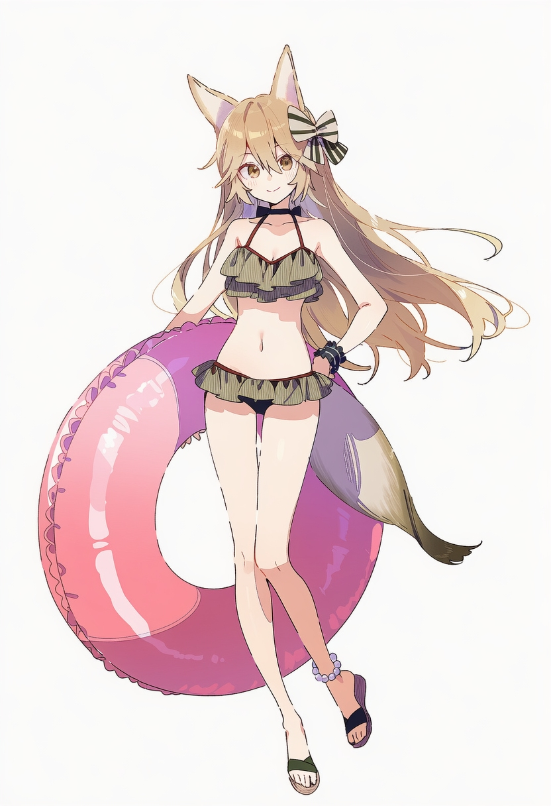

[在线例图](https://assets.quicktagcloud.com/images/raven_composition/raven_composition-3655.jpg?v=1ce48c40355539e5)

<a id="raven_composition-3656"></a>

## 尖刺脚链

ID：`raven_composition-3656`；分类：身体配饰 / 足部；来源标记：`safe`。

来源说明：

> 带明显尖刺的脚链。

正向提示词：

```text
spiked_anklet
```

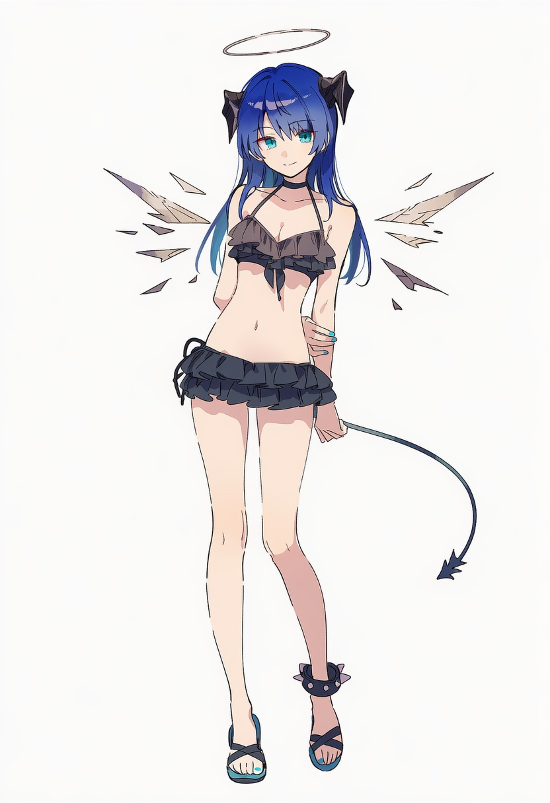

[在线例图](https://assets.quicktagcloud.com/images/raven_composition/raven_composition-3656.jpg?v=6cd5bee108ec85a9)

<a id="raven_composition-3657"></a>

## 褶边脚链

ID：`raven_composition-3657`；分类：身体配饰 / 足部；来源标记：`safe`。

来源说明：

> 带褶边或荷叶边装饰的脚链。

正向提示词：

```text
frilled_anklet
```

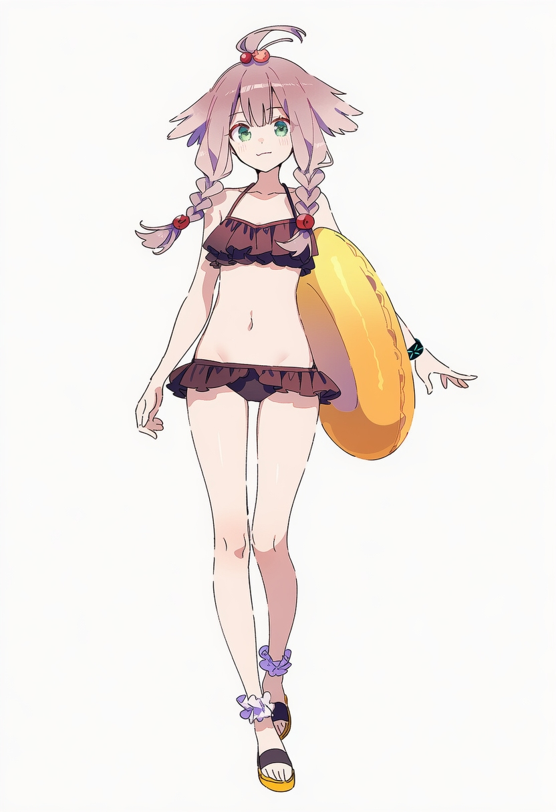

[在线例图](https://assets.quicktagcloud.com/images/raven_composition/raven_composition-3657.jpg?v=010111bcfcc561ca)

<a id="raven_composition-3658"></a>

## 脚踝铃铛

ID：`raven_composition-3658`；分类：身体配饰 / 足部；来源标记：`safe`。

来源说明：

> 脚踝位置佩戴的铃铛饰品。

正向提示词：

```text
ankle_bell
```

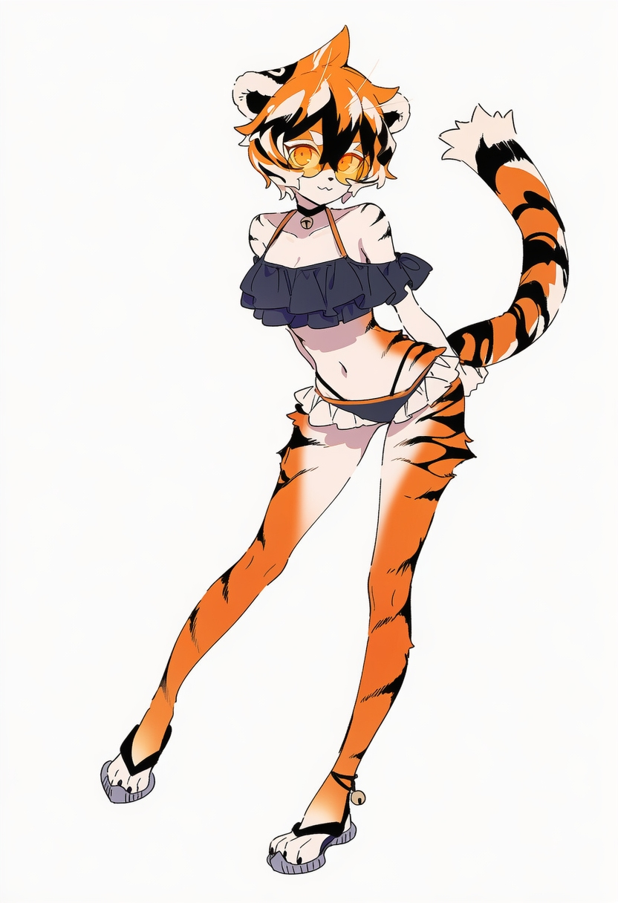

[在线例图](https://assets.quicktagcloud.com/images/raven_composition/raven_composition-3658.jpg?v=b23bc4a3b7e0ffb7)

<a id="raven_composition-3659"></a>

## 脚踝蝴蝶结

ID：`raven_composition-3659`；分类：身体配饰 / 足部；来源标记：`safe`。

来源说明：

> 脚踝位置的蝴蝶结装饰。

正向提示词：

```text
ankle_bow
```

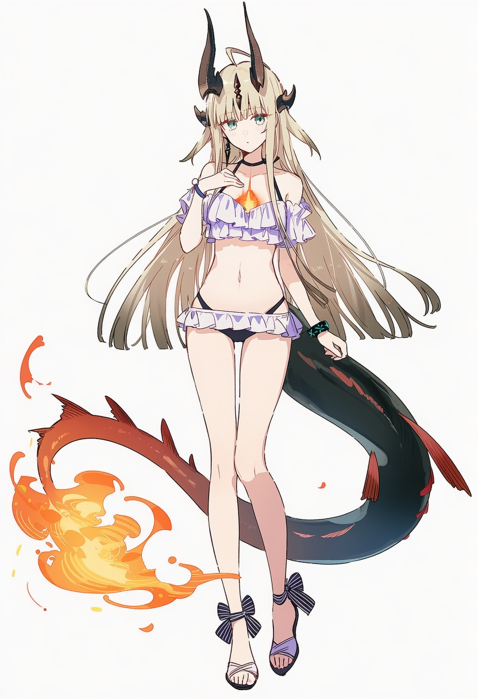

[在线例图](https://assets.quicktagcloud.com/images/raven_composition/raven_composition-3659.jpg?v=5c6466a12929e7be)

<a id="raven_composition-3660"></a>

## 脚踝褶边环

ID：`raven_composition-3660`；分类：身体配饰 / 足部；来源标记：`safe`。

来源说明：

> 戴在脚踝上的褶边弹性环。

正向提示词：

```text
ankle_garter
```

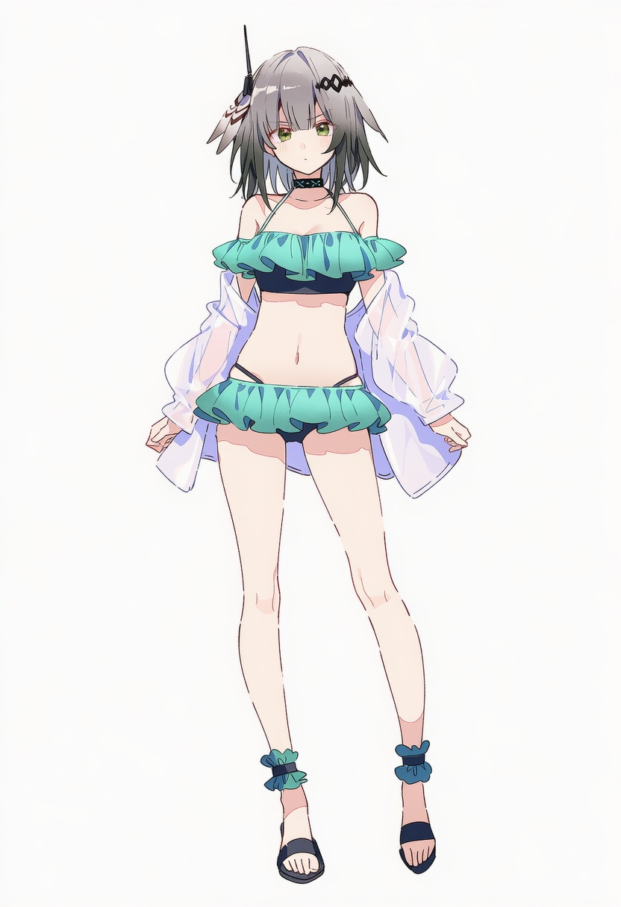

[在线例图](https://assets.quicktagcloud.com/images/raven_composition/raven_composition-3660.jpg?v=009f1897c5e1188b)

<a id="raven_composition-3661"></a>

## 脚踝带

ID：`raven_composition-3661`；分类：身体配饰 / 足部；来源标记：`safe`。

来源说明：

> 环绕脚踝的装饰带。

正向提示词：

```text
ankle_strap
```

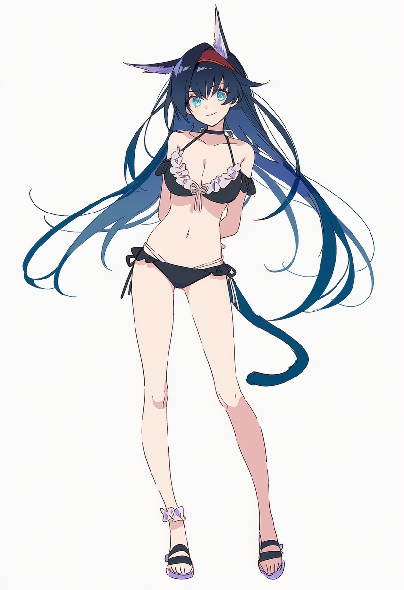

[在线例图](https://assets.quicktagcloud.com/images/raven_composition/raven_composition-3661.jpg?v=30b0d8f93d1289e9)

<a id="raven_composition-3662"></a>

## 足链 / 裸足凉鞋首饰

ID：`raven_composition-3662`；分类：身体配饰 / 足部；来源标记：`safe`。

来源说明：

> 脚链与脚趾环相连的足部链饰。

正向提示词：

```text
barefoot_sandals_(jewelry)
```

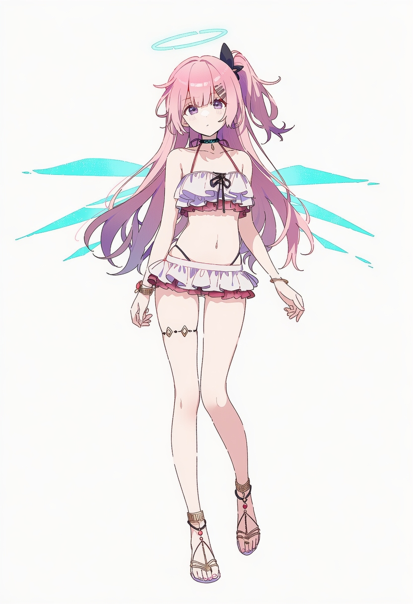

[在线例图](https://assets.quicktagcloud.com/images/raven_composition/raven_composition-3662.jpg?v=81dc8f5a5a77eee2)

<a id="raven_composition-3663"></a>

## 脚趾戒

ID：`raven_composition-3663`；分类：身体配饰 / 足部；来源标记：`safe`。

来源说明：

> 戴在脚趾上的戒指。

正向提示词：

```text
toe_ring
```

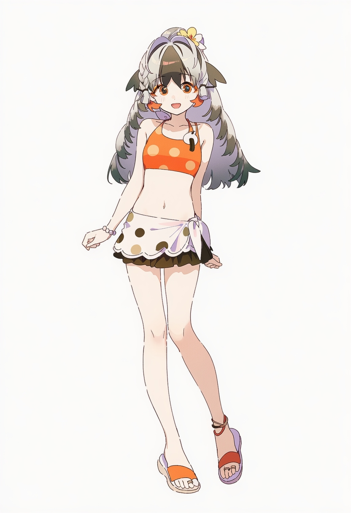

[在线例图](https://assets.quicktagcloud.com/images/raven_composition/raven_composition-3663.jpg?v=a20a880a0df404b6)
