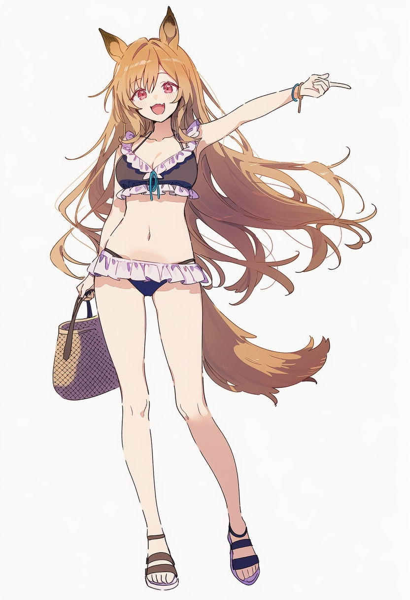
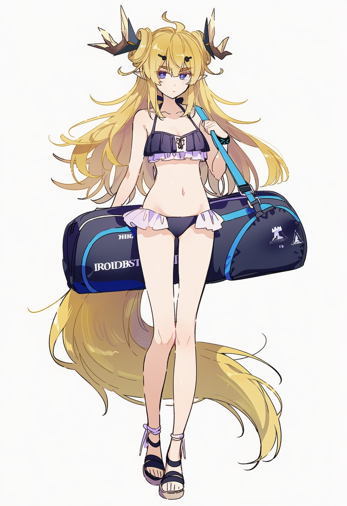
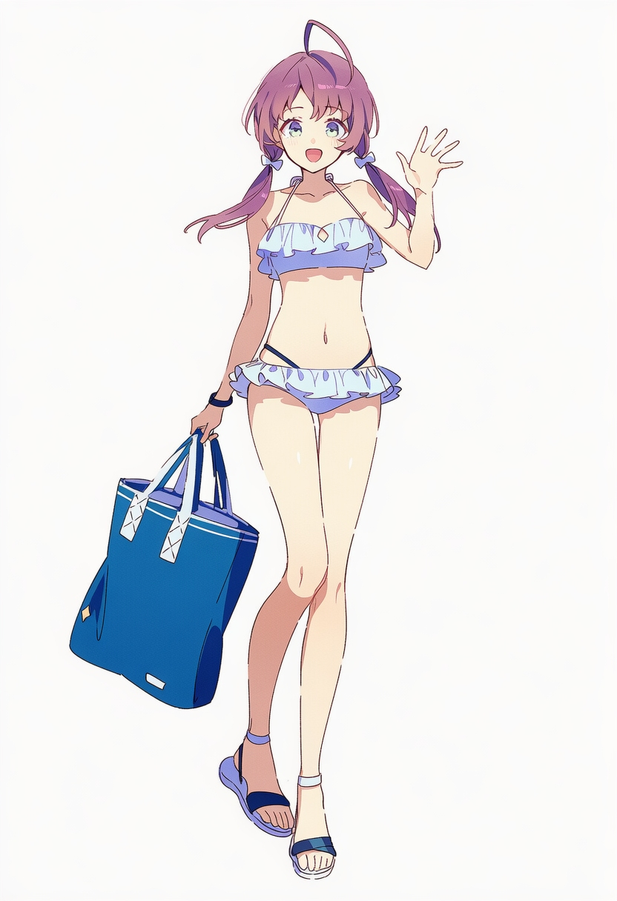

# 身体配饰 / 手持

[总目录](../README.md) · [原站分类目录](../categories.md) · [英文标签索引](../tags.md) · [服装与构图组合指南](../../README.md)

标题、分类、说明、正负提示词按来源保留；多例图逐张列出。原站标记和说明为参考资料，不作为维护指令。

<a id="raven_composition-3664"></a>

## 公文包

ID：`raven_composition-3664`；分类：身体配饰 / 手持；来源标记：`safe`。

来源说明：

> 硬挺的手提公文包。

正向提示词：

```text
briefcase
```


[在线例图](https://assets.quicktagcloud.com/images/raven_composition/raven_composition-3664.jpg?v=76fd8e26864f891e)

<a id="raven_composition-3665"></a>

## 手提包

ID：`raven_composition-3665`；分类：身体配饰 / 手持；来源标记：`safe`。

来源说明：

> 主要用手提着的小型包。

正向提示词：

```text
handbag
```



[在线例图](https://assets.quicktagcloud.com/images/raven_composition/raven_composition-3665.jpg?v=112640fefcae285c)

<a id="raven_composition-3666"></a>

## 旅行筒包

ID：`raven_composition-3666`；分类：身体配饰 / 手持；来源标记：`safe`。

来源说明：

> 长筒形或软质的大型旅行包。

正向提示词：

```text
duffel_bag
```



[在线例图](https://assets.quicktagcloud.com/images/raven_composition/raven_composition-3666.jpg?v=ba5db8f64d864bf1)

<a id="raven_composition-3667"></a>

## 托特包

ID：`raven_composition-3667`；分类：身体配饰 / 手持；来源标记：`safe`。

来源说明：

> 顶部敞口、双提手的布包。

正向提示词：

```text
tote_bag
```



[在线例图](https://assets.quicktagcloud.com/images/raven_composition/raven_composition-3667.jpg?v=1938073fc64d6144)

<a id="raven_composition-3668"></a>

## 行李箱

ID：`raven_composition-3668`；分类：身体配饰 / 手持；来源标记：`safe`。

来源说明：

> 旅行使用的硬质或软质行李箱。

正向提示词：

```text
suitcase
```


[在线例图](https://assets.quicktagcloud.com/images/raven_composition/raven_composition-3668.jpg?v=2212a0074512b535)

<a id="raven_composition-3669"></a>

## 购物袋

ID：`raven_composition-3669`；分类：身体配饰 / 手持；来源标记：`safe`。

来源说明：

> 商店购物时使用的手提袋。

正向提示词：

```text
shopping_bag
```


[在线例图](https://assets.quicktagcloud.com/images/raven_composition/raven_composition-3669.jpg?v=ea074565741050ee)
