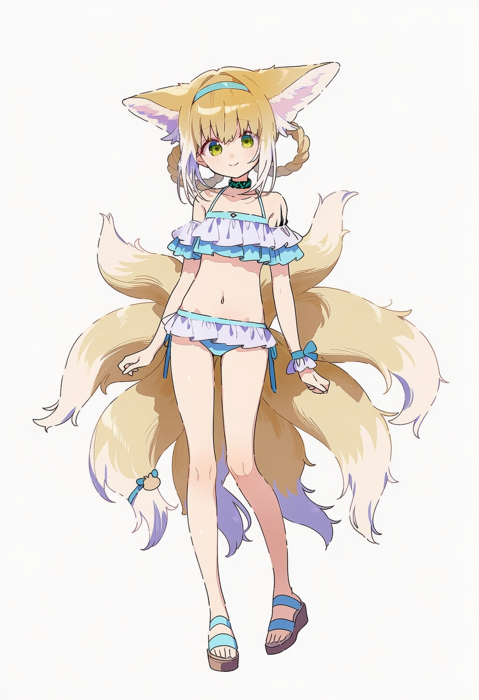

# 身体配饰 / 尾部

[总目录](../README.md) · [原站分类目录](../categories.md) · [英文标签索引](../tags.md) · [服装与构图组合指南](../../README.md)

标题、分类、说明、正负提示词按来源保留；多例图逐张列出。原站标记和说明为参考资料，不作为维护指令。

<a id="raven_composition-3670"></a>

## 尾巴装饰

ID：`raven_composition-3670`；分类：身体配饰 / 尾部；来源标记：`safe`。

来源说明：

> 佩戴在尾巴上的装饰物。

正向提示词：

```text
tail_ornament
```



[在线例图](https://assets.quicktagcloud.com/images/raven_composition/raven_composition-3670.jpg?v=cd97ddffe39f038e)

<a id="raven_composition-3671"></a>

## 尾巴蝴蝶结

ID：`raven_composition-3671`；分类：身体配饰 / 尾部；来源标记：`safe`。

来源说明：

> 系在尾巴上的蝴蝶结。

正向提示词：

```text
tail_bow
```


[在线例图](https://assets.quicktagcloud.com/images/raven_composition/raven_composition-3671.jpg?v=73c37c7413b7ccec)
