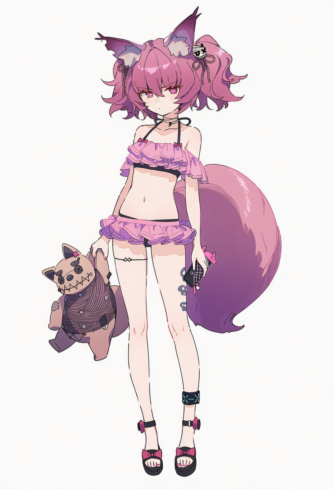

# 身体配饰 / 物件挂饰

[总目录](../README.md) · [原站分类目录](../categories.md) · [英文标签索引](../tags.md) · [服装与构图组合指南](../../README.md)

标题、分类、说明、正负提示词按来源保留；多例图逐张列出。原站标记和说明为参考资料，不作为维护指令。

<a id="raven_composition-3672"></a>

## 挂件

ID：`raven_composition-3672`；分类：身体配饰 / 物件挂饰；来源标记：`safe`。

来源说明：

> 挂在包、腰带或其他物件上的小装饰。

正向提示词：

```text
charm_(object)
```


[在线例图](https://assets.quicktagcloud.com/images/raven_composition/raven_composition-3672.jpg?v=a6eac4a3b8c9bfce)

<a id="raven_composition-3673"></a>

## 手机挂绳

ID：`raven_composition-3673`；分类：身体配饰 / 物件挂饰；来源标记：`safe`。

来源说明：

> 连接手机的装饰挂绳。

正向提示词：

```text
cellphone_strap
```



[在线例图](https://assets.quicktagcloud.com/images/raven_composition/raven_composition-3673.jpg?v=d2b4aa037a974bcd)
