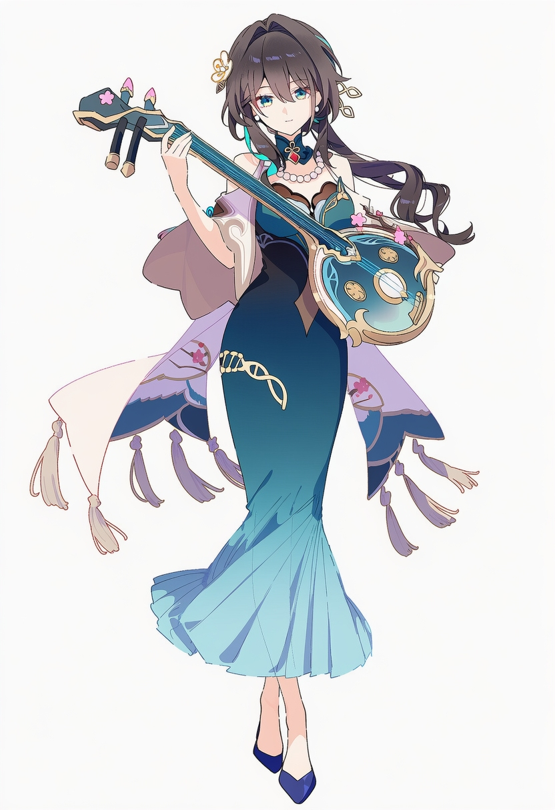
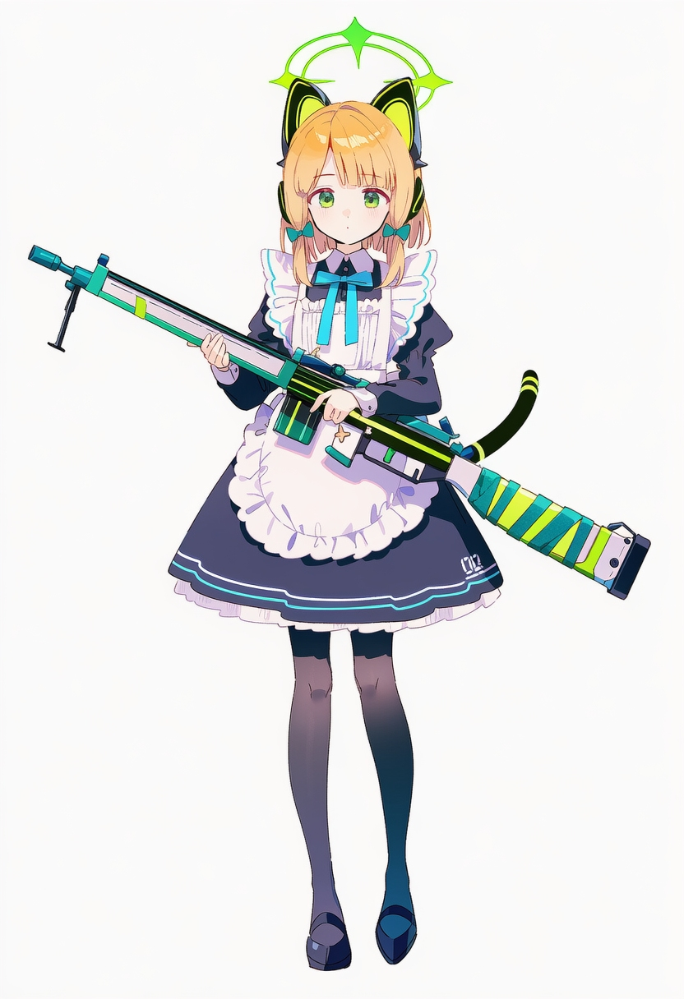
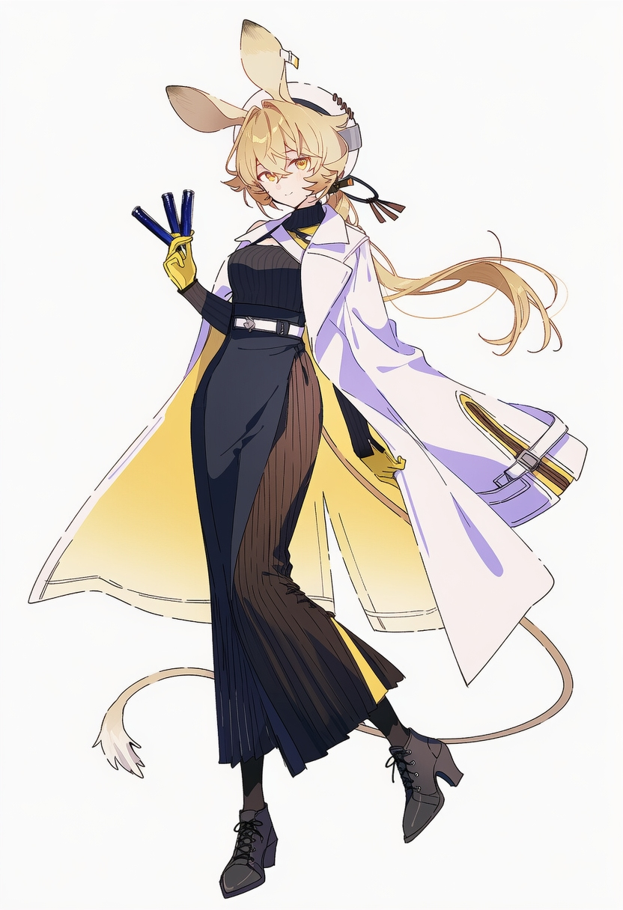
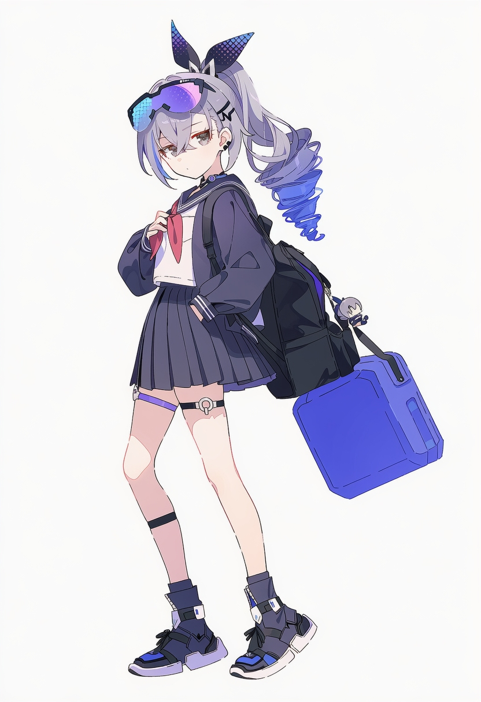
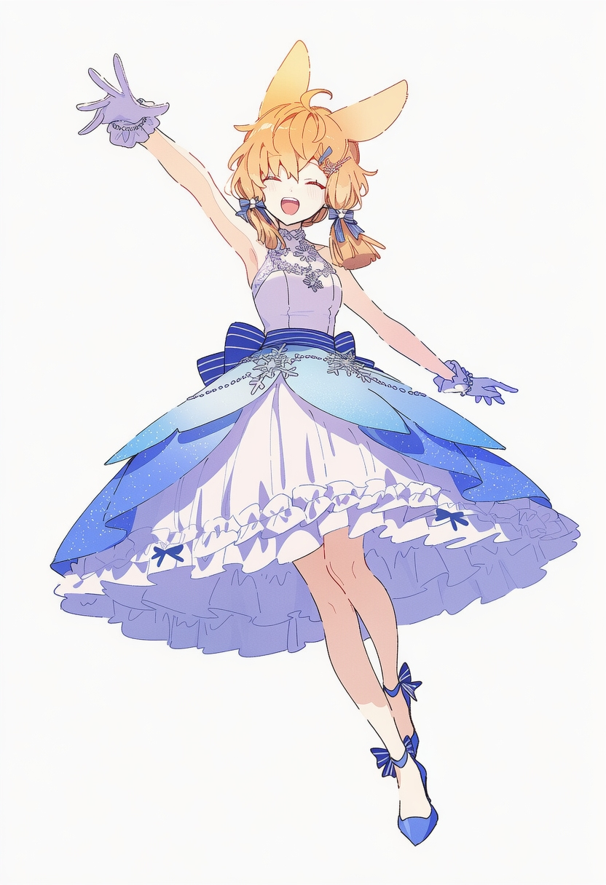
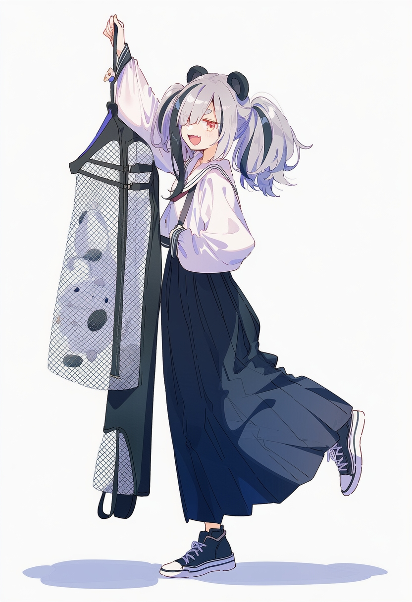

# 物体互动 / 通用持物/拿取

[总目录](../README.md) · [原站分类目录](../categories.md) · [英文标签索引](../tags.md) · [服装与构图组合指南](../../README.md)

标题、分类、说明、正负提示词按来源保留；多例图逐张列出。原站标记和说明为参考资料，不作为维护指令。

<a id="raven_composition-3674"></a>

## 持物

ID：`raven_composition-3674`；分类：物体互动 / 通用持物/拿取；来源标记：`safe`。

来源说明：

> 角色用手拿着可携带物体。

正向提示词：

```text
holding
```



[在线例图](https://assets.quicktagcloud.com/images/raven_composition/raven_composition-3674.jpg?v=8fa11c4be650f511)

<a id="raven_composition-3675"></a>

## 双手握持

ID：`raven_composition-3675`；分类：物体互动 / 通用持物/拿取；来源标记：`safe`。

来源说明：

> 用双手握持同一个物体。

正向提示词：

```text
two-handed
```



[在线例图](https://assets.quicktagcloud.com/images/raven_composition/raven_composition-3675.jpg?v=5b0728de60545054)

<a id="raven_composition-3676"></a>

## 夹在手指间

ID：`raven_composition-3676`；分类：物体互动 / 通用持物/拿取；来源标记：`safe`。

来源说明：

> 把小物体夹在手指之间。

正向提示词：

```text
between_fingers
```



[在线例图](https://assets.quicktagcloud.com/images/raven_composition/raven_composition-3676.jpg?v=99b81dbf28169033)

<a id="raven_composition-3677"></a>

## 抓取

ID：`raven_composition-3677`；分类：物体互动 / 通用持物/拿取；来源标记：`safe`。

来源说明：

> 主动伸手抓住物体。

正向提示词：

```text
grabbing
```



[在线例图](https://assets.quicktagcloud.com/images/raven_composition/raven_composition-3677.jpg?v=d8294c858cfd3fdf)

<a id="raven_composition-3678"></a>

## 携带

ID：`raven_composition-3678`；分类：物体互动 / 通用持物/拿取；来源标记：`safe`。

来源说明：

> 角色正在携带物体。

正向提示词：

```text
carrying
```


[在线例图](https://assets.quicktagcloud.com/images/raven_composition/raven_composition-3678.jpg?v=e27e96cfc53a355c)

<a id="raven_composition-3679"></a>

## 扛在肩上

ID：`raven_composition-3679`；分类：物体互动 / 通用持物/拿取；来源标记：`safe`。

来源说明：

> 把物体扛在肩膀上携带。

正向提示词：

```text
carrying_over_shoulder
```


[在线例图](https://assets.quicktagcloud.com/images/raven_composition/raven_composition-3679.jpg?v=7edc3afe0aef2359)

<a id="raven_composition-3680"></a>

## 夹在腋下

ID：`raven_composition-3680`；分类：物体互动 / 通用持物/拿取；来源标记：`safe`。

来源说明：

> 把物体夹在腋下携带。

正向提示词：

```text
carrying_under_arm
```


[在线例图](https://assets.quicktagcloud.com/images/raven_composition/raven_composition-3680.jpg?v=9689ff35fde412e1)

<a id="raven_composition-3681"></a>

## 伸手去拿

ID：`raven_composition-3681`；分类：物体互动 / 通用持物/拿取；来源标记：`safe`。

来源说明：

> 伸手朝某个物体去拿。

正向提示词：

```text
reaching_for
```



[在线例图](https://assets.quicktagcloud.com/images/raven_composition/raven_composition-3681.jpg?v=bd73b98ee38e3555)

<a id="raven_composition-3682"></a>

## 捡起

ID：`raven_composition-3682`；分类：物体互动 / 通用持物/拿取；来源标记：`safe`。

来源说明：

> 把物体从表面或地面拿起来。

正向提示词：

```text
picking_up
```



[在线例图](https://assets.quicktagcloud.com/images/raven_composition/raven_composition-3682.jpg?v=b93c5852467a9207)

<a id="raven_composition-3683"></a>

## 放下

ID：`raven_composition-3683`；分类：物体互动 / 通用持物/拿取；来源标记：`safe`。

来源说明：

> 把手中的物体放下。

正向提示词：

```text
putting_down
```


[在线例图](https://assets.quicktagcloud.com/images/raven_composition/raven_composition-3683.jpg?v=5ada8954ec93e896)

<a id="raven_composition-3684"></a>

## 递交

ID：`raven_composition-3684`；分类：物体互动 / 通用持物/拿取；来源标记：`safe`。

来源说明：

> 把物体递给另一方。

正向提示词：

```text
passing
```


[在线例图](https://assets.quicktagcloud.com/images/raven_composition/raven_composition-3684.jpg?v=eb49ab79bfe0768b)

<a id="raven_composition-3685"></a>

## 递出 / 提供

ID：`raven_composition-3685`；分类：物体互动 / 通用持物/拿取；来源标记：`safe`。

来源说明：

> 把物体向别人递出或展示。

正向提示词：

```text
offering
```


[在线例图](https://assets.quicktagcloud.com/images/raven_composition/raven_composition-3685.jpg?v=ea66ceb2f87d25b7)
