# 物体互动 / 书写/纸张/电子设备

[总目录](../README.md) · [原站分类目录](../categories.md) · [英文标签索引](../tags.md) · [服装与构图组合指南](../../README.md)

标题、分类、说明、正负提示词按来源保留；多例图逐张列出。原站标记和说明为参考资料，不作为维护指令。

<a id="raven_composition-3686"></a>

## 手持书

ID：`raven_composition-3686`；分类：物体互动 / 书写/纸张/电子设备；来源标记：`safe`。

来源说明：

> 角色用手拿着书。

正向提示词：

```text
holding_book
```


[在线例图](https://assets.quicktagcloud.com/images/raven_composition/raven_composition-3686.jpg?v=a64865d67f63883e)

<a id="raven_composition-3687"></a>

## 手持杂志

ID：`raven_composition-3687`；分类：物体互动 / 书写/纸张/电子设备；来源标记：`safe`。

来源说明：

> 角色用手拿着杂志。

正向提示词：

```text
holding_magazine
```


[在线例图](https://assets.quicktagcloud.com/images/raven_composition/raven_composition-3687.jpg?v=89990ed56a314b7f)

<a id="raven_composition-3688"></a>

## 手持报纸

ID：`raven_composition-3688`；分类：物体互动 / 书写/纸张/电子设备；来源标记：`safe`。

来源说明：

> 角色用手拿着报纸。

正向提示词：

```text
holding_newspaper
```

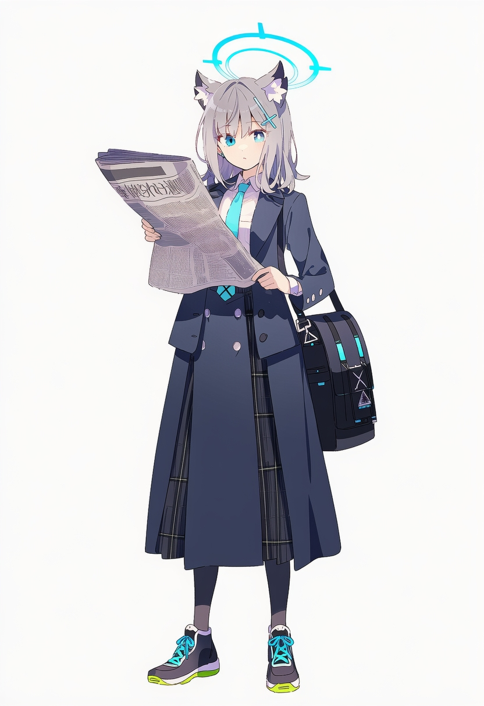

[在线例图](https://assets.quicktagcloud.com/images/raven_composition/raven_composition-3688.jpg?v=236065b72906c18c)

<a id="raven_composition-3689"></a>

## 手持笔记本

ID：`raven_composition-3689`；分类：物体互动 / 书写/纸张/电子设备；来源标记：`safe`。

来源说明：

> 角色用手拿着笔记本。

正向提示词：

```text
holding_notebook
```


[在线例图](https://assets.quicktagcloud.com/images/raven_composition/raven_composition-3689.jpg?v=5e69350eedb18f8f)

<a id="raven_composition-3690"></a>

## 手持便笺本

ID：`raven_composition-3690`；分类：物体互动 / 书写/纸张/电子设备；来源标记：`safe`。

来源说明：

> 角色用手拿着便笺本。

正向提示词：

```text
holding_notepad
```

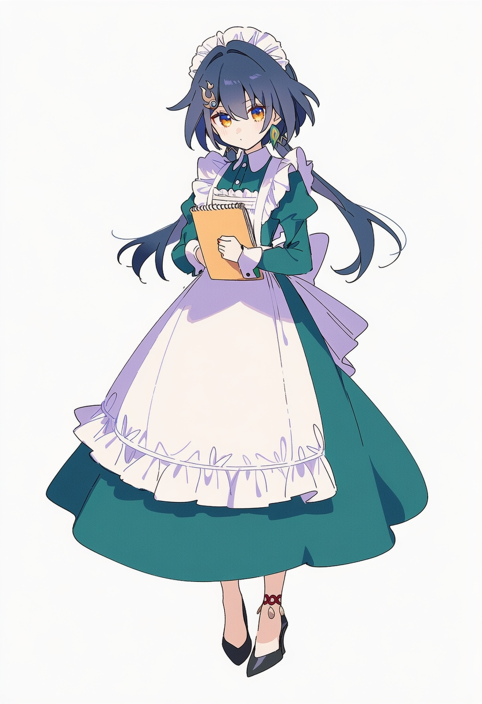

[在线例图](https://assets.quicktagcloud.com/images/raven_composition/raven_composition-3690.jpg?v=23514183bf3016ec)

<a id="raven_composition-3691"></a>

## 手持纸

ID：`raven_composition-3691`；分类：物体互动 / 书写/纸张/电子设备；来源标记：`safe`。

来源说明：

> 角色用手拿着纸。

正向提示词：

```text
holding_paper
```

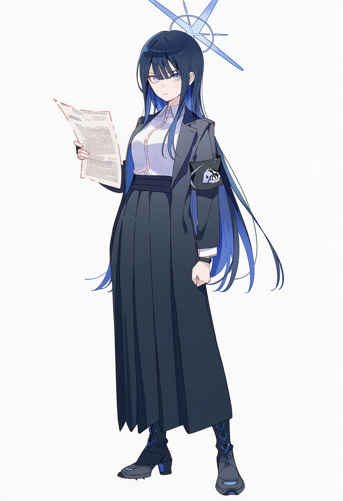

[在线例图](https://assets.quicktagcloud.com/images/raven_composition/raven_composition-3691.jpg?v=4f17a3a71116cc0a)

<a id="raven_composition-3692"></a>

## 手持信

ID：`raven_composition-3692`；分类：物体互动 / 书写/纸张/电子设备；来源标记：`safe`。

来源说明：

> 角色用手拿着信。

正向提示词：

```text
holding_letter
```


[在线例图](https://assets.quicktagcloud.com/images/raven_composition/raven_composition-3692.jpg?v=6d8fc01c89c41ce7)

<a id="raven_composition-3693"></a>

## 手持信封

ID：`raven_composition-3693`；分类：物体互动 / 书写/纸张/电子设备；来源标记：`safe`。

来源说明：

> 角色用手拿着信封。

正向提示词：

```text
holding_envelope
```


[在线例图](https://assets.quicktagcloud.com/images/raven_composition/raven_composition-3693.jpg?v=3f92c4230e262f87)

<a id="raven_composition-3694"></a>

## 手持卷轴

ID：`raven_composition-3694`；分类：物体互动 / 书写/纸张/电子设备；来源标记：`safe`。

来源说明：

> 角色用手拿着卷轴。

正向提示词：

```text
holding_scroll
```

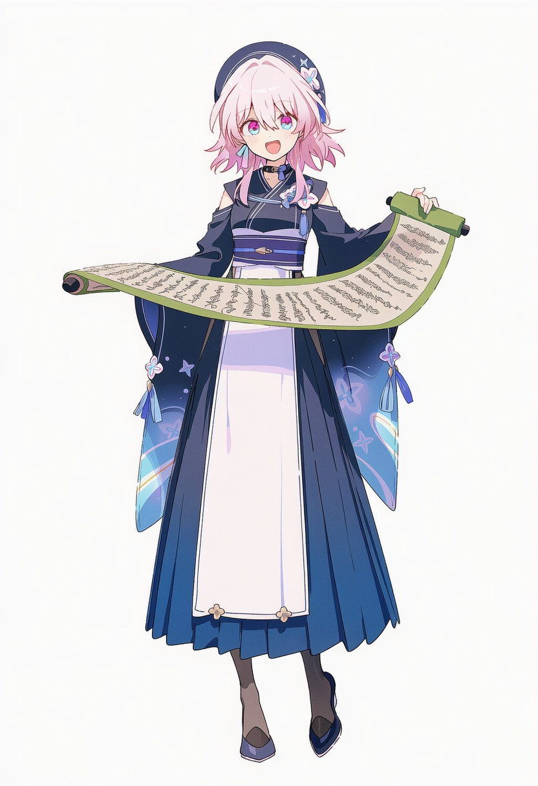

[在线例图](https://assets.quicktagcloud.com/images/raven_composition/raven_composition-3694.jpg?v=70c66ff8a0d5757c)

<a id="raven_composition-3695"></a>

## 手持地图

ID：`raven_composition-3695`；分类：物体互动 / 书写/纸张/电子设备；来源标记：`safe`。

来源说明：

> 角色用手拿着地图。

正向提示词：

```text
holding_map
```


[在线例图](https://assets.quicktagcloud.com/images/raven_composition/raven_composition-3695.jpg?v=6caeda3afd8735ae)

<a id="raven_composition-3696"></a>

## 手持照片

ID：`raven_composition-3696`；分类：物体互动 / 书写/纸张/电子设备；来源标记：`safe`。

来源说明：

> 角色用手拿着照片。

正向提示词：

```text
holding_photo
```


[在线例图](https://assets.quicktagcloud.com/images/raven_composition/raven_composition-3696.jpg?v=8b289f75f574059b)

<a id="raven_composition-3697"></a>

## 手持相框

ID：`raven_composition-3697`；分类：物体互动 / 书写/纸张/电子设备；来源标记：`safe`。

来源说明：

> 角色用手拿着相框。

正向提示词：

```text
holding_picture_frame
```

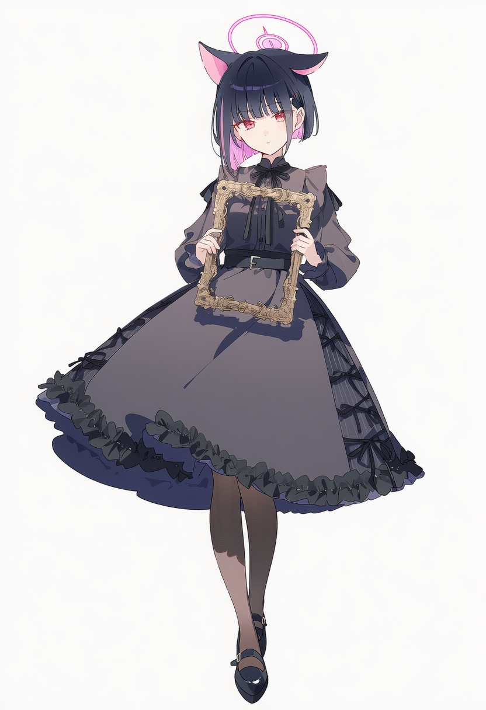

[在线例图](https://assets.quicktagcloud.com/images/raven_composition/raven_composition-3697.jpg?v=a2ec740a5e0a756b)

<a id="raven_composition-3698"></a>

## 手持画作

ID：`raven_composition-3698`；分类：物体互动 / 书写/纸张/电子设备；来源标记：`safe`。

来源说明：

> 角色用手拿着画作。

正向提示词：

```text
holding_drawing
```


[在线例图](https://assets.quicktagcloud.com/images/raven_composition/raven_composition-3698.jpg?v=95c5e2b217609070)

<a id="raven_composition-3699"></a>

## 手持速写本

ID：`raven_composition-3699`；分类：物体互动 / 书写/纸张/电子设备；来源标记：`safe`。

来源说明：

> 角色用手拿着速写本。

正向提示词：

```text
holding_sketchbook
```

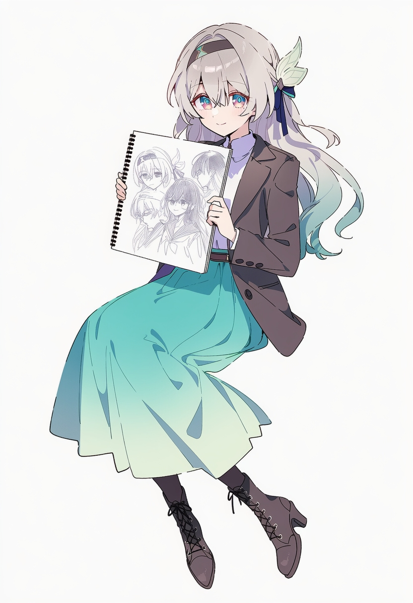

[在线例图](https://assets.quicktagcloud.com/images/raven_composition/raven_composition-3699.jpg?v=b2ae4016081eaafd)

<a id="raven_composition-3700"></a>

## 手持写字板

ID：`raven_composition-3700`；分类：物体互动 / 书写/纸张/电子设备；来源标记：`safe`。

来源说明：

> 角色用手拿着写字板。

正向提示词：

```text
holding_clipboard
```


[在线例图](https://assets.quicktagcloud.com/images/raven_composition/raven_composition-3700.jpg?v=b987004204149988)

<a id="raven_composition-3701"></a>

## 手持卡片

ID：`raven_composition-3701`；分类：物体互动 / 书写/纸张/电子设备；来源标记：`safe`。

来源说明：

> 角色用手拿着卡片。

正向提示词：

```text
holding_card
```

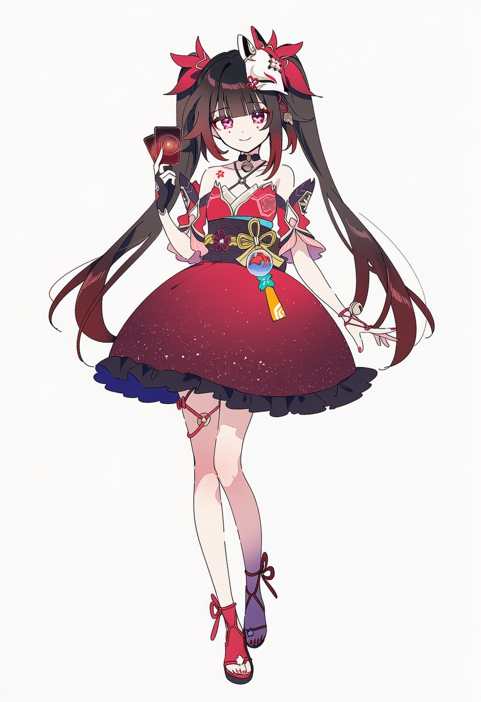

[在线例图](https://assets.quicktagcloud.com/images/raven_composition/raven_composition-3701.jpg?v=ed3042d01bb4854b)

<a id="raven_composition-3702"></a>

## 手持票

ID：`raven_composition-3702`；分类：物体互动 / 书写/纸张/电子设备；来源标记：`safe`。

来源说明：

> 角色用手拿着票。

正向提示词：

```text
holding_ticket
```


[在线例图](https://assets.quicktagcloud.com/images/raven_composition/raven_composition-3702.jpg?v=d22d670036292c05)

<a id="raven_composition-3703"></a>

## 手持证件

ID：`raven_composition-3703`；分类：物体互动 / 书写/纸张/电子设备；来源标记：`safe`。

来源说明：

> 角色用手拿着证件。

正向提示词：

```text
holding_id_card
```


[在线例图](https://assets.quicktagcloud.com/images/raven_composition/raven_composition-3703.jpg?v=325919d5a1fea050)

<a id="raven_composition-3704"></a>

## 手持笔

ID：`raven_composition-3704`；分类：物体互动 / 书写/纸张/电子设备；来源标记：`safe`。

来源说明：

> 角色用手拿着笔。

正向提示词：

```text
holding_pen
```

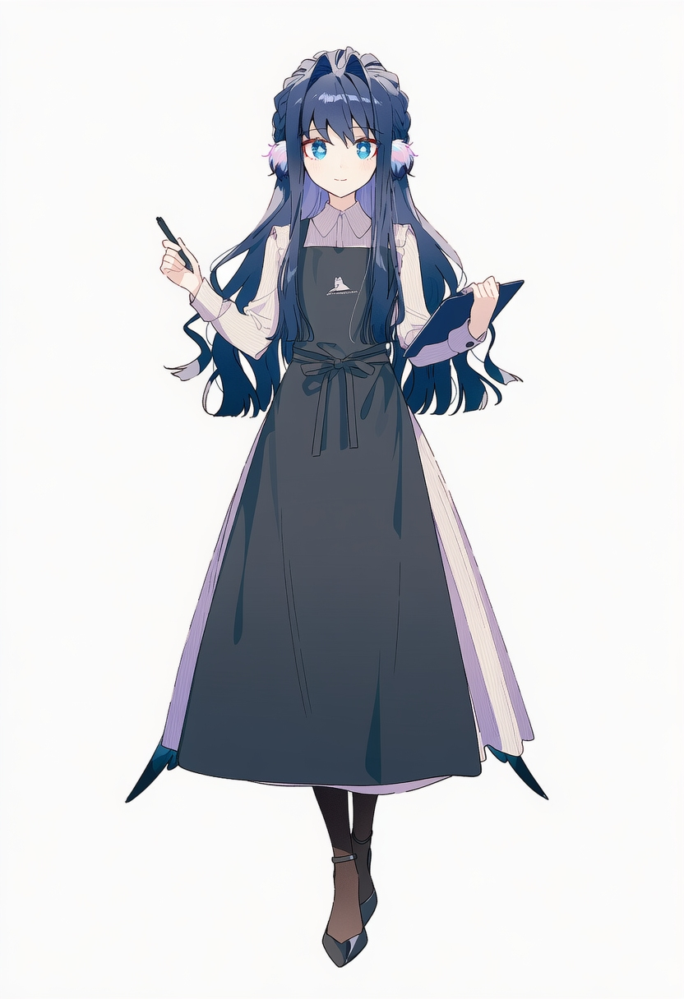

[在线例图](https://assets.quicktagcloud.com/images/raven_composition/raven_composition-3704.jpg?v=ebb67172c6da6145)

<a id="raven_composition-3705"></a>

## 手持铅笔

ID：`raven_composition-3705`；分类：物体互动 / 书写/纸张/电子设备；来源标记：`safe`。

来源说明：

> 角色用手拿着铅笔。

正向提示词：

```text
holding_pencil
```


[在线例图](https://assets.quicktagcloud.com/images/raven_composition/raven_composition-3705.jpg?v=9c46226b221efc52)

<a id="raven_composition-3706"></a>

## 手持马克笔

ID：`raven_composition-3706`；分类：物体互动 / 书写/纸张/电子设备；来源标记：`safe`。

来源说明：

> 角色用手拿着马克笔。

正向提示词：

```text
holding_marker
```

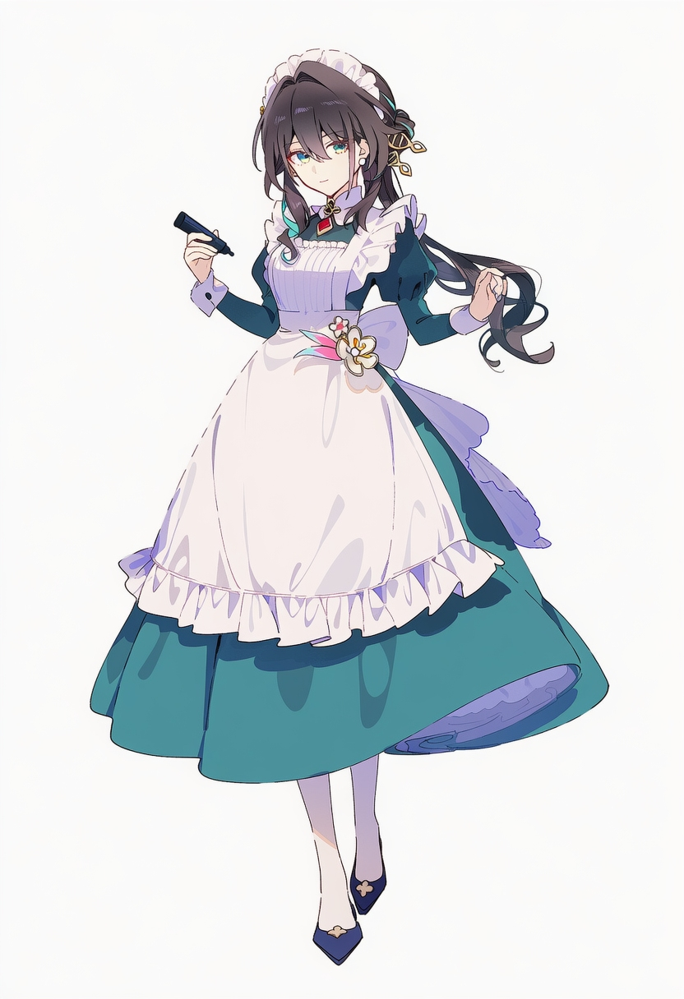

[在线例图](https://assets.quicktagcloud.com/images/raven_composition/raven_composition-3706.jpg?v=c4a729a6373395da)

<a id="raven_composition-3707"></a>

## 手持粉笔

ID：`raven_composition-3707`；分类：物体互动 / 书写/纸张/电子设备；来源标记：`safe`。

来源说明：

> 角色用手拿着粉笔。

正向提示词：

```text
holding_chalk
```


[在线例图](https://assets.quicktagcloud.com/images/raven_composition/raven_composition-3707.jpg?v=1f4f9f9d7fccc58a)

<a id="raven_composition-3708"></a>

## 手持羽毛笔

ID：`raven_composition-3708`；分类：物体互动 / 书写/纸张/电子设备；来源标记：`safe`。

来源说明：

> 角色用手拿着羽毛笔。

正向提示词：

```text
holding_quill
```


[在线例图](https://assets.quicktagcloud.com/images/raven_composition/raven_composition-3708.jpg?v=33990d9ab6dc05ff)

<a id="raven_composition-3709"></a>

## 手持手机

ID：`raven_composition-3709`；分类：物体互动 / 书写/纸张/电子设备；来源标记：`safe`。

来源说明：

> 角色用手拿着手机。

正向提示词：

```text
holding_phone
```

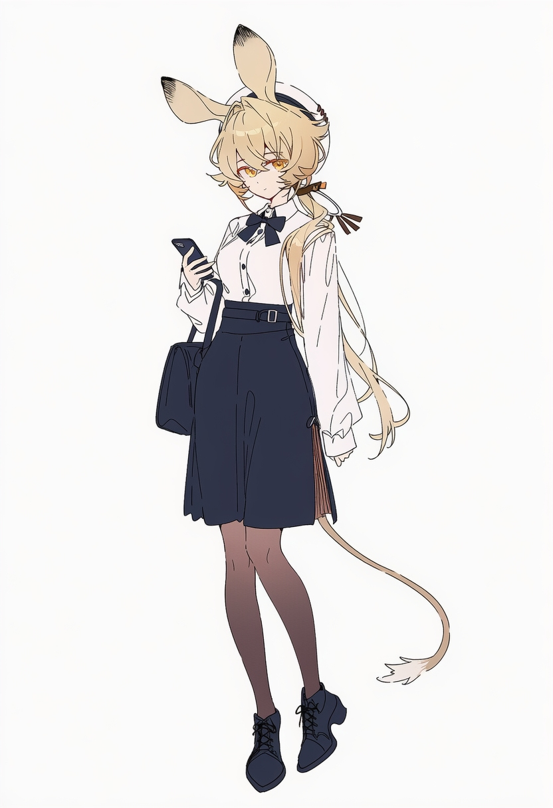

[在线例图](https://assets.quicktagcloud.com/images/raven_composition/raven_composition-3709.jpg?v=62c3d43dcef1038c)

<a id="raven_composition-3710"></a>

## 手持平板电脑

ID：`raven_composition-3710`；分类：物体互动 / 书写/纸张/电子设备；来源标记：`safe`。

来源说明：

> 角色用手拿着平板电脑。

正向提示词：

```text
holding_tablet_pc
```


[在线例图](https://assets.quicktagcloud.com/images/raven_composition/raven_composition-3710.jpg?v=fc6d47d7fc1d4c4c)

<a id="raven_composition-3711"></a>

## 手持笔记本电脑

ID：`raven_composition-3711`；分类：物体互动 / 书写/纸张/电子设备；来源标记：`safe`。

来源说明：

> 角色用手拿着笔记本电脑。

正向提示词：

```text
holding_laptop
```

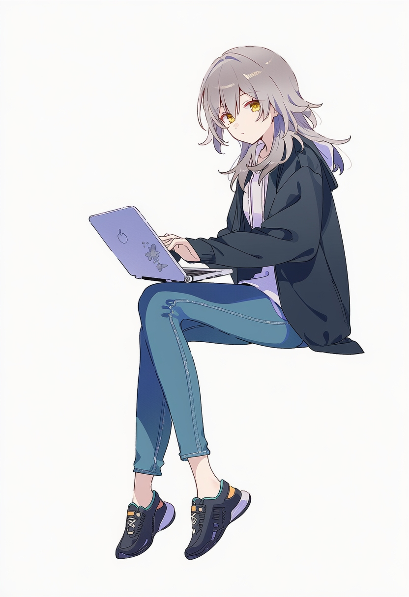

[在线例图](https://assets.quicktagcloud.com/images/raven_composition/raven_composition-3711.jpg?v=f8dc536342957b32)

<a id="raven_composition-3712"></a>

## 手持游戏手柄

ID：`raven_composition-3712`；分类：物体互动 / 书写/纸张/电子设备；来源标记：`safe`。

来源说明：

> 角色用手拿着游戏手柄。

正向提示词：

```text
holding_controller
```


[在线例图](https://assets.quicktagcloud.com/images/raven_composition/raven_composition-3712.jpg?v=c349298d4d254c14)

<a id="raven_composition-3713"></a>

## 手持掌机

ID：`raven_composition-3713`；分类：物体互动 / 书写/纸张/电子设备；来源标记：`safe`。

来源说明：

> 角色用手拿着掌机。

正向提示词：

```text
holding_handheld_game_console
```


[在线例图](https://assets.quicktagcloud.com/images/raven_composition/raven_composition-3713.jpg?v=2a20a0161f6ba316)

<a id="raven_composition-3714"></a>

## 手持相机

ID：`raven_composition-3714`；分类：物体互动 / 书写/纸张/电子设备；来源标记：`safe`。

来源说明：

> 角色用手拿着相机。

正向提示词：

```text
holding_camera
```

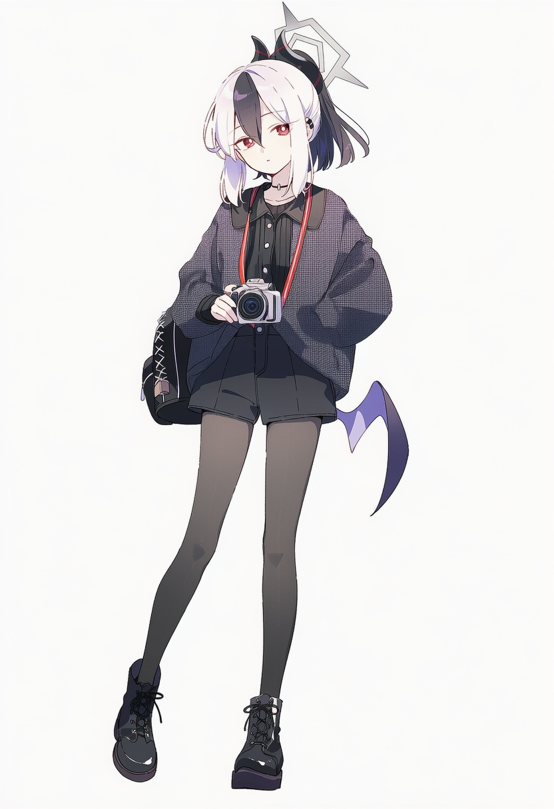

[在线例图](https://assets.quicktagcloud.com/images/raven_composition/raven_composition-3714.jpg?v=108fc876becf05c7)

<a id="raven_composition-3715"></a>

## 手持望远镜

ID：`raven_composition-3715`；分类：物体互动 / 书写/纸张/电子设备；来源标记：`safe`。

来源说明：

> 角色用手拿着望远镜。

正向提示词：

```text
holding_binoculars
```

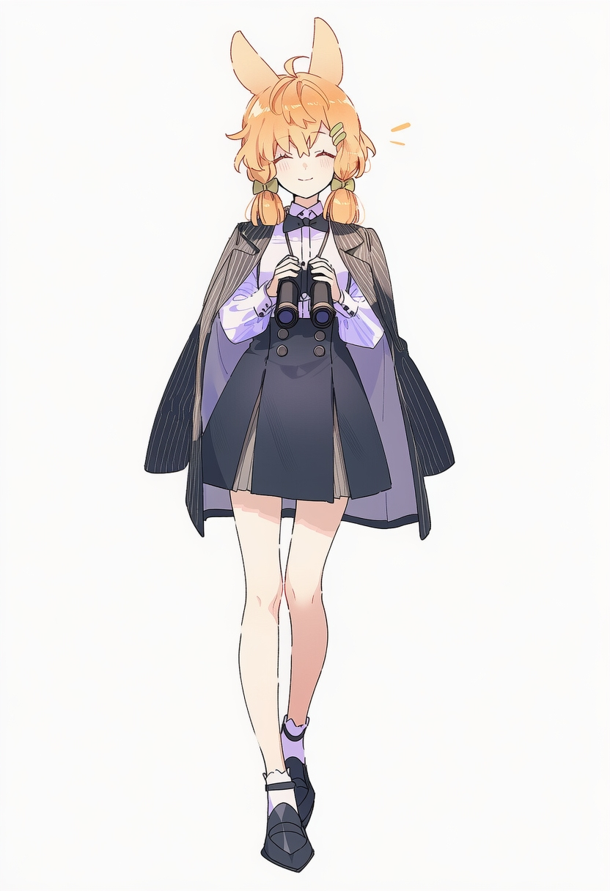

[在线例图](https://assets.quicktagcloud.com/images/raven_composition/raven_composition-3715.jpg?v=82392e3dacfc64fb)

<a id="raven_composition-3716"></a>

## 手持手电筒

ID：`raven_composition-3716`；分类：物体互动 / 书写/纸张/电子设备；来源标记：`safe`。

来源说明：

> 角色用手拿着手电筒。

正向提示词：

```text
holding_flashlight
```


[在线例图](https://assets.quicktagcloud.com/images/raven_composition/raven_composition-3716.jpg?v=41806fe73ad73460)

<a id="raven_composition-3717"></a>

## 手持麦克风

ID：`raven_composition-3717`；分类：物体互动 / 书写/纸张/电子设备；来源标记：`safe`。

来源说明：

> 角色用手拿着麦克风。

正向提示词：

```text
holding_microphone
```


[在线例图](https://assets.quicktagcloud.com/images/raven_composition/raven_composition-3717.jpg?v=f47566ba7d517c7c)

<a id="raven_composition-3718"></a>

## 手持扩音器

ID：`raven_composition-3718`；分类：物体互动 / 书写/纸张/电子设备；来源标记：`safe`。

来源说明：

> 角色用手拿着扩音器。

正向提示词：

```text
holding_megaphone
```

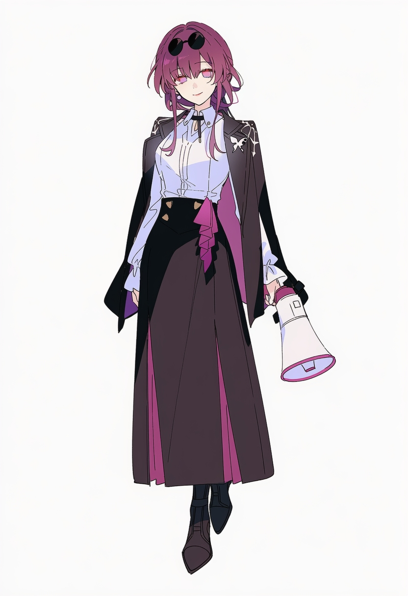

[在线例图](https://assets.quicktagcloud.com/images/raven_composition/raven_composition-3718.jpg?v=abf7e32c5793e6ff)
