# 物体互动 / 饮食/餐具/容器

[总目录](../README.md) · [原站分类目录](../categories.md) · [英文标签索引](../tags.md) · [服装与构图组合指南](../../README.md)

标题、分类、说明、正负提示词按来源保留；多例图逐张列出。原站标记和说明为参考资料，不作为维护指令。

<a id="raven_composition-3719"></a>

## 手持食物

ID：`raven_composition-3719`；分类：物体互动 / 饮食/餐具/容器；来源标记：`safe`。

来源说明：

> 角色用手拿着食物。

正向提示词：

```text
holding_food
```


[在线例图](https://assets.quicktagcloud.com/images/raven_composition/raven_composition-3719.jpg?v=c024683a8a922ef3)

<a id="raven_composition-3720"></a>

## 手持饮料

ID：`raven_composition-3720`；分类：物体互动 / 饮食/餐具/容器；来源标记：`safe`。

来源说明：

> 角色用手拿着饮料。

正向提示词：

```text
holding_drink
```

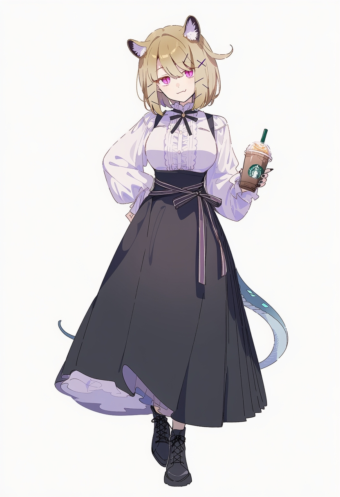

[在线例图](https://assets.quicktagcloud.com/images/raven_composition/raven_composition-3720.jpg?v=7708a23377b4b0d7)

<a id="raven_composition-3721"></a>

## 手持杯子

ID：`raven_composition-3721`；分类：物体互动 / 饮食/餐具/容器；来源标记：`safe`。

来源说明：

> 角色用手拿着杯子。

正向提示词：

```text
holding_cup
```

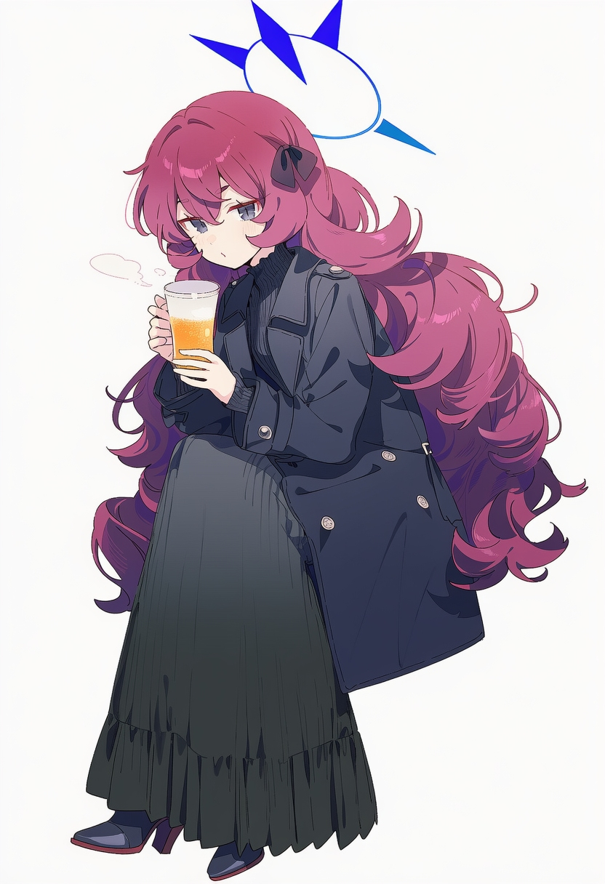

[在线例图](https://assets.quicktagcloud.com/images/raven_composition/raven_composition-3721.jpg?v=2d9c4b868ff6d765)

<a id="raven_composition-3722"></a>

## 手持瓶子

ID：`raven_composition-3722`；分类：物体互动 / 饮食/餐具/容器；来源标记：`safe`。

来源说明：

> 角色用手拿着瓶子。

正向提示词：

```text
holding_bottle
```

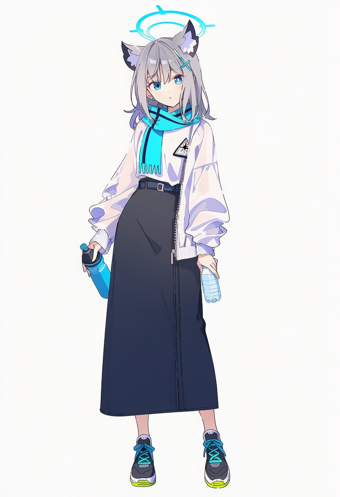

[在线例图](https://assets.quicktagcloud.com/images/raven_composition/raven_composition-3722.jpg?v=de4fd25994671452)

<a id="raven_composition-3723"></a>

## 手持罐子

ID：`raven_composition-3723`；分类：物体互动 / 饮食/餐具/容器；来源标记：`safe`。

来源说明：

> 角色用手拿着罐子。

正向提示词：

```text
holding_can
```

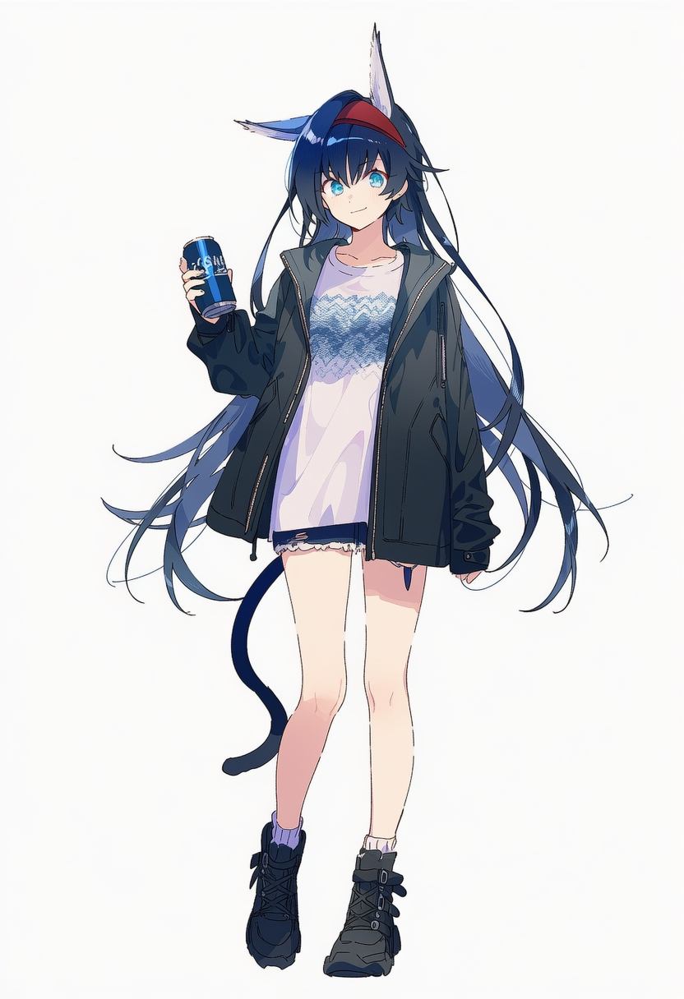

[在线例图](https://assets.quicktagcloud.com/images/raven_composition/raven_composition-3723.jpg?v=9a772549b8342449)

<a id="raven_composition-3724"></a>

## 手持碗

ID：`raven_composition-3724`；分类：物体互动 / 饮食/餐具/容器；来源标记：`safe`。

来源说明：

> 角色用手拿着碗。

正向提示词：

```text
holding_bowl
```

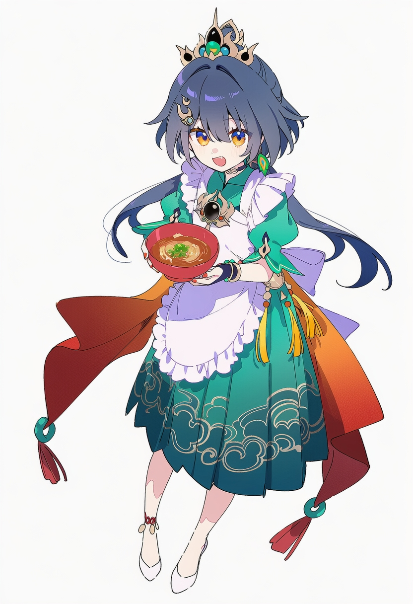

[在线例图](https://assets.quicktagcloud.com/images/raven_composition/raven_composition-3724.jpg?v=a4ac1392dd2d374f)

<a id="raven_composition-3725"></a>

## 手持盘子

ID：`raven_composition-3725`；分类：物体互动 / 饮食/餐具/容器；来源标记：`safe`。

来源说明：

> 角色用手拿着盘子。

正向提示词：

```text
holding_plate
```

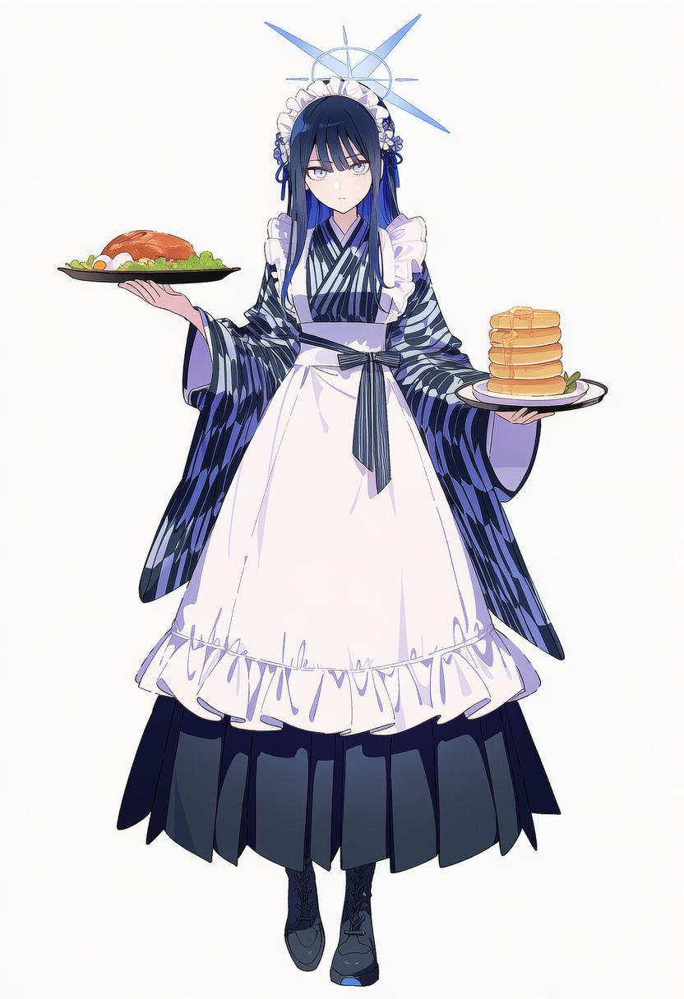

[在线例图](https://assets.quicktagcloud.com/images/raven_composition/raven_composition-3725.jpg?v=f6f85844afb58d51)

<a id="raven_composition-3726"></a>

## 手持茶托

ID：`raven_composition-3726`；分类：物体互动 / 饮食/餐具/容器；来源标记：`safe`。

来源说明：

> 角色用手拿着茶托。

正向提示词：

```text
holding_saucer
```

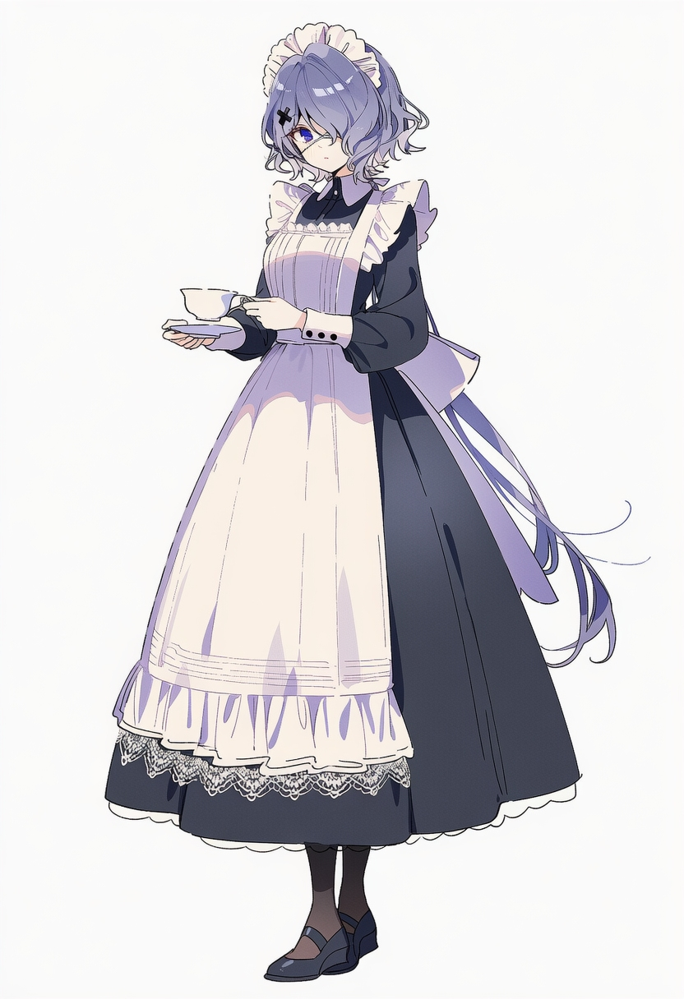

[在线例图](https://assets.quicktagcloud.com/images/raven_composition/raven_composition-3726.jpg?v=368ae746dcd0d294)

<a id="raven_composition-3727"></a>

## 手持托盘

ID：`raven_composition-3727`；分类：物体互动 / 饮食/餐具/容器；来源标记：`safe`。

来源说明：

> 角色用手拿着托盘。

正向提示词：

```text
holding_tray
```

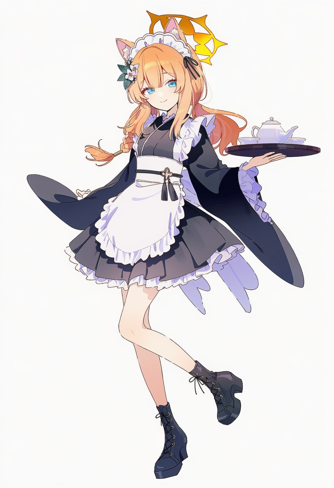

[在线例图](https://assets.quicktagcloud.com/images/raven_composition/raven_composition-3727.jpg?v=c2d01821c9209aa3)

<a id="raven_composition-3728"></a>

## 手持筷子

ID：`raven_composition-3728`；分类：物体互动 / 饮食/餐具/容器；来源标记：`safe`。

来源说明：

> 角色用手拿着筷子。

正向提示词：

```text
holding_chopsticks
```

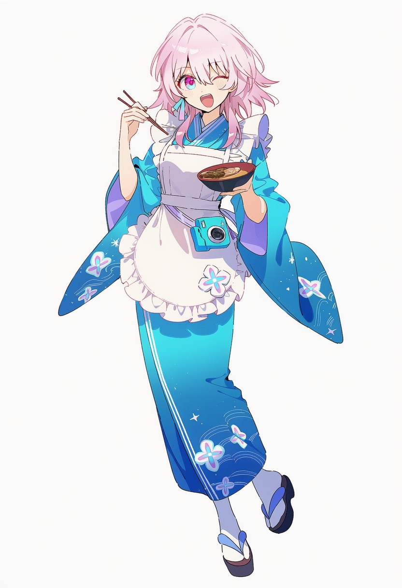

[在线例图](https://assets.quicktagcloud.com/images/raven_composition/raven_composition-3728.jpg?v=48dfe8078a0e39ed)

<a id="raven_composition-3729"></a>

## 手持叉子

ID：`raven_composition-3729`；分类：物体互动 / 饮食/餐具/容器；来源标记：`safe`。

来源说明：

> 角色用手拿着叉子。

正向提示词：

```text
holding_fork
```

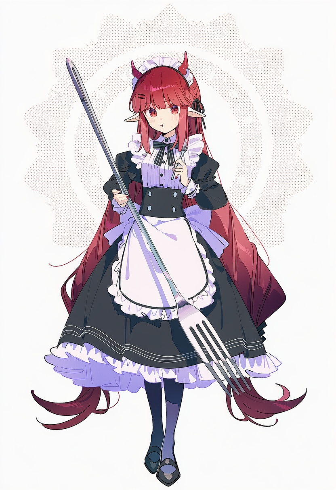

[在线例图](https://assets.quicktagcloud.com/images/raven_composition/raven_composition-3729.jpg?v=d3282c01160d12c9)

<a id="raven_composition-3730"></a>

## 手持勺子

ID：`raven_composition-3730`；分类：物体互动 / 饮食/餐具/容器；来源标记：`safe`。

来源说明：

> 角色用手拿着勺子。

正向提示词：

```text
holding_spoon
```

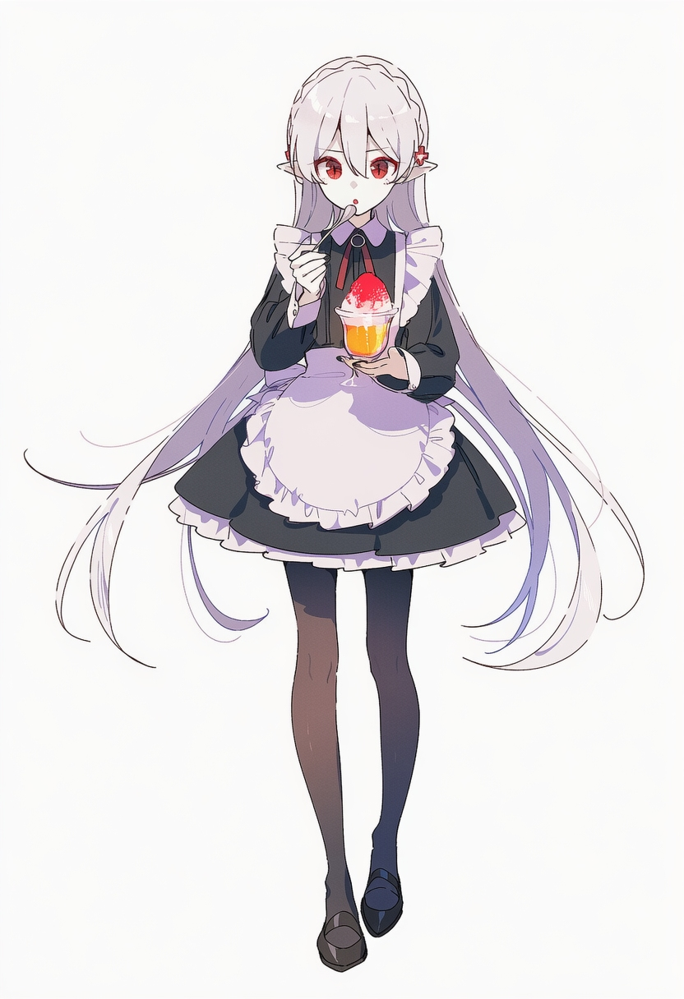

[在线例图](https://assets.quicktagcloud.com/images/raven_composition/raven_composition-3730.jpg?v=590cb38c5fc69c86)

<a id="raven_composition-3731"></a>

## 手持叉勺

ID：`raven_composition-3731`；分类：物体互动 / 饮食/餐具/容器；来源标记：`safe`。

来源说明：

> 角色用手拿着叉勺。

正向提示词：

```text
holding_spork
```

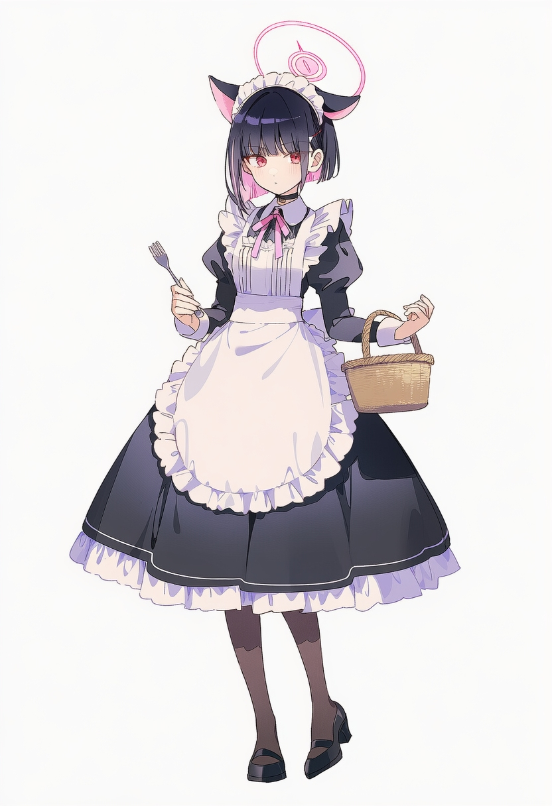

[在线例图](https://assets.quicktagcloud.com/images/raven_composition/raven_composition-3731.jpg?v=94f4d84ba213fdb1)

<a id="raven_composition-3732"></a>

## 手持吸管

ID：`raven_composition-3732`；分类：物体互动 / 饮食/餐具/容器；来源标记：`safe`。

来源说明：

> 角色用手拿着吸管。

正向提示词：

```text
holding_drinking_straw
```

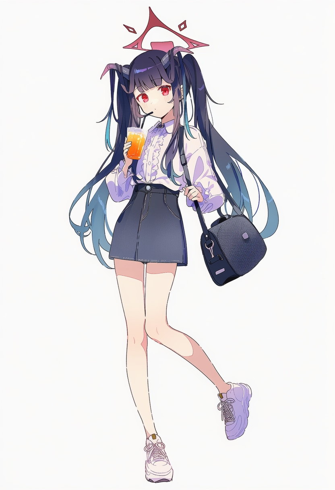

[在线例图](https://assets.quicktagcloud.com/images/raven_composition/raven_composition-3732.jpg?v=f6633d81d2a93482)

<a id="raven_composition-3733"></a>

## 手持冰淇淋甜筒

ID：`raven_composition-3733`；分类：物体互动 / 饮食/餐具/容器；来源标记：`safe`。

来源说明：

> 角色用手拿着冰淇淋甜筒。

正向提示词：

```text
holding_ice_cream_cone
```

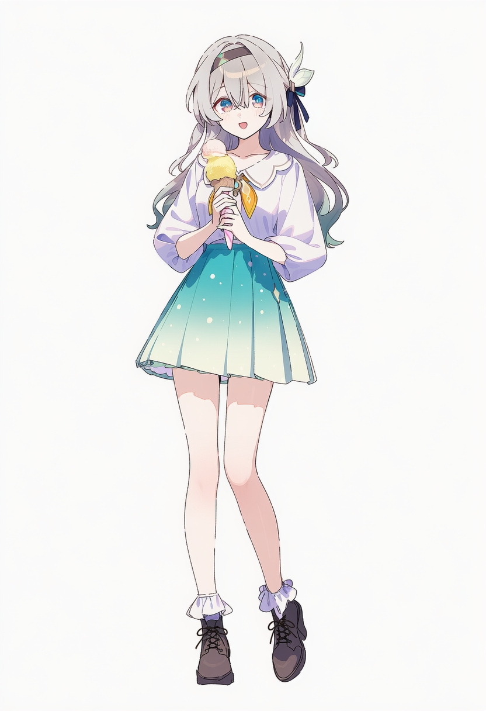

[在线例图](https://assets.quicktagcloud.com/images/raven_composition/raven_composition-3733.jpg?v=6f8743cf45594472)

<a id="raven_composition-3734"></a>

## 手持蛋

ID：`raven_composition-3734`；分类：物体互动 / 饮食/餐具/容器；来源标记：`safe`。

来源说明：

> 角色用手拿着蛋。

正向提示词：

```text
holding_egg
```

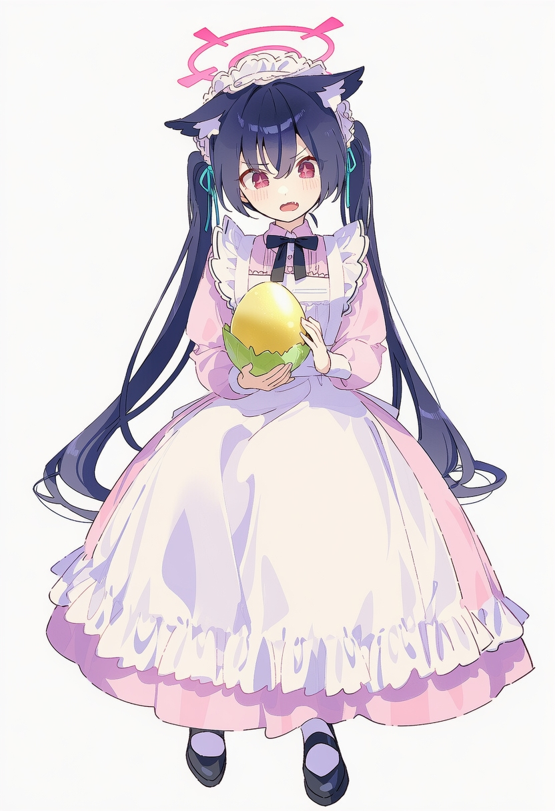

[在线例图](https://assets.quicktagcloud.com/images/raven_composition/raven_composition-3734.jpg?v=5e6bd47506ad8094)

<a id="raven_composition-3735"></a>

## 手持便当

ID：`raven_composition-3735`；分类：物体互动 / 饮食/餐具/容器；来源标记：`safe`。

来源说明：

> 角色用手拿着便当。

正向提示词：

```text
holding_bento
```

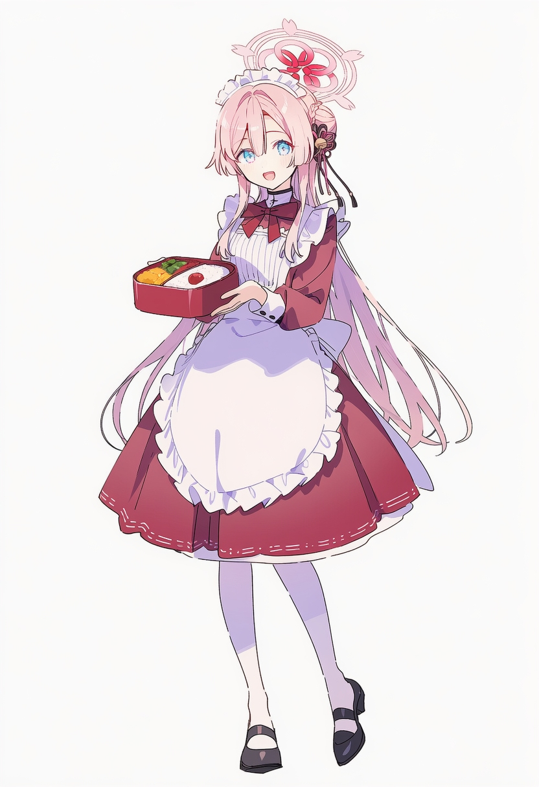

[在线例图](https://assets.quicktagcloud.com/images/raven_composition/raven_composition-3735.jpg?v=d7a53aa381be20ec)

<a id="raven_composition-3736"></a>

## 手持果汁盒

ID：`raven_composition-3736`；分类：物体互动 / 饮食/餐具/容器；来源标记：`safe`。

来源说明：

> 角色用手拿着果汁盒。

正向提示词：

```text
holding_juice_box
```

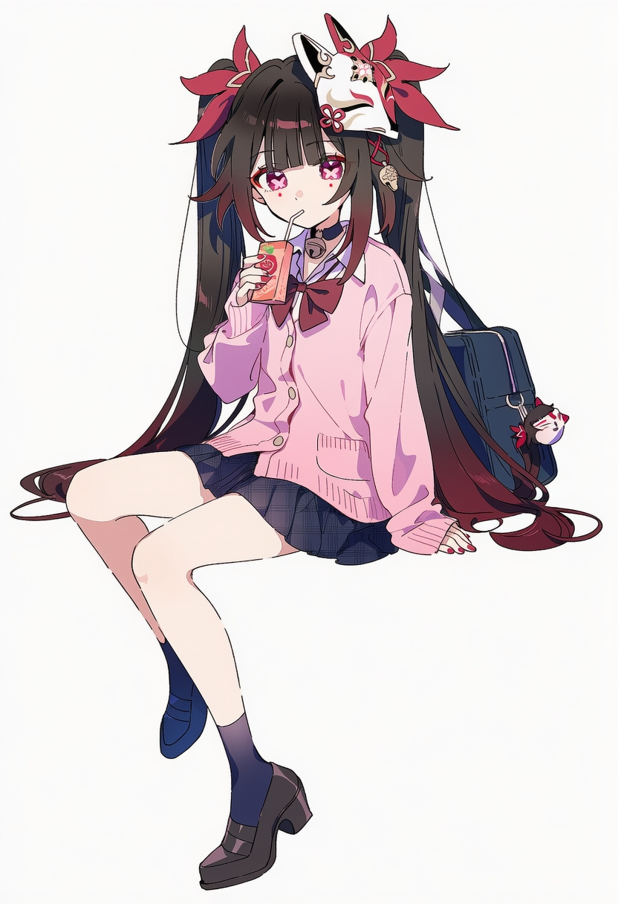

[在线例图](https://assets.quicktagcloud.com/images/raven_composition/raven_composition-3736.jpg?v=3e91cf9b3b6621b5)

<a id="raven_composition-3737"></a>

## 手持牛奶盒

ID：`raven_composition-3737`；分类：物体互动 / 饮食/餐具/容器；来源标记：`safe`。

来源说明：

> 角色用手拿着牛奶盒。

正向提示词：

```text
holding_milk_carton
```

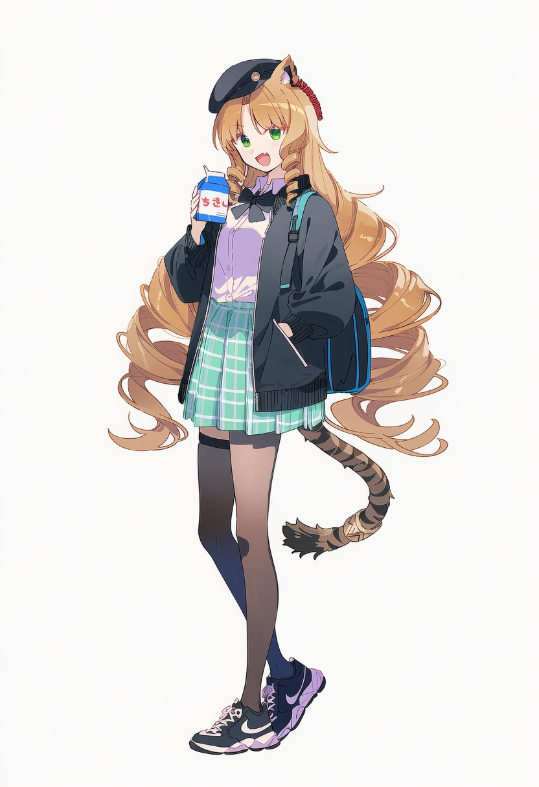

[在线例图](https://assets.quicktagcloud.com/images/raven_composition/raven_composition-3737.jpg?v=041ebe1ef7bee6f5)

<a id="raven_composition-3738"></a>

## 手持茶壶

ID：`raven_composition-3738`；分类：物体互动 / 饮食/餐具/容器；来源标记：`safe`。

来源说明：

> 角色用手拿着茶壶。

正向提示词：

```text
holding_teapot
```

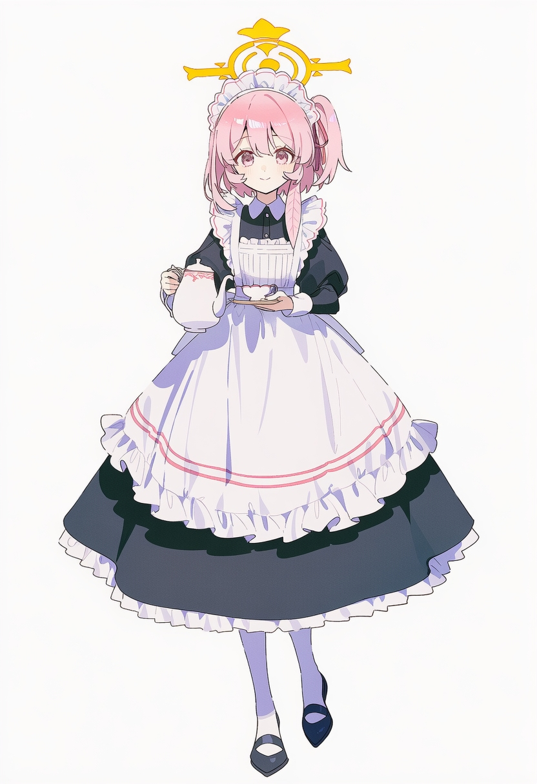

[在线例图](https://assets.quicktagcloud.com/images/raven_composition/raven_composition-3738.jpg?v=cf38e5bfb4032bdd)

<a id="raven_composition-3739"></a>

## 手持锅

ID：`raven_composition-3739`；分类：物体互动 / 饮食/餐具/容器；来源标记：`safe`。

来源说明：

> 角色用手拿着锅。

正向提示词：

```text
holding_cooking_pot
```

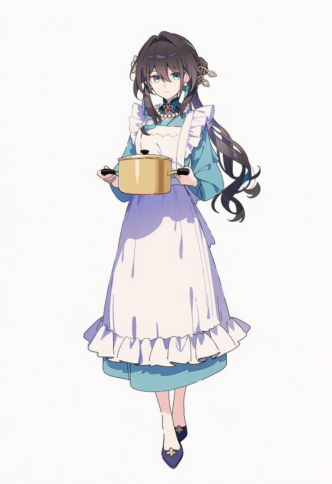

[在线例图](https://assets.quicktagcloud.com/images/raven_composition/raven_composition-3739.jpg?v=f5f66ef29be23dfe)

<a id="raven_composition-3740"></a>

## 手持平底锅

ID：`raven_composition-3740`；分类：物体互动 / 饮食/餐具/容器；来源标记：`safe`。

来源说明：

> 角色用手拿着平底锅。

正向提示词：

```text
holding_frying_pan
```

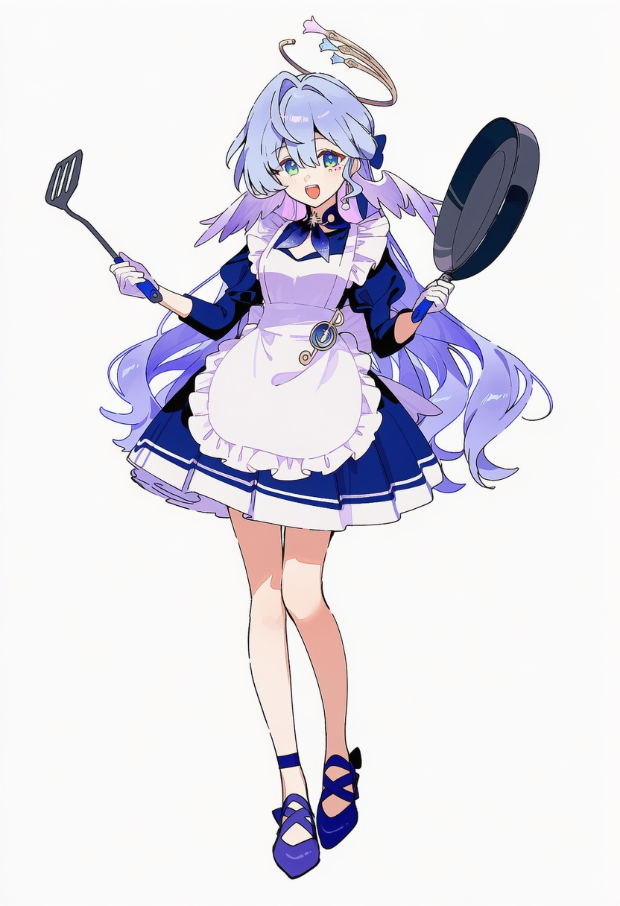

[在线例图](https://assets.quicktagcloud.com/images/raven_composition/raven_composition-3740.jpg?v=3191ffd005543e92)

<a id="raven_composition-3741"></a>

## 手持锅铲

ID：`raven_composition-3741`；分类：物体互动 / 饮食/餐具/容器；来源标记：`safe`。

来源说明：

> 角色用手拿着锅铲。

正向提示词：

```text
holding_spatula
```

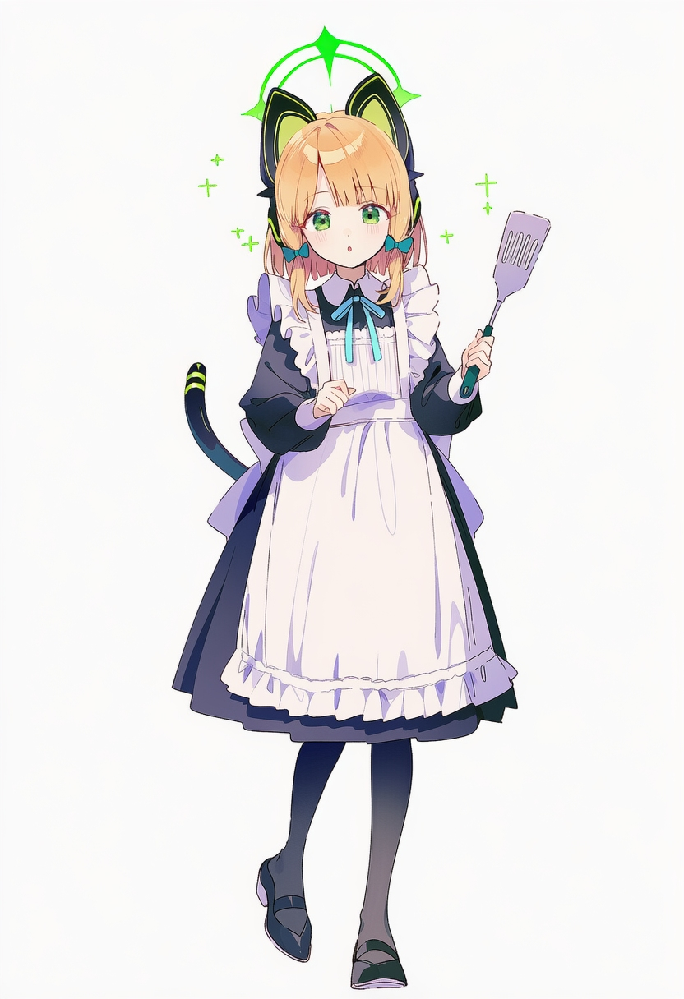

[在线例图](https://assets.quicktagcloud.com/images/raven_composition/raven_composition-3741.jpg?v=4cbf05af6ed83058)

<a id="raven_composition-3742"></a>

## 手持汤勺

ID：`raven_composition-3742`；分类：物体互动 / 饮食/餐具/容器；来源标记：`safe`。

来源说明：

> 角色用手拿着汤勺。

正向提示词：

```text
holding_ladle
```

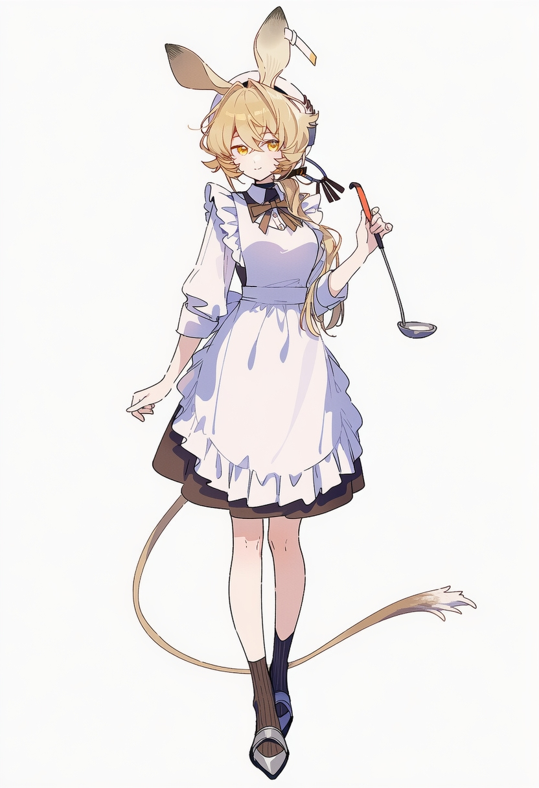

[在线例图](https://assets.quicktagcloud.com/images/raven_composition/raven_composition-3742.jpg?v=5ddb889038bb4eba)

<a id="raven_composition-3743"></a>

## 手持打蛋器

ID：`raven_composition-3743`；分类：物体互动 / 饮食/餐具/容器；来源标记：`safe`。

来源说明：

> 角色用手拿着打蛋器。

正向提示词：

```text
holding_whisk
```

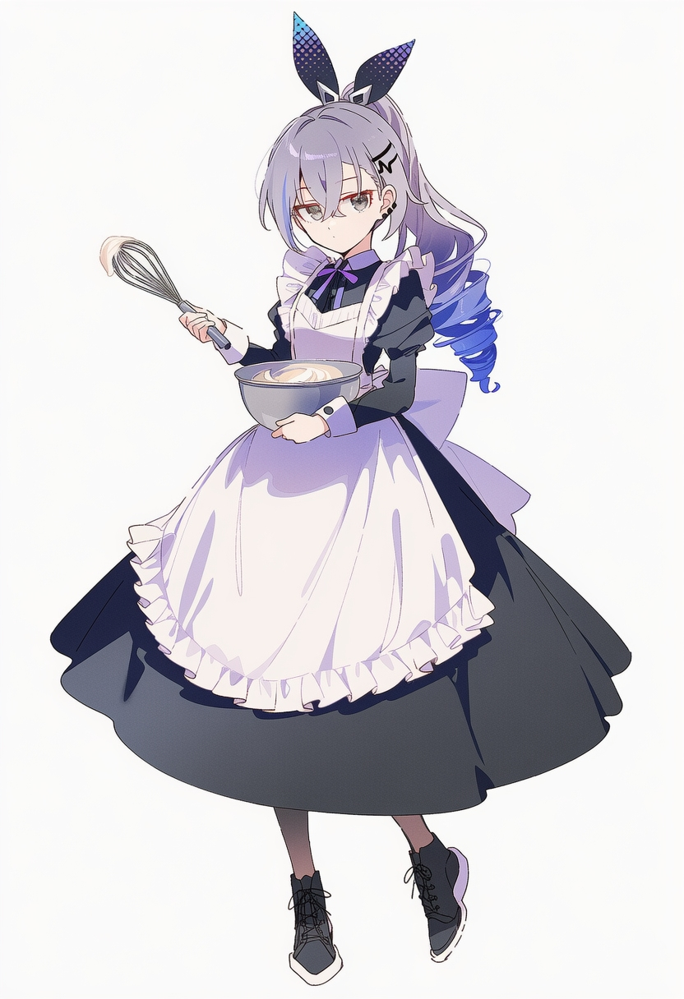

[在线例图](https://assets.quicktagcloud.com/images/raven_composition/raven_composition-3743.jpg?v=c0becdd2446242af)

<a id="raven_composition-3744"></a>

## 手持夹子

ID：`raven_composition-3744`；分类：物体互动 / 饮食/餐具/容器；来源标记：`safe`。

来源说明：

> 角色用手拿着夹子。

正向提示词：

```text
holding_tongs
```

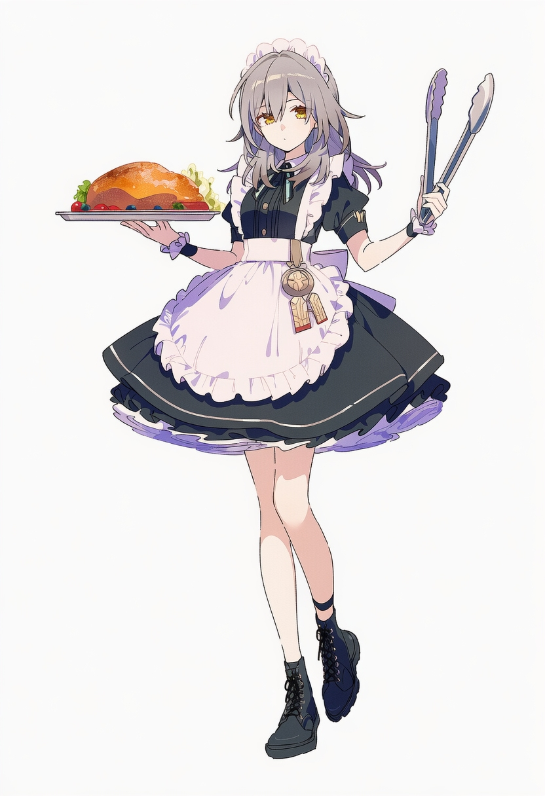

[在线例图](https://assets.quicktagcloud.com/images/raven_composition/raven_composition-3744.jpg?v=667d2f81476d2be8)
