# 物体互动 / 日用品/衣物/装饰

[总目录](../README.md) · [原站分类目录](../categories.md) · [英文标签索引](../tags.md) · [服装与构图组合指南](../../README.md)

标题、分类、说明、正负提示词按来源保留；多例图逐张列出。原站标记和说明为参考资料，不作为维护指令。

<a id="raven_composition-3745"></a>

## 手持包

ID：`raven_composition-3745`；分类：物体互动 / 日用品/衣物/装饰；来源标记：`safe`。

来源说明：

> 角色用手拿着包。

正向提示词：

```text
holding_bag
```

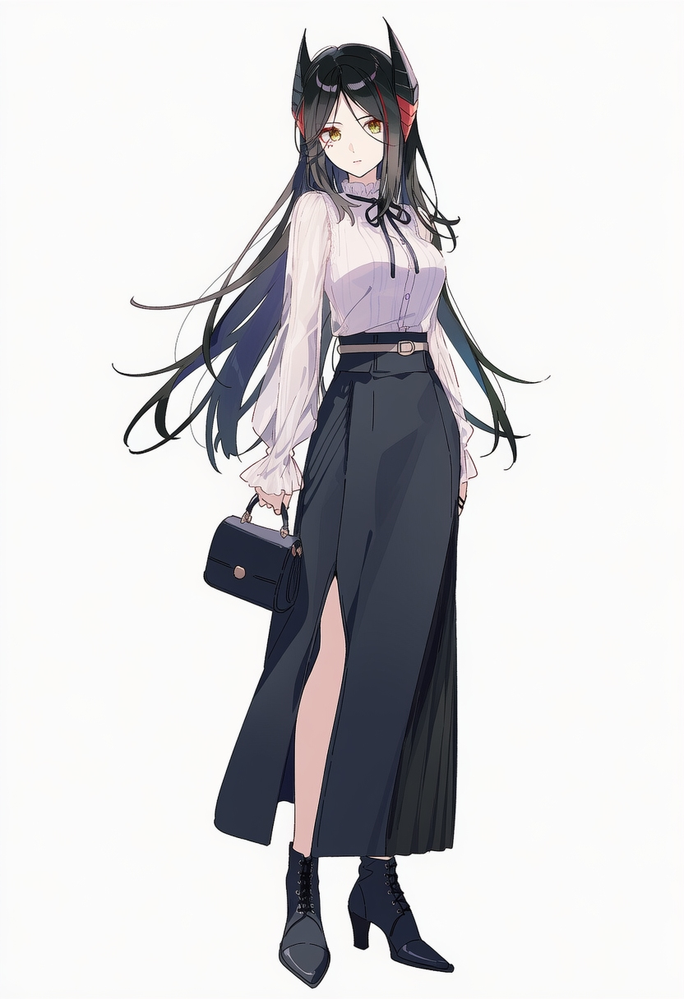

[在线例图](https://assets.quicktagcloud.com/images/raven_composition/raven_composition-3745.jpg?v=24520bdcfc87374f)

<a id="raven_composition-3746"></a>

## 手持篮子

ID：`raven_composition-3746`；分类：物体互动 / 日用品/衣物/装饰；来源标记：`safe`。

来源说明：

> 角色用手拿着篮子。

正向提示词：

```text
holding_basket
```

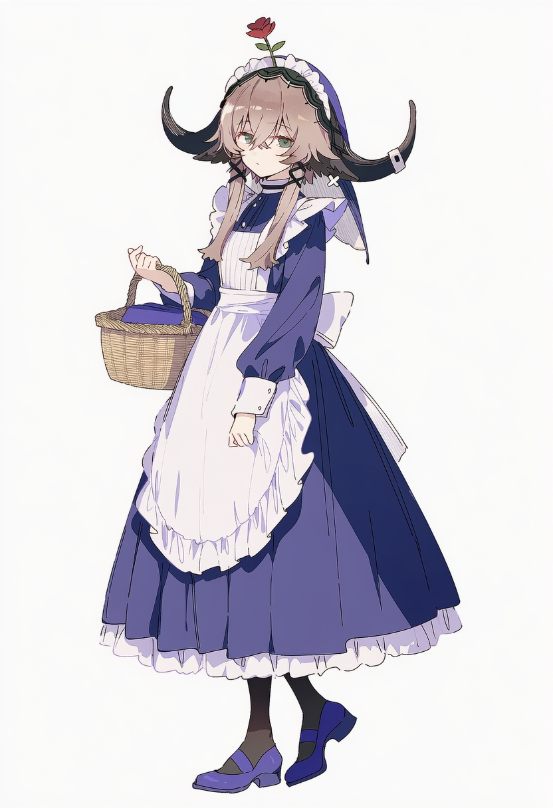

[在线例图](https://assets.quicktagcloud.com/images/raven_composition/raven_composition-3746.jpg?v=1d9b7203ffc6dd87)

<a id="raven_composition-3747"></a>

## 手持盒子

ID：`raven_composition-3747`；分类：物体互动 / 日用品/衣物/装饰；来源标记：`safe`。

来源说明：

> 角色用手拿着盒子。

正向提示词：

```text
holding_box
```

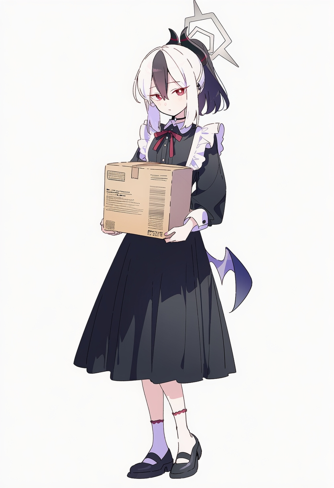

[在线例图](https://assets.quicktagcloud.com/images/raven_composition/raven_composition-3747.jpg?v=acf8cfd98c5d133b)

<a id="raven_composition-3748"></a>

## 手持桶

ID：`raven_composition-3748`；分类：物体互动 / 日用品/衣物/装饰；来源标记：`safe`。

来源说明：

> 角色用手拿着桶。

正向提示词：

```text
holding_bucket
```

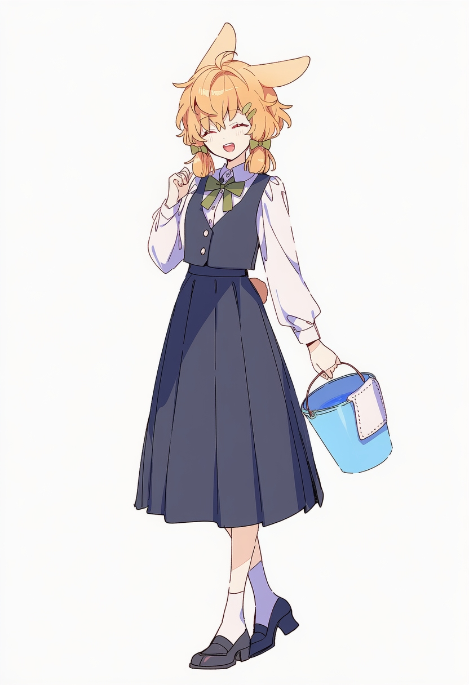

[在线例图](https://assets.quicktagcloud.com/images/raven_composition/raven_composition-3748.jpg?v=4116fb23b3d42e1c)

<a id="raven_composition-3749"></a>

## 手持扫帚

ID：`raven_composition-3749`；分类：物体互动 / 日用品/衣物/装饰；来源标记：`safe`。

来源说明：

> 角色用手拿着扫帚。

正向提示词：

```text
holding_broom
```

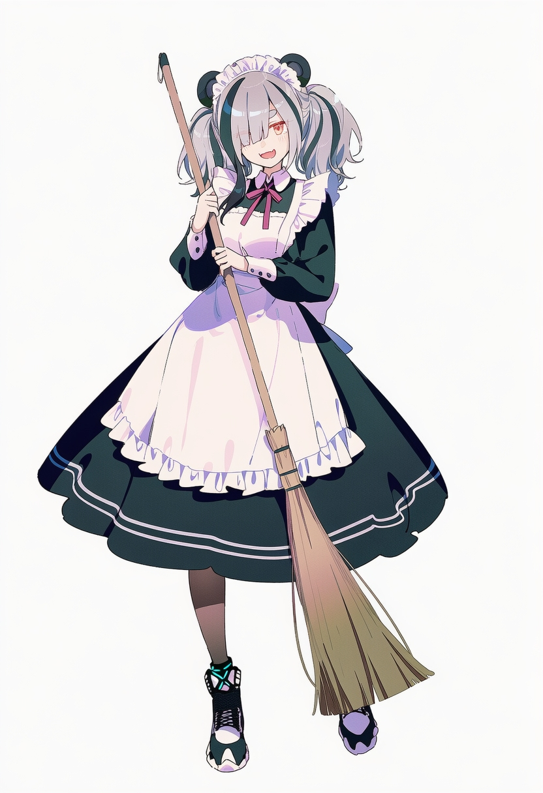

[在线例图](https://assets.quicktagcloud.com/images/raven_composition/raven_composition-3749.jpg?v=b91f4e83ee0525af)

<a id="raven_composition-3750"></a>

## 手持刷子

ID：`raven_composition-3750`；分类：物体互动 / 日用品/衣物/装饰；来源标记：`safe`。

来源说明：

> 角色用手拿着刷子。

正向提示词：

```text
holding_brush
```

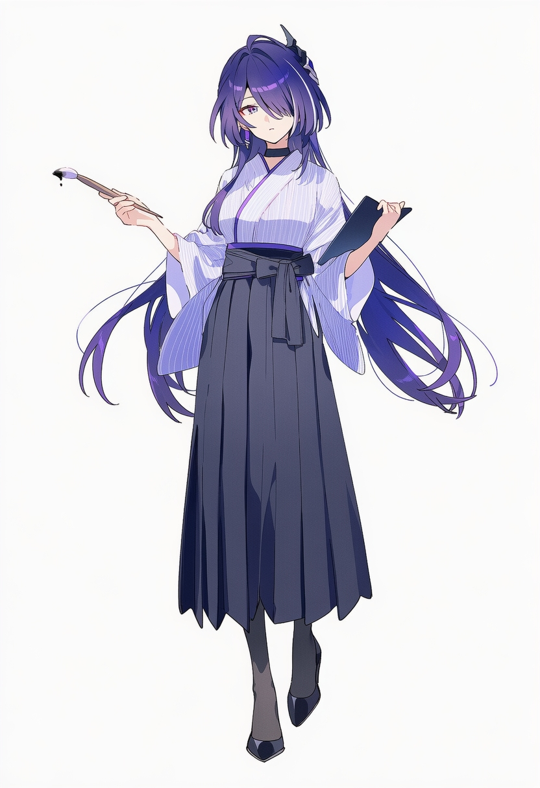

[在线例图](https://assets.quicktagcloud.com/images/raven_composition/raven_composition-3750.jpg?v=f78141a99a833a12)

<a id="raven_composition-3751"></a>

## 手持梳子

ID：`raven_composition-3751`；分类：物体互动 / 日用品/衣物/装饰；来源标记：`safe`。

来源说明：

> 角色用手拿着梳子。

正向提示词：

```text
holding_comb
```

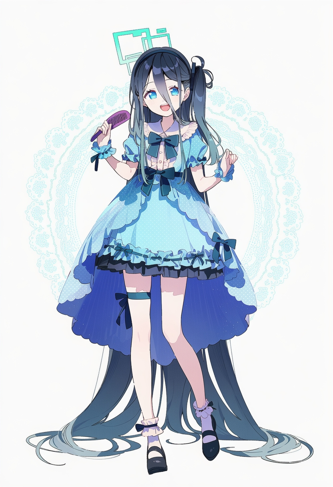

[在线例图](https://assets.quicktagcloud.com/images/raven_composition/raven_composition-3751.jpg?v=de90dc1a199934f2)

<a id="raven_composition-3752"></a>

## 手持发刷

ID：`raven_composition-3752`；分类：物体互动 / 日用品/衣物/装饰；来源标记：`safe`。

来源说明：

> 角色用手拿着发刷。

正向提示词：

```text
holding_hair_brush
```

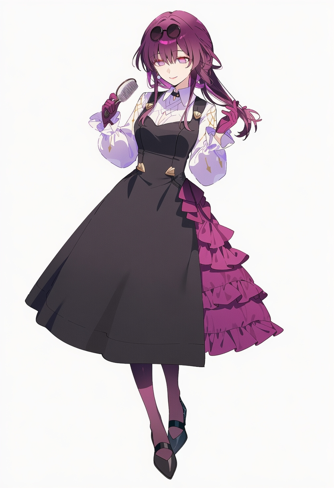

[在线例图](https://assets.quicktagcloud.com/images/raven_composition/raven_composition-3752.jpg?v=965213e7deeb533e)

<a id="raven_composition-3753"></a>

## 手持吹风机

ID：`raven_composition-3753`；分类：物体互动 / 日用品/衣物/装饰；来源标记：`safe`。

来源说明：

> 角色用手拿着吹风机。

正向提示词：

```text
holding_hair_dryer
```

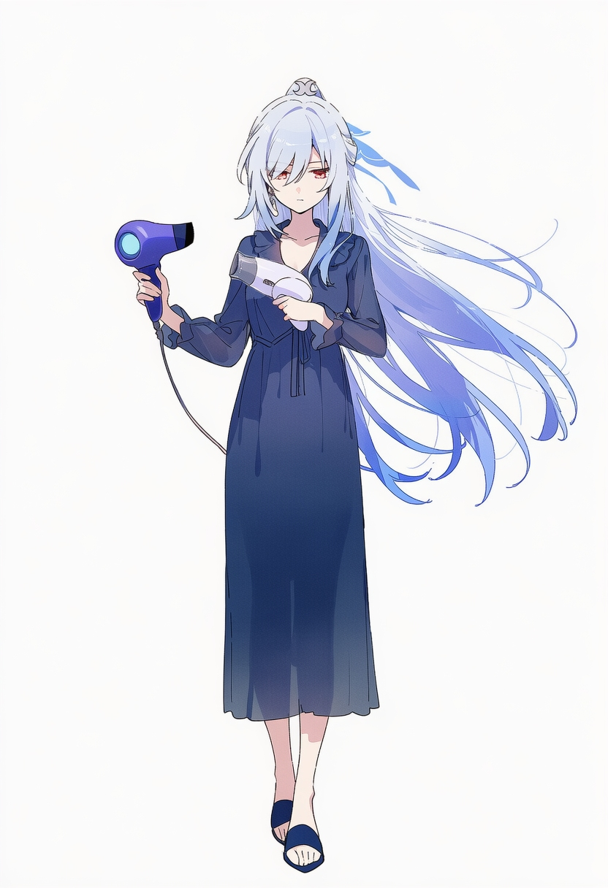

[在线例图](https://assets.quicktagcloud.com/images/raven_composition/raven_composition-3753.jpg?v=f78798d860077636)

<a id="raven_composition-3754"></a>

## 手持毛巾

ID：`raven_composition-3754`；分类：物体互动 / 日用品/衣物/装饰；来源标记：`safe`。

来源说明：

> 角色用手拿着毛巾。

正向提示词：

```text
holding_towel
```

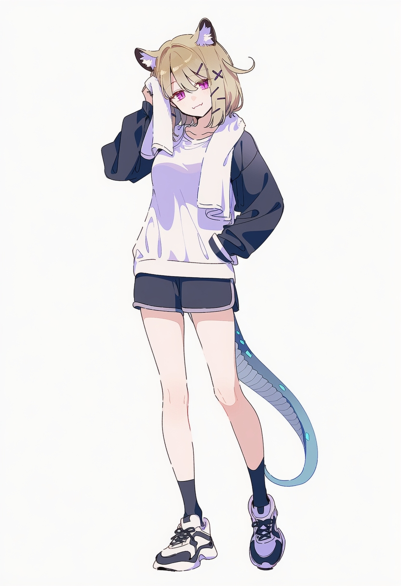

[在线例图](https://assets.quicktagcloud.com/images/raven_composition/raven_composition-3754.jpg?v=a18496bf7d741c59)

<a id="raven_composition-3755"></a>

## 手持毯子

ID：`raven_composition-3755`；分类：物体互动 / 日用品/衣物/装饰；来源标记：`safe`。

来源说明：

> 角色用手拿着毯子。

正向提示词：

```text
holding_blanket
```

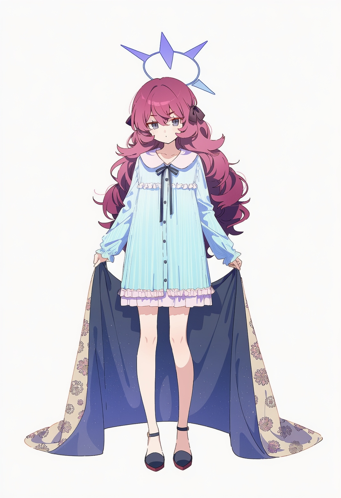

[在线例图](https://assets.quicktagcloud.com/images/raven_composition/raven_composition-3755.jpg?v=794077b7839be1bf)

<a id="raven_composition-3756"></a>

## 手持枕头

ID：`raven_composition-3756`；分类：物体互动 / 日用品/衣物/装饰；来源标记：`safe`。

来源说明：

> 角色用手拿着枕头。

正向提示词：

```text
holding_pillow
```

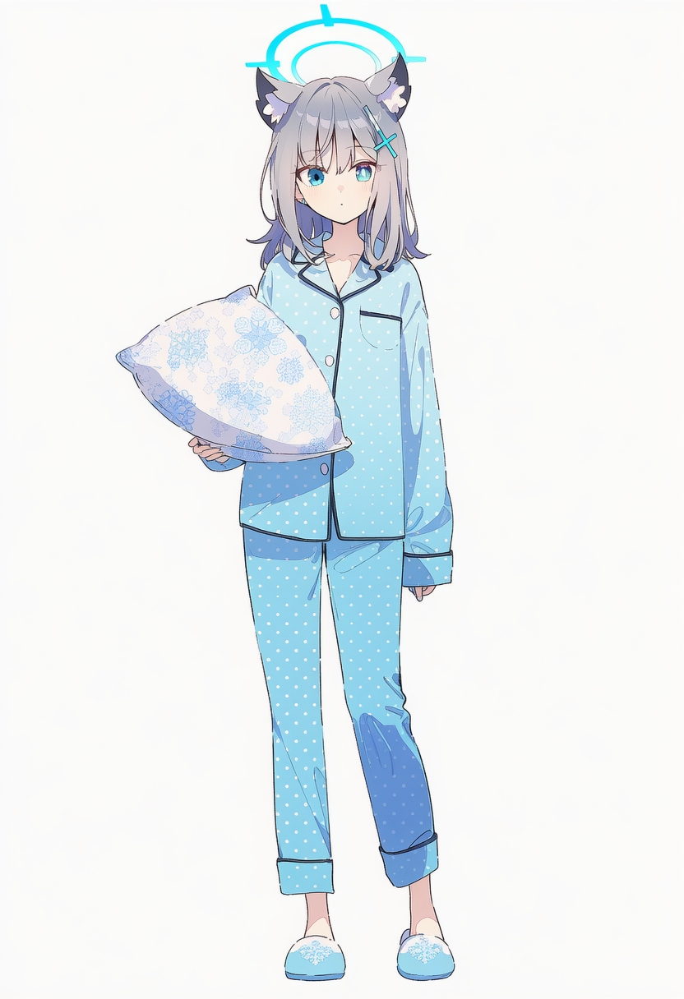

[在线例图](https://assets.quicktagcloud.com/images/raven_composition/raven_composition-3756.jpg?v=e1248fe2dd661960)

<a id="raven_composition-3757"></a>

## 手持伞

ID：`raven_composition-3757`；分类：物体互动 / 日用品/衣物/装饰；来源标记：`safe`。

来源说明：

> 角色用手拿着伞。

正向提示词：

```text
holding_umbrella
```

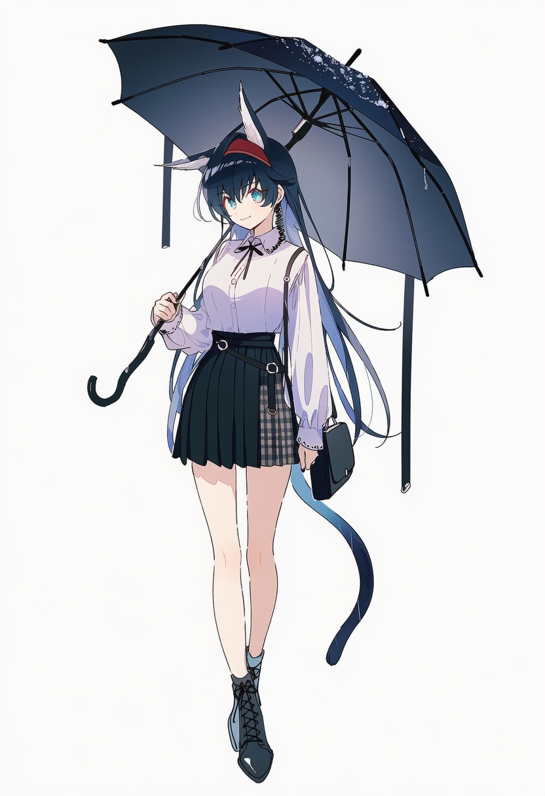

[在线例图](https://assets.quicktagcloud.com/images/raven_composition/raven_composition-3757.jpg?v=d58e3a179eb40a7e)

<a id="raven_composition-3758"></a>

## 手持扇子

ID：`raven_composition-3758`；分类：物体互动 / 日用品/衣物/装饰；来源标记：`safe`。

来源说明：

> 角色用手拿着扇子。

正向提示词：

```text
holding_fan
```

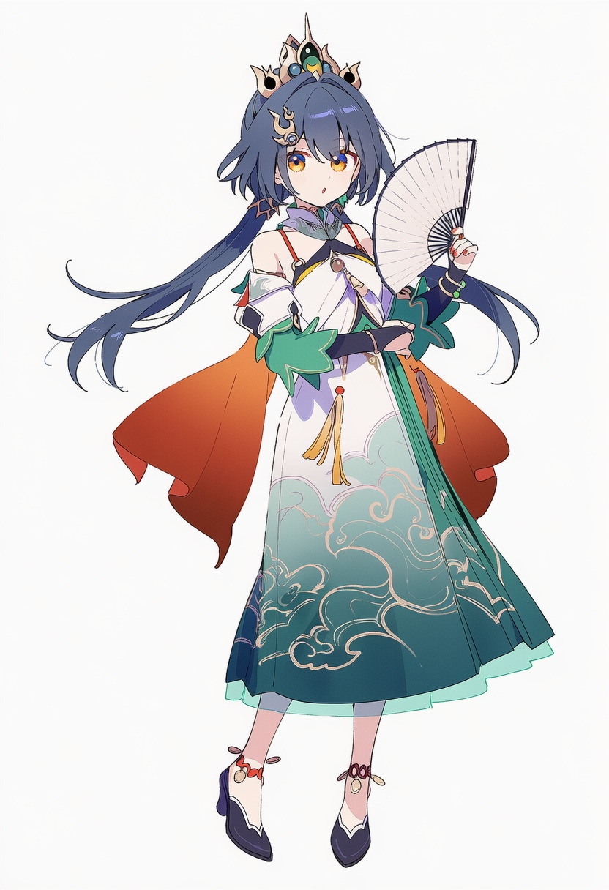

[在线例图](https://assets.quicktagcloud.com/images/raven_composition/raven_composition-3758.jpg?v=ee34c5a9af56f2c1)

<a id="raven_composition-3759"></a>

## 手持面具

ID：`raven_composition-3759`；分类：物体互动 / 日用品/衣物/装饰；来源标记：`safe`。

来源说明：

> 角色用手拿着面具。

正向提示词：

```text
holding_mask
```

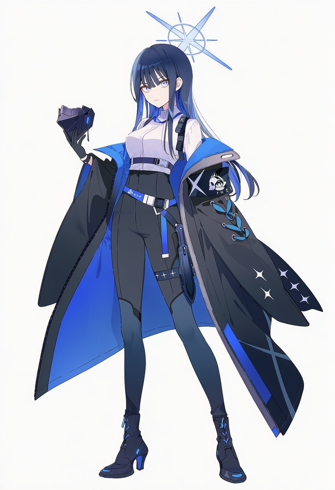

[在线例图](https://assets.quicktagcloud.com/images/raven_composition/raven_composition-3759.jpg?v=179ee59227948bfb)

<a id="raven_composition-3760"></a>

## 手持镜子

ID：`raven_composition-3760`；分类：物体互动 / 日用品/衣物/装饰；来源标记：`safe`。

来源说明：

> 角色用手拿着镜子。

正向提示词：

```text
holding_mirror
```

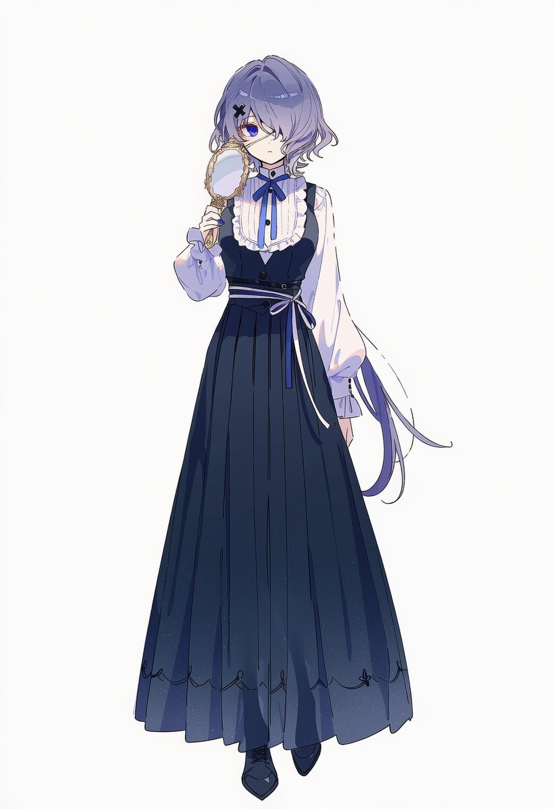

[在线例图](https://assets.quicktagcloud.com/images/raven_composition/raven_composition-3760.jpg?v=4824bbc5e7933fb6)

<a id="raven_composition-3761"></a>

## 手持钥匙

ID：`raven_composition-3761`；分类：物体互动 / 日用品/衣物/装饰；来源标记：`safe`。

来源说明：

> 角色用手拿着钥匙。

正向提示词：

```text
holding_key
```

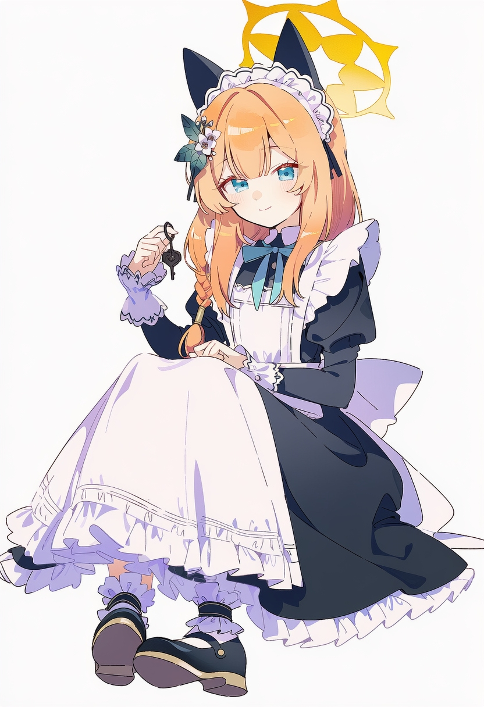

[在线例图](https://assets.quicktagcloud.com/images/raven_composition/raven_composition-3761.jpg?v=72b45acabc29c6dd)

<a id="raven_composition-3762"></a>

## 手持钱包

ID：`raven_composition-3762`；分类：物体互动 / 日用品/衣物/装饰；来源标记：`safe`。

来源说明：

> 角色用手拿着钱包。

正向提示词：

```text
holding_wallet
```

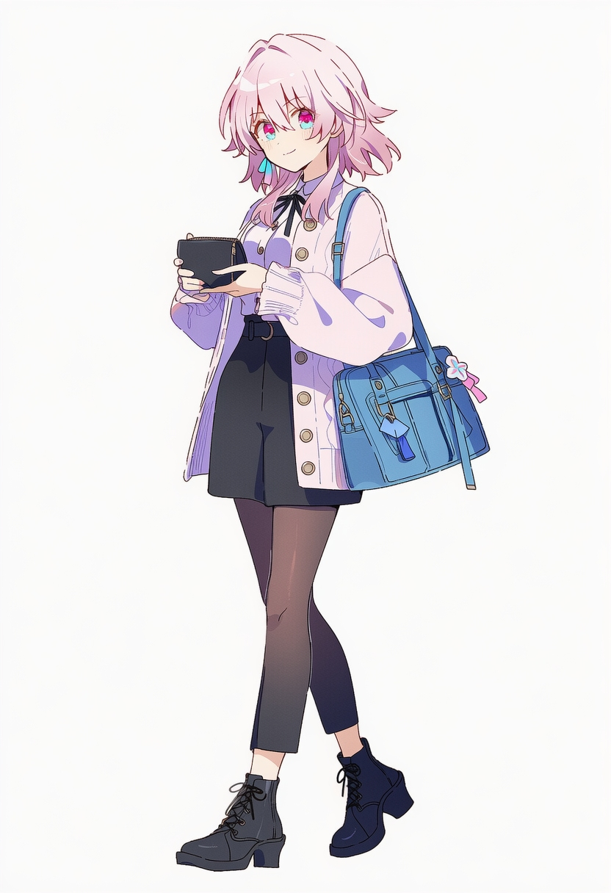

[在线例图](https://assets.quicktagcloud.com/images/raven_composition/raven_composition-3762.jpg?v=efa58010114ee3cf)

<a id="raven_composition-3763"></a>

## 手持钱

ID：`raven_composition-3763`；分类：物体互动 / 日用品/衣物/装饰；来源标记：`safe`。

来源说明：

> 角色用手拿着钱。

正向提示词：

```text
holding_money
```

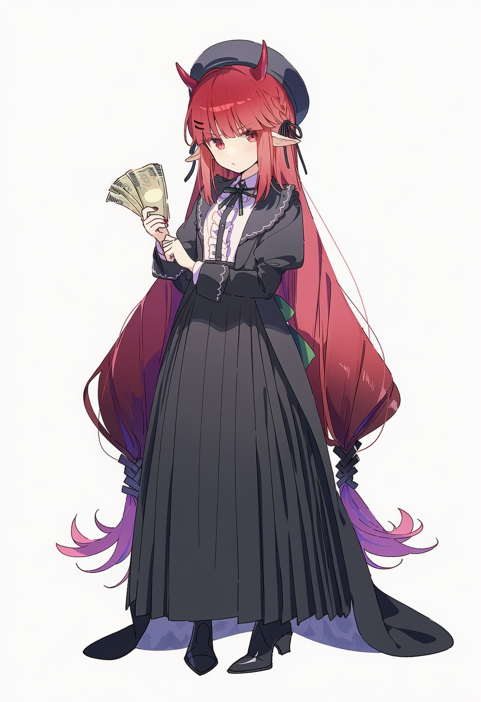

[在线例图](https://assets.quicktagcloud.com/images/raven_composition/raven_composition-3763.jpg?v=2877eace7c085619)

<a id="raven_composition-3764"></a>

## 手持硬币

ID：`raven_composition-3764`；分类：物体互动 / 日用品/衣物/装饰；来源标记：`safe`。

来源说明：

> 角色用手拿着硬币。

正向提示词：

```text
holding_coin
```

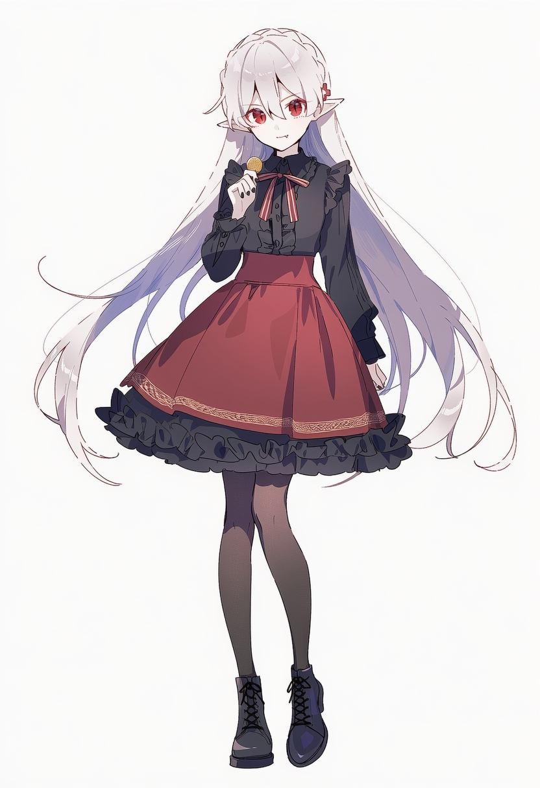

[在线例图](https://assets.quicktagcloud.com/images/raven_composition/raven_composition-3764.jpg?v=ac848b5f18e8fc4e)

<a id="raven_composition-3765"></a>

## 手持礼物

ID：`raven_composition-3765`；分类：物体互动 / 日用品/衣物/装饰；来源标记：`safe`。

来源说明：

> 角色用手拿着礼物。

正向提示词：

```text
holding_gift
```

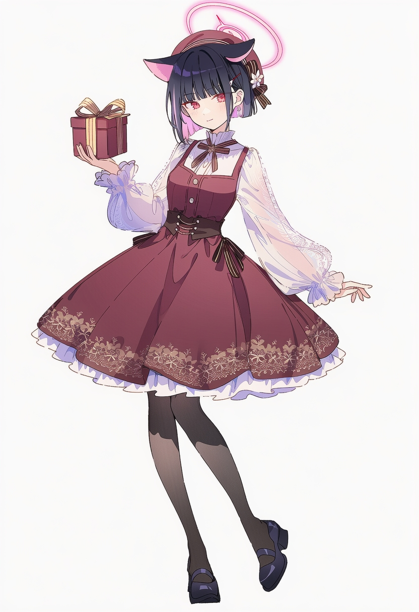

[在线例图](https://assets.quicktagcloud.com/images/raven_composition/raven_composition-3765.jpg?v=9fb5be1d752f84c5)

<a id="raven_composition-3766"></a>

## 手持气球

ID：`raven_composition-3766`；分类：物体互动 / 日用品/衣物/装饰；来源标记：`safe`。

来源说明：

> 角色用手拿着气球。

正向提示词：

```text
holding_balloon
```

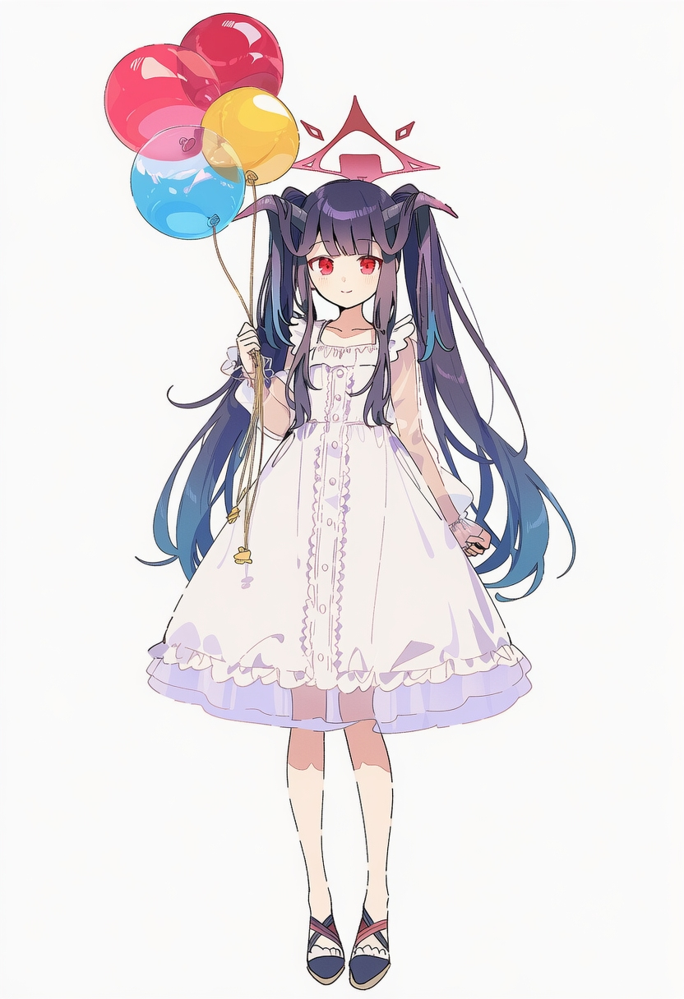

[在线例图](https://assets.quicktagcloud.com/images/raven_composition/raven_composition-3766.jpg?v=183308291e5889b1)

<a id="raven_composition-3767"></a>

## 手持花

ID：`raven_composition-3767`；分类：物体互动 / 日用品/衣物/装饰；来源标记：`safe`。

来源说明：

> 角色用手拿着花。

正向提示词：

```text
holding_flower
```

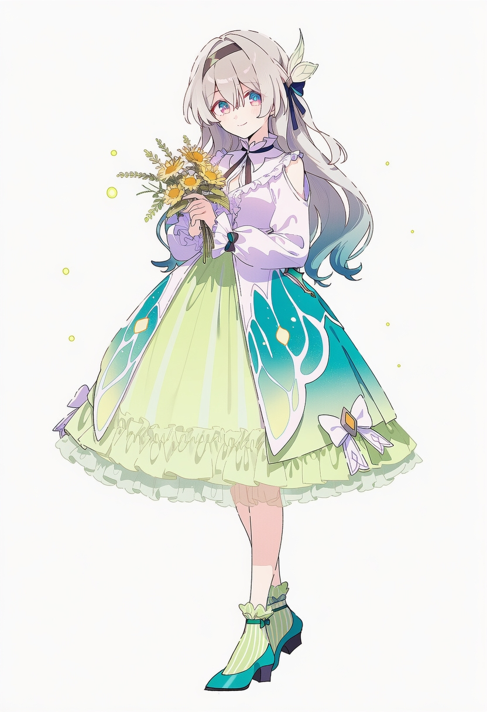

[在线例图](https://assets.quicktagcloud.com/images/raven_composition/raven_composition-3767.jpg?v=beb92803c41ee0db)

<a id="raven_composition-3768"></a>

## 手持花束

ID：`raven_composition-3768`；分类：物体互动 / 日用品/衣物/装饰；来源标记：`safe`。

来源说明：

> 角色用手拿着花束。

正向提示词：

```text
holding_bouquet
```

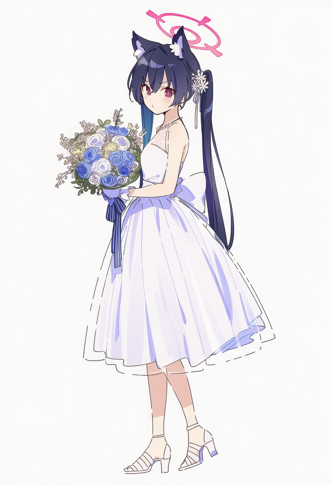

[在线例图](https://assets.quicktagcloud.com/images/raven_composition/raven_composition-3768.jpg?v=11af5d932b5d7f34)

<a id="raven_composition-3769"></a>

## 手持植物

ID：`raven_composition-3769`；分类：物体互动 / 日用品/衣物/装饰；来源标记：`safe`。

来源说明：

> 角色用手拿着植物。

正向提示词：

```text
holding_plant
```

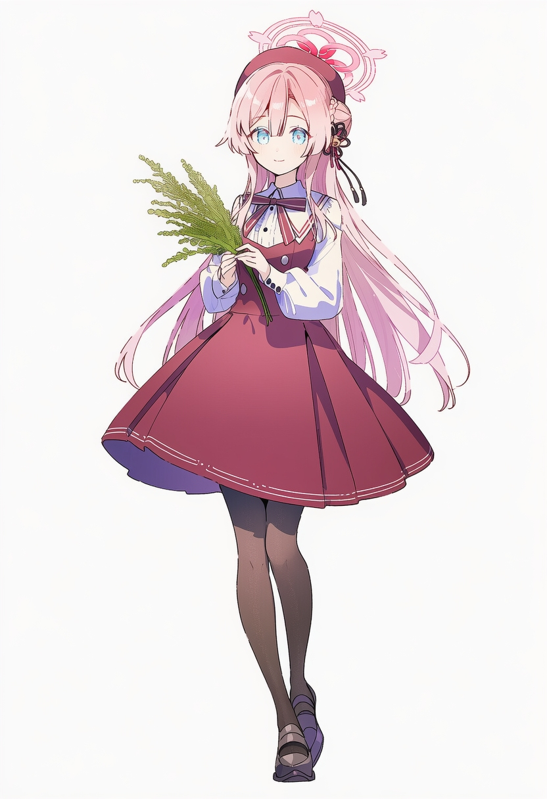

[在线例图](https://assets.quicktagcloud.com/images/raven_composition/raven_composition-3769.jpg?v=c37ff094b7d2cefb)

<a id="raven_composition-3770"></a>

## 手持花盆

ID：`raven_composition-3770`；分类：物体互动 / 日用品/衣物/装饰；来源标记：`safe`。

来源说明：

> 角色用手拿着花盆。

正向提示词：

```text
holding_flower_pot
```

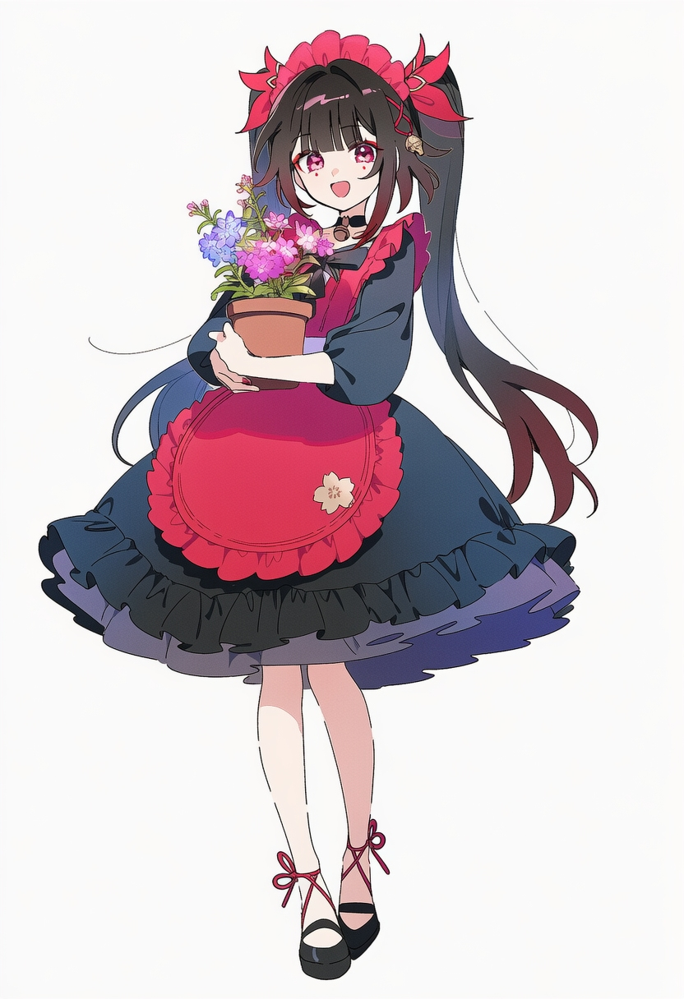

[在线例图](https://assets.quicktagcloud.com/images/raven_composition/raven_composition-3770.jpg?v=757d5f0c364af1b9)

<a id="raven_composition-3771"></a>

## 手持叶子

ID：`raven_composition-3771`；分类：物体互动 / 日用品/衣物/装饰；来源标记：`safe`。

来源说明：

> 角色用手拿着叶子。

正向提示词：

```text
holding_leaf
```

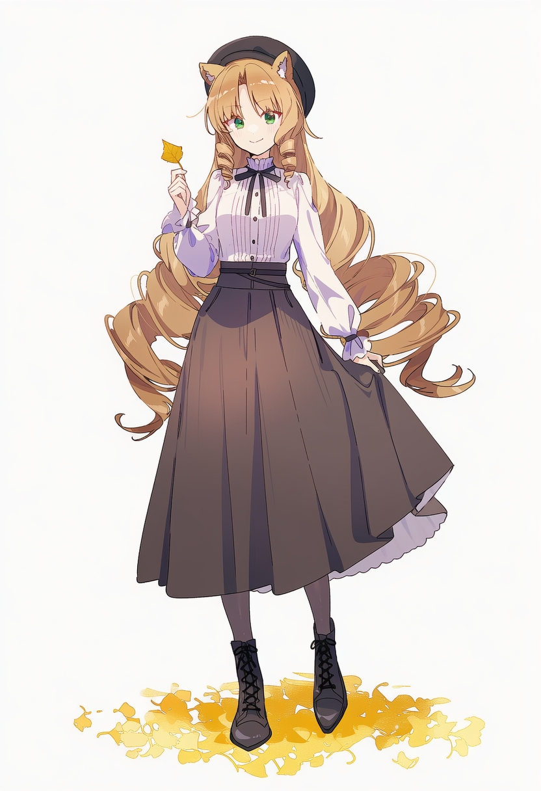

[在线例图](https://assets.quicktagcloud.com/images/raven_composition/raven_composition-3771.jpg?v=b3dc8b50e642b805)

<a id="raven_composition-3772"></a>

## 手持羽毛

ID：`raven_composition-3772`；分类：物体互动 / 日用品/衣物/装饰；来源标记：`safe`。

来源说明：

> 角色用手拿着羽毛。

正向提示词：

```text
holding_feather
```

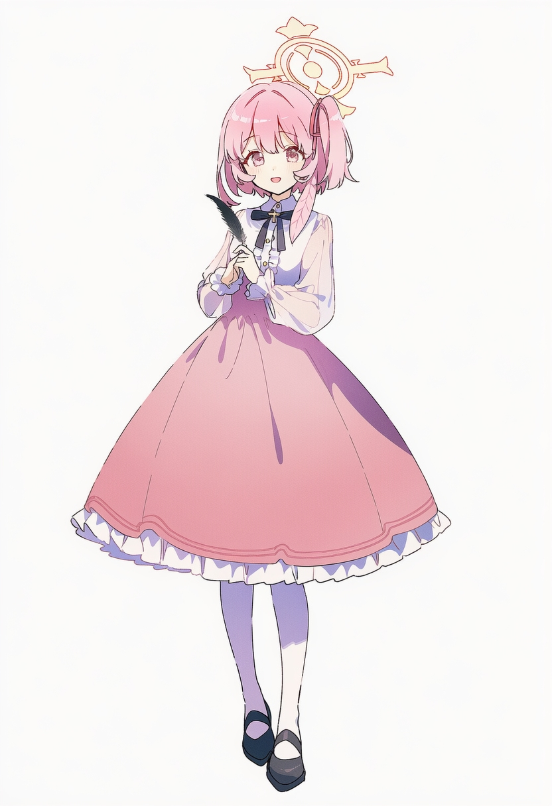

[在线例图](https://assets.quicktagcloud.com/images/raven_composition/raven_composition-3772.jpg?v=92d214512afb9de3)

<a id="raven_composition-3773"></a>

## 手持丝带

ID：`raven_composition-3773`；分类：物体互动 / 日用品/衣物/装饰；来源标记：`safe`。

来源说明：

> 角色用手拿着丝带。

正向提示词：

```text
holding_ribbon
```

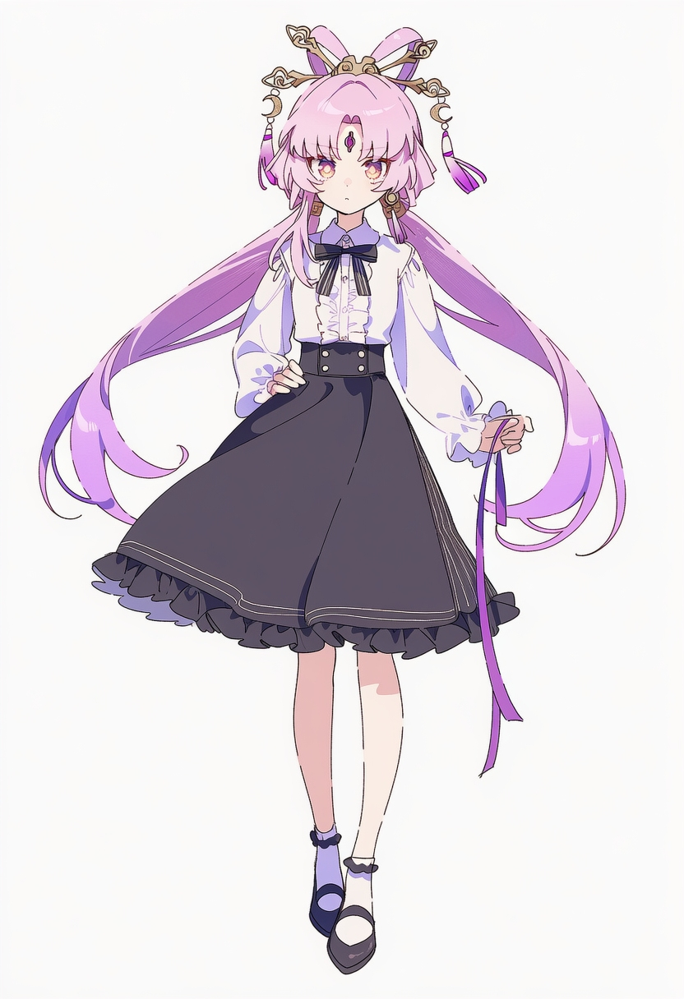

[在线例图](https://assets.quicktagcloud.com/images/raven_composition/raven_composition-3773.jpg?v=f21558d31f46b245)

<a id="raven_composition-3774"></a>

## 手持首饰

ID：`raven_composition-3774`；分类：物体互动 / 日用品/衣物/装饰；来源标记：`safe`。

来源说明：

> 角色用手拿着首饰。

正向提示词：

```text
holding_jewelry
```

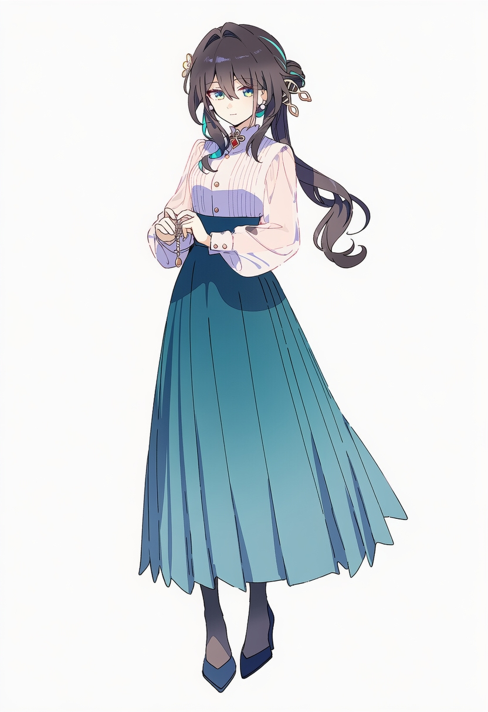

[在线例图](https://assets.quicktagcloud.com/images/raven_composition/raven_composition-3774.jpg?v=d80c8c0de38e4726)

<a id="raven_composition-3775"></a>

## 手持未穿衣物

ID：`raven_composition-3775`；分类：物体互动 / 日用品/衣物/装饰；来源标记：`safe`。

来源说明：

> 角色用手拿着未穿衣物。

正向提示词：

```text
holding_unworn_clothes
```


[在线例图](https://assets.quicktagcloud.com/images/raven_composition/raven_composition-3775.jpg?v=447080189fb6ba31)

<a id="raven_composition-3776"></a>

## 手持衣架

ID：`raven_composition-3776`；分类：物体互动 / 日用品/衣物/装饰；来源标记：`safe`。

来源说明：

> 角色用手拿着衣架。

正向提示词：

```text
holding_clothes_hanger
```

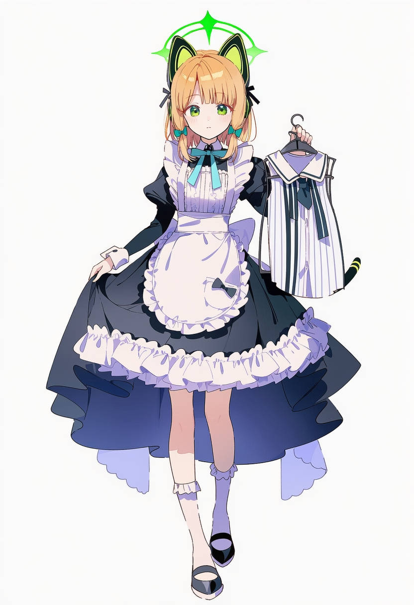

[在线例图](https://assets.quicktagcloud.com/images/raven_composition/raven_composition-3776.jpg?v=f264a9e54d4c1a30)

<a id="raven_composition-3777"></a>

## 手持摘下的眼镜

ID：`raven_composition-3777`；分类：物体互动 / 日用品/衣物/装饰；来源标记：`safe`。

来源说明：

> 角色用手拿着摘下的眼镜。

正向提示词：

```text
holding_removed_eyewear
```

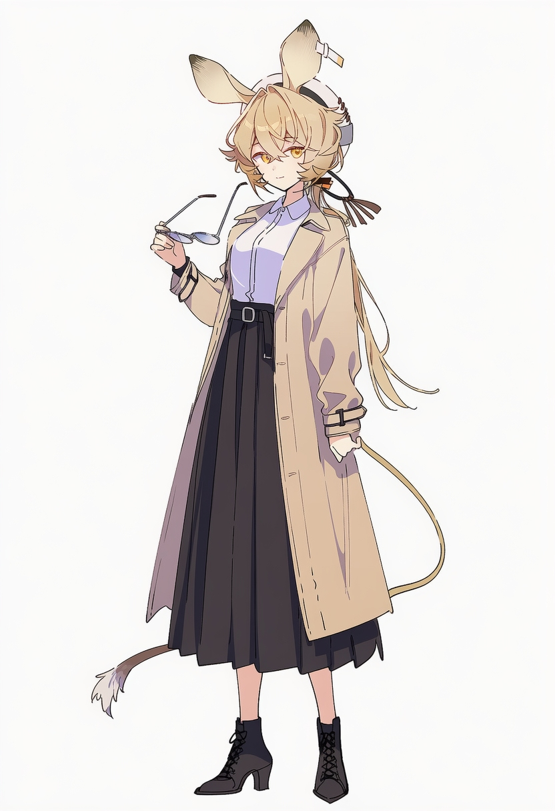

[在线例图](https://assets.quicktagcloud.com/images/raven_composition/raven_composition-3777.jpg?v=af9c099e5e660bc2)

<a id="raven_composition-3778"></a>

## 手持耳机

ID：`raven_composition-3778`；分类：物体互动 / 日用品/衣物/装饰；来源标记：`safe`。

来源说明：

> 角色用手拿着耳机。

正向提示词：

```text
holding_headphones
```

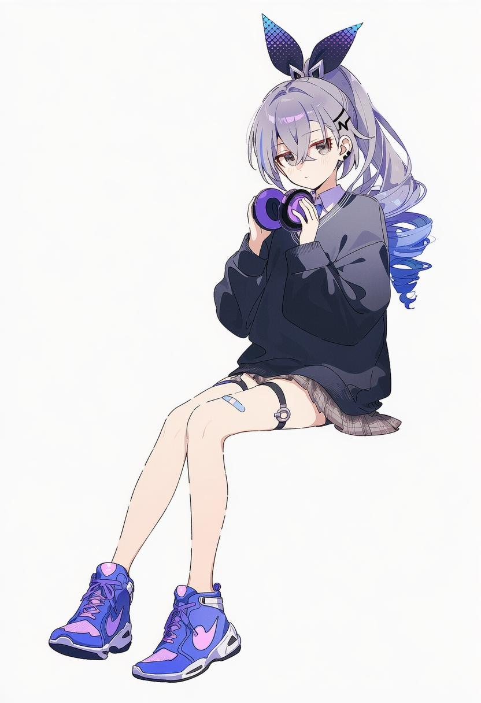

[在线例图](https://assets.quicktagcloud.com/images/raven_composition/raven_composition-3778.jpg?v=9c76d8a40210f156)

<a id="raven_composition-3779"></a>

## 手持入耳式耳机

ID：`raven_composition-3779`；分类：物体互动 / 日用品/衣物/装饰；来源标记：`safe`。

来源说明：

> 角色用手拿着入耳式耳机。

正向提示词：

```text
holding_earphones
```

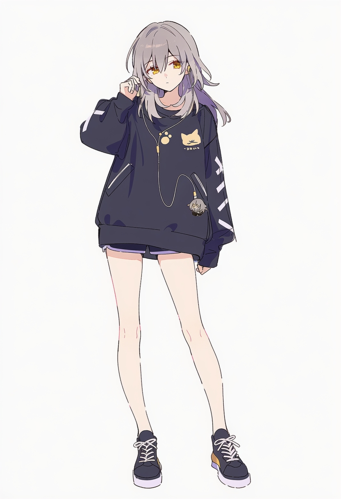

[在线例图](https://assets.quicktagcloud.com/images/raven_composition/raven_composition-3779.jpg?v=305cdf52c6c2dcab)
