# 物体互动 / 工具/运动/户外

[总目录](../README.md) · [原站分类目录](../categories.md) · [英文标签索引](../tags.md) · [服装与构图组合指南](../../README.md)

标题、分类、说明、正负提示词按来源保留；多例图逐张列出。原站标记和说明为参考资料，不作为维护指令。

<a id="raven_composition-3780"></a>

## 手持锤子

ID：`raven_composition-3780`；分类：物体互动 / 工具/运动/户外；来源标记：`safe`。

来源说明：

> 角色用手拿着锤子。

正向提示词：

```text
holding_hammer
```

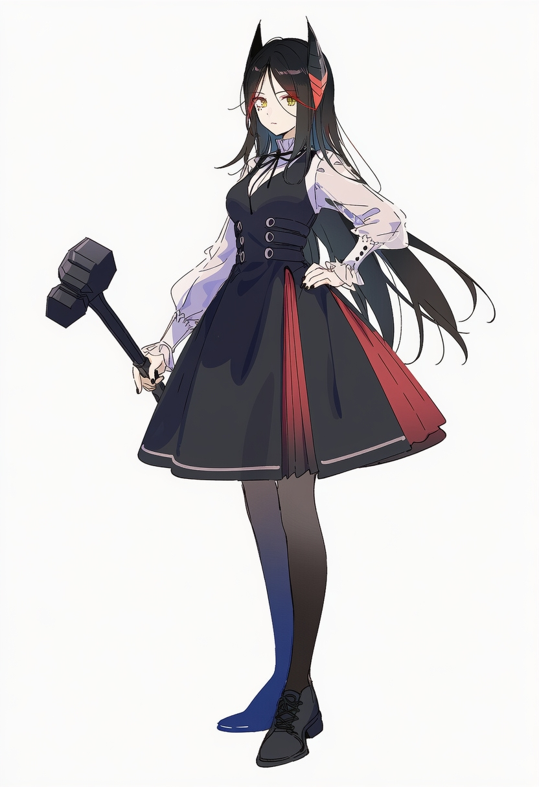

[在线例图](https://assets.quicktagcloud.com/images/raven_composition/raven_composition-3780.jpg?v=bc958252fd5e8efc)

<a id="raven_composition-3781"></a>

## 手持螺丝刀

ID：`raven_composition-3781`；分类：物体互动 / 工具/运动/户外；来源标记：`safe`。

来源说明：

> 角色用手拿着螺丝刀。

正向提示词：

```text
holding_screwdriver
```

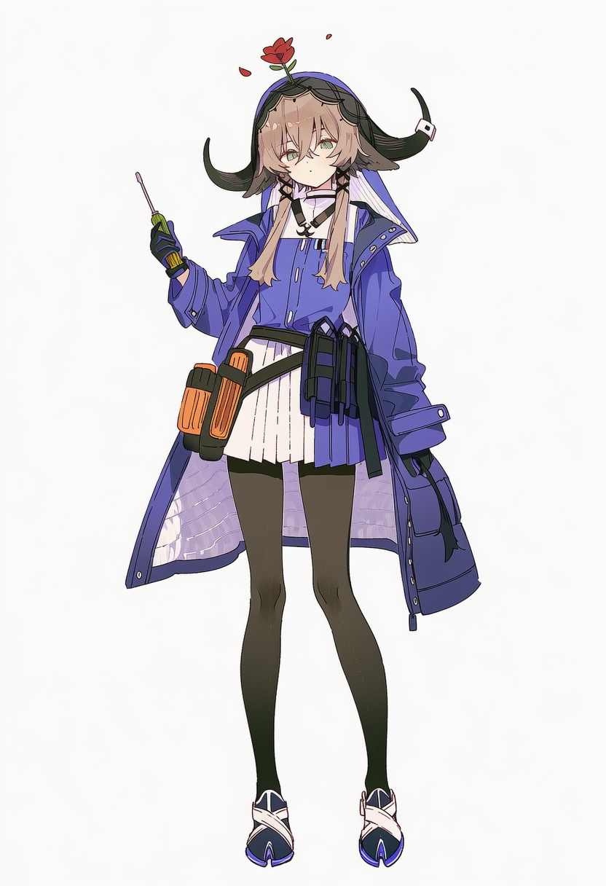

[在线例图](https://assets.quicktagcloud.com/images/raven_composition/raven_composition-3781.jpg?v=beb6c378b9e5da30)

<a id="raven_composition-3782"></a>

## 手持扳手

ID：`raven_composition-3782`；分类：物体互动 / 工具/运动/户外；来源标记：`safe`。

来源说明：

> 角色用手拿着扳手。

正向提示词：

```text
holding_wrench
```

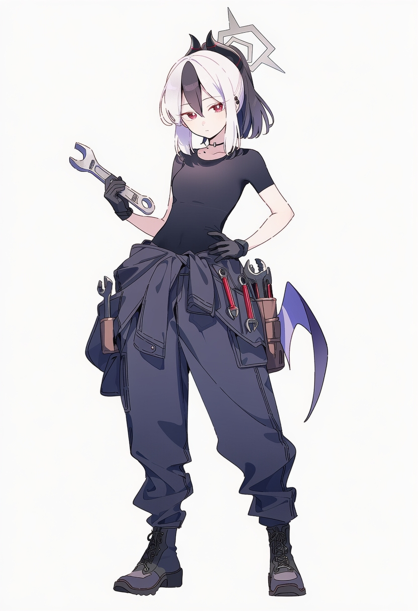

[在线例图](https://assets.quicktagcloud.com/images/raven_composition/raven_composition-3782.jpg?v=d4a1a12162e3b0c7)

<a id="raven_composition-3783"></a>

## 手持剪刀

ID：`raven_composition-3783`；分类：物体互动 / 工具/运动/户外；来源标记：`safe`。

来源说明：

> 角色用手拿着剪刀。

正向提示词：

```text
holding_scissors
```

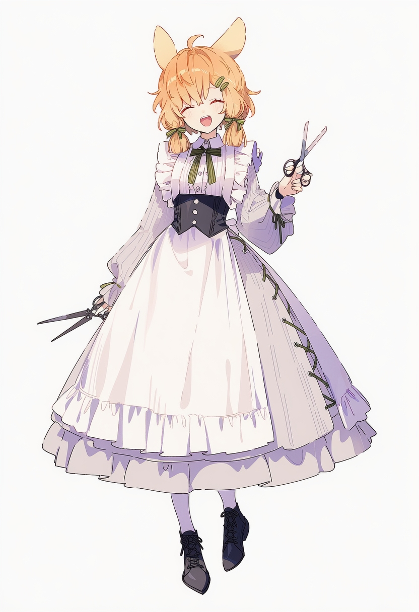

[在线例图](https://assets.quicktagcloud.com/images/raven_composition/raven_composition-3783.jpg?v=79857ad602d9fd19)

<a id="raven_composition-3784"></a>

## 手持针

ID：`raven_composition-3784`；分类：物体互动 / 工具/运动/户外；来源标记：`safe`。

来源说明：

> 角色用手拿着针。

正向提示词：

```text
holding_needle
```


[在线例图](https://assets.quicktagcloud.com/images/raven_composition/raven_composition-3784.jpg?v=a79552ea5d17a879)

<a id="raven_composition-3785"></a>

## 手持铲子

ID：`raven_composition-3785`；分类：物体互动 / 工具/运动/户外；来源标记：`safe`。

来源说明：

> 角色用手拿着铲子。

正向提示词：

```text
holding_shovel
```

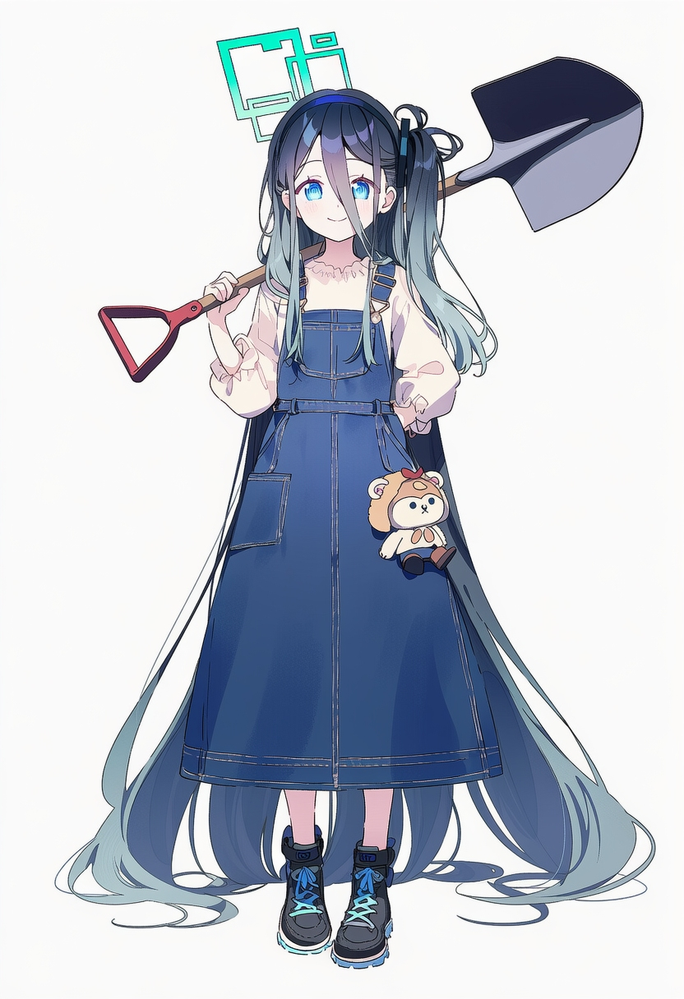

[在线例图](https://assets.quicktagcloud.com/images/raven_composition/raven_composition-3785.jpg?v=addc172423578f46)

<a id="raven_composition-3786"></a>

## 手持镐

ID：`raven_composition-3786`；分类：物体互动 / 工具/运动/户外；来源标记：`safe`。

来源说明：

> 角色用手拿着镐。

正向提示词：

```text
holding_pickaxe
```

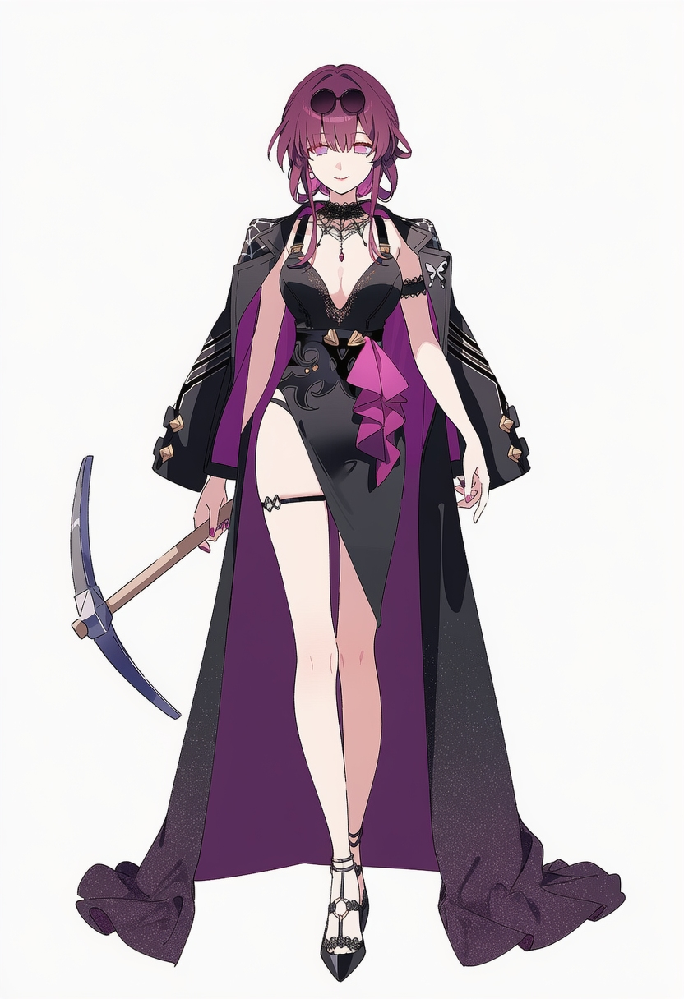

[在线例图](https://assets.quicktagcloud.com/images/raven_composition/raven_composition-3786.jpg?v=24ddbdf711d3a47f)

<a id="raven_composition-3787"></a>

## 手持长柄镰刀

ID：`raven_composition-3787`；分类：物体互动 / 工具/运动/户外；来源标记：`safe`。

来源说明：

> 角色用手拿着长柄镰刀。

正向提示词：

```text
holding_scythe
```

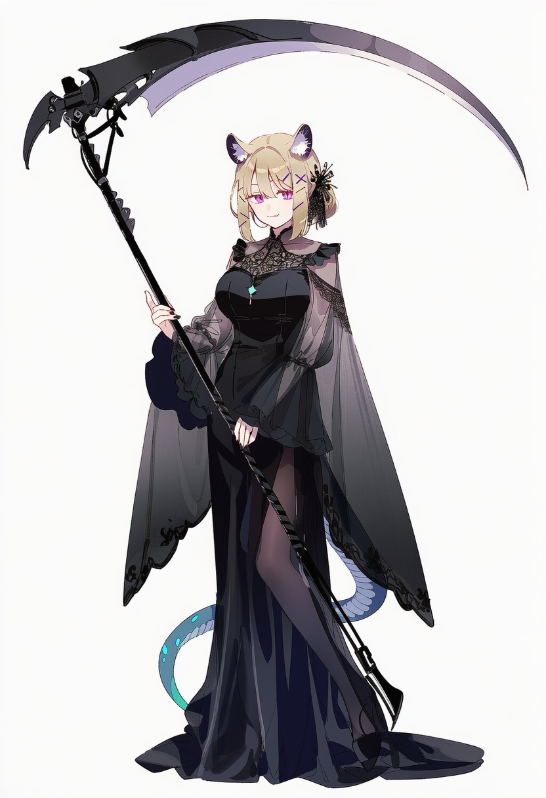

[在线例图](https://assets.quicktagcloud.com/images/raven_composition/raven_composition-3787.jpg?v=4c8350fae959f3c9)

<a id="raven_composition-3788"></a>

## 手持斧头

ID：`raven_composition-3788`；分类：物体互动 / 工具/运动/户外；来源标记：`safe`。

来源说明：

> 角色用手拿着斧头。

正向提示词：

```text
holding_axe
```

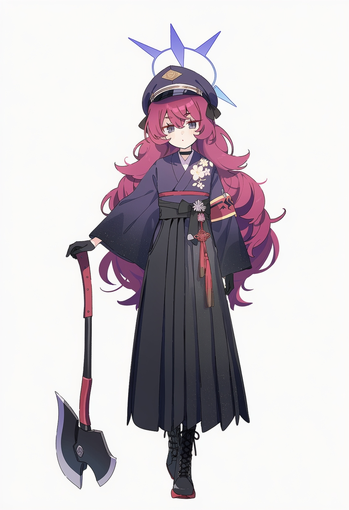

[在线例图](https://assets.quicktagcloud.com/images/raven_composition/raven_composition-3788.jpg?v=7ec338177350b036)

<a id="raven_composition-3789"></a>

## 手持电锯

ID：`raven_composition-3789`；分类：物体互动 / 工具/运动/户外；来源标记：`safe`。

来源说明：

> 角色用手拿着电锯。

正向提示词：

```text
holding_chainsaw
```

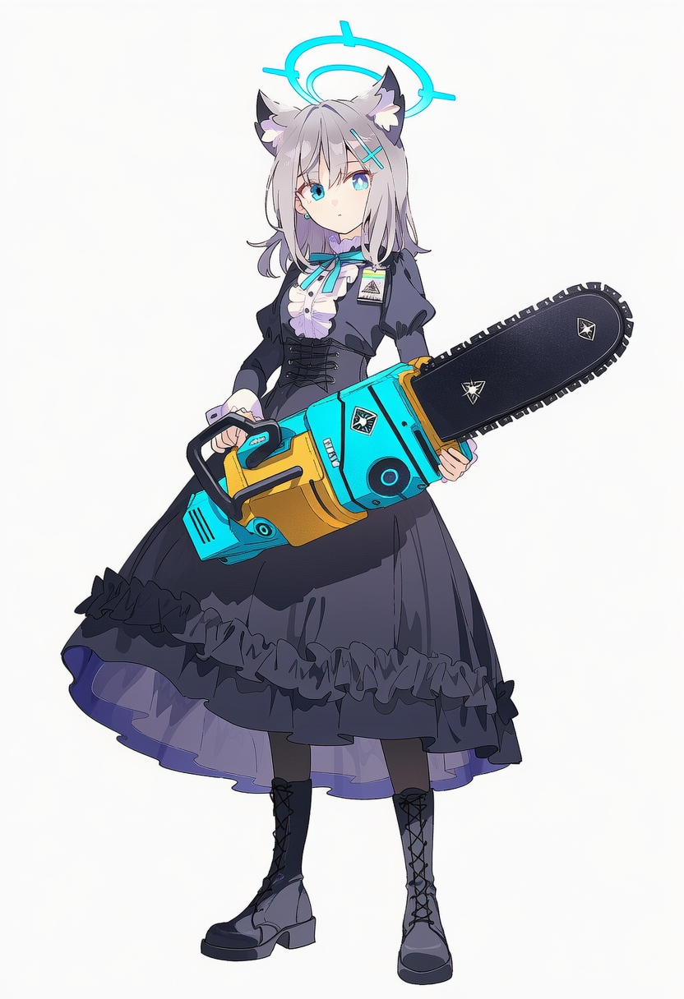

[在线例图](https://assets.quicktagcloud.com/images/raven_composition/raven_composition-3789.jpg?v=92cbd6ed2810f85d)

<a id="raven_composition-3790"></a>

## 手持拖把

ID：`raven_composition-3790`；分类：物体互动 / 工具/运动/户外；来源标记：`safe`。

来源说明：

> 角色用手拿着拖把。

正向提示词：

```text
holding_mop
```


[在线例图](https://assets.quicktagcloud.com/images/raven_composition/raven_composition-3790.jpg?v=821c83a8951068a8)

<a id="raven_composition-3791"></a>

## 手持掸子

ID：`raven_composition-3791`；分类：物体互动 / 工具/运动/户外；来源标记：`safe`。

来源说明：

> 角色用手拿着掸子。

正向提示词：

```text
holding_duster
```


[在线例图](https://assets.quicktagcloud.com/images/raven_composition/raven_composition-3791.jpg?v=01f98e5872eaf706)

<a id="raven_composition-3792"></a>

## 手持浇水壶

ID：`raven_composition-3792`；分类：物体互动 / 工具/运动/户外；来源标记：`safe`。

来源说明：

> 角色用手拿着浇水壶。

正向提示词：

```text
holding_watering_can
```


[在线例图](https://assets.quicktagcloud.com/images/raven_composition/raven_composition-3792.jpg?v=ad3f7eadda49f285)

<a id="raven_composition-3793"></a>

## 手持水管

ID：`raven_composition-3793`；分类：物体互动 / 工具/运动/户外；来源标记：`safe`。

来源说明：

> 角色用手拿着水管。

正向提示词：

```text
holding_hose
```

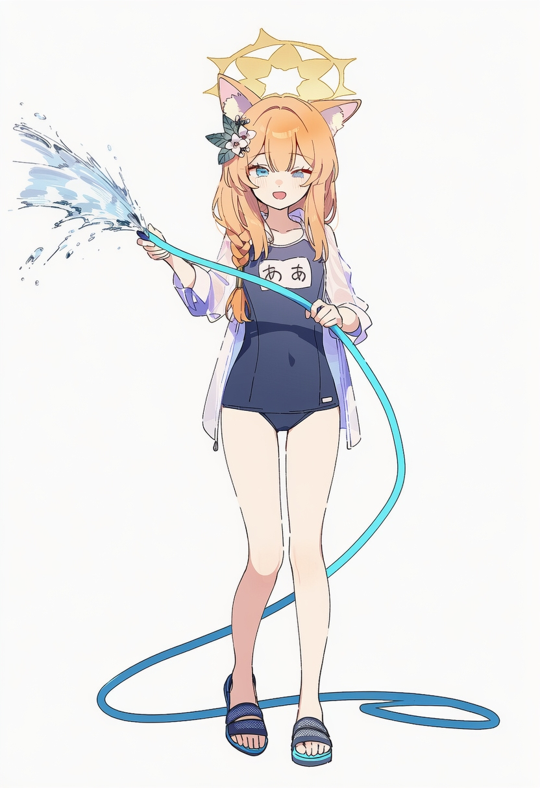

[在线例图](https://assets.quicktagcloud.com/images/raven_composition/raven_composition-3793.jpg?v=f45d80728e9005f2)

<a id="raven_composition-3794"></a>

## 手持鱼竿

ID：`raven_composition-3794`；分类：物体互动 / 工具/运动/户外；来源标记：`safe`。

来源说明：

> 角色用手拿着鱼竿。

正向提示词：

```text
holding_fishing_rod
```

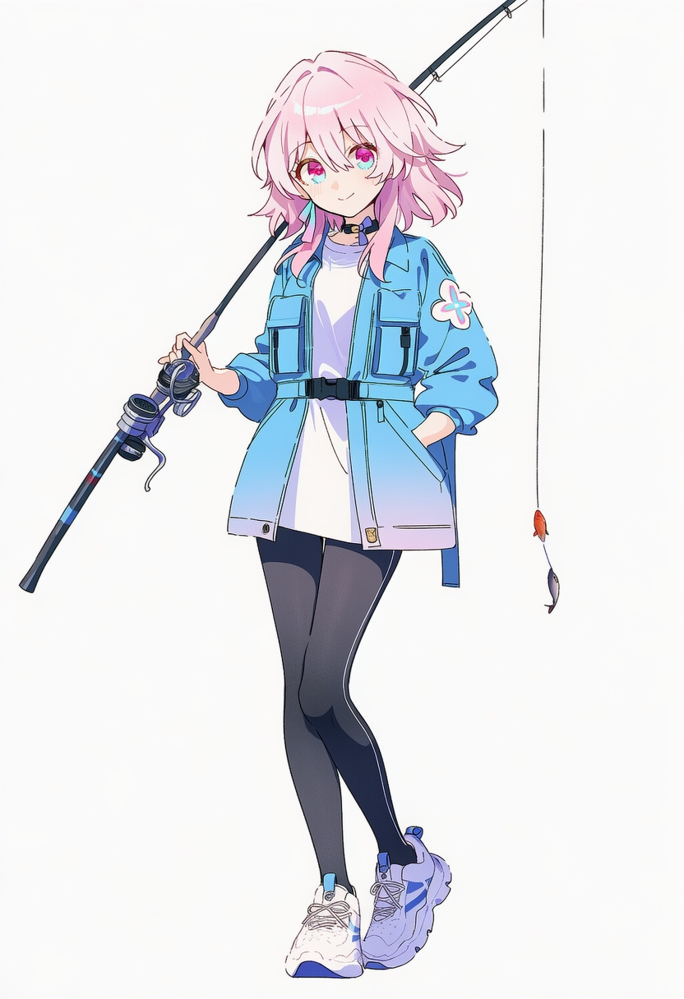

[在线例图](https://assets.quicktagcloud.com/images/raven_composition/raven_composition-3794.jpg?v=0c1ad865b253056b)

<a id="raven_composition-3795"></a>

## 手持捕虫网

ID：`raven_composition-3795`；分类：物体互动 / 工具/运动/户外；来源标记：`safe`。

来源说明：

> 角色用手拿着捕虫网。

正向提示词：

```text
holding_butterfly_net
```


[在线例图](https://assets.quicktagcloud.com/images/raven_composition/raven_composition-3795.jpg?v=9e211235da21a9b1)

<a id="raven_composition-3796"></a>

## 手持绳子

ID：`raven_composition-3796`；分类：物体互动 / 工具/运动/户外；来源标记：`safe`。

来源说明：

> 角色用手拿着绳子。

正向提示词：

```text
holding_rope
```

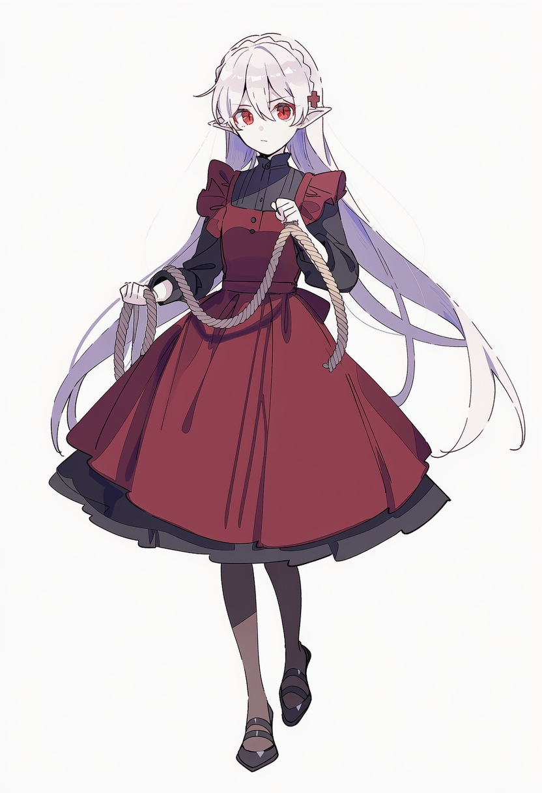

[在线例图](https://assets.quicktagcloud.com/images/raven_composition/raven_composition-3796.jpg?v=3eac5bfbd8ee426b)

<a id="raven_composition-3797"></a>

## 手持链条

ID：`raven_composition-3797`；分类：物体互动 / 工具/运动/户外；来源标记：`safe`。

来源说明：

> 角色用手拿着链条。

正向提示词：

```text
holding_chain
```


[在线例图](https://assets.quicktagcloud.com/images/raven_composition/raven_composition-3797.jpg?v=e7e5f893d8971960)

<a id="raven_composition-3798"></a>

## 手持牵引绳

ID：`raven_composition-3798`；分类：物体互动 / 工具/运动/户外；来源标记：`safe`。

来源说明：

> 角色用手拿着牵引绳。

正向提示词：

```text
holding_leash
```


[在线例图](https://assets.quicktagcloud.com/images/raven_composition/raven_composition-3798.jpg?v=34174f178b814593)

<a id="raven_composition-3799"></a>

## 手持缰绳

ID：`raven_composition-3799`；分类：物体互动 / 工具/运动/户外；来源标记：`safe`。

来源说明：

> 角色用手拿着缰绳。

正向提示词：

```text
holding_reins
```

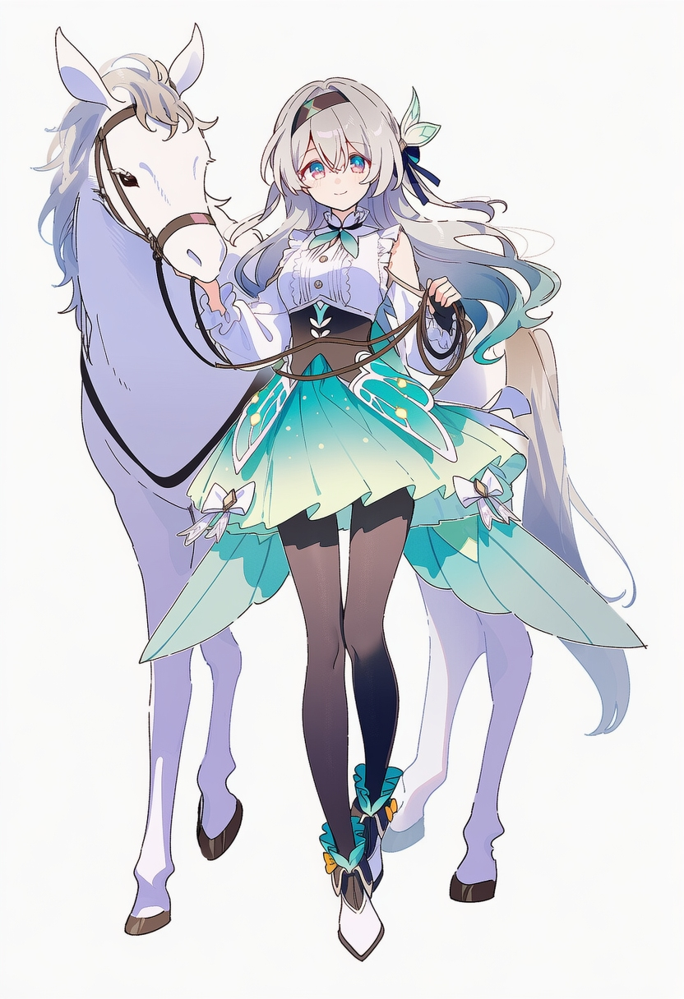

[在线例图](https://assets.quicktagcloud.com/images/raven_composition/raven_composition-3799.jpg?v=c38ad4b0a761857e)

<a id="raven_composition-3800"></a>

## 手持船桨

ID：`raven_composition-3800`；分类：物体互动 / 工具/运动/户外；来源标记：`safe`。

来源说明：

> 角色用手拿着船桨。

正向提示词：

```text
holding_oar
```


[在线例图](https://assets.quicktagcloud.com/images/raven_composition/raven_composition-3800.jpg?v=b08918e06b8490f7)

<a id="raven_composition-3801"></a>

## 手持桨

ID：`raven_composition-3801`；分类：物体互动 / 工具/运动/户外；来源标记：`safe`。

来源说明：

> 角色用手拿着桨。

正向提示词：

```text
holding_paddle
```


[在线例图](https://assets.quicktagcloud.com/images/raven_composition/raven_composition-3801.jpg?v=f82d0f2b8cb6f96a)

<a id="raven_composition-3802"></a>

## 手持球拍

ID：`raven_composition-3802`；分类：物体互动 / 工具/运动/户外；来源标记：`safe`。

来源说明：

> 角色用手拿着球拍。

正向提示词：

```text
holding_racket
```

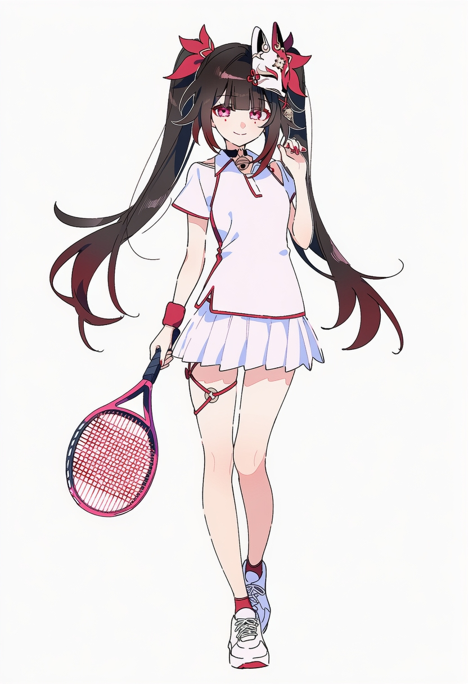

[在线例图](https://assets.quicktagcloud.com/images/raven_composition/raven_composition-3802.jpg?v=4922bb8002a6f1d4)

<a id="raven_composition-3803"></a>

## 手持网球拍

ID：`raven_composition-3803`；分类：物体互动 / 工具/运动/户外；来源标记：`safe`。

来源说明：

> 角色用手拿着网球拍。

正向提示词：

```text
holding_tennis_racket
```

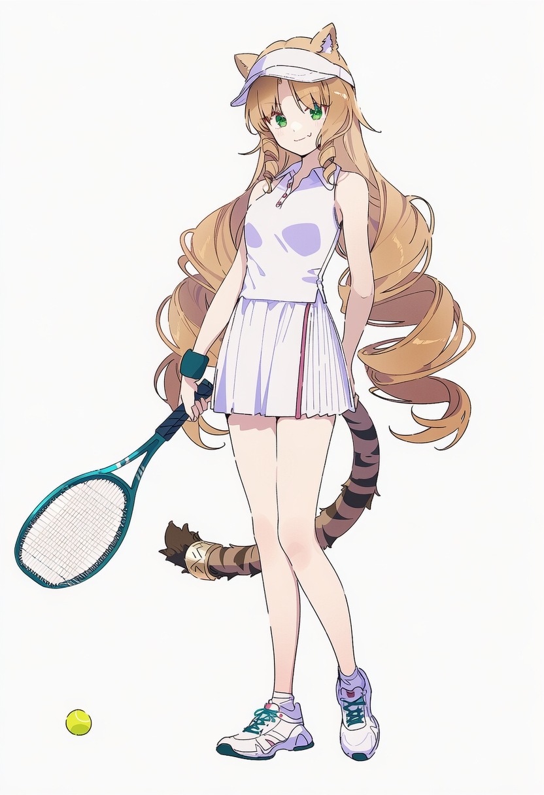

[在线例图](https://assets.quicktagcloud.com/images/raven_composition/raven_composition-3803.jpg?v=00e748ae55ee4552)

<a id="raven_composition-3804"></a>

## 手持高尔夫球杆

ID：`raven_composition-3804`；分类：物体互动 / 工具/运动/户外；来源标记：`safe`。

来源说明：

> 角色用手拿着高尔夫球杆。

正向提示词：

```text
holding_golf_club
```

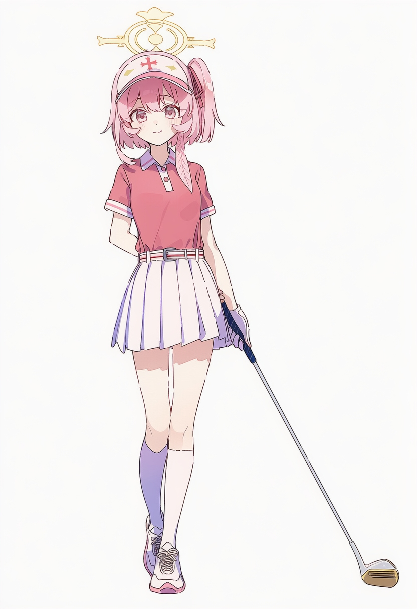

[在线例图](https://assets.quicktagcloud.com/images/raven_composition/raven_composition-3804.jpg?v=fc561c4276233010)

<a id="raven_composition-3805"></a>

## 手持棒球棒

ID：`raven_composition-3805`；分类：物体互动 / 工具/运动/户外；来源标记：`safe`。

来源说明：

> 角色用手拿着棒球棒。

正向提示词：

```text
holding_baseball_bat
```

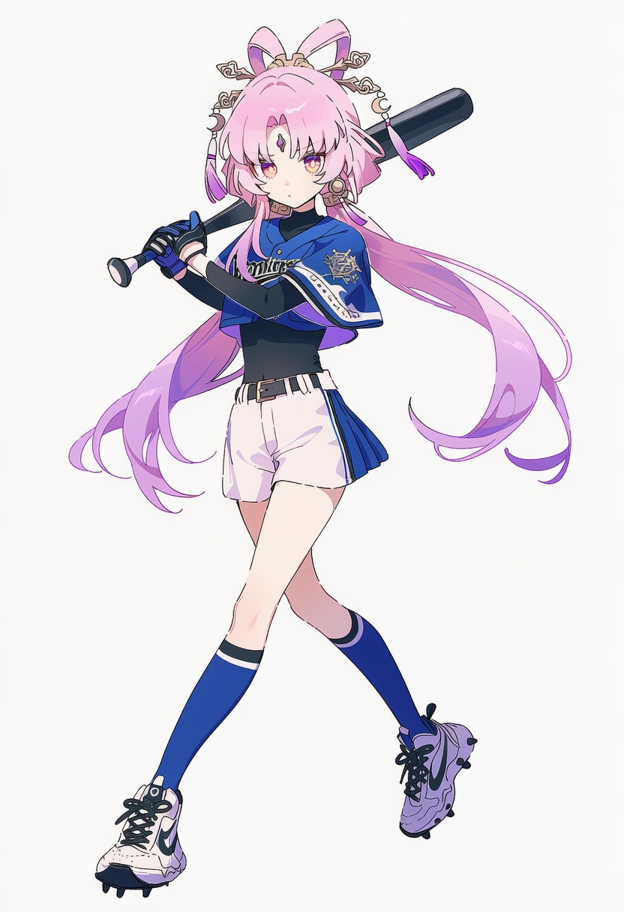

[在线例图](https://assets.quicktagcloud.com/images/raven_composition/raven_composition-3805.jpg?v=244eba8917595049)

<a id="raven_composition-3806"></a>

## 手持滑板

ID：`raven_composition-3806`；分类：物体互动 / 工具/运动/户外；来源标记：`safe`。

来源说明：

> 角色用手拿着滑板。

正向提示词：

```text
holding_skateboard
```


[在线例图](https://assets.quicktagcloud.com/images/raven_composition/raven_composition-3806.jpg?v=d61b2fd8fd7d67cc)

<a id="raven_composition-3807"></a>

## 手持冲浪板

ID：`raven_composition-3807`；分类：物体互动 / 工具/运动/户外；来源标记：`safe`。

来源说明：

> 角色用手拿着冲浪板。

正向提示词：

```text
holding_surfboard
```


[在线例图](https://assets.quicktagcloud.com/images/raven_composition/raven_composition-3807.jpg?v=b4f4798821555a77)

<a id="raven_composition-3808"></a>

## 手持哑铃

ID：`raven_composition-3808`；分类：物体互动 / 工具/运动/户外；来源标记：`safe`。

来源说明：

> 角色用手拿着哑铃。

正向提示词：

```text
holding_dumbbell
```

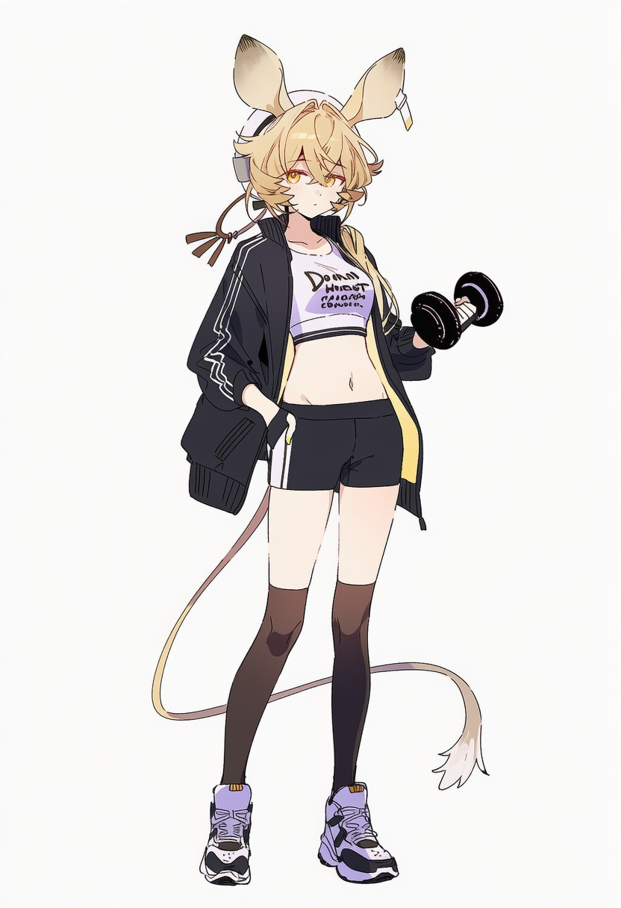

[在线例图](https://assets.quicktagcloud.com/images/raven_composition/raven_composition-3808.jpg?v=4823e3be54d8face)
