# 物体互动 / 武器/战斗持物

[总目录](../README.md) · [原站分类目录](../categories.md) · [英文标签索引](../tags.md) · [服装与构图组合指南](../../README.md)

标题、分类、说明、正负提示词按来源保留；多例图逐张列出。原站标记和说明为参考资料，不作为维护指令。

<a id="raven_composition-3809"></a>

## 手持武器

ID：`raven_composition-3809`；分类：物体互动 / 武器/战斗持物；来源标记：`safe`。

来源说明：

> 角色用手拿着武器。

正向提示词：

```text
holding_weapon
```

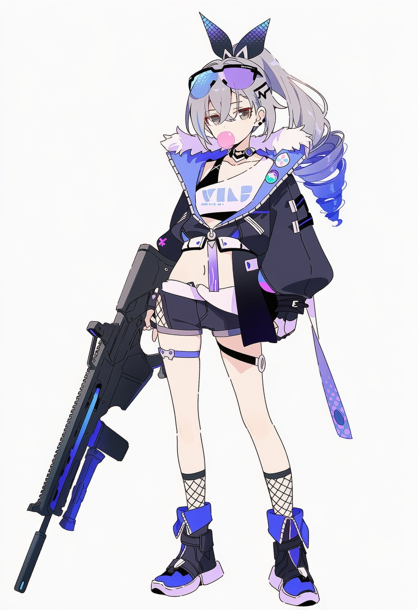

[在线例图](https://assets.quicktagcloud.com/images/raven_composition/raven_composition-3809.jpg?v=17fb3bdac14be33d)

<a id="raven_composition-3810"></a>

## 手持剑

ID：`raven_composition-3810`；分类：物体互动 / 武器/战斗持物；来源标记：`safe`。

来源说明：

> 角色用手拿着剑。

正向提示词：

```text
holding_sword
```

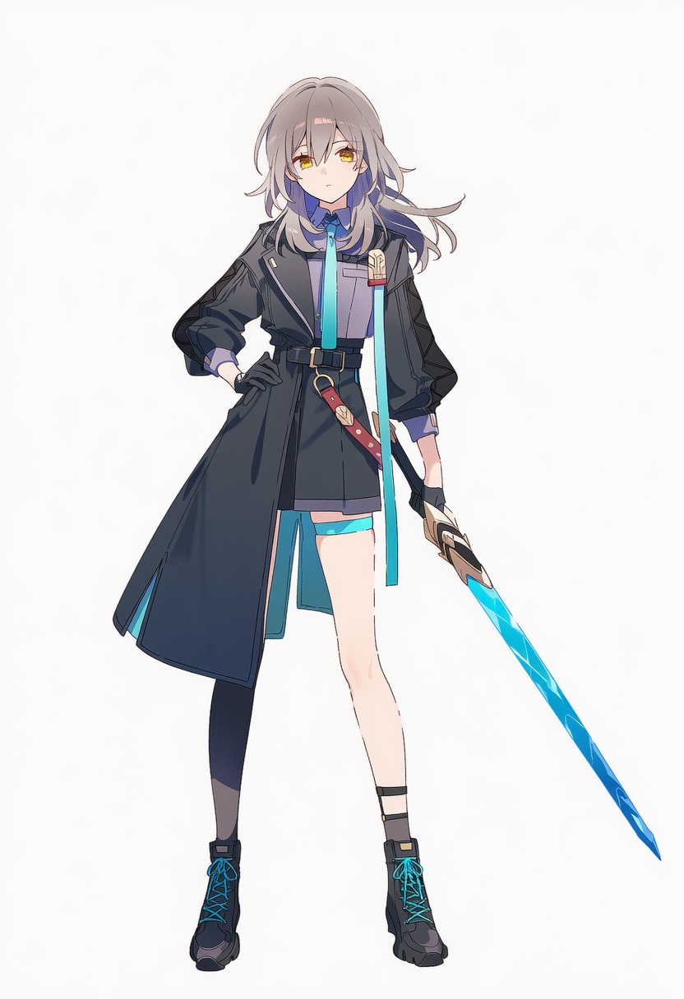

[在线例图](https://assets.quicktagcloud.com/images/raven_composition/raven_composition-3810.jpg?v=ee53ab3567a6ffd2)

<a id="raven_composition-3811"></a>

## 手持刀

ID：`raven_composition-3811`；分类：物体互动 / 武器/战斗持物；来源标记：`safe`。

来源说明：

> 角色用手拿着刀。

正向提示词：

```text
holding_knife
```

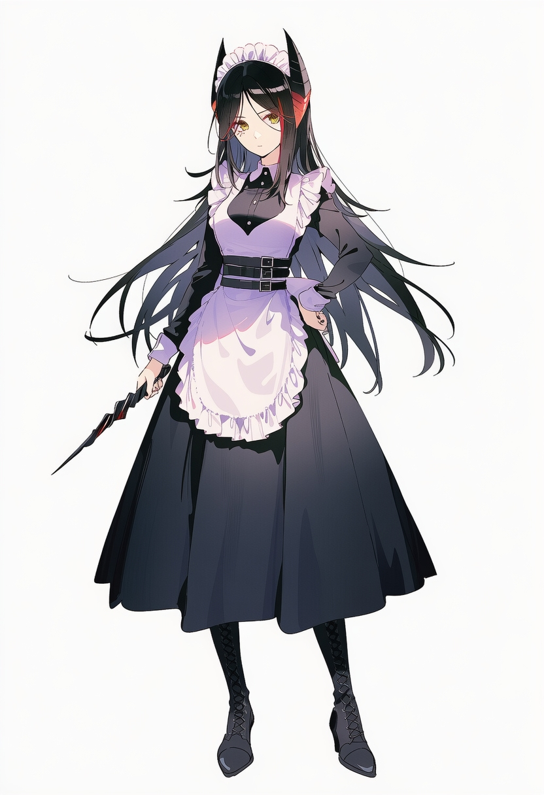

[在线例图](https://assets.quicktagcloud.com/images/raven_composition/raven_composition-3811.jpg?v=151bca6ac1172948)

<a id="raven_composition-3812"></a>

## 手持弓

ID：`raven_composition-3812`；分类：物体互动 / 武器/战斗持物；来源标记：`safe`。

来源说明：

> 角色用手拿着弓。

正向提示词：

```text
holding_bow_(weapon)
```

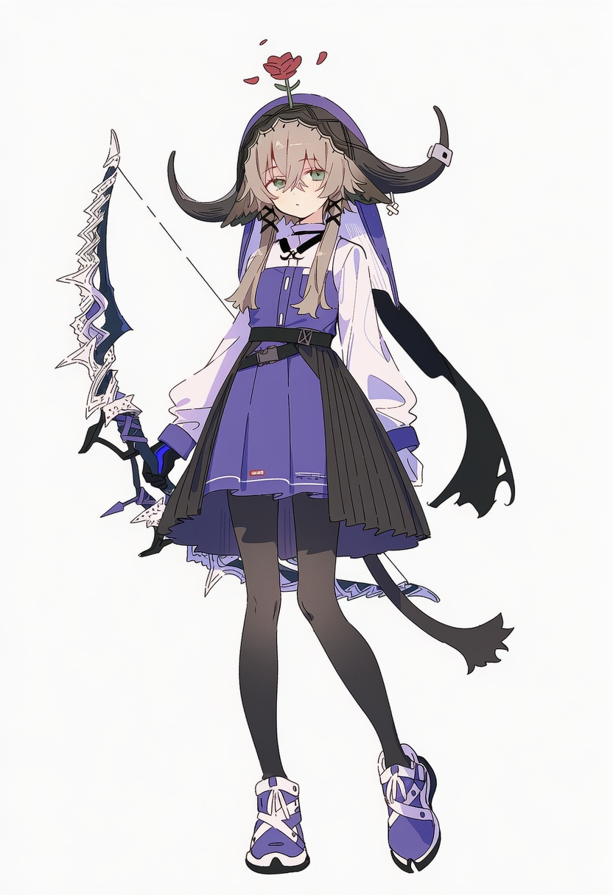

[在线例图](https://assets.quicktagcloud.com/images/raven_composition/raven_composition-3812.jpg?v=c2d50018e1c57ee1)

<a id="raven_composition-3813"></a>

## 手持箭

ID：`raven_composition-3813`；分类：物体互动 / 武器/战斗持物；来源标记：`safe`。

来源说明：

> 角色用手拿着箭。

正向提示词：

```text
holding_arrow
```

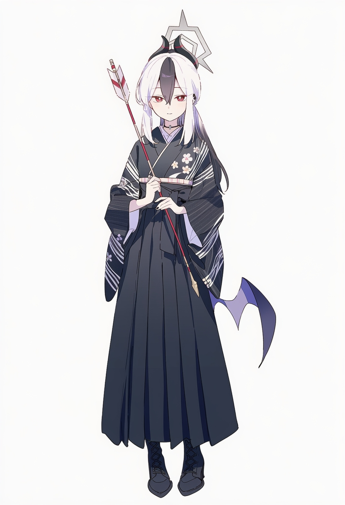

[在线例图](https://assets.quicktagcloud.com/images/raven_composition/raven_composition-3813.jpg?v=e77164ccf95d2c03)

<a id="raven_composition-3814"></a>

## 手持盾牌

ID：`raven_composition-3814`；分类：物体互动 / 武器/战斗持物；来源标记：`safe`。

来源说明：

> 角色用手拿着盾牌。

正向提示词：

```text
holding_shield
```

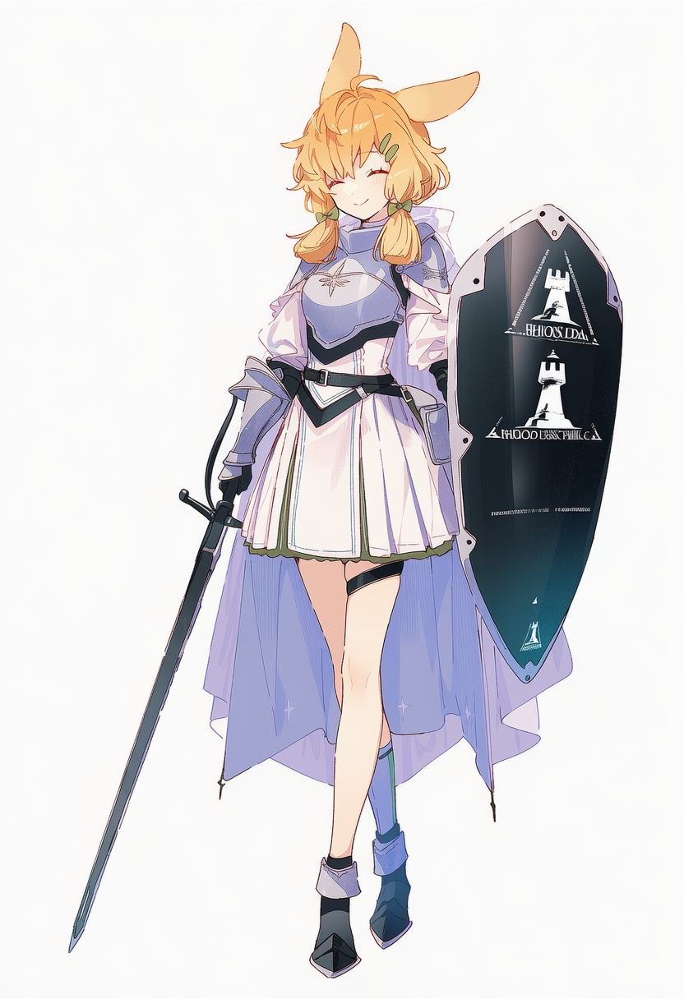

[在线例图](https://assets.quicktagcloud.com/images/raven_composition/raven_composition-3814.jpg?v=57a313f31b2fb24e)

<a id="raven_composition-3815"></a>

## 手持法杖 / 长杖

ID：`raven_composition-3815`；分类：物体互动 / 武器/战斗持物；来源标记：`safe`。

来源说明：

> 角色用手拿着法杖 / 长杖。

正向提示词：

```text
holding_staff
```

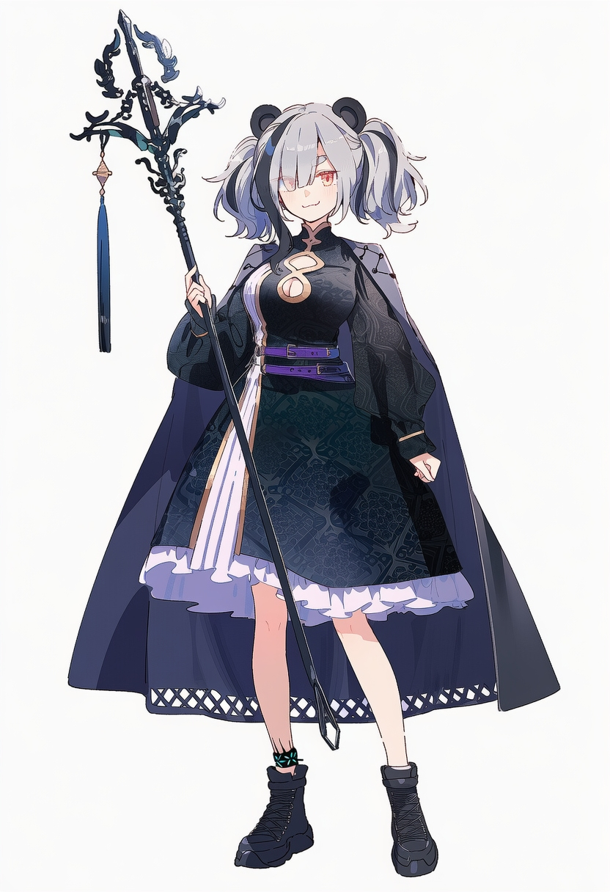

[在线例图](https://assets.quicktagcloud.com/images/raven_composition/raven_composition-3815.jpg?v=1d4824a2d2039c63)

<a id="raven_composition-3816"></a>

## 手持魔杖

ID：`raven_composition-3816`；分类：物体互动 / 武器/战斗持物；来源标记：`safe`。

来源说明：

> 角色用手拿着魔杖。

正向提示词：

```text
holding_wand
```


[在线例图](https://assets.quicktagcloud.com/images/raven_composition/raven_composition-3816.jpg?v=620391143c2b838d)

<a id="raven_composition-3817"></a>

## 手持长枪

ID：`raven_composition-3817`；分类：物体互动 / 武器/战斗持物；来源标记：`safe`。

来源说明：

> 角色用手拿着长枪。

正向提示词：

```text
holding_spear
```

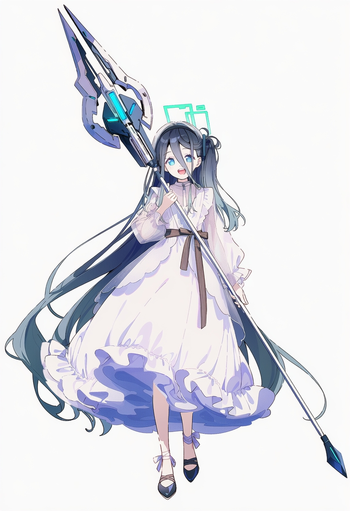

[在线例图](https://assets.quicktagcloud.com/images/raven_composition/raven_composition-3817.jpg?v=0c03d3ed7e3a8cab)

<a id="raven_composition-3818"></a>

## 手持枪械

ID：`raven_composition-3818`；分类：物体互动 / 武器/战斗持物；来源标记：`safe`。

来源说明：

> 角色用手拿着枪械。

正向提示词：

```text
holding_gun
```

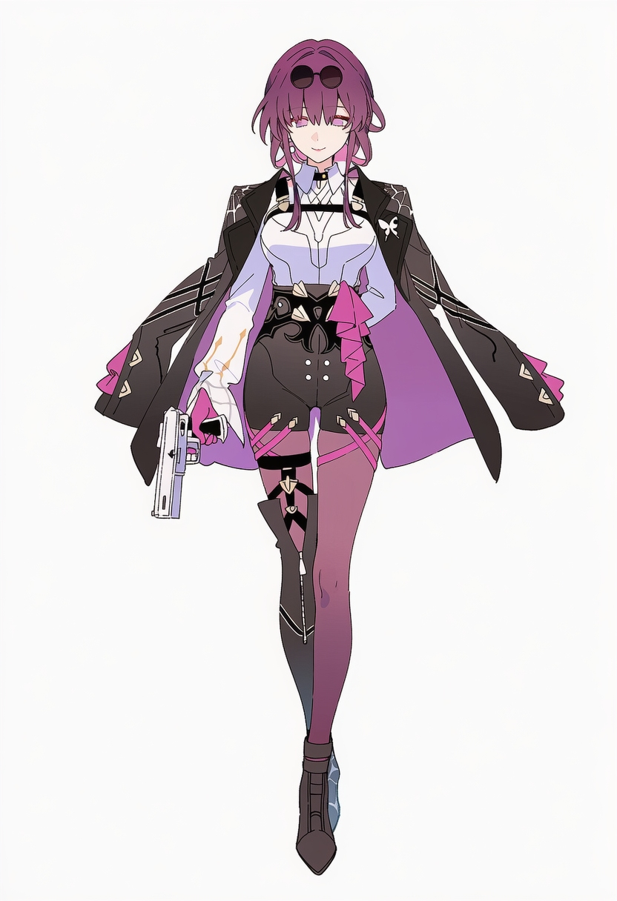

[在线例图](https://assets.quicktagcloud.com/images/raven_composition/raven_composition-3818.jpg?v=23a732d484958002)

<a id="raven_composition-3819"></a>

## 手持步枪

ID：`raven_composition-3819`；分类：物体互动 / 武器/战斗持物；来源标记：`safe`。

来源说明：

> 角色用手拿着步枪。

正向提示词：

```text
holding_rifle
```


[在线例图](https://assets.quicktagcloud.com/images/raven_composition/raven_composition-3819.jpg?v=32839a647f7e2b14)

<a id="raven_composition-3820"></a>

## 手持手枪

ID：`raven_composition-3820`；分类：物体互动 / 武器/战斗持物；来源标记：`safe`。

来源说明：

> 角色用手拿着手枪。

正向提示词：

```text
holding_pistol
```

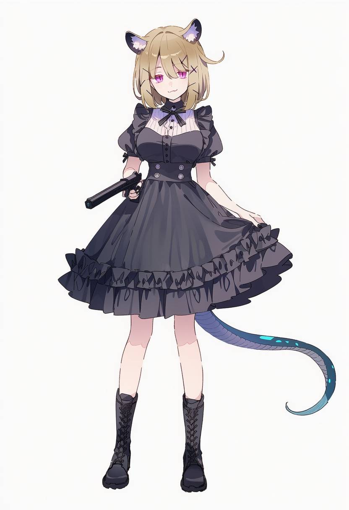

[在线例图](https://assets.quicktagcloud.com/images/raven_composition/raven_composition-3820.jpg?v=e4f288734f0d26b4)

<a id="raven_composition-3821"></a>

## 手持水枪

ID：`raven_composition-3821`；分类：物体互动 / 武器/战斗持物；来源标记：`safe`。

来源说明：

> 角色用手拿着水枪。

正向提示词：

```text
holding_water_gun
```

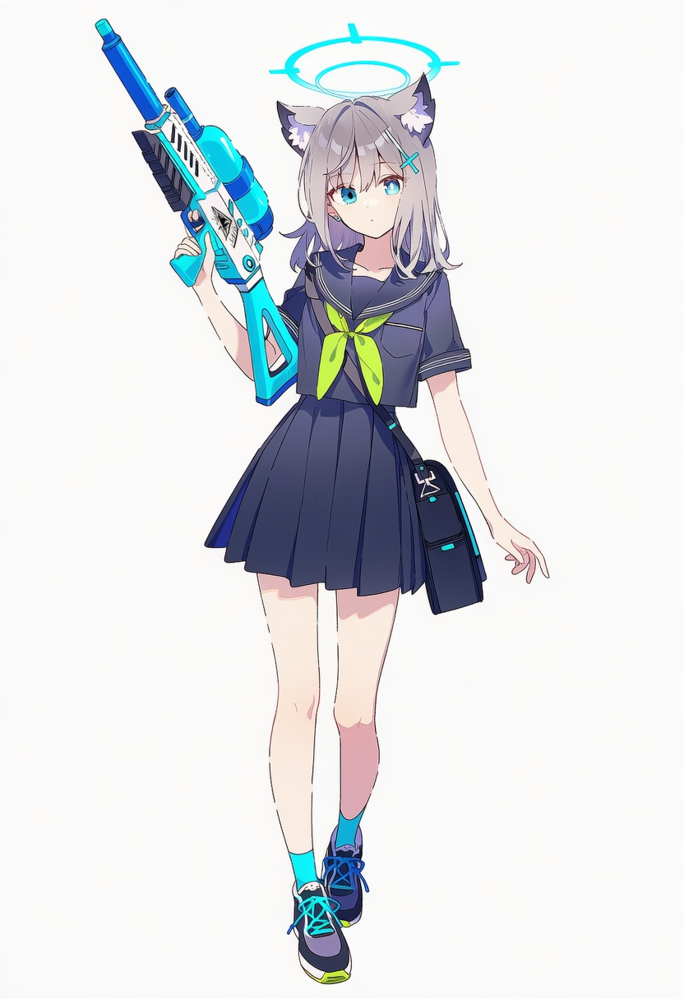

[在线例图](https://assets.quicktagcloud.com/images/raven_composition/raven_composition-3821.jpg?v=47b4c65b9d70e296)

<a id="raven_composition-3822"></a>

## 手持鞭子

ID：`raven_composition-3822`；分类：物体互动 / 武器/战斗持物；来源标记：`safe`。

来源说明：

> 角色用手拿着鞭子。

正向提示词：

```text
holding_whip
```

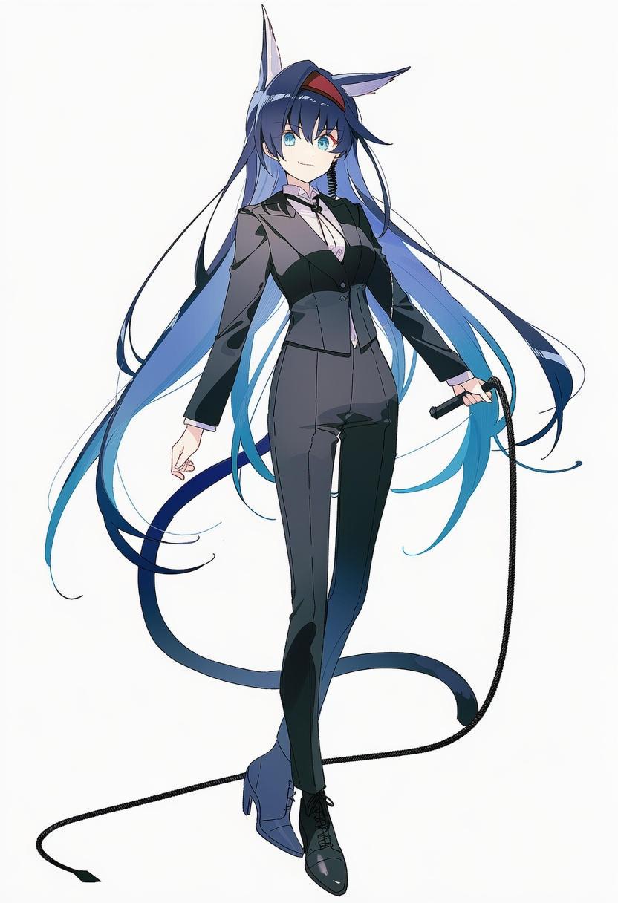

[在线例图](https://assets.quicktagcloud.com/images/raven_composition/raven_composition-3822.jpg?v=b890284592b9c7a7)

<a id="raven_composition-3823"></a>

## 双持

ID：`raven_composition-3823`；分类：物体互动 / 武器/战斗持物；来源标记：`safe`。

来源说明：

> 左右手分别持有武器或物体。

正向提示词：

```text
dual_wielding
```

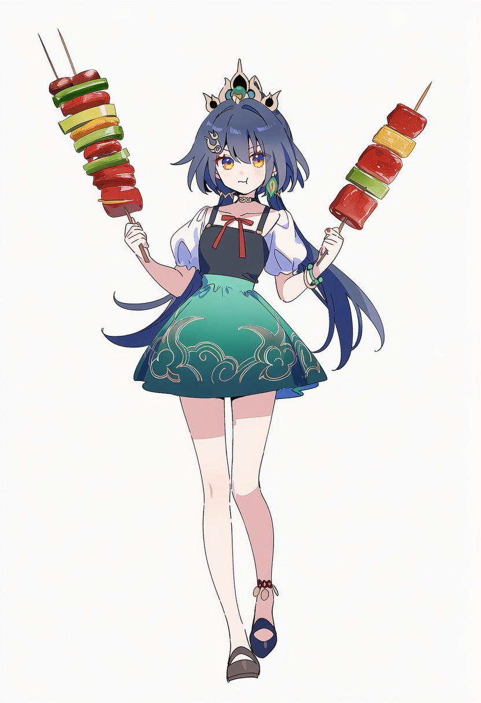

[在线例图](https://assets.quicktagcloud.com/images/raven_composition/raven_composition-3823.jpg?v=3b84c22da639c695)

<a id="raven_composition-3824"></a>

## 挥持武器

ID：`raven_composition-3824`；分类：物体互动 / 武器/战斗持物；来源标记：`safe`。

来源说明：

> 以可使用、攻击的姿态握持武器。

正向提示词：

```text
wielding
```

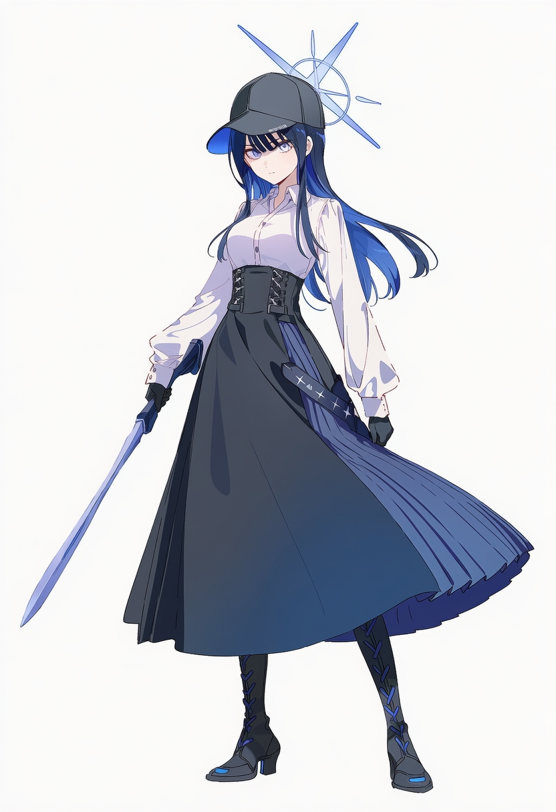

[在线例图](https://assets.quicktagcloud.com/images/raven_composition/raven_composition-3824.jpg?v=a7752ed07c5a9f52)

<a id="raven_composition-3825"></a>

## 挥舞 / 炫示武器

ID：`raven_composition-3825`；分类：物体互动 / 武器/战斗持物；来源标记：`safe`。

来源说明：

> 明显挥舞或展示手中的武器。

正向提示词：

```text
brandishing
```

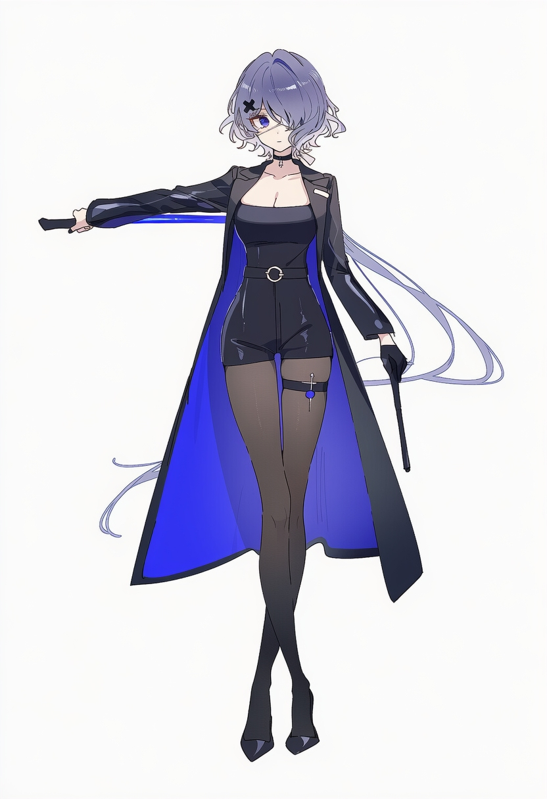

[在线例图](https://assets.quicktagcloud.com/images/raven_composition/raven_composition-3825.jpg?v=a9da13e6739ff195)

<a id="raven_composition-3826"></a>

## 瞄准

ID：`raven_composition-3826`；分类：物体互动 / 武器/战斗持物；来源标记：`safe`。

来源说明：

> 用武器或器具对准目标。

正向提示词：

```text
aiming
```

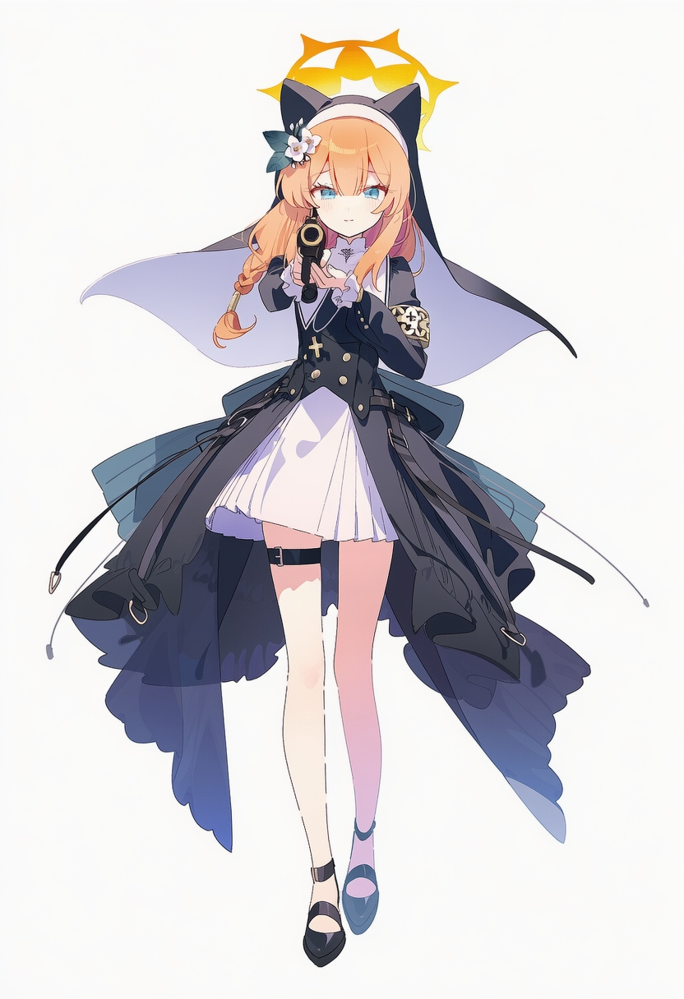

[在线例图](https://assets.quicktagcloud.com/images/raven_composition/raven_composition-3826.jpg?v=932bbea956228cbb)

<a id="raven_composition-3827"></a>

## 拔出武器

ID：`raven_composition-3827`；分类：物体互动 / 武器/战斗持物；来源标记：`safe`。

来源说明：

> 正在把武器从收纳位置拔出。

正向提示词：

```text
drawing_weapon
```

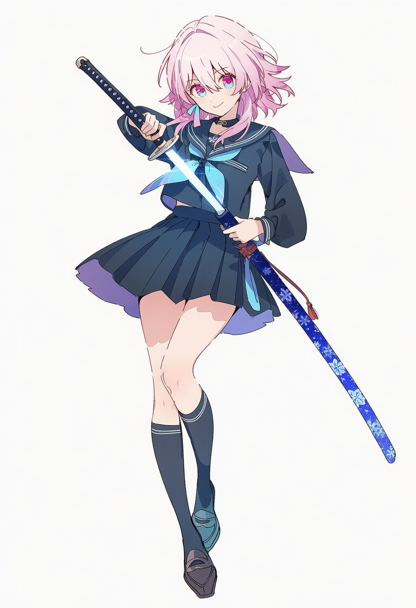

[在线例图](https://assets.quicktagcloud.com/images/raven_composition/raven_composition-3827.jpg?v=087ed2a8d98afa6e)

<a id="raven_composition-3828"></a>

## 收刀入鞘

ID：`raven_composition-3828`；分类：物体互动 / 武器/战斗持物；来源标记：`safe`。

来源说明：

> 正在把刀剑等收入鞘中。

正向提示词：

```text
sheathing
```

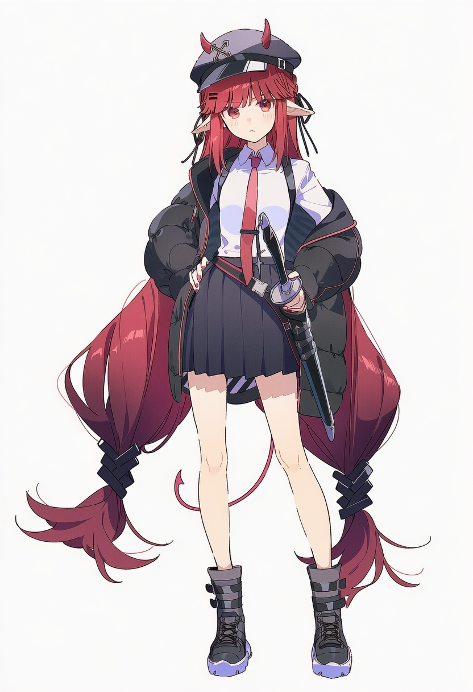

[在线例图](https://assets.quicktagcloud.com/images/raven_composition/raven_composition-3828.jpg?v=19611aeee5c088be)

<a id="raven_composition-3829"></a>

## 拔刀出鞘

ID：`raven_composition-3829`；分类：物体互动 / 武器/战斗持物；来源标记：`safe`。

来源说明：

> 正在从鞘中拔出刀剑等武器。

正向提示词：

```text
unsheathing
```

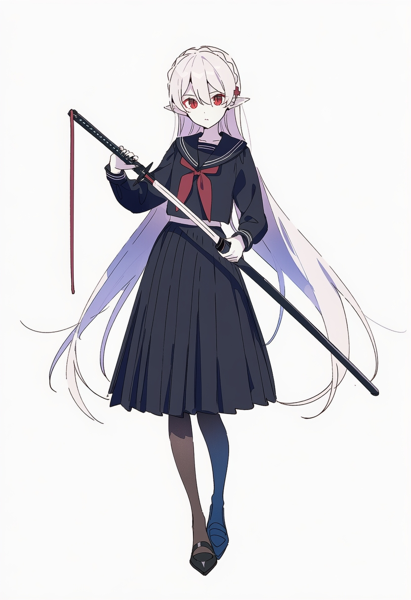

[在线例图](https://assets.quicktagcloud.com/images/raven_composition/raven_composition-3829.jpg?v=695475a09656334e)
