# 物体互动 / 生物/玩具/特殊物件

[总目录](../README.md) · [原站分类目录](../categories.md) · [英文标签索引](../tags.md) · [服装与构图组合指南](../../README.md)

标题、分类、说明、正负提示词按来源保留；多例图逐张列出。原站标记和说明为参考资料，不作为维护指令。

<a id="raven_composition-3830"></a>

## 手持动物

ID：`raven_composition-3830`；分类：物体互动 / 生物/玩具/特殊物件；来源标记：`safe`。

来源说明：

> 角色用手拿着动物。

正向提示词：

```text
holding_animal
```

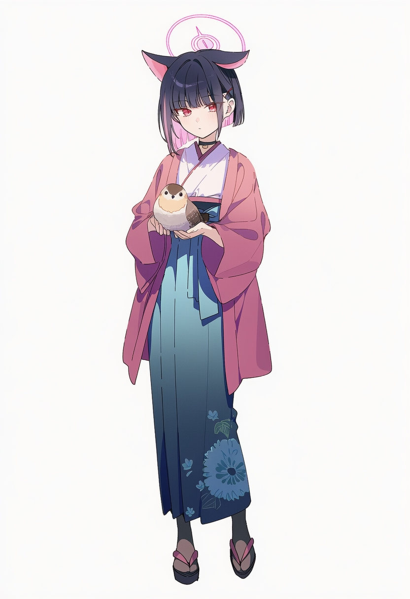

[在线例图](https://assets.quicktagcloud.com/images/raven_composition/raven_composition-3830.jpg?v=5243644378b1d862)

<a id="raven_composition-3831"></a>

## 手持生物

ID：`raven_composition-3831`；分类：物体互动 / 生物/玩具/特殊物件；来源标记：`safe`。

来源说明：

> 角色用手拿着生物。

正向提示词：

```text
holding_creature
```

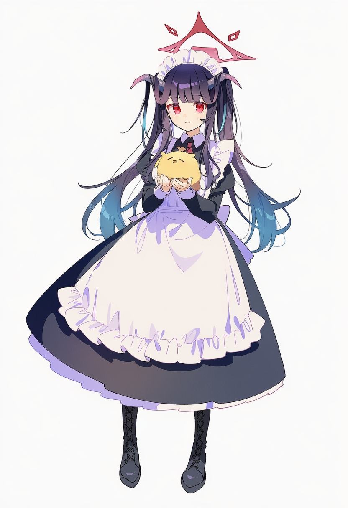

[在线例图](https://assets.quicktagcloud.com/images/raven_composition/raven_composition-3831.jpg?v=4bf69c98394890b2)

<a id="raven_composition-3832"></a>

## 手持宝可梦

ID：`raven_composition-3832`；分类：物体互动 / 生物/玩具/特殊物件；来源标记：`safe`。

来源说明：

> 角色用手拿着宝可梦。

正向提示词：

```text
holding_pokemon
```

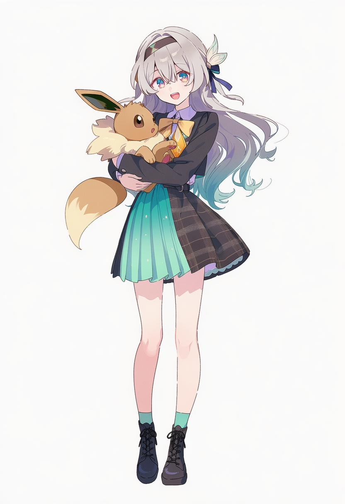

[在线例图](https://assets.quicktagcloud.com/images/raven_composition/raven_composition-3832.jpg?v=b020e0cad56072be)

<a id="raven_composition-3833"></a>

## 手持人偶

ID：`raven_composition-3833`；分类：物体互动 / 生物/玩具/特殊物件；来源标记：`safe`。

来源说明：

> 角色用手拿着人偶。

正向提示词：

```text
holding_doll
```

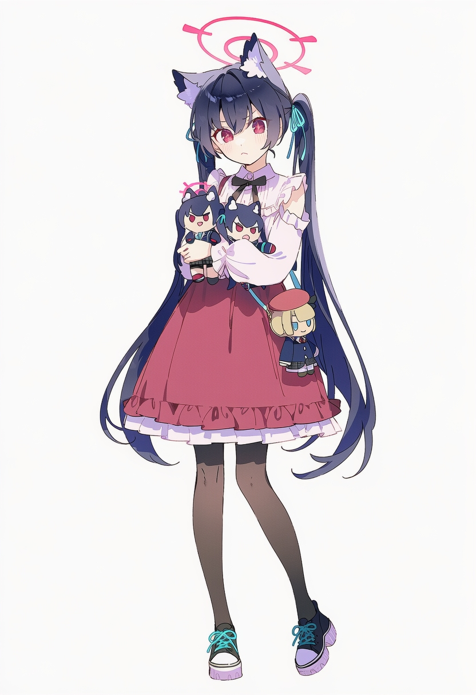

[在线例图](https://assets.quicktagcloud.com/images/raven_composition/raven_composition-3833.jpg?v=3be6f5357b3ed015)

<a id="raven_composition-3834"></a>

## 手持毛绒玩具

ID：`raven_composition-3834`；分类：物体互动 / 生物/玩具/特殊物件；来源标记：`safe`。

来源说明：

> 角色用手拿着毛绒玩具。

正向提示词：

```text
holding_stuffed_toy
```

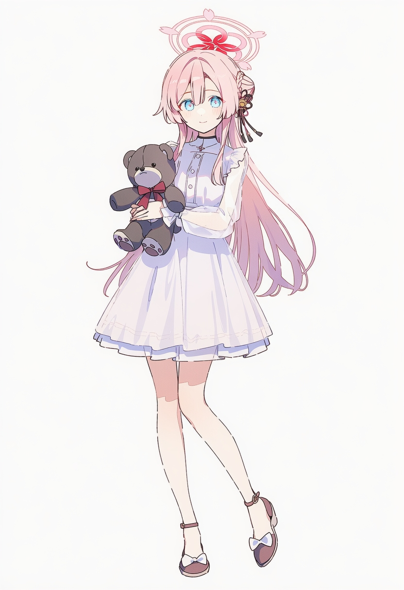

[在线例图](https://assets.quicktagcloud.com/images/raven_composition/raven_composition-3834.jpg?v=d232e4e95b9bc2bf)

<a id="raven_composition-3835"></a>

## 手持玩具

ID：`raven_composition-3835`；分类：物体互动 / 生物/玩具/特殊物件；来源标记：`safe`。

来源说明：

> 角色用手拿着玩具。

正向提示词：

```text
holding_toy
```

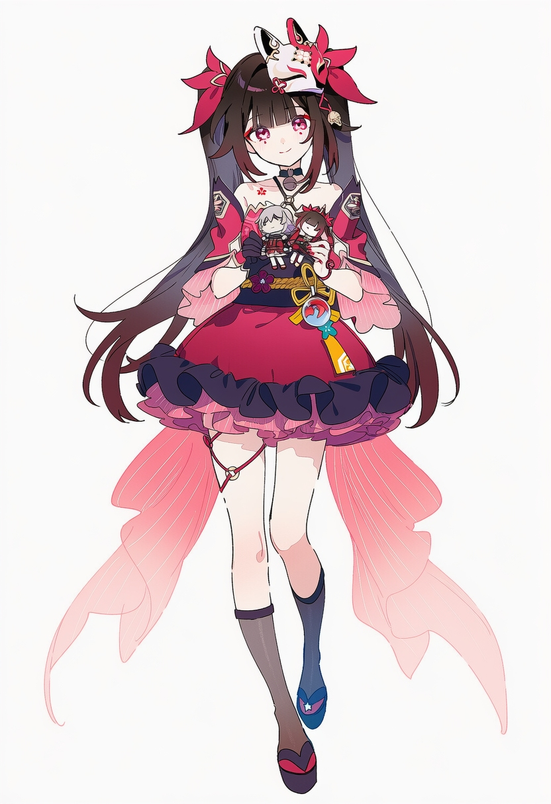

[在线例图](https://assets.quicktagcloud.com/images/raven_composition/raven_composition-3835.jpg?v=77064dcd18803314)

<a id="raven_composition-3836"></a>

## 手持头骨

ID：`raven_composition-3836`；分类：物体互动 / 生物/玩具/特殊物件；来源标记：`safe`。

来源说明：

> 角色用手拿着头骨。

正向提示词：

```text
holding_skull
```

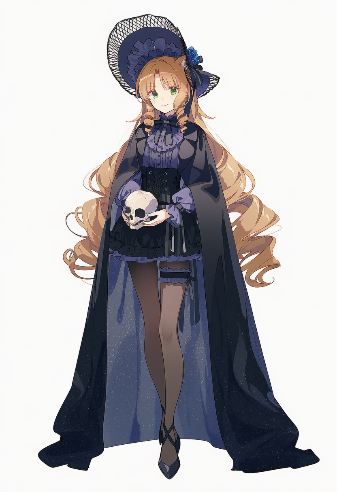

[在线例图](https://assets.quicktagcloud.com/images/raven_composition/raven_composition-3836.jpg?v=e1fe9b09d0f81ceb)

<a id="raven_composition-3837"></a>

## 手持骨头

ID：`raven_composition-3837`；分类：物体互动 / 生物/玩具/特殊物件；来源标记：`safe`。

来源说明：

> 角色用手拿着骨头。

正向提示词：

```text
holding_bone
```

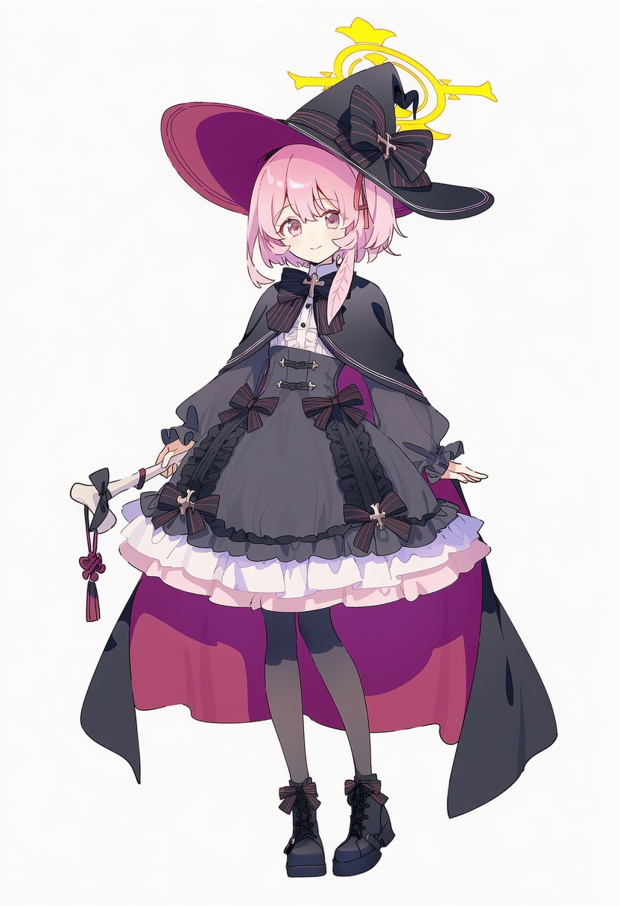

[在线例图](https://assets.quicktagcloud.com/images/raven_composition/raven_composition-3837.jpg?v=bc7260476875517c)

<a id="raven_composition-3838"></a>

## 手持心形物

ID：`raven_composition-3838`；分类：物体互动 / 生物/玩具/特殊物件；来源标记：`safe`。

来源说明：

> 角色用手拿着心形物。

正向提示词：

```text
holding_heart
```

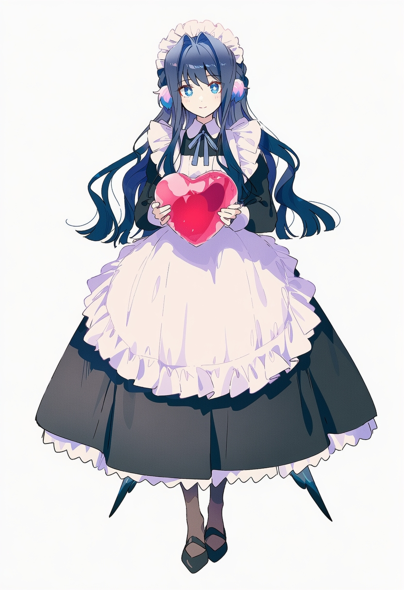

[在线例图](https://assets.quicktagcloud.com/images/raven_composition/raven_composition-3838.jpg?v=d11df03ab768e18f)

<a id="raven_composition-3839"></a>

## 手持球体 / 宝珠

ID：`raven_composition-3839`；分类：物体互动 / 生物/玩具/特殊物件；来源标记：`safe`。

来源说明：

> 角色用手拿着球体 / 宝珠。

正向提示词：

```text
holding_orb
```

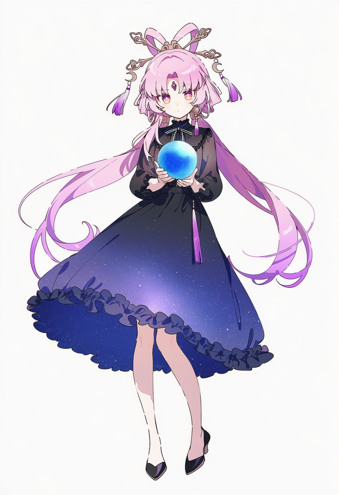

[在线例图](https://assets.quicktagcloud.com/images/raven_composition/raven_composition-3839.jpg?v=2f80303f38ead971)

<a id="raven_composition-3840"></a>

## 手持宝石

ID：`raven_composition-3840`；分类：物体互动 / 生物/玩具/特殊物件；来源标记：`safe`。

来源说明：

> 角色用手拿着宝石。

正向提示词：

```text
holding_gem
```

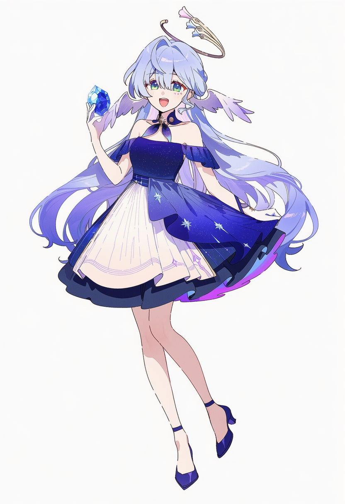

[在线例图](https://assets.quicktagcloud.com/images/raven_composition/raven_composition-3840.jpg?v=f2302381fd2d1b76)

<a id="raven_composition-3841"></a>

## 手持星形物

ID：`raven_composition-3841`；分类：物体互动 / 生物/玩具/特殊物件；来源标记：`safe`。

来源说明：

> 角色用手拿着星形物。

正向提示词：

```text
holding_star
```

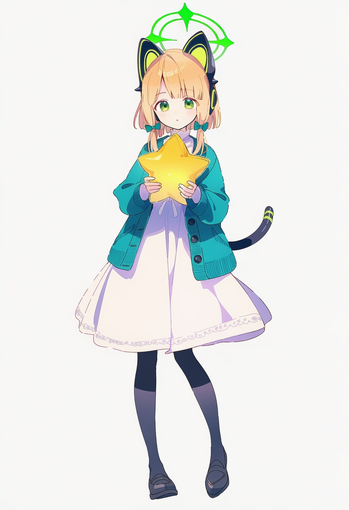

[在线例图](https://assets.quicktagcloud.com/images/raven_composition/raven_composition-3841.jpg?v=3ead3042b63fd2b3)

<a id="raven_composition-3842"></a>

## 手持蜡烛

ID：`raven_composition-3842`；分类：物体互动 / 生物/玩具/特殊物件；来源标记：`safe`。

来源说明：

> 角色用手拿着蜡烛。

正向提示词：

```text
holding_candle
```

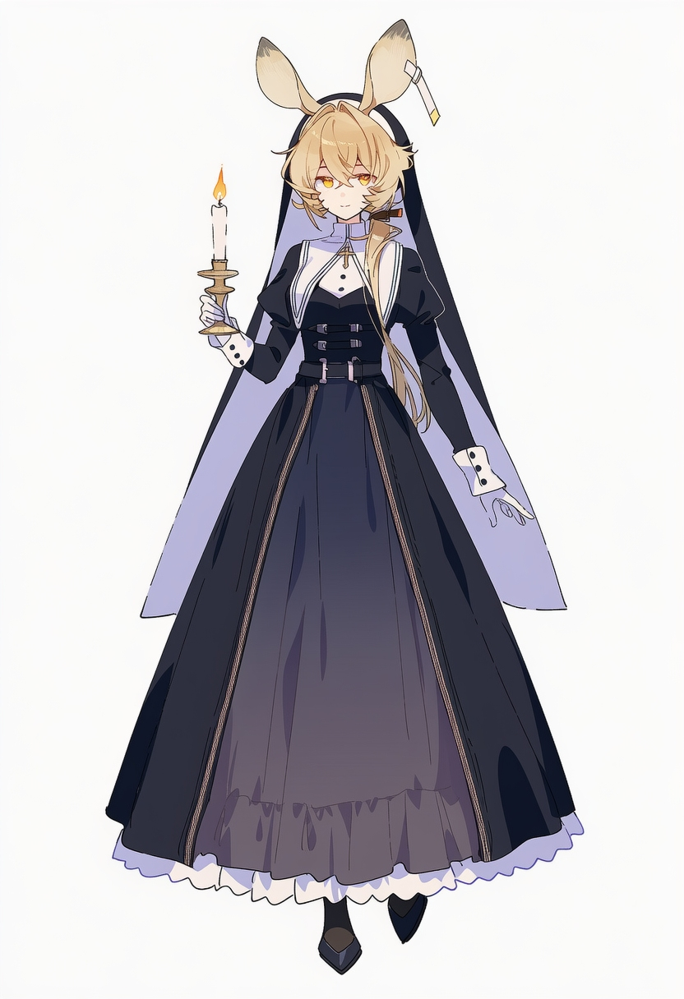

[在线例图](https://assets.quicktagcloud.com/images/raven_composition/raven_composition-3842.jpg?v=1fe7978d1ba59c1e)

<a id="raven_composition-3843"></a>

## 手持灯笼

ID：`raven_composition-3843`；分类：物体互动 / 生物/玩具/特殊物件；来源标记：`safe`。

来源说明：

> 角色用手拿着灯笼。

正向提示词：

```text
holding_lantern
```

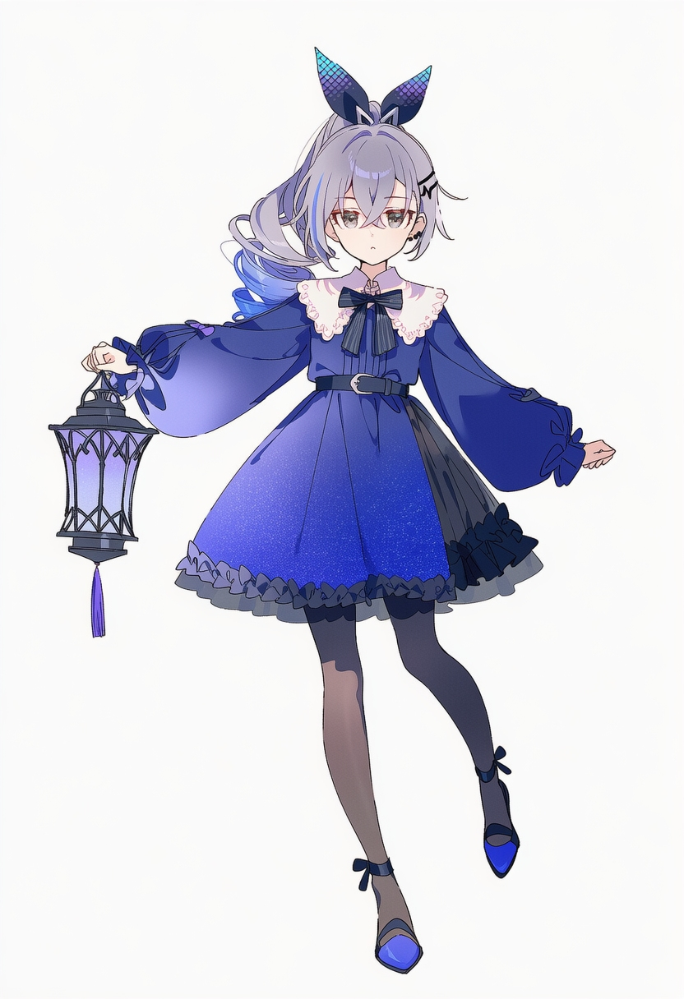

[在线例图](https://assets.quicktagcloud.com/images/raven_composition/raven_composition-3843.jpg?v=aa77d23233f07431)

<a id="raven_composition-3844"></a>

## 手持荧光棒

ID：`raven_composition-3844`；分类：物体互动 / 生物/玩具/特殊物件；来源标记：`safe`。

来源说明：

> 角色用手拿着荧光棒。

正向提示词：

```text
holding_glowstick
```

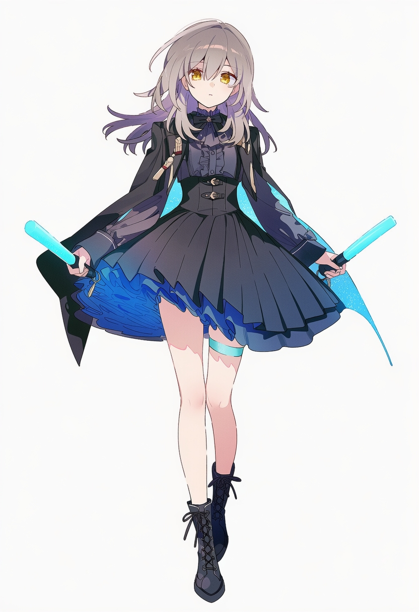

[在线例图](https://assets.quicktagcloud.com/images/raven_composition/raven_composition-3844.jpg?v=1975ef31b56762bf)

<a id="raven_composition-3845"></a>

## 手持旗帜

ID：`raven_composition-3845`；分类：物体互动 / 生物/玩具/特殊物件；来源标记：`safe`。

来源说明：

> 角色用手拿着旗帜。

正向提示词：

```text
holding_flag
```

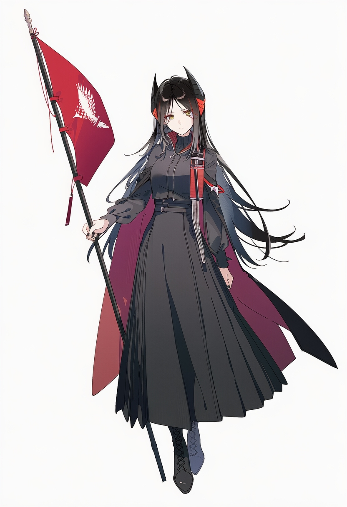

[在线例图](https://assets.quicktagcloud.com/images/raven_composition/raven_composition-3845.jpg?v=764cdffe14d48034)

<a id="raven_composition-3846"></a>

## 手持标牌

ID：`raven_composition-3846`；分类：物体互动 / 生物/玩具/特殊物件；来源标记：`safe`。

来源说明：

> 角色用手拿着标牌。

正向提示词：

```text
holding_sign
```

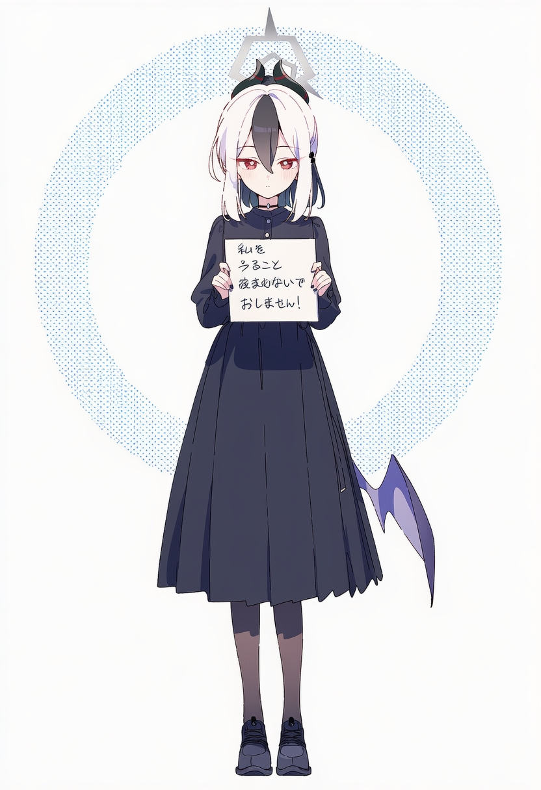

[在线例图](https://assets.quicktagcloud.com/images/raven_composition/raven_composition-3846.jpg?v=d0c3a38be8e1e2c3)

<a id="raven_composition-3847"></a>

## 手持奖杯

ID：`raven_composition-3847`；分类：物体互动 / 生物/玩具/特殊物件；来源标记：`safe`。

来源说明：

> 角色用手拿着奖杯。

正向提示词：

```text
holding_trophy
```

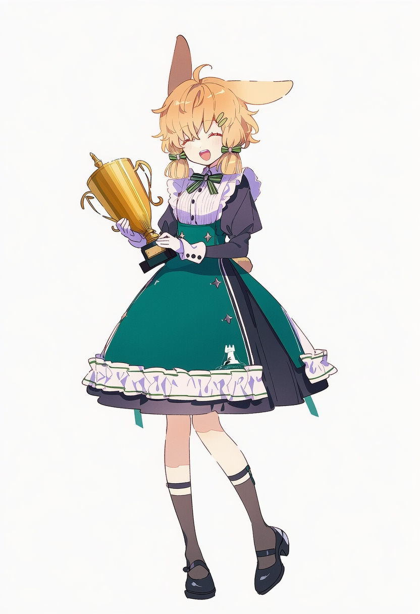

[在线例图](https://assets.quicktagcloud.com/images/raven_composition/raven_composition-3847.jpg?v=431449a0c62737f2)

<a id="raven_composition-3848"></a>

## 手持王冠

ID：`raven_composition-3848`；分类：物体互动 / 生物/玩具/特殊物件；来源标记：`safe`。

来源说明：

> 角色用手拿着王冠。

正向提示词：

```text
holding_crown
```

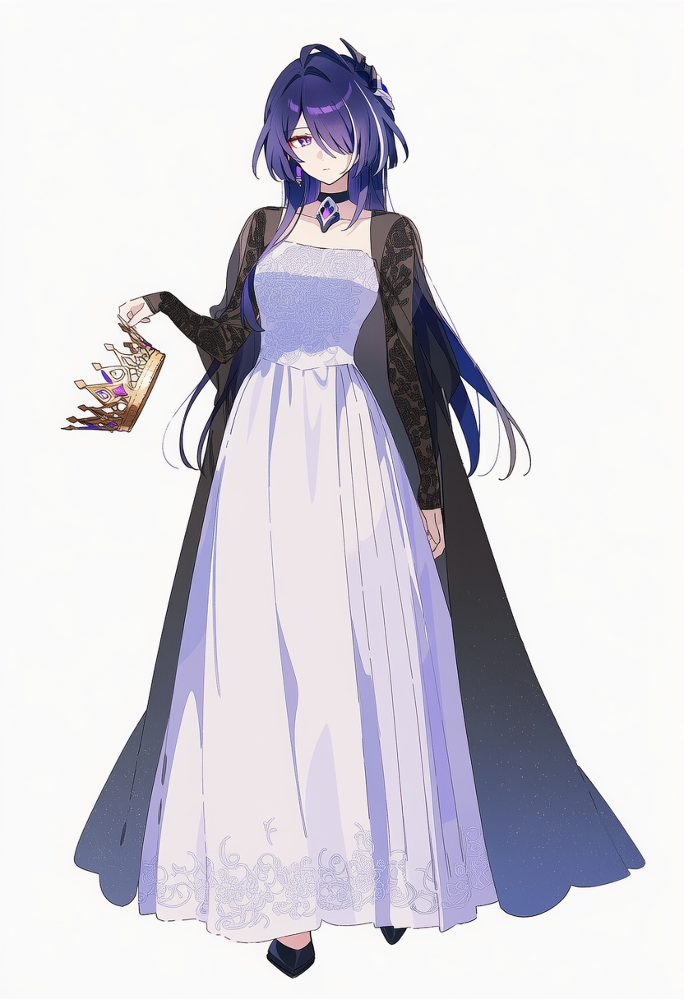

[在线例图](https://assets.quicktagcloud.com/images/raven_composition/raven_composition-3848.jpg?v=a23e8134bb00dc65)

<a id="raven_composition-3849"></a>

## 手持权杖

ID：`raven_composition-3849`；分类：物体互动 / 生物/玩具/特殊物件；来源标记：`safe`。

来源说明：

> 角色用手拿着权杖。

正向提示词：

```text
holding_scepter
```

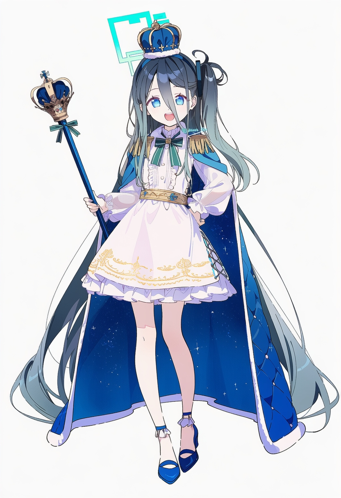

[在线例图](https://assets.quicktagcloud.com/images/raven_composition/raven_composition-3849.jpg?v=60bea30579b859a1)

<a id="raven_composition-3850"></a>

## 手持十字架

ID：`raven_composition-3850`；分类：物体互动 / 生物/玩具/特殊物件；来源标记：`safe`。

来源说明：

> 角色用手拿着十字架。

正向提示词：

```text
holding_cross
```

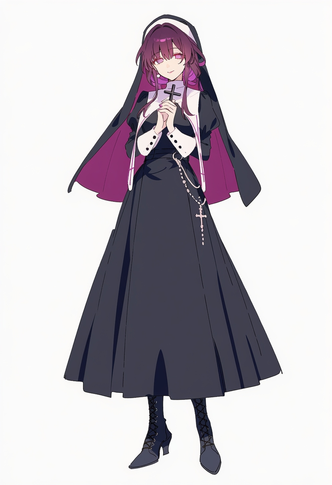

[在线例图](https://assets.quicktagcloud.com/images/raven_composition/raven_composition-3850.jpg?v=4ce26e091f61bfbf)

<a id="raven_composition-3851"></a>

## 手持御札

ID：`raven_composition-3851`；分类：物体互动 / 生物/玩具/特殊物件；来源标记：`safe`。

来源说明：

> 角色用手拿着御札。

正向提示词：

```text
holding_ofuda
```

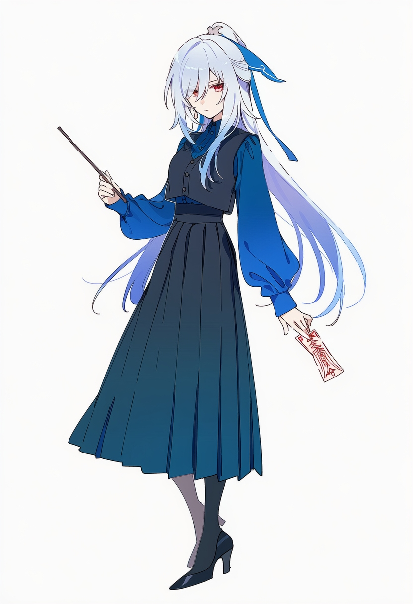

[在线例图](https://assets.quicktagcloud.com/images/raven_composition/raven_composition-3851.jpg?v=89b4b4d985542a57)

<a id="raven_composition-3852"></a>

## 手持精灵球

ID：`raven_composition-3852`；分类：物体互动 / 生物/玩具/特殊物件；来源标记：`safe`。

来源说明：

> 角色用手拿着精灵球。

正向提示词：

```text
holding_poke_ball
```

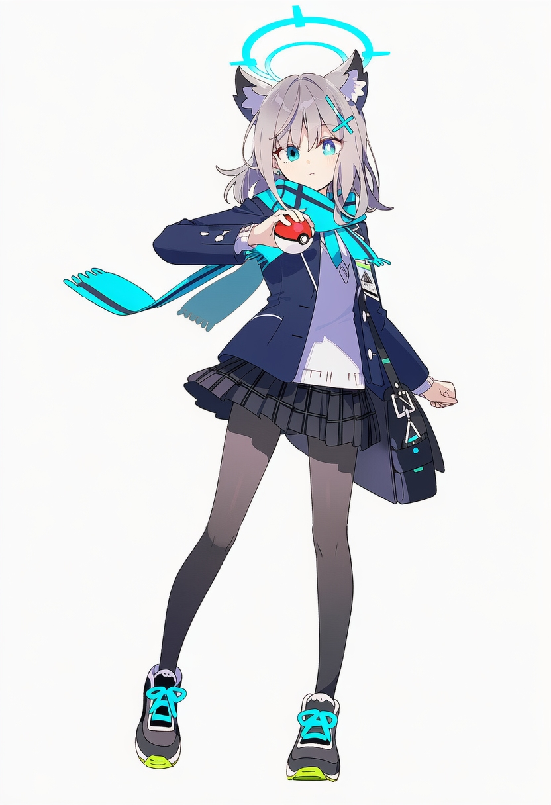

[在线例图](https://assets.quicktagcloud.com/images/raven_composition/raven_composition-3852.jpg?v=4be5efb007fc5e93)
