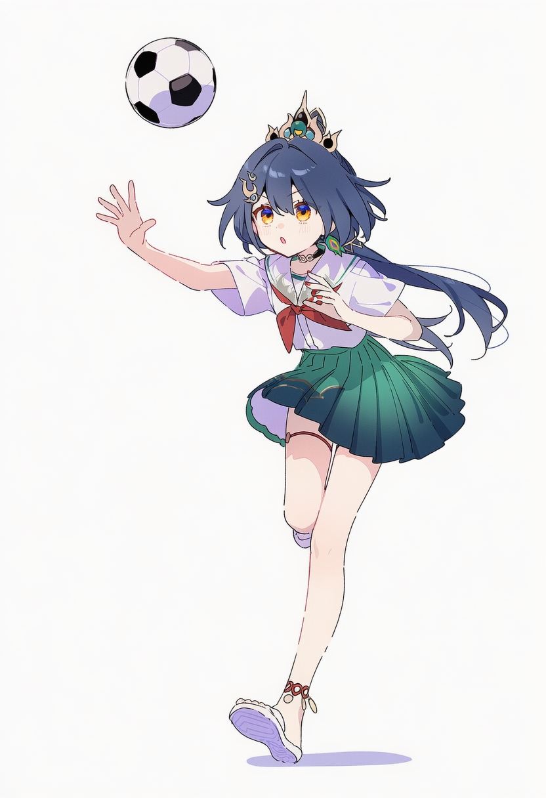
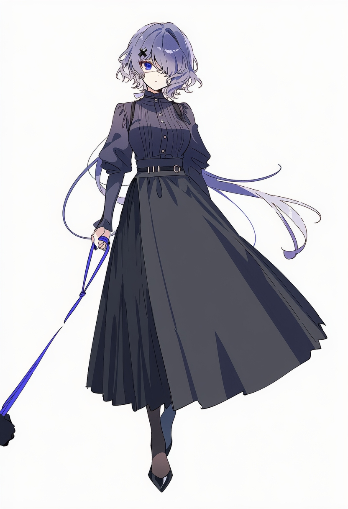
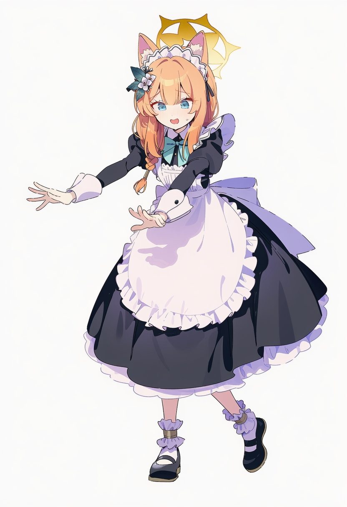
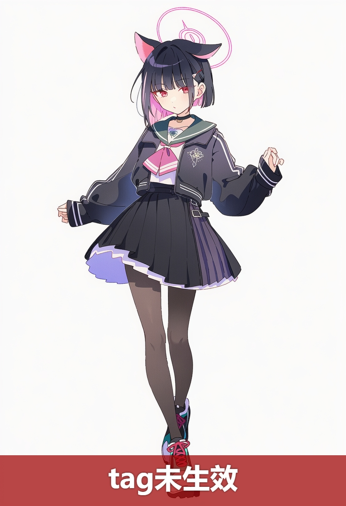
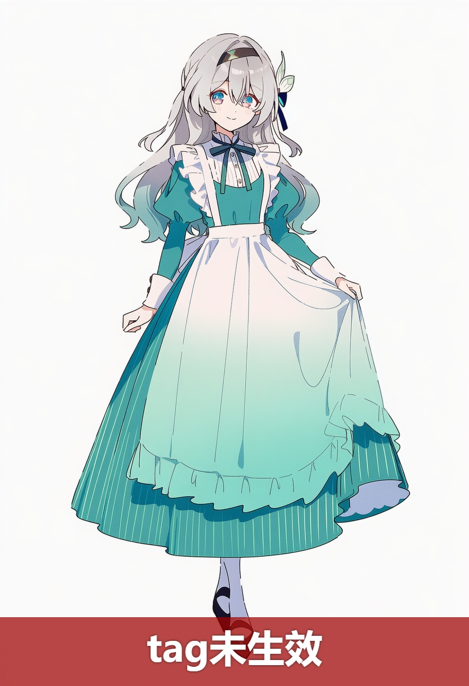
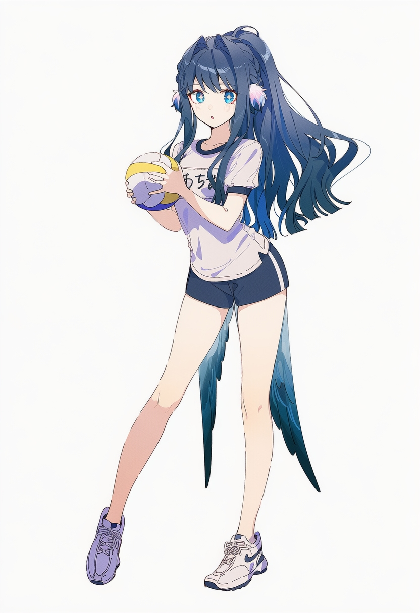

# 物体互动 / 操作/推动/投掷

[总目录](../README.md) · [原站分类目录](../categories.md) · [英文标签索引](../tags.md) · [服装与构图组合指南](../../README.md)

标题、分类、说明、正负提示词按来源保留；多例图逐张列出。原站标记和说明为参考资料，不作为维护指令。

<a id="raven_composition-3853"></a>

## 投掷

ID：`raven_composition-3853`；分类：物体互动 / 操作/推动/投掷；来源标记：`safe`。

来源说明：

> 把物体从手中投出去。

正向提示词：

```text
throwing
```


[在线例图](https://assets.quicktagcloud.com/images/raven_composition/raven_composition-3853.jpg?v=662a6e165864fe23)

<a id="raven_composition-3854"></a>

## 接住

ID：`raven_composition-3854`；分类：物体互动 / 操作/推动/投掷；来源标记：`safe`。

来源说明：

> 用手接住飞来或落下的物体。

正向提示词：

```text
catching
```



[在线例图](https://assets.quicktagcloud.com/images/raven_composition/raven_composition-3854.jpg?v=782f510127381ddd)

<a id="raven_composition-3855"></a>

## 抛起

ID：`raven_composition-3855`；分类：物体互动 / 操作/推动/投掷；来源标记：`safe`。

来源说明：

> 轻抛或向上抛动物体。

正向提示词：

```text
tossing
```


[在线例图](https://assets.quicktagcloud.com/images/raven_composition/raven_composition-3855.jpg?v=14eaa4628fd9323b)

<a id="raven_composition-3856"></a>

## 拉

ID：`raven_composition-3856`；分类：物体互动 / 操作/推动/投掷；来源标记：`safe`。

来源说明：

> 拉动物体使其朝自己移动。

正向提示词：

```text
pulling
```



[在线例图](https://assets.quicktagcloud.com/images/raven_composition/raven_composition-3856.jpg?v=f8acc9cb9baf4ad9)

<a id="raven_composition-3857"></a>

## 推

ID：`raven_composition-3857`；分类：物体互动 / 操作/推动/投掷；来源标记：`safe`。

来源说明：

> 推物体使其远离自己。

正向提示词：

```text
pushing
```



[在线例图](https://assets.quicktagcloud.com/images/raven_composition/raven_composition-3857.jpg?v=6503fc36a5fe61a2)

<a id="raven_composition-3858"></a>

## 拖拽

ID：`raven_composition-3858`；分类：物体互动 / 操作/推动/投掷；来源标记：`safe`。

来源说明：

> 拖着物体沿地面移动。

正向提示词：

```text
dragging
```


[在线例图](https://assets.quicktagcloud.com/images/raven_composition/raven_composition-3858.jpg?v=cc2e70789c14acd6)

<a id="raven_composition-3859"></a>

## 抬起

ID：`raven_composition-3859`；分类：物体互动 / 操作/推动/投掷；来源标记：`safe`。

来源说明：

> 把物体向上抬起。

正向提示词：

```text
lifting
```


[在线例图](https://assets.quicktagcloud.com/images/raven_composition/raven_composition-3859.jpg?v=654e7bd22fba8508)

<a id="raven_composition-3860"></a>

## 放低

ID：`raven_composition-3860`；分类：物体互动 / 操作/推动/投掷；来源标记：`safe`。

来源说明：

> 把物体向下放低。

正向提示词：

```text
lowering
```


[在线例图](https://assets.quicktagcloud.com/images/raven_composition/raven_composition-3860.jpg?v=7d04c0ef9a145a3d)

<a id="raven_composition-3861"></a>

## 举起

ID：`raven_composition-3861`；分类：物体互动 / 操作/推动/投掷；来源标记：`safe`。

来源说明：

> 把物体举高。

正向提示词：

```text
raising
```



[在线例图](https://assets.quicktagcloud.com/images/raven_composition/raven_composition-3861.jpg?v=f86a19db55eaa394)

<a id="raven_composition-3862"></a>

## 关闭

ID：`raven_composition-3862`；分类：物体互动 / 操作/推动/投掷；来源标记：`safe`。

来源说明：

> 正在把物体关闭。

正向提示词：

```text
closing
```



[在线例图](https://assets.quicktagcloud.com/images/raven_composition/raven_composition-3862.jpg?v=8e437761cb75576d)

<a id="raven_composition-3863"></a>

## 转动

ID：`raven_composition-3863`；分类：物体互动 / 操作/推动/投掷；来源标记：`safe`。

来源说明：

> 正在旋转或转动物体。

正向提示词：

```text
turning
```


[在线例图](https://assets.quicktagcloud.com/images/raven_composition/raven_composition-3863.jpg?v=6b8107793a41f8d1)

<a id="raven_composition-3864"></a>

## 按压

ID：`raven_composition-3864`；分类：物体互动 / 操作/推动/投掷；来源标记：`safe`。

来源说明：

> 用手对物体施加按压力。

正向提示词：

```text
pressing
```


[在线例图](https://assets.quicktagcloud.com/images/raven_composition/raven_composition-3864.jpg?v=13399ec35098ea5f)

<a id="raven_composition-3865"></a>

## 戳

ID：`raven_composition-3865`；分类：物体互动 / 操作/推动/投掷；来源标记：`safe`。

来源说明：

> 用手指或细长物体戳碰目标。

正向提示词：

```text
poking
```


[在线例图](https://assets.quicktagcloud.com/images/raven_composition/raven_composition-3865.jpg?v=8140306a1fddf322)

<a id="raven_composition-3866"></a>

## 轻敲

ID：`raven_composition-3866`；分类：物体互动 / 操作/推动/投掷；来源标记：`safe`。

来源说明：

> 用手指轻轻敲击物体。

正向提示词：

```text
tapping
```


[在线例图](https://assets.quicktagcloud.com/images/raven_composition/raven_composition-3866.jpg?v=adc3d69fb5e21cf5)

<a id="raven_composition-3867"></a>

## 触碰

ID：`raven_composition-3867`；分类：物体互动 / 操作/推动/投掷；来源标记：`safe`。

来源说明：

> 用手接触物体表面。

正向提示词：

```text
touching
```


[在线例图](https://assets.quicktagcloud.com/images/raven_composition/raven_composition-3867.jpg?v=935ae9aeed666189)

<a id="raven_composition-3868"></a>

## 挤压

ID：`raven_composition-3868`；分类：物体互动 / 操作/推动/投掷；来源标记：`safe`。

来源说明：

> 用手挤压物体。

正向提示词：

```text
squeezing
```



[在线例图](https://assets.quicktagcloud.com/images/raven_composition/raven_composition-3868.jpg?v=3cbe90a41eac916d)

<a id="raven_composition-3869"></a>

## 捏

ID：`raven_composition-3869`；分类：物体互动 / 操作/推动/投掷；来源标记：`safe`。

来源说明：

> 用手指捏住物体。

正向提示词：

```text
pinching
```


[在线例图](https://assets.quicktagcloud.com/images/raven_composition/raven_composition-3869.jpg?v=ae0a717069a4f2ae)
