# 色彩光影 / 单色主题

[总目录](../README.md) · [原站分类目录](../categories.md) · [英文标签索引](../tags.md) · [服装与构图组合指南](../../README.md)

标题、分类、说明、正负提示词按来源保留；多例图逐张列出。原站标记和说明为参考资料，不作为维护指令。

<a id="raven_composition-3870"></a>

## 粉色主题

ID：`raven_composition-3870`；分类：色彩光影 / 单色主题；来源标记：`safe`。

来源说明：

> 画面整体以粉色为主色。

正向提示词：

```text
pink_theme
```

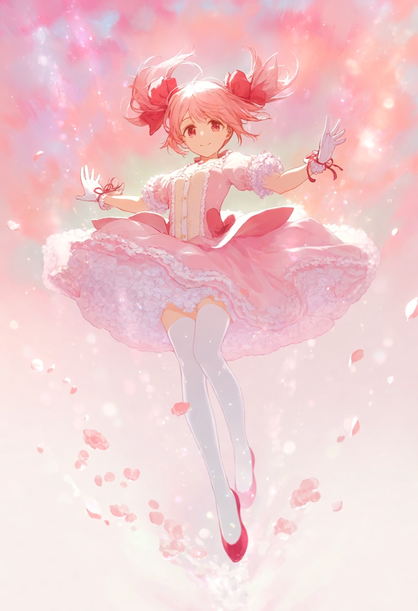

[在线例图](https://assets.quicktagcloud.com/images/raven_composition/raven_composition-3870.jpg?v=35b04e76263dbad6)

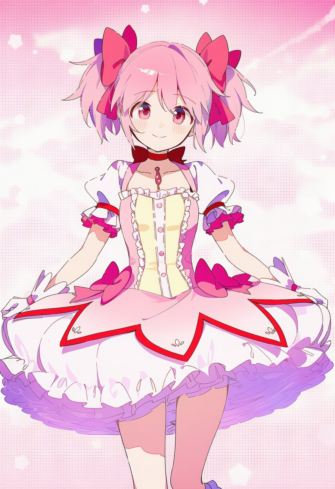

[在线例图](https://assets.quicktagcloud.com/images/raven_composition/raven_composition-3870-02.jpg?v=35b04e76263dbad6)

<a id="raven_composition-3871"></a>

## 红色主题

ID：`raven_composition-3871`；分类：色彩光影 / 单色主题；来源标记：`safe`。

来源说明：

> 画面整体以红色为主色。

正向提示词：

```text
red_theme
```

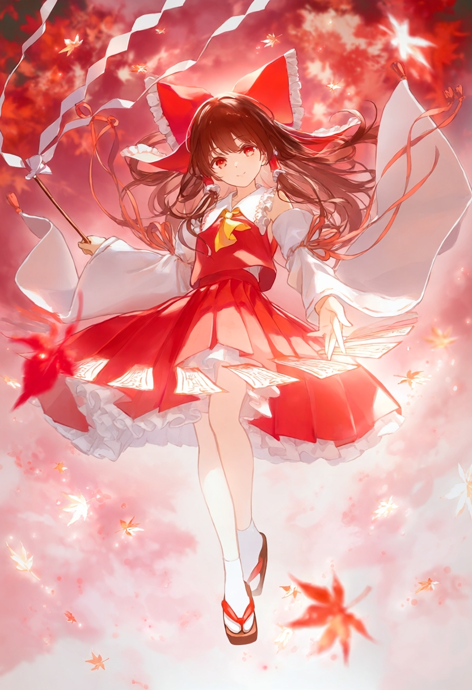

[在线例图](https://assets.quicktagcloud.com/images/raven_composition/raven_composition-3871.jpg?v=17db49107853344b)

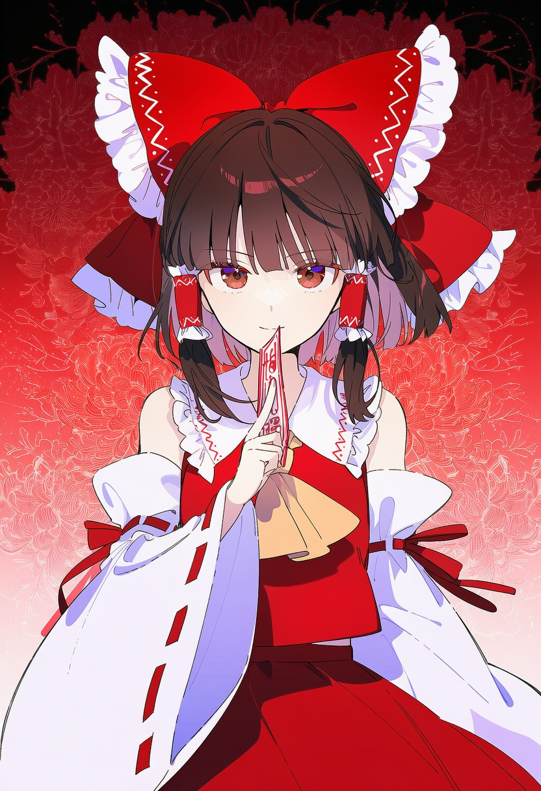

[在线例图](https://assets.quicktagcloud.com/images/raven_composition/raven_composition-3871-02.jpg?v=17db49107853344b)

<a id="raven_composition-3872"></a>

## 橙色主题

ID：`raven_composition-3872`；分类：色彩光影 / 单色主题；来源标记：`safe`。

来源说明：

> 画面整体以橙色为主色。

正向提示词：

```text
orange_theme
```

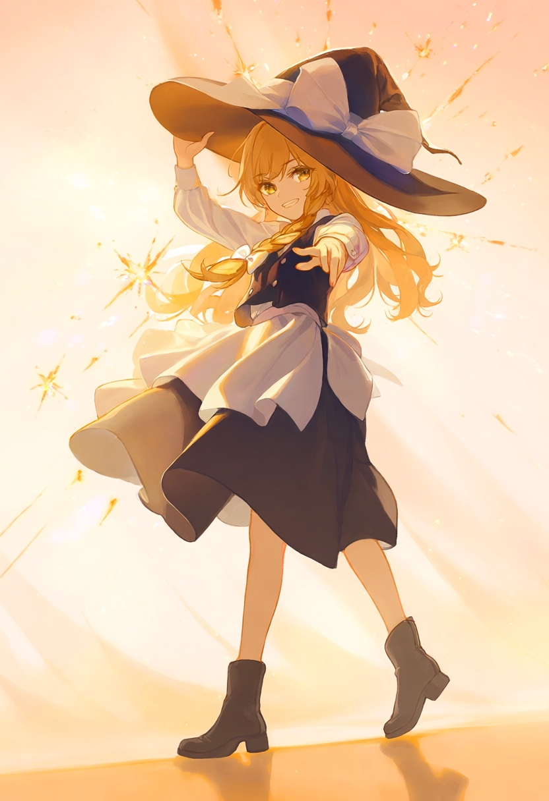

[在线例图](https://assets.quicktagcloud.com/images/raven_composition/raven_composition-3872.jpg?v=1168eb3e4f460ecf)

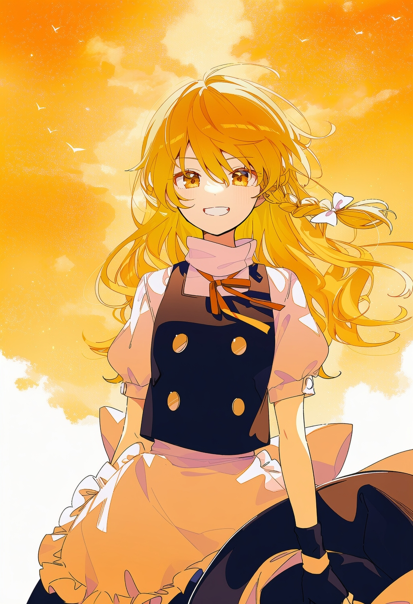

[在线例图](https://assets.quicktagcloud.com/images/raven_composition/raven_composition-3872-02.jpg?v=1168eb3e4f460ecf)

<a id="raven_composition-3873"></a>

## 棕色主题

ID：`raven_composition-3873`；分类：色彩光影 / 单色主题；来源标记：`safe`。

来源说明：

> 画面整体以棕色为主色。

正向提示词：

```text
brown_theme
```

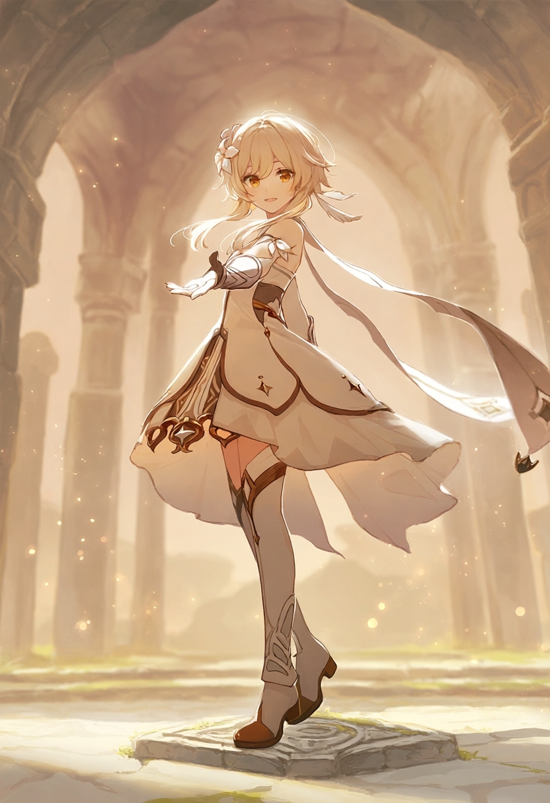

[在线例图](https://assets.quicktagcloud.com/images/raven_composition/raven_composition-3873.jpg?v=f21a496de6047ec3)

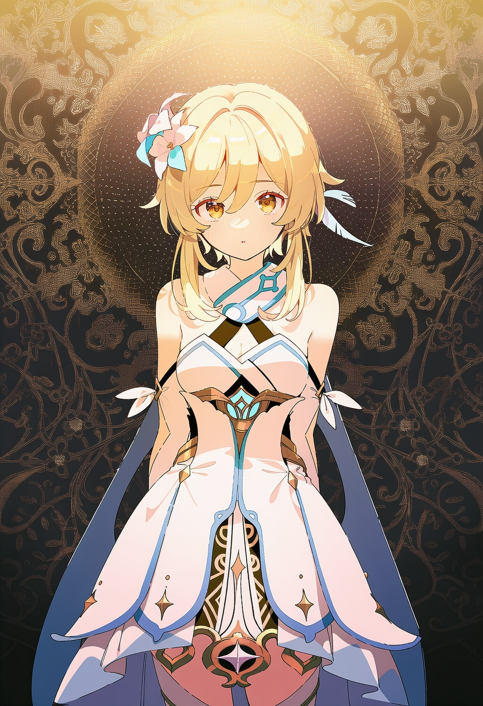

[在线例图](https://assets.quicktagcloud.com/images/raven_composition/raven_composition-3873-02.jpg?v=f21a496de6047ec3)

<a id="raven_composition-3874"></a>

## 黄色主题

ID：`raven_composition-3874`；分类：色彩光影 / 单色主题；来源标记：`safe`。

来源说明：

> 画面整体以黄色为主色。

正向提示词：

```text
yellow_theme
```

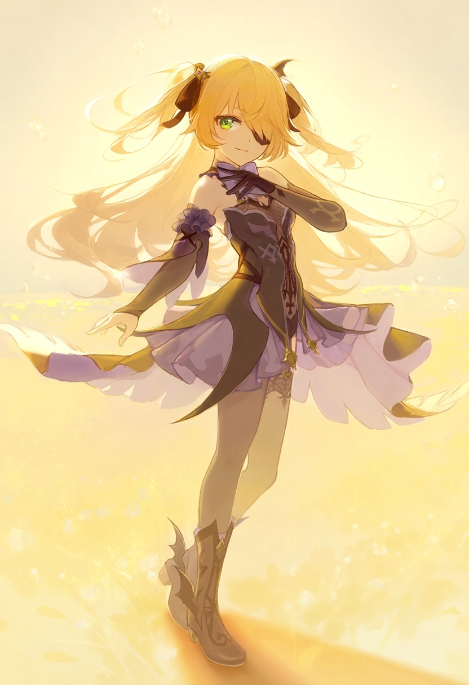

[在线例图](https://assets.quicktagcloud.com/images/raven_composition/raven_composition-3874.jpg?v=68dea4ce2f13217f)

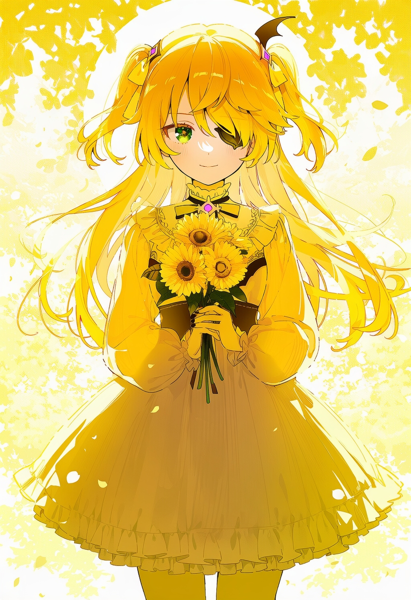

[在线例图](https://assets.quicktagcloud.com/images/raven_composition/raven_composition-3874-02.jpg?v=68dea4ce2f13217f)

<a id="raven_composition-3875"></a>

## 绿色主题

ID：`raven_composition-3875`；分类：色彩光影 / 单色主题；来源标记：`safe`。

来源说明：

> 画面整体以绿色为主色。

正向提示词：

```text
green_theme
```

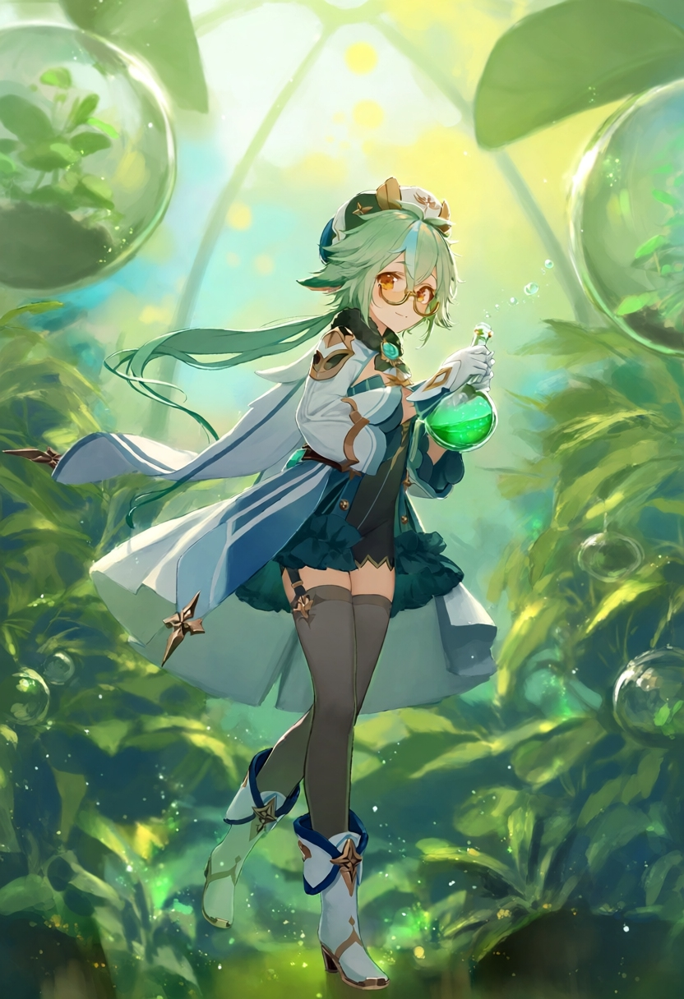

[在线例图](https://assets.quicktagcloud.com/images/raven_composition/raven_composition-3875.jpg?v=87261a5a0e7651f0)

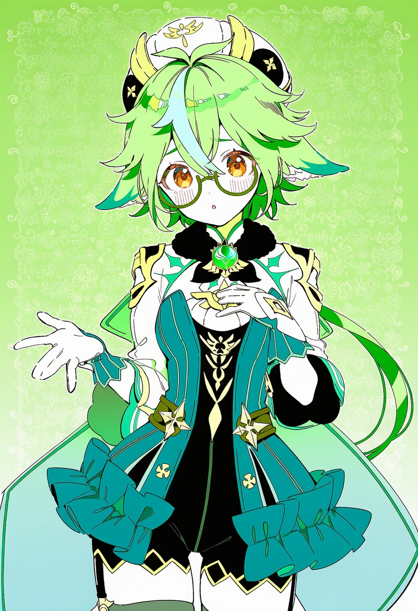

[在线例图](https://assets.quicktagcloud.com/images/raven_composition/raven_composition-3875-02.jpg?v=87261a5a0e7651f0)

<a id="raven_composition-3876"></a>

## 水青色主题

ID：`raven_composition-3876`；分类：色彩光影 / 单色主题；来源标记：`safe`。

来源说明：

> 画面整体以青蓝或水青色为主色。

正向提示词：

```text
aqua_theme
```

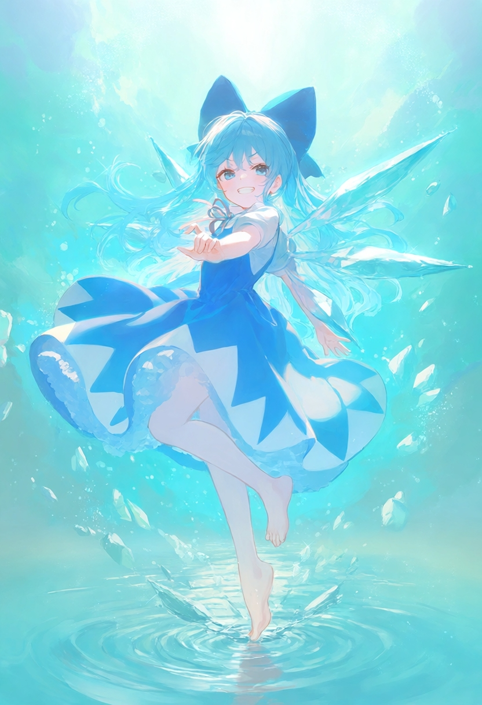

[在线例图](https://assets.quicktagcloud.com/images/raven_composition/raven_composition-3876.jpg?v=acd5beac13ee261b)

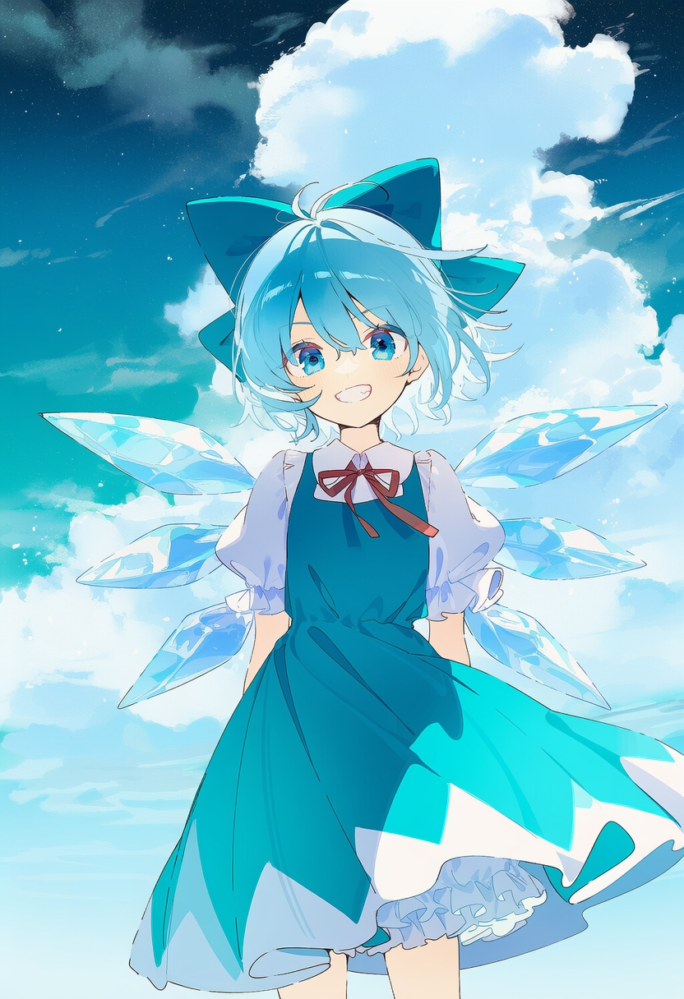

[在线例图](https://assets.quicktagcloud.com/images/raven_composition/raven_composition-3876-02.jpg?v=acd5beac13ee261b)

<a id="raven_composition-3877"></a>

## 蓝色主题

ID：`raven_composition-3877`；分类：色彩光影 / 单色主题；来源标记：`safe`。

来源说明：

> 画面整体以蓝色为主色。

正向提示词：

```text
blue_theme
```

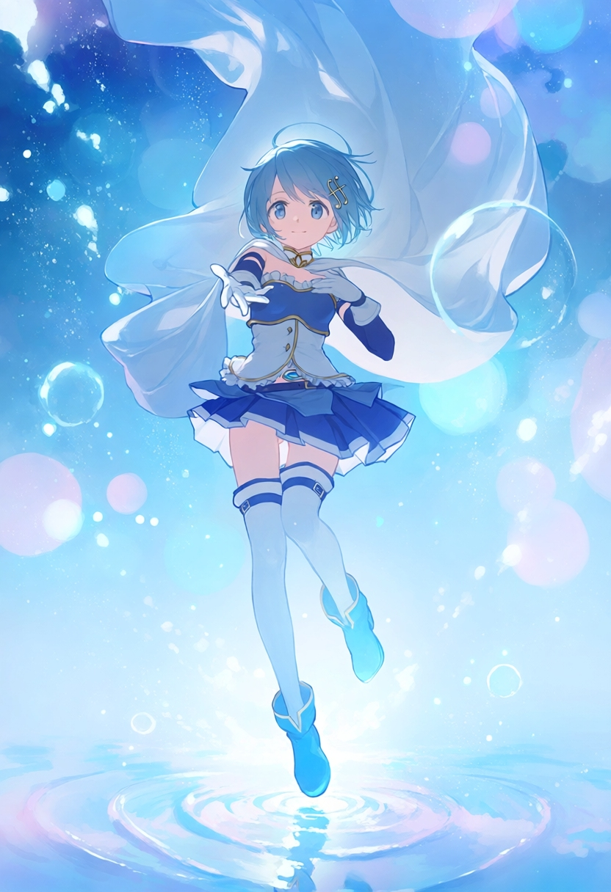

[在线例图](https://assets.quicktagcloud.com/images/raven_composition/raven_composition-3877.jpg?v=e21a712cda9be684)

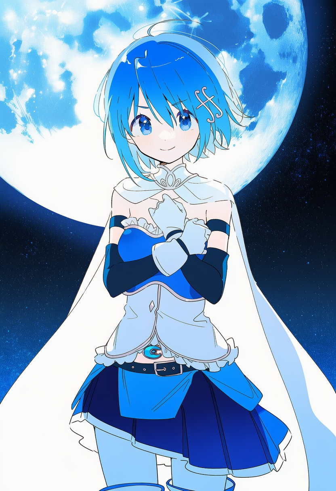

[在线例图](https://assets.quicktagcloud.com/images/raven_composition/raven_composition-3877-02.jpg?v=e21a712cda9be684)

<a id="raven_composition-3878"></a>

## 紫色主题

ID：`raven_composition-3878`；分类：色彩光影 / 单色主题；来源标记：`safe`。

来源说明：

> 画面整体以紫色为主色。

正向提示词：

```text
purple_theme
```

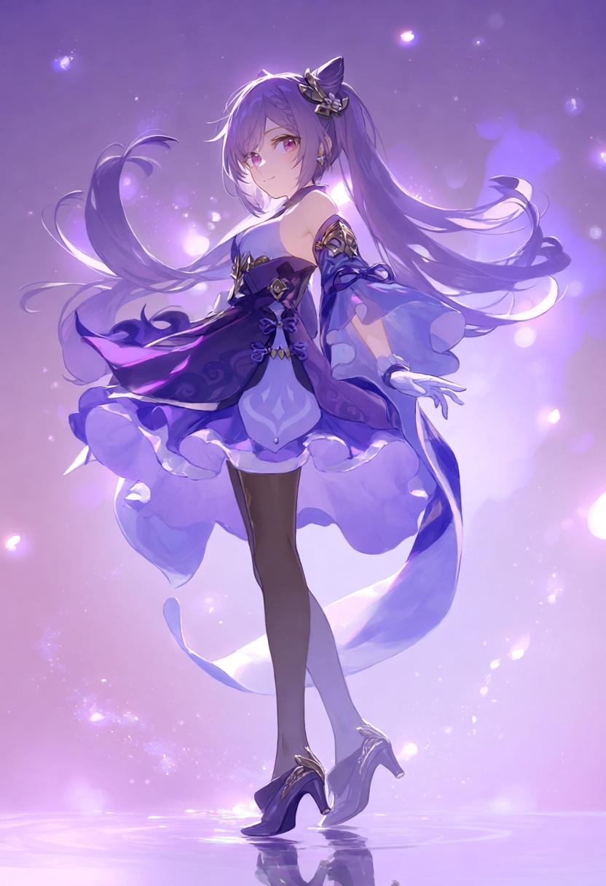

[在线例图](https://assets.quicktagcloud.com/images/raven_composition/raven_composition-3878.jpg?v=1bdcb1112cee4381)

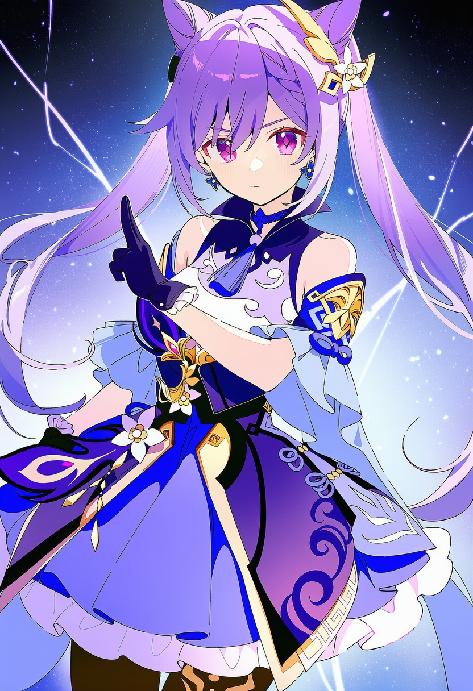

[在线例图](https://assets.quicktagcloud.com/images/raven_composition/raven_composition-3878-02.jpg?v=1bdcb1112cee4381)

<a id="raven_composition-3879"></a>

## 黑色主题

ID：`raven_composition-3879`；分类：色彩光影 / 单色主题；来源标记：`safe`。

来源说明：

> 画面整体以黑色为主色。

正向提示词：

```text
black_theme
```

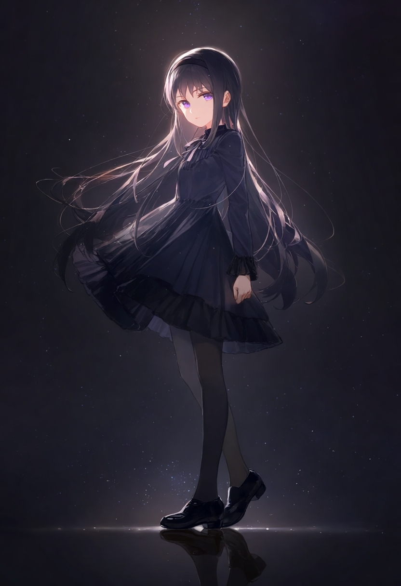

[在线例图](https://assets.quicktagcloud.com/images/raven_composition/raven_composition-3879.jpg?v=9da36b3c416452c2)

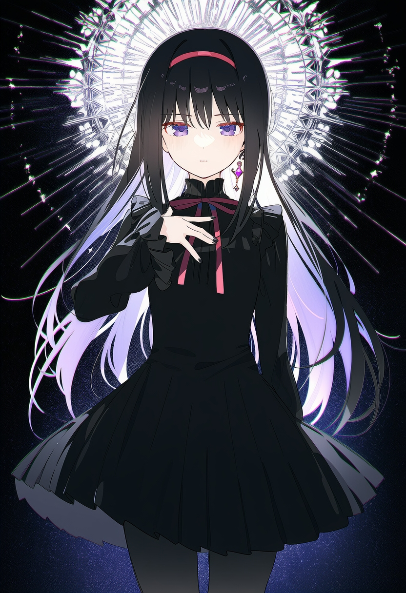

[在线例图](https://assets.quicktagcloud.com/images/raven_composition/raven_composition-3879-02.jpg?v=9da36b3c416452c2)

<a id="raven_composition-3880"></a>

## 灰色主题

ID：`raven_composition-3880`；分类：色彩光影 / 单色主题；来源标记：`safe`。

来源说明：

> 画面整体以灰色为主色。

正向提示词：

```text
grey_theme
```

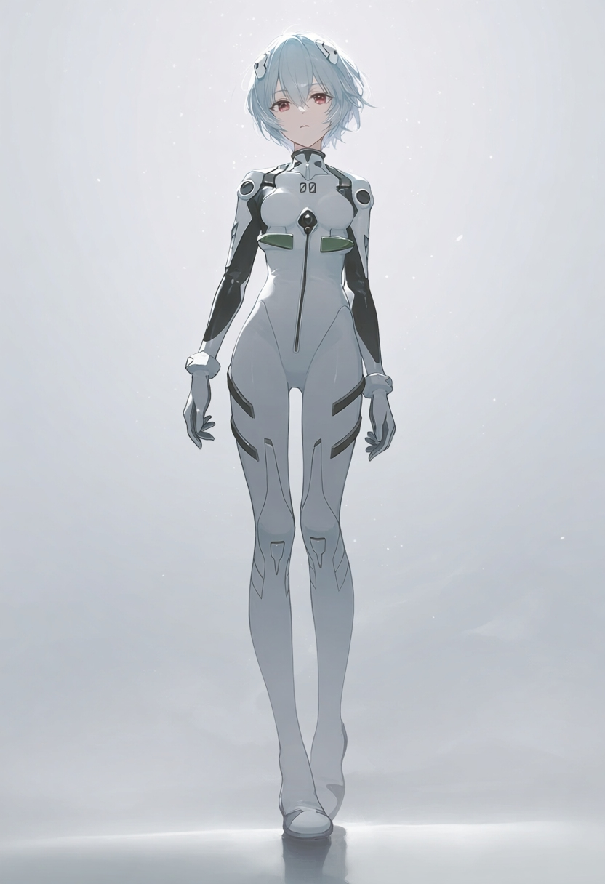

[在线例图](https://assets.quicktagcloud.com/images/raven_composition/raven_composition-3880.jpg?v=401e1d99b5b9d8d7)

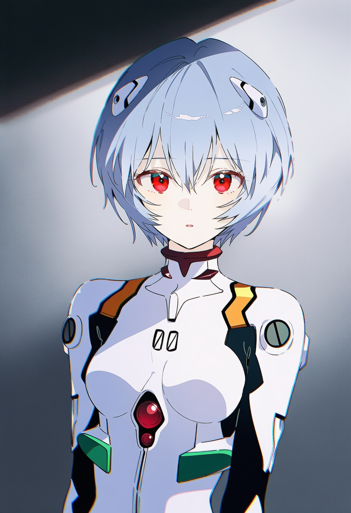

[在线例图](https://assets.quicktagcloud.com/images/raven_composition/raven_composition-3880-02.jpg?v=401e1d99b5b9d8d7)

<a id="raven_composition-3881"></a>

## 白色主题

ID：`raven_composition-3881`；分类：色彩光影 / 单色主题；来源标记：`safe`。

来源说明：

> 画面整体以白色为主色。

正向提示词：

```text
white_theme
```

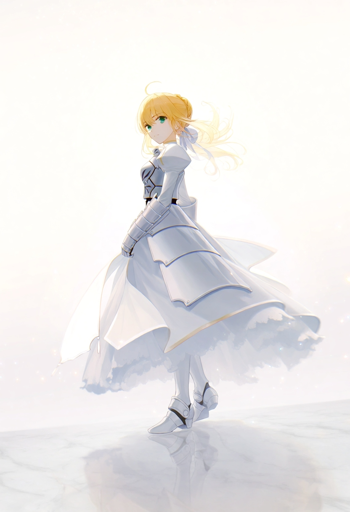

[在线例图](https://assets.quicktagcloud.com/images/raven_composition/raven_composition-3881.jpg?v=2cb5ce23ec98cec2)


[在线例图](https://assets.quicktagcloud.com/images/raven_composition/raven_composition-3881-02.jpg?v=2cb5ce23ec98cec2)
