# 色彩光影 / 黑白与局部上色

[总目录](../README.md) · [原站分类目录](../categories.md) · [英文标签索引](../tags.md) · [服装与构图组合指南](../../README.md)

标题、分类、说明、正负提示词按来源保留；多例图逐张列出。原站标记和说明为参考资料，不作为维护指令。

<a id="raven_composition-3882"></a>

## 单色画

ID：`raven_composition-3882`；分类：色彩光影 / 黑白与局部上色；来源标记：`safe`。

来源说明：

> 主要用一种色相及其明暗变化。

正向提示词：

```text
monochrome
```

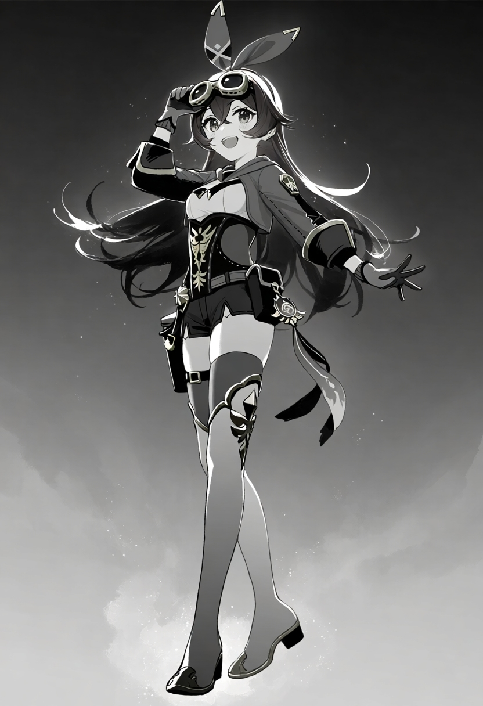

[在线例图](https://assets.quicktagcloud.com/images/raven_composition/raven_composition-3882.jpg?v=0387bc6abbf4622a)

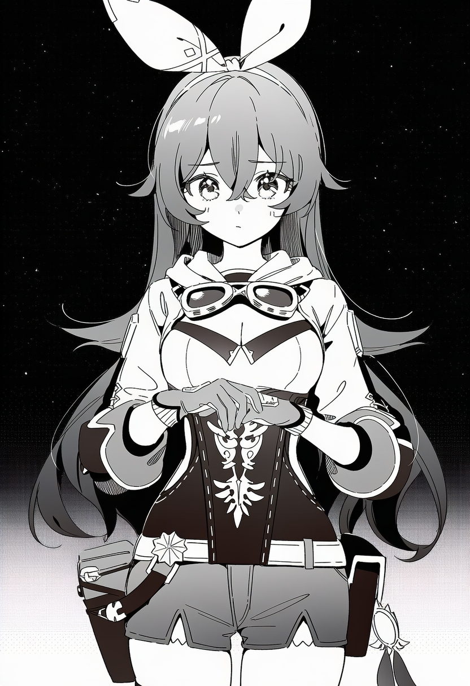

[在线例图](https://assets.quicktagcloud.com/images/raven_composition/raven_composition-3882-02.jpg?v=0387bc6abbf4622a)

<a id="raven_composition-3883"></a>

## 灰度 / 黑白灰

ID：`raven_composition-3883`；分类：色彩光影 / 黑白与局部上色；来源标记：`safe`。

来源说明：

> 只有黑白灰，没有彩色。

正向提示词：

```text
greyscale
```

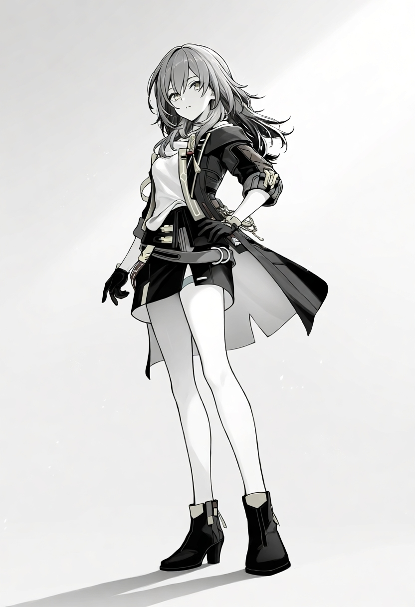

[在线例图](https://assets.quicktagcloud.com/images/raven_composition/raven_composition-3883.jpg?v=7aadc013973d56b7)

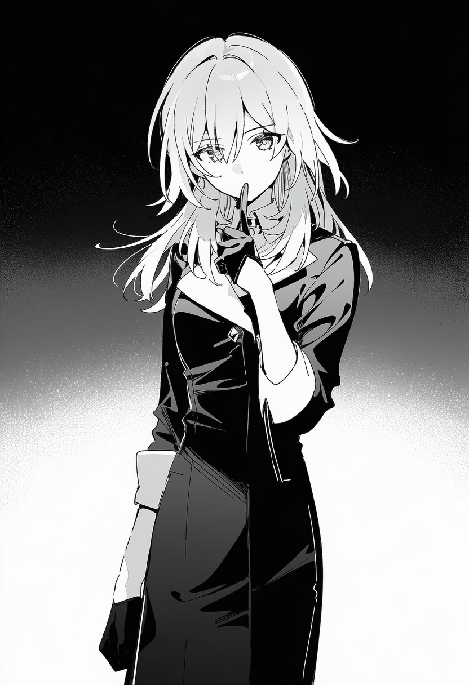

[在线例图](https://assets.quicktagcloud.com/images/raven_composition/raven_composition-3883-02.jpg?v=7aadc013973d56b7)

<a id="raven_composition-3884"></a>

## 线稿

ID：`raven_composition-3884`；分类：色彩光影 / 黑白与局部上色；来源标记：`safe`。

来源说明：

> 主要由线条构成，基本没有上色。

正向提示词：

```text
lineart
```

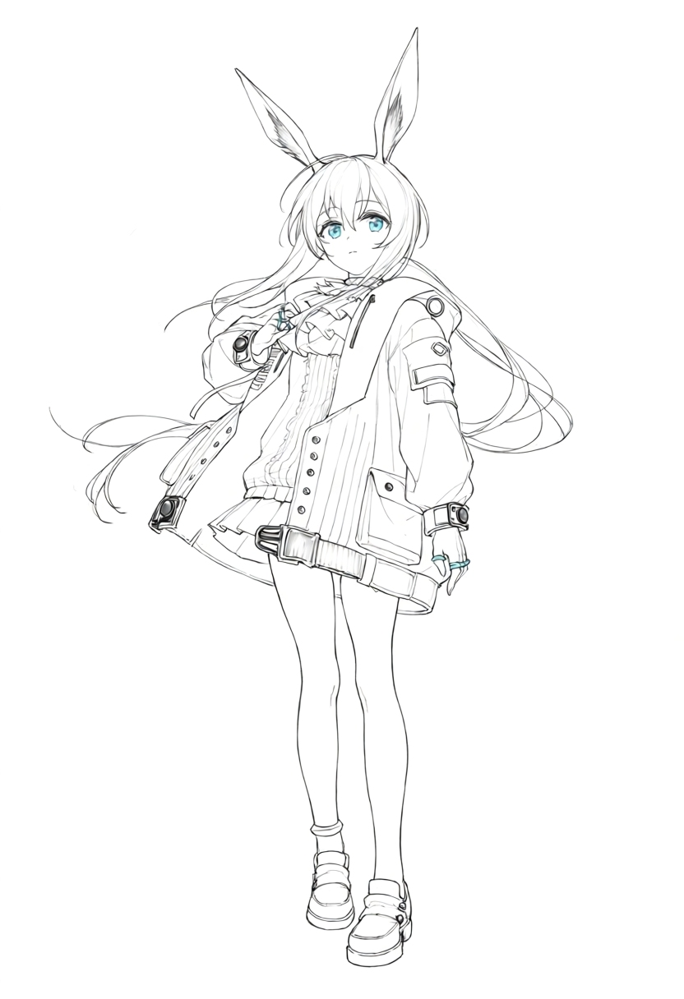

[在线例图](https://assets.quicktagcloud.com/images/raven_composition/raven_composition-3884.jpg?v=9a74e85a8b1c3b6c)

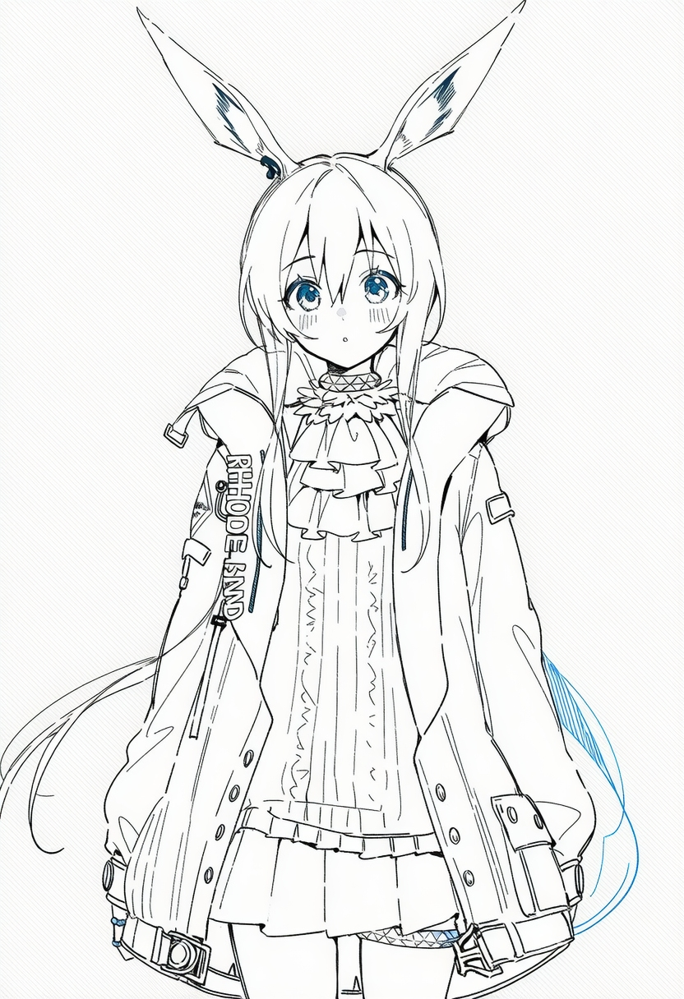

[在线例图](https://assets.quicktagcloud.com/images/raven_composition/raven_composition-3884-02.jpg?v=9a74e85a8b1c3b6c)

<a id="raven_composition-3885"></a>

## 局部上色

ID：`raven_composition-3885`；分类：色彩光影 / 黑白与局部上色；来源标记：`safe`。

来源说明：

> 大部分无彩或单色，只有部分区域有颜色。

正向提示词：

```text
partially_colored
```


[在线例图](https://assets.quicktagcloud.com/images/raven_composition/raven_composition-3885.jpg?v=89ff4653fcb0ae44)

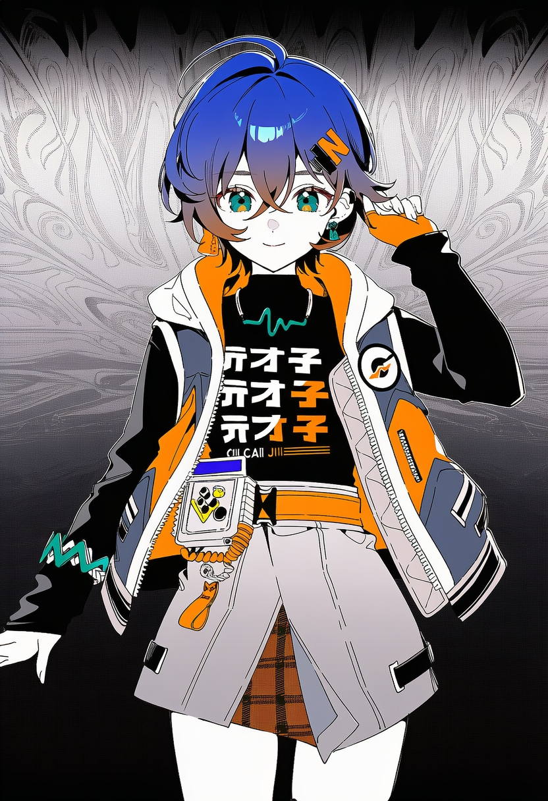

[在线例图](https://assets.quicktagcloud.com/images/raven_composition/raven_composition-3885-02.jpg?v=89ff4653fcb0ae44)

<a id="raven_composition-3886"></a>

## 彩色背景灰度主体

ID：`raven_composition-3886`；分类：色彩光影 / 黑白与局部上色；来源标记：`safe`。

来源说明：

> 主体是灰度，背景保留彩色。

正向提示词：

```text
greyscale_with_colored_background
```

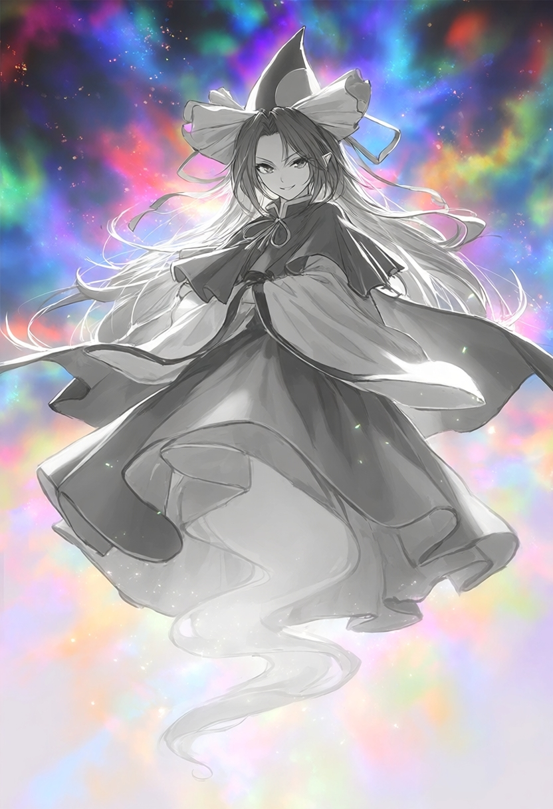

[在线例图](https://assets.quicktagcloud.com/images/raven_composition/raven_composition-3886.jpg?v=ae260bdeda9759f9)

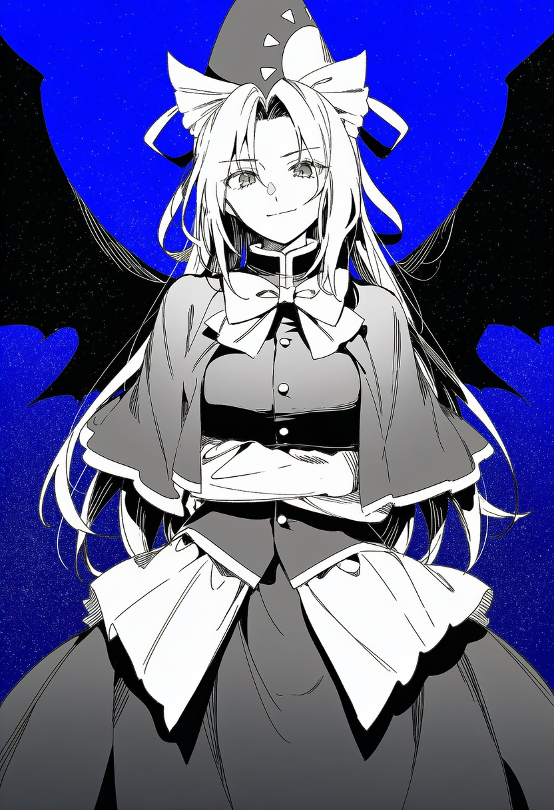

[在线例图](https://assets.quicktagcloud.com/images/raven_composition/raven_composition-3886-02.jpg?v=ae260bdeda9759f9)

<a id="raven_composition-3887"></a>

## 单色背景

ID：`raven_composition-3887`；分类：色彩光影 / 黑白与局部上色；来源标记：`safe`。

来源说明：

> 背景用单一色调，主体可以正常上色。

正向提示词：

```text
monochrome_background
```


[在线例图](https://assets.quicktagcloud.com/images/raven_composition/raven_composition-3887.jpg?v=a0853536a202b3f1)


[在线例图](https://assets.quicktagcloud.com/images/raven_composition/raven_composition-3887-02.jpg?v=a0853536a202b3f1)

<a id="raven_composition-3888"></a>

## 强调色 / 点色

ID：`raven_composition-3888`；分类：色彩光影 / 黑白与局部上色；来源标记：`safe`。

来源说明：

> 大部分低彩或无彩，只用少量颜色突出重点。

正向提示词：

```text
spot_color
```

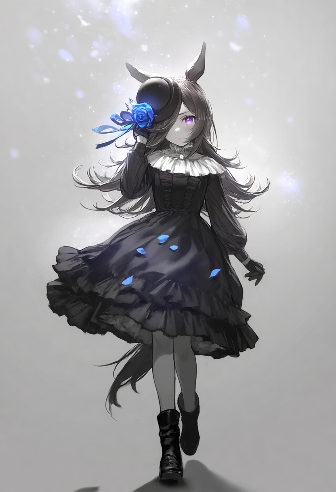

[在线例图](https://assets.quicktagcloud.com/images/raven_composition/raven_composition-3888.jpg?v=a00054ca69ff9068)

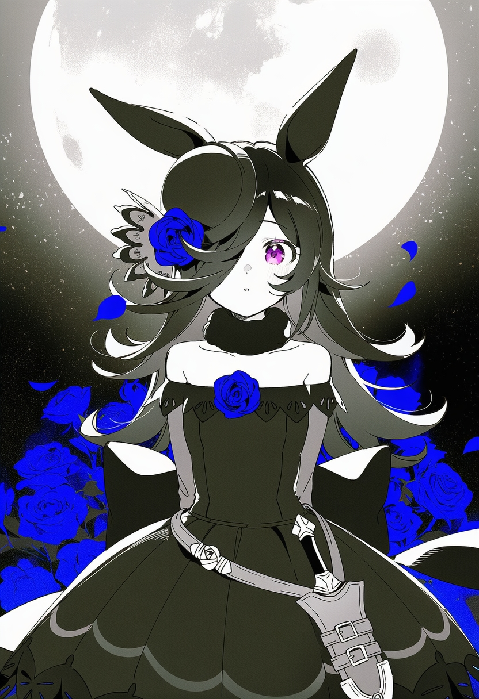

[在线例图](https://assets.quicktagcloud.com/images/raven_composition/raven_composition-3888-02.jpg?v=a00054ca69ff9068)

<a id="raven_composition-3889"></a>

## 多重单色

ID：`raven_composition-3889`；分类：色彩光影 / 黑白与局部上色；来源标记：`safe`。

来源说明：

> 多个区域或人物各自使用不同的单色色调。

正向提示词：

```text
multiple_monochrome
```


[在线例图](https://assets.quicktagcloud.com/images/raven_composition/raven_composition-3889.jpg?v=090c612c07875b31)

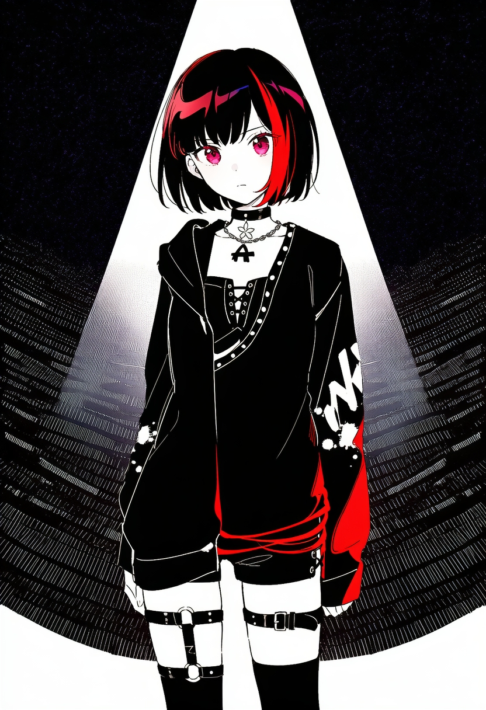

[在线例图](https://assets.quicktagcloud.com/images/raven_composition/raven_composition-3889-02.jpg?v=090c612c07875b31)

<a id="raven_composition-3890"></a>

## 限定色板

ID：`raven_composition-3890`；分类：色彩光影 / 黑白与局部上色；来源标记：`safe`。

来源说明：

> 整张图只使用少量几种颜色。

正向提示词：

```text
limited_palette
```

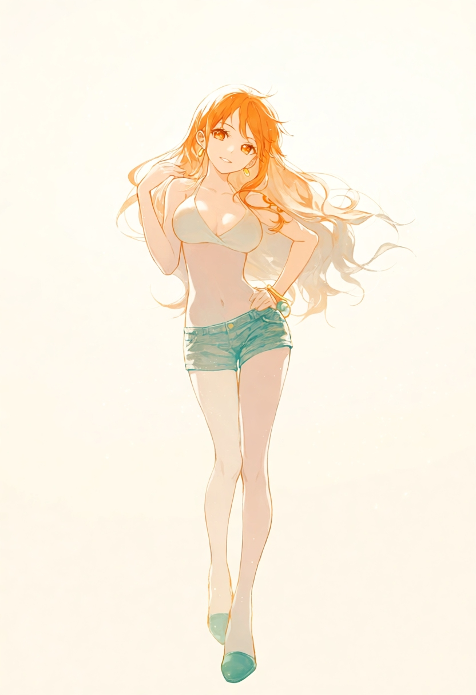

[在线例图](https://assets.quicktagcloud.com/images/raven_composition/raven_composition-3890.jpg?v=16f2122d182cecf1)


[在线例图](https://assets.quicktagcloud.com/images/raven_composition/raven_composition-3890-02.jpg?v=16f2122d182cecf1)
