# 色彩光影 / 整体色调与配色

[总目录](../README.md) · [原站分类目录](../categories.md) · [英文标签索引](../tags.md) · [服装与构图组合指南](../../README.md)

标题、分类、说明、正负提示词按来源保留；多例图逐张列出。原站标记和说明为参考资料，不作为维护指令。

<a id="raven_composition-3891"></a>

## 暗色调

ID：`raven_composition-3891`；分类：色彩光影 / 整体色调与配色；来源标记：`safe`。

来源说明：

> 整体亮度很低，画面偏暗。

正向提示词：

```text
dark
```


[在线例图](https://assets.quicktagcloud.com/images/raven_composition/raven_composition-3891.jpg?v=a737d31528a2b415)

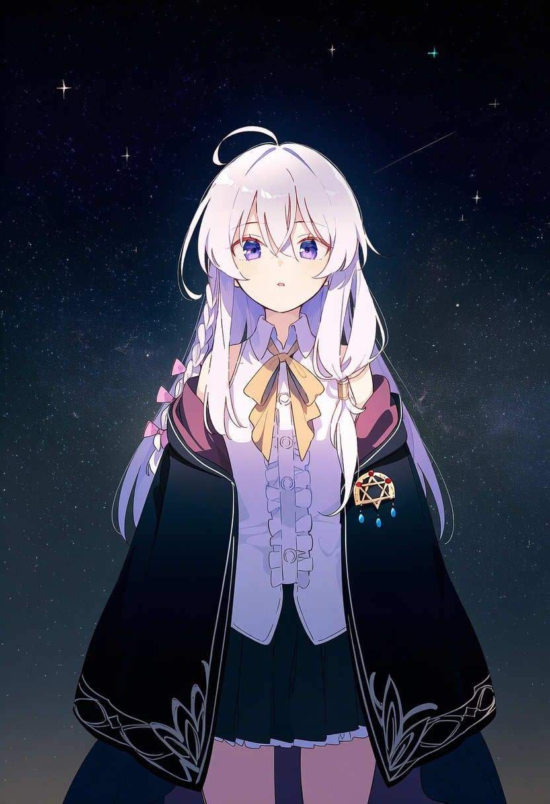

[在线例图](https://assets.quicktagcloud.com/images/raven_composition/raven_composition-3891-02.jpg?v=a737d31528a2b415)

<a id="raven_composition-3892"></a>

## 低饱和柔和色

ID：`raven_composition-3892`；分类：色彩光影 / 整体色调与配色；来源标记：`safe`。

来源说明：

> 颜色压灰、不鲜艳。

正向提示词：

```text
muted_colors
```

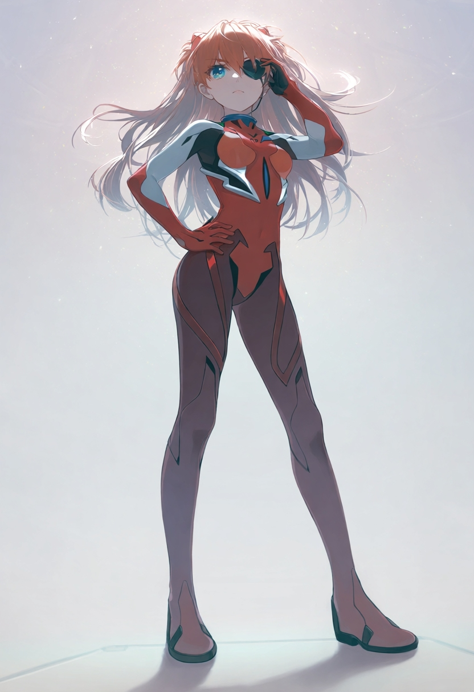

[在线例图](https://assets.quicktagcloud.com/images/raven_composition/raven_composition-3892.jpg?v=6aeb6d77afbc52d6)

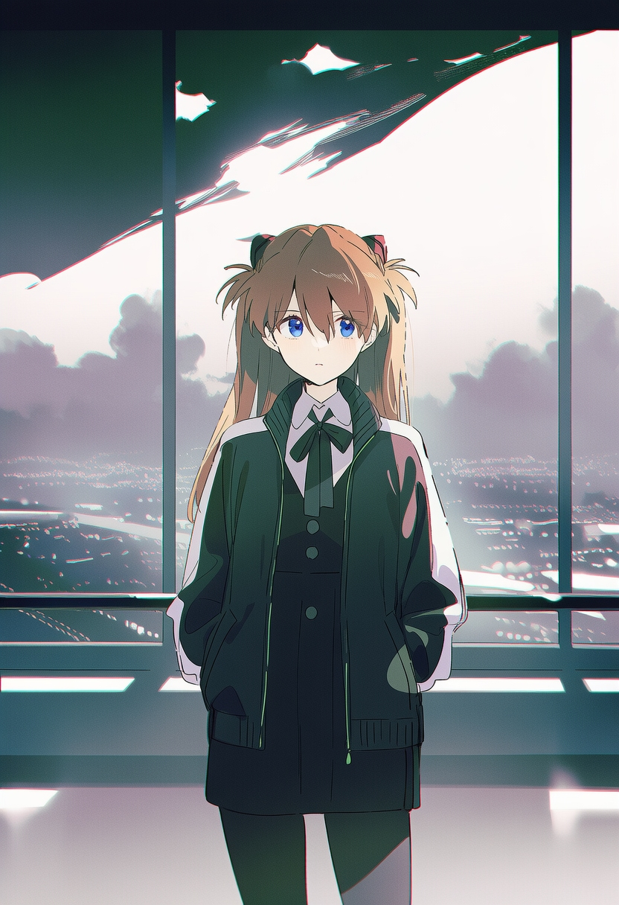

[在线例图](https://assets.quicktagcloud.com/images/raven_composition/raven_composition-3892-02.jpg?v=6aeb6d77afbc52d6)

<a id="raven_composition-3893"></a>

## 淡色调

ID：`raven_composition-3893`；分类：色彩光影 / 整体色调与配色；来源标记：`safe`。

来源说明：

> 颜色很浅，整体接近白色。

正向提示词：

```text
pale_colors
```

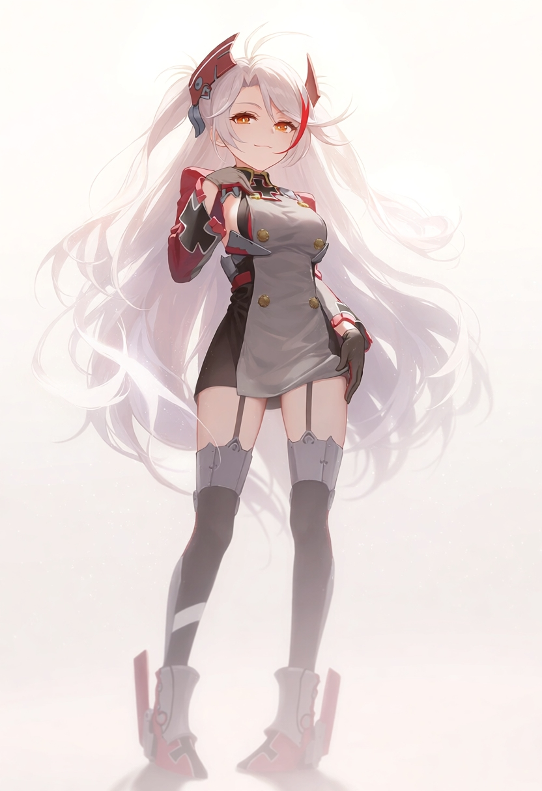

[在线例图](https://assets.quicktagcloud.com/images/raven_composition/raven_composition-3893.jpg?v=92a7c0a39e19601b)


[在线例图](https://assets.quicktagcloud.com/images/raven_composition/raven_composition-3893-02.jpg?v=92a7c0a39e19601b)

<a id="raven_composition-3894"></a>

## 棕褐色调

ID：`raven_composition-3894`；分类：色彩光影 / 整体色调与配色；来源标记：`safe`。

来源说明：

> 整体像老照片一样偏棕黄。

正向提示词：

```text
sepia
```

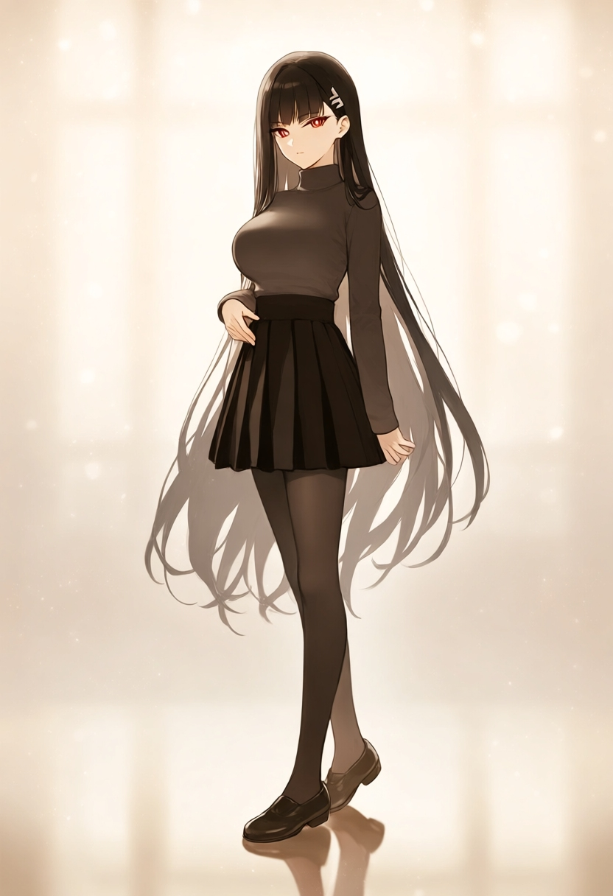

[在线例图](https://assets.quicktagcloud.com/images/raven_composition/raven_composition-3894.jpg?v=b97346bea74ef061)

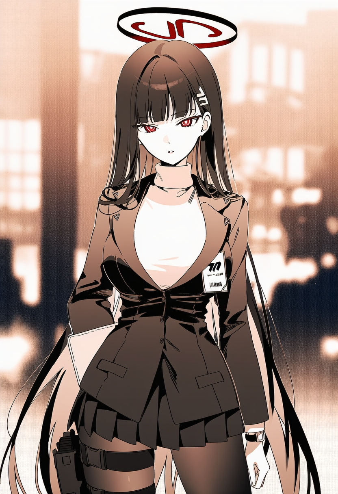

[在线例图](https://assets.quicktagcloud.com/images/raven_composition/raven_composition-3894-02.jpg?v=b97346bea74ef061)

<a id="raven_composition-3895"></a>

## 粉彩色

ID：`raven_composition-3895`；分类：色彩光影 / 整体色调与配色；来源标记：`safe`。

来源说明：

> 颜色浅而柔和，有粉彩或奶油感。

正向提示词：

```text
pastel_colors
```


[在线例图](https://assets.quicktagcloud.com/images/raven_composition/raven_composition-3895.jpg?v=9ca48b31c526ce63)


[在线例图](https://assets.quicktagcloud.com/images/raven_composition/raven_composition-3895-02.jpg?v=9ca48b31c526ce63)

<a id="raven_composition-3896"></a>

## 高对比

ID：`raven_composition-3896`；分类：色彩光影 / 整体色调与配色；来源标记：`safe`。

来源说明：

> 明暗或颜色差异很大。

正向提示词：

```text
high_contrast
```

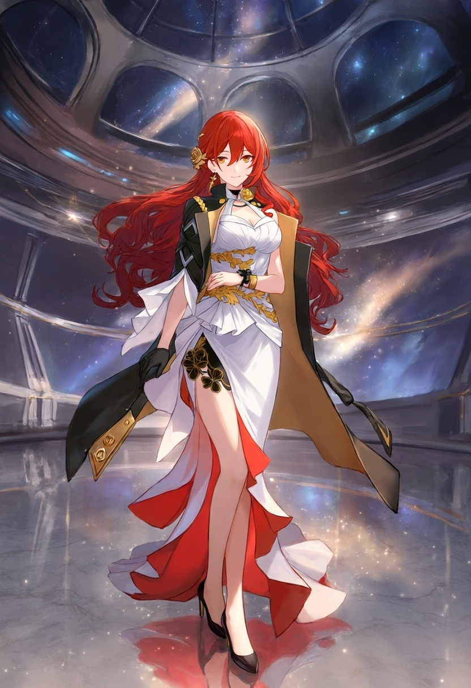

[在线例图](https://assets.quicktagcloud.com/images/raven_composition/raven_composition-3896.jpg?v=1178dfeefefd2fe4)

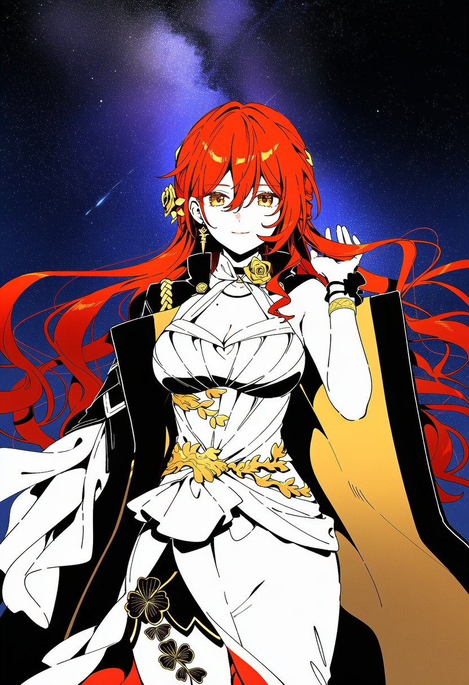

[在线例图](https://assets.quicktagcloud.com/images/raven_composition/raven_composition-3896-02.jpg?v=1178dfeefefd2fe4)

<a id="raven_composition-3897"></a>

## 高饱和

ID：`raven_composition-3897`；分类：色彩光影 / 整体色调与配色；来源标记：`safe`。

来源说明：

> 颜色浓烈、鲜艳。

正向提示词：

```text
saturated
```

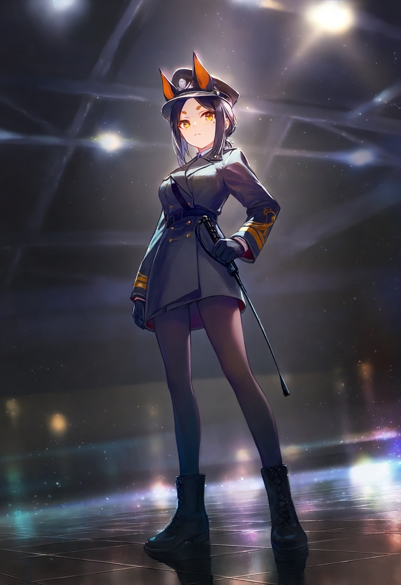

[在线例图](https://assets.quicktagcloud.com/images/raven_composition/raven_composition-3897.jpg?v=f081c25b58fcc1d6)

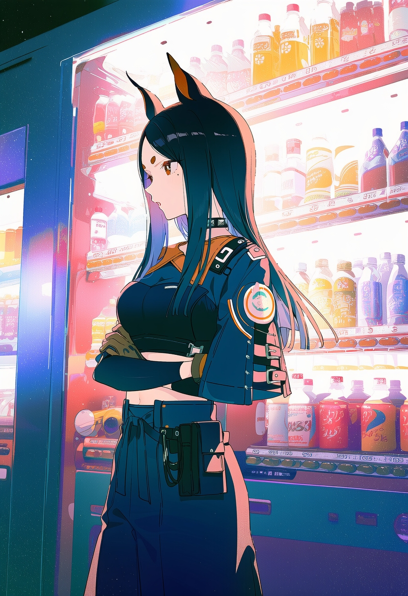

[在线例图](https://assets.quicktagcloud.com/images/raven_composition/raven_composition-3897-02.jpg?v=f081c25b58fcc1d6)

<a id="raven_composition-3898"></a>

## 多彩

ID：`raven_composition-3898`；分类：色彩光影 / 整体色调与配色；来源标记：`safe`。

来源说明：

> 画面同时有很多明显不同的颜色。

正向提示词：

```text
colorful
```

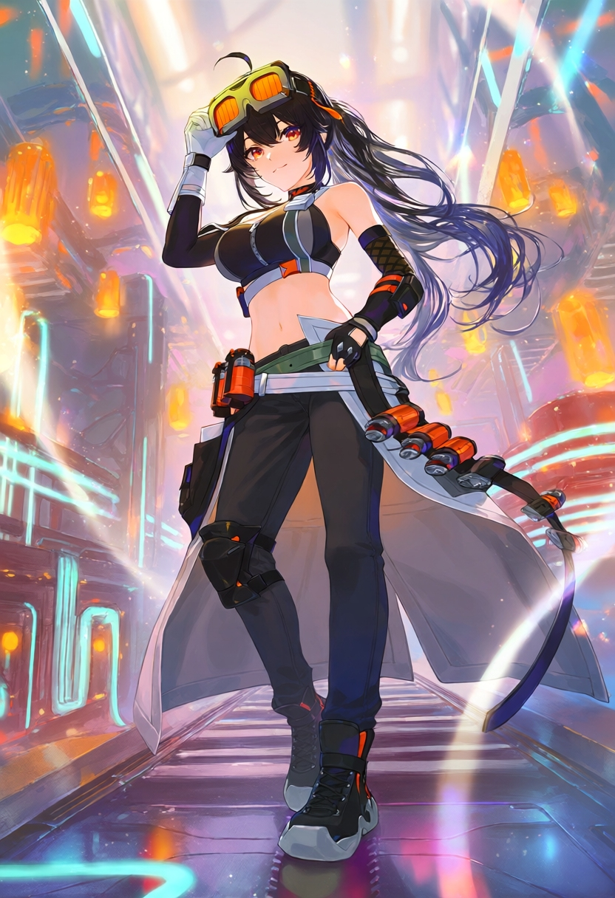

[在线例图](https://assets.quicktagcloud.com/images/raven_composition/raven_composition-3898.jpg?v=b77182ff3b38c316)

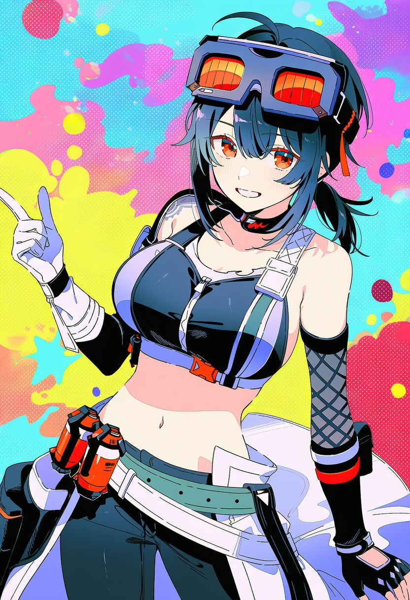

[在线例图](https://assets.quicktagcloud.com/images/raven_composition/raven_composition-3898-02.jpg?v=b77182ff3b38c316)

<a id="raven_composition-3899"></a>

## 霓虹配色

ID：`raven_composition-3899`；分类：色彩光影 / 整体色调与配色；来源标记：`safe`。

来源说明：

> 以高饱和、荧光感的霓虹色为主。

正向提示词：

```text
neon_palette
```

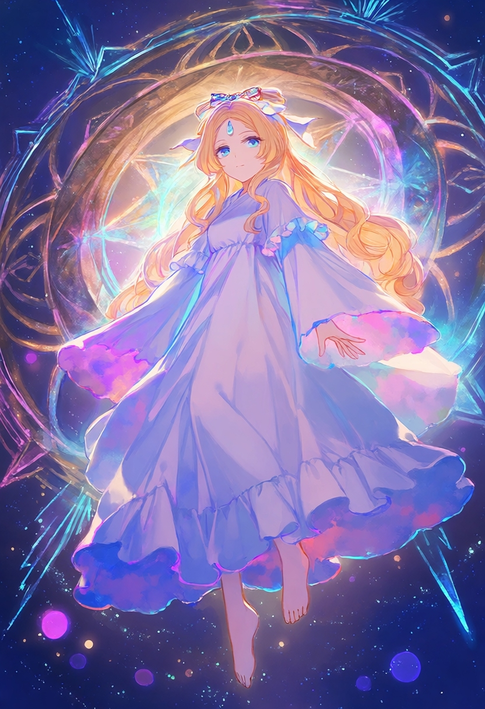

[在线例图](https://assets.quicktagcloud.com/images/raven_composition/raven_composition-3899.jpg?v=3a4fd4dc3ba7a0fc)


[在线例图](https://assets.quicktagcloud.com/images/raven_composition/raven_composition-3899-02.jpg?v=3a4fd4dc3ba7a0fc)

<a id="raven_composition-3900"></a>

## 高饱和背景

ID：`raven_composition-3900`；分类：色彩光影 / 整体色调与配色；来源标记：`safe`。

来源说明：

> 背景颜色特别鲜艳浓烈。

正向提示词：

```text
saturated_background
```


[在线例图](https://assets.quicktagcloud.com/images/raven_composition/raven_composition-3900.jpg?v=ce1009fd3a1e6f05)


[在线例图](https://assets.quicktagcloud.com/images/raven_composition/raven_composition-3900-02.jpg?v=ce1009fd3a1e6f05)

<a id="raven_composition-3901"></a>

## 分割配色

ID：`raven_composition-3901`；分类：色彩光影 / 整体色调与配色；来源标记：`safe`。

来源说明：

> 画面明显分成两种或多种不同色调区域。

正向提示词：

```text
split_theme
```

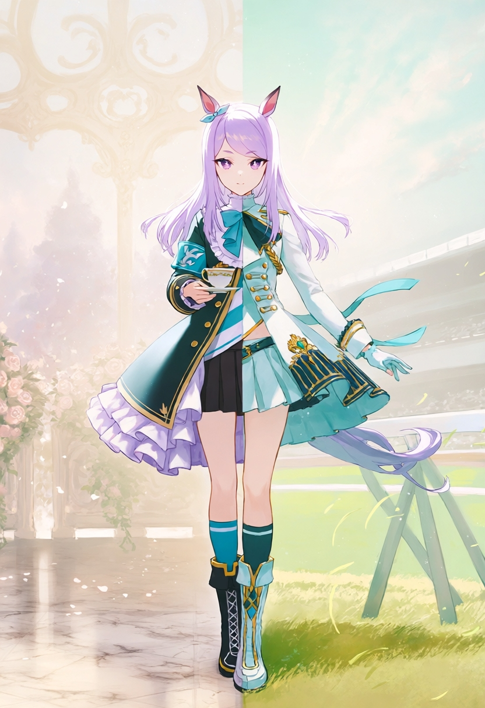

[在线例图](https://assets.quicktagcloud.com/images/raven_composition/raven_composition-3901.jpg?v=48550ccae1719cdd)

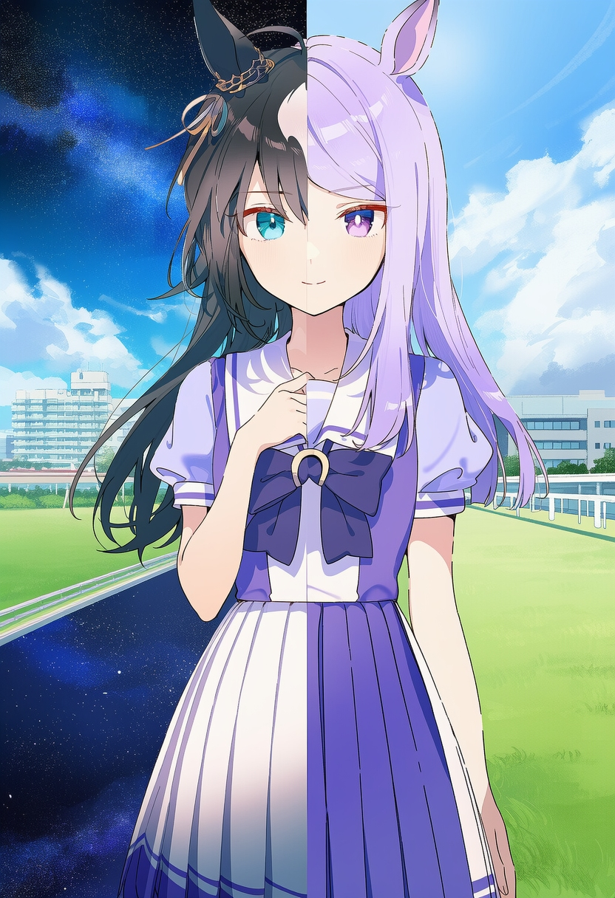

[在线例图](https://assets.quicktagcloud.com/images/raven_composition/raven_composition-3901-02.jpg?v=48550ccae1719cdd)

<a id="raven_composition-3902"></a>

## 图站配色

ID：`raven_composition-3902`；分类：色彩光影 / 整体色调与配色；来源标记：`safe`。

来源说明：

> 用图站页面色做背景，常做出融进网页或假透明的感觉。

正向提示词：

```text
imageboard_colors
```


[在线例图](https://assets.quicktagcloud.com/images/raven_composition/raven_composition-3902.jpg?v=85ebe221ee9313de)


[在线例图](https://assets.quicktagcloud.com/images/raven_composition/raven_composition-3902-02.jpg?v=85ebe221ee9313de)

<a id="raven_composition-3903"></a>

## 色相偏移

ID：`raven_composition-3903`；分类：色彩光影 / 整体色调与配色；来源标记：`safe`。

来源说明：

> 同一物体的明暗区域会往不同色相偏移，而不只是变亮变暗。

正向提示词：

```text
hue_shifting
```

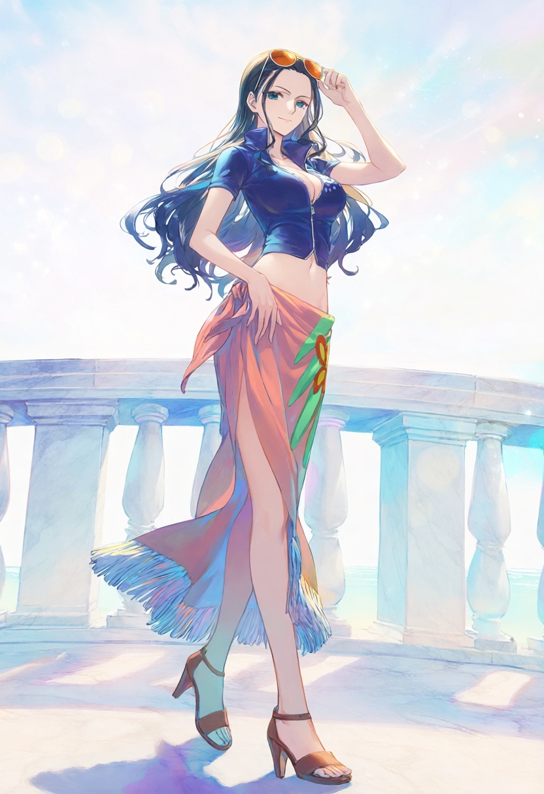

[在线例图](https://assets.quicktagcloud.com/images/raven_composition/raven_composition-3903.jpg?v=1a02d969fc64b5ed)


[在线例图](https://assets.quicktagcloud.com/images/raven_composition/raven_composition-3903-02.jpg?v=1a02d969fc64b5ed)

<a id="raven_composition-3904"></a>

## 多主题色

ID：`raven_composition-3904`；分类：色彩光影 / 整体色调与配色；来源标记：`safe`。

来源说明：

> 画面同时明确使用多种主题色。

正向提示词：

```text
multiple_theme_colors
```

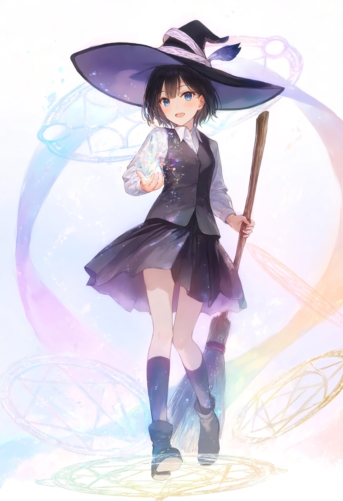

[在线例图](https://assets.quicktagcloud.com/images/raven_composition/raven_composition-3904.jpg?v=4e99d6a0973419d9)


[在线例图](https://assets.quicktagcloud.com/images/raven_composition/raven_composition-3904-02.jpg?v=4e99d6a0973419d9)
