# 色彩光影 / 配色关系与颜色规则

[总目录](../README.md) · [原站分类目录](../categories.md) · [英文标签索引](../tags.md) · [服装与构图组合指南](../../README.md)

标题、分类、说明、正负提示词按来源保留；多例图逐张列出。原站标记和说明为参考资料，不作为维护指令。

<a id="raven_composition-3905"></a>

## 冷色调

ID：`raven_composition-3905`；分类：色彩光影 / 配色关系与颜色规则；来源标记：`safe`。

来源说明：

> 以蓝、青、紫等偏冷颜色为主。

正向提示词：

```text
cool_colors
```

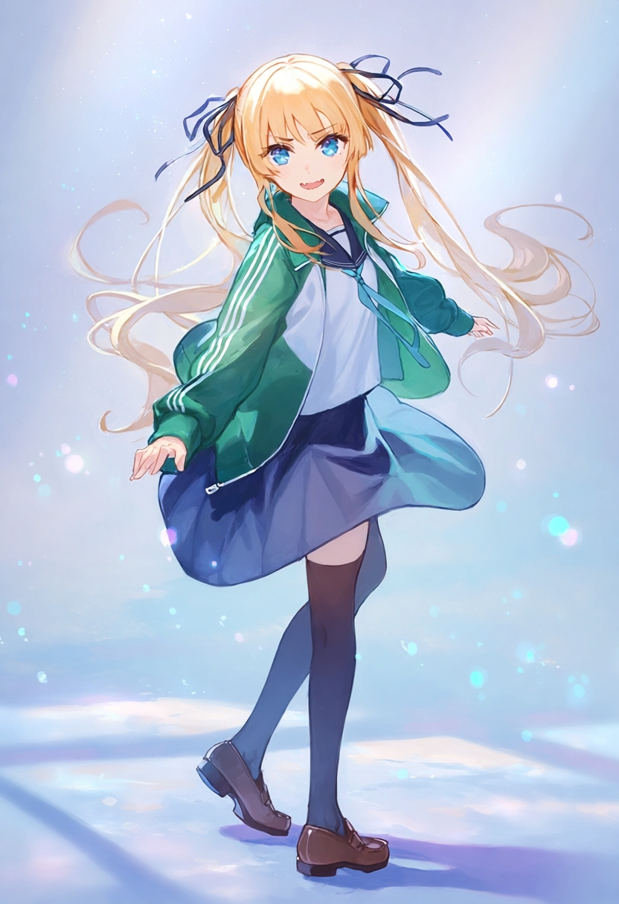

[在线例图](https://assets.quicktagcloud.com/images/raven_composition/raven_composition-3905.jpg?v=78964ed8f663b235)

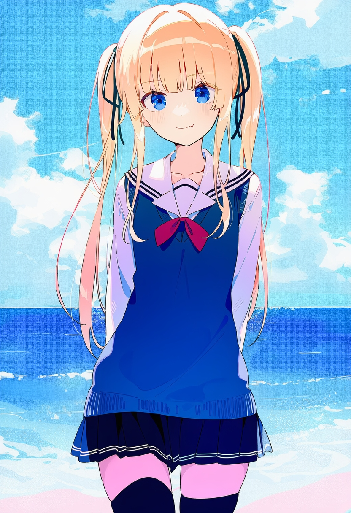

[在线例图](https://assets.quicktagcloud.com/images/raven_composition/raven_composition-3905-02.jpg?v=78964ed8f663b235)

<a id="raven_composition-3906"></a>

## 暖色调

ID：`raven_composition-3906`；分类：色彩光影 / 配色关系与颜色规则；来源标记：`safe`。

来源说明：

> 以红、橙、黄等偏暖颜色为主。

正向提示词：

```text
warm_colors
```

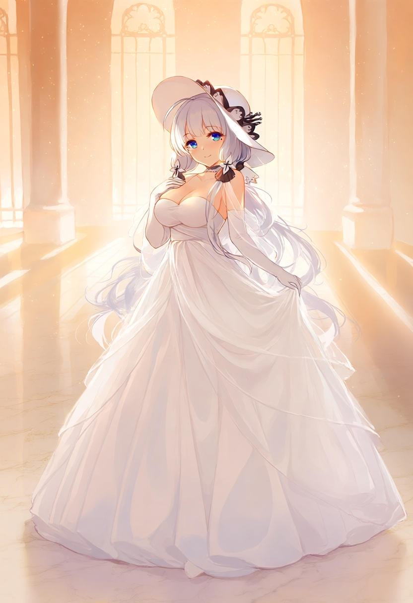

[在线例图](https://assets.quicktagcloud.com/images/raven_composition/raven_composition-3906.jpg?v=2029552c1f522c07)

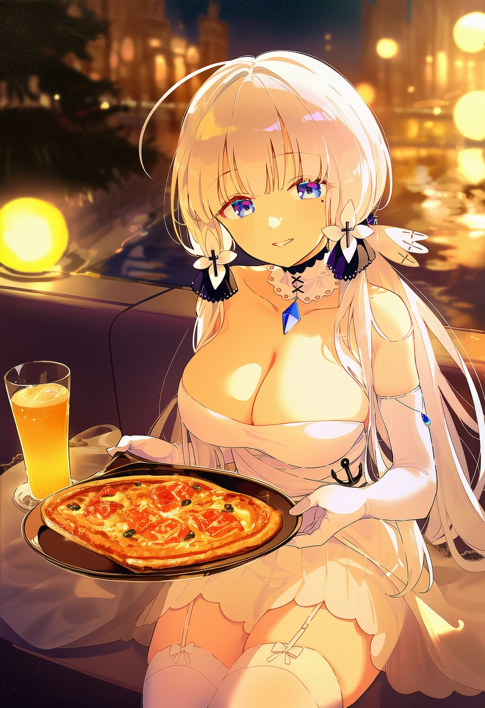

[在线例图](https://assets.quicktagcloud.com/images/raven_composition/raven_composition-3906-02.jpg?v=2029552c1f522c07)

<a id="raven_composition-3907"></a>

## 类似色配色

ID：`raven_composition-3907`；分类：色彩光影 / 配色关系与颜色规则；来源标记：`safe`。

来源说明：

> 主要使用色轮上相邻的颜色。

正向提示词：

```text
analogous_colors
```

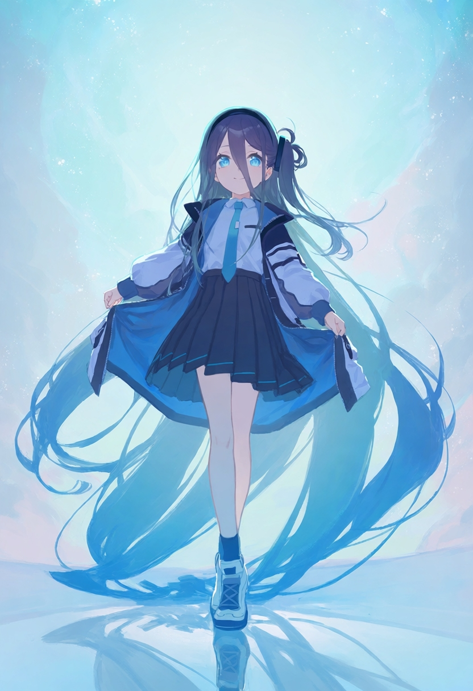

[在线例图](https://assets.quicktagcloud.com/images/raven_composition/raven_composition-3907.jpg?v=f9c1b17f8ae3f445)

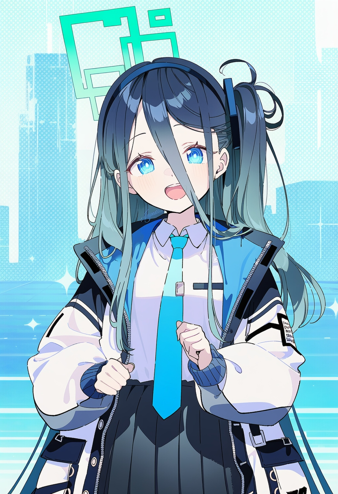

[在线例图](https://assets.quicktagcloud.com/images/raven_composition/raven_composition-3907-02.jpg?v=f9c1b17f8ae3f445)

<a id="raven_composition-3908"></a>

## 互补色配色

ID：`raven_composition-3908`；分类：色彩光影 / 配色关系与颜色规则；来源标记：`safe`。

来源说明：

> 主要使用色轮上相对的颜色形成强对比。

正向提示词：

```text
complementary_colors
```

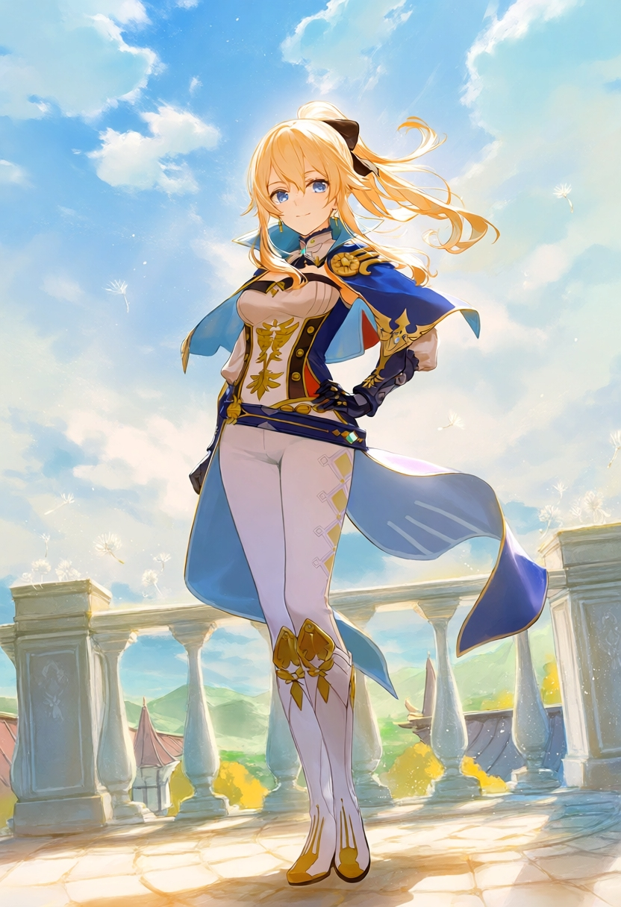

[在线例图](https://assets.quicktagcloud.com/images/raven_composition/raven_composition-3908.jpg?v=07b44d9d521f88b8)

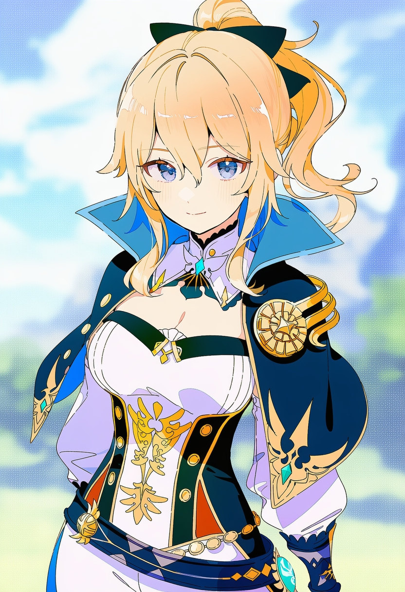

[在线例图](https://assets.quicktagcloud.com/images/raven_composition/raven_composition-3908-02.jpg?v=07b44d9d521f88b8)

<a id="raven_composition-3909"></a>

## 色板 / 配色条

ID：`raven_composition-3909`；分类：色彩光影 / 配色关系与颜色规则；来源标记：`safe`。

来源说明：

> 画面里直接放出本图使用的颜色色块或色条。

正向提示词：

```text
color_guide
```

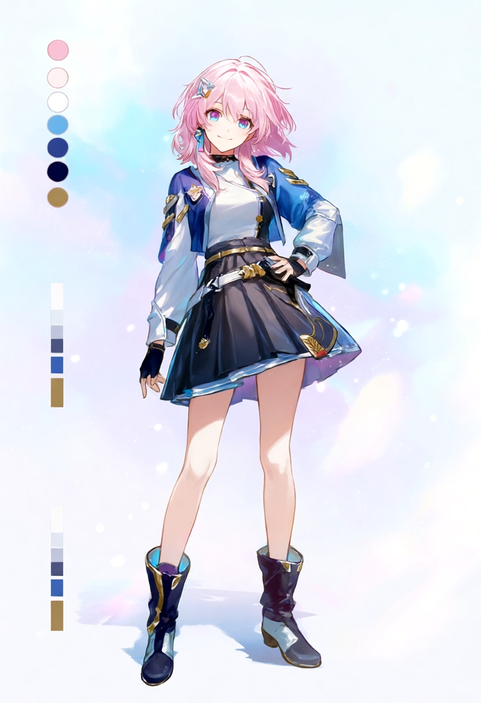

[在线例图](https://assets.quicktagcloud.com/images/raven_composition/raven_composition-3909.jpg?v=f275bba506280700)

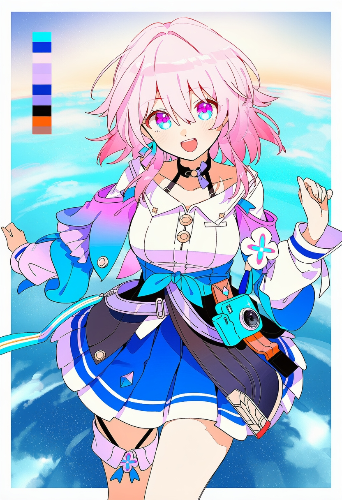

[在线例图](https://assets.quicktagcloud.com/images/raven_composition/raven_composition-3909-02.jpg?v=f275bba506280700)

<a id="raven_composition-3910"></a>

## 色彩流失

ID：`raven_composition-3910`；分类：色彩光影 / 配色关系与颜色规则；来源标记：`safe`。

来源说明：

> 人物或分镜突然变成黑白灰来表现强烈情绪反应。

正向提示词：

```text
color_drain
```

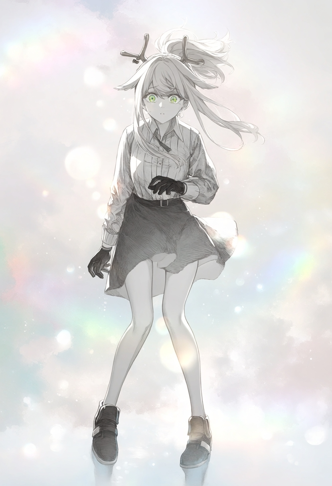

[在线例图](https://assets.quicktagcloud.com/images/raven_composition/raven_composition-3910.jpg?v=ae62b29fe563f51a)

<a id="raven_composition-3911"></a>

## 同色关联

ID：`raven_composition-3911`；分类：色彩光影 / 配色关系与颜色规则；来源标记：`safe`。

来源说明：

> 用相同主题色把人物或物体联系、分组起来。

正向提示词：

```text
color_connection
```

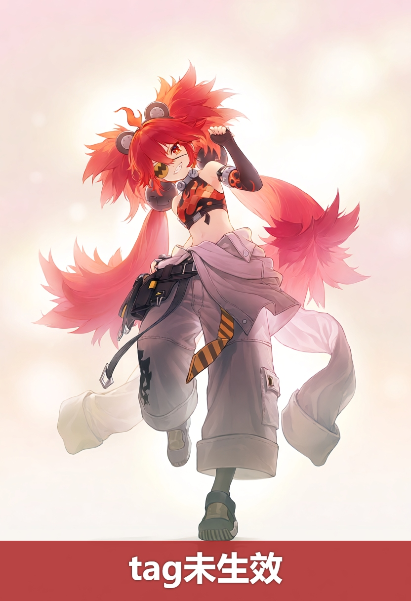

[在线例图](https://assets.quicktagcloud.com/images/raven_composition/raven_composition-3911.jpg?v=250a0ac8640bc997)

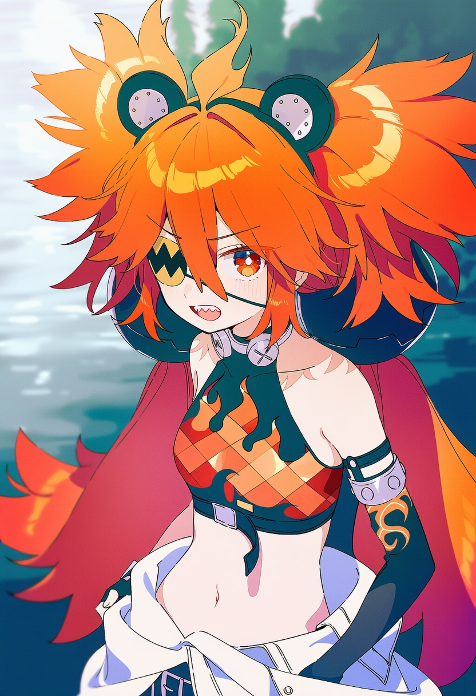

[在线例图](https://assets.quicktagcloud.com/images/raven_composition/raven_composition-3911-02.jpg?v=250a0ac8640bc997)

<a id="raven_composition-3912"></a>

## 色彩呼应

ID：`raven_composition-3912`；分类：色彩光影 / 配色关系与颜色规则；来源标记：`safe`。

来源说明：

> 人物或物体的颜色相互匹配，形成配套或对称感。

正向提示词：

```text
color_coordination
```

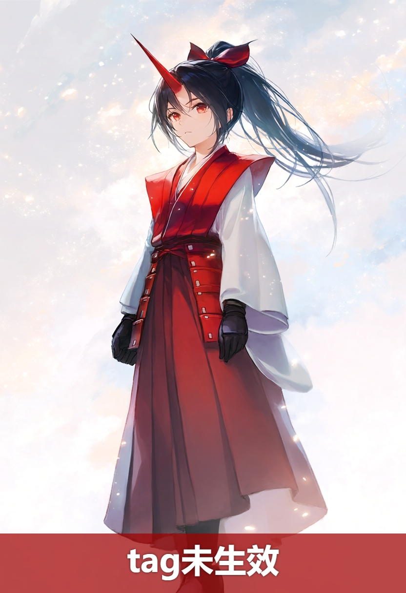

[在线例图](https://assets.quicktagcloud.com/images/raven_composition/raven_composition-3912.jpg?v=0f73000c63262020)

<a id="raven_composition-3913"></a>

## 颜色编码

ID：`raven_composition-3913`；分类：色彩光影 / 配色关系与颜色规则；来源标记：`safe`。

来源说明：

> 一组角色或对象分别用自己的代表色来区分。

正向提示词：

```text
color-coded
```

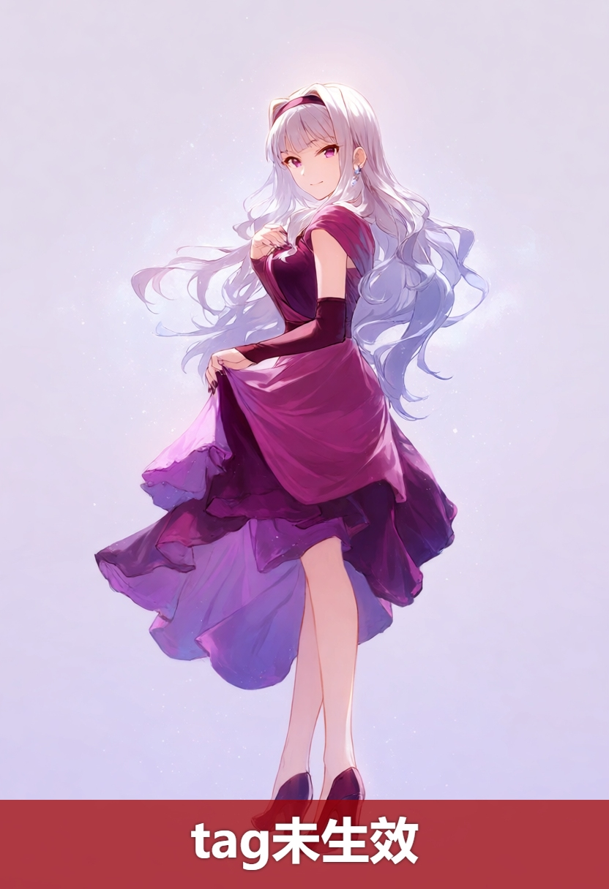

[在线例图](https://assets.quicktagcloud.com/images/raven_composition/raven_composition-3913.jpg?v=675f87417bff3d29)

<a id="raven_composition-3914"></a>

## 调色盘替换

ID：`raven_composition-3914`；分类：色彩光影 / 配色关系与颜色规则；来源标记：`safe`。

来源说明：

> 同一角色或物体造型不变，只把整体配色换掉。

正向提示词：

```text
palette_swap
```

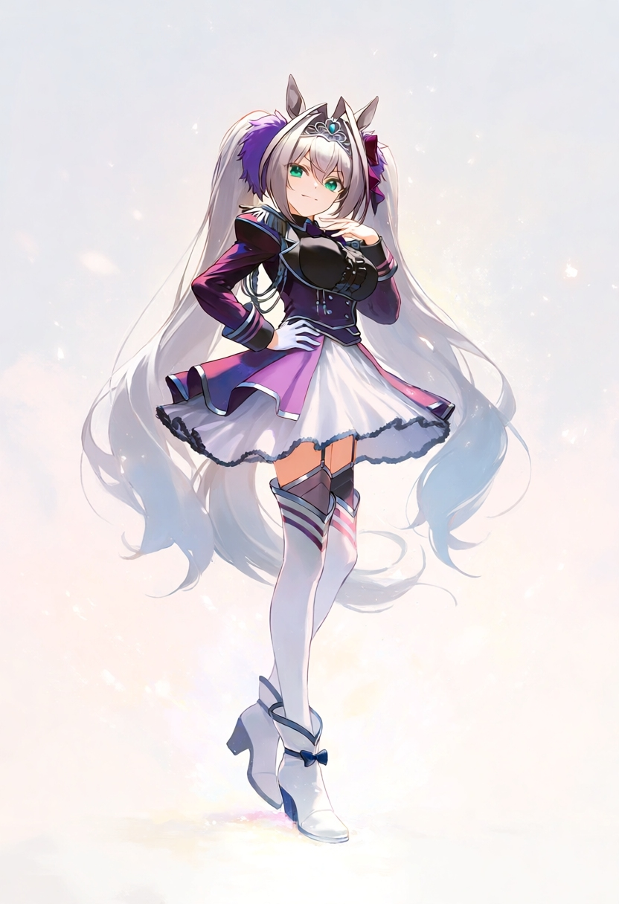

[在线例图](https://assets.quicktagcloud.com/images/raven_composition/raven_composition-3914.jpg?v=024e3d9c816ecd7e)

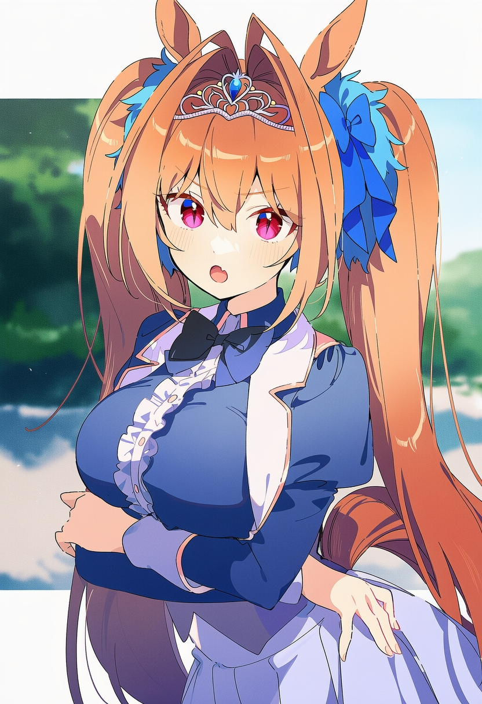

[在线例图](https://assets.quicktagcloud.com/images/raven_composition/raven_composition-3914-02.jpg?v=024e3d9c816ecd7e)

<a id="raven_composition-3915"></a>

## 配色互换

ID：`raven_composition-3915`；分类：色彩光影 / 配色关系与颜色规则；来源标记：`safe`。

来源说明：

> 角色服装样式不变，但把彼此的颜色方案交换。

正向提示词：

```text
color_switch
```

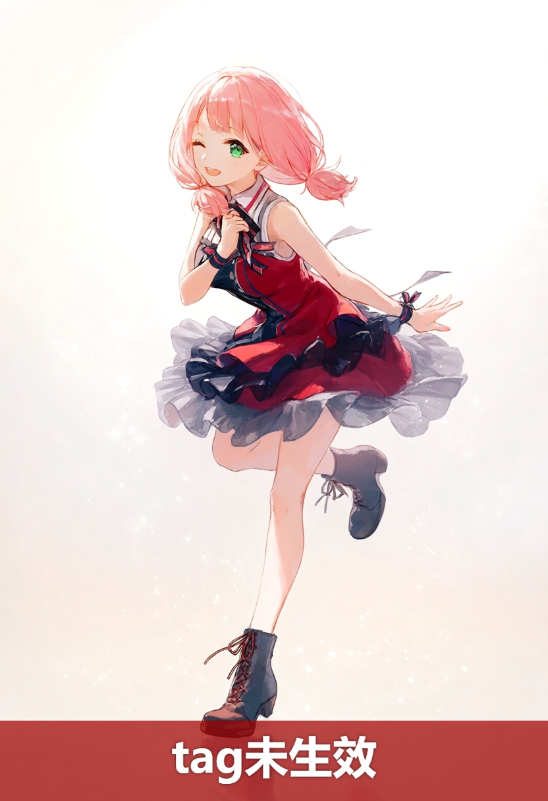

[在线例图](https://assets.quicktagcloud.com/images/raven_composition/raven_composition-3915.jpg?v=fd70186577992dfa)


[在线例图](https://assets.quicktagcloud.com/images/raven_composition/raven_composition-3915-02.jpg?v=fd70186577992dfa)

<a id="raven_composition-3916"></a>

## 彩虹顺序

ID：`raven_composition-3916`；分类：色彩光影 / 配色关系与颜色规则；来源标记：`safe`。

来源说明：

> 颜色按红橙黄绿青蓝紫等彩虹顺序排列。

正向提示词：

```text
rainbow_order
```

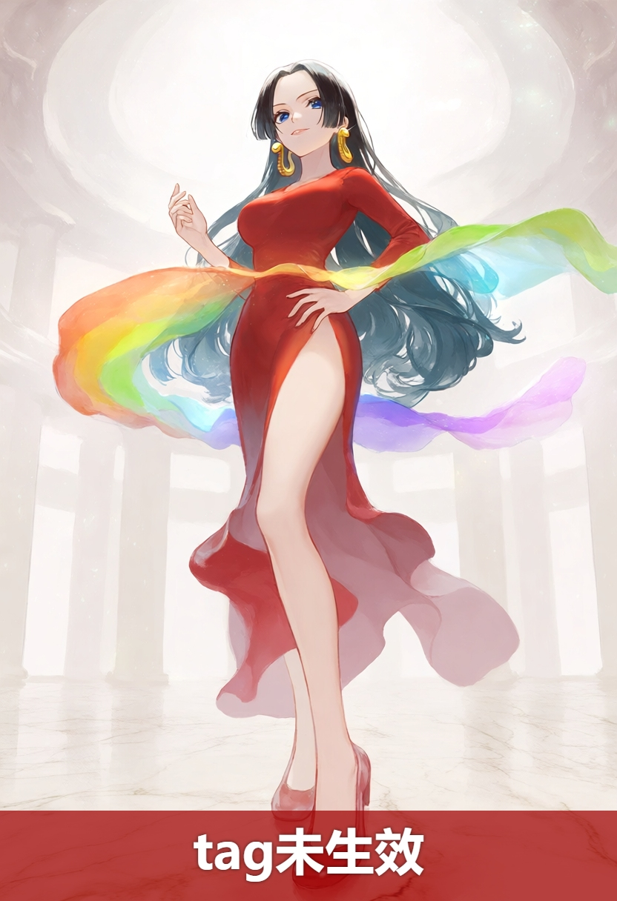

[在线例图](https://assets.quicktagcloud.com/images/raven_composition/raven_composition-3916.jpg?v=3d42d0fb692598bb)

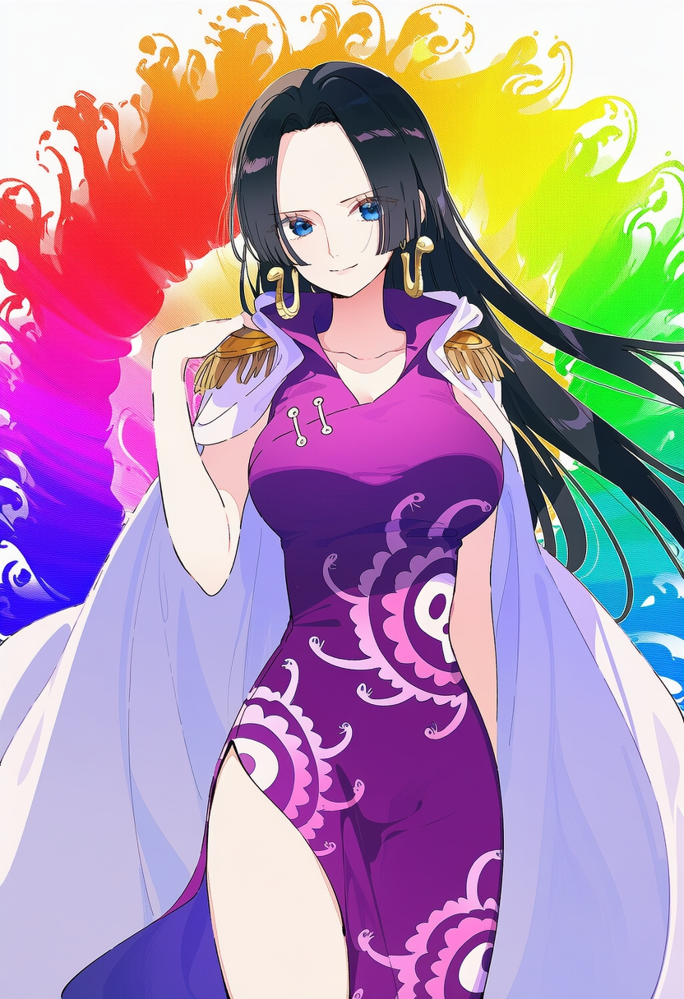

[在线例图](https://assets.quicktagcloud.com/images/raven_composition/raven_composition-3916-02.jpg?v=3d42d0fb692598bb)
