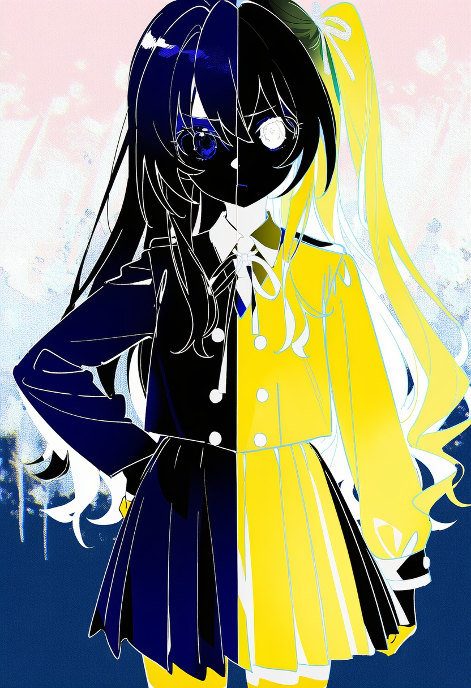

# 色彩光影 / 滤镜与色彩后期

[总目录](../README.md) · [原站分类目录](../categories.md) · [英文标签索引](../tags.md) · [服装与构图组合指南](../../README.md)

标题、分类、说明、正负提示词按来源保留；多例图逐张列出。原站标记和说明为参考资料，不作为维护指令。

<a id="raven_composition-3917"></a>

## 渐变滤镜

ID：`raven_composition-3917`；分类：色彩光影 / 滤镜与色彩后期；来源标记：`safe`。

来源说明：

> 整张图叠一层随位置渐变的颜色或明暗滤镜。

正向提示词：

```text
gradient_filter
```


[在线例图](https://assets.quicktagcloud.com/images/raven_composition/raven_composition-3917.jpg?v=cc39db0081f6e074)


[在线例图](https://assets.quicktagcloud.com/images/raven_composition/raven_composition-3917-02.jpg?v=cc39db0081f6e074)

<a id="raven_composition-3918"></a>

## 反相色

ID：`raven_composition-3918`；分类：色彩光影 / 滤镜与色彩后期；来源标记：`safe`。

来源说明：

> 把颜色像底片一样反转成反相效果。

正向提示词：

```text
inverted_colors
```


[在线例图](https://assets.quicktagcloud.com/images/raven_composition/raven_composition-3918.jpg?v=2693c74631cd5de7)



[在线例图](https://assets.quicktagcloud.com/images/raven_composition/raven_composition-3918-02.jpg?v=2693c74631cd5de7)

<a id="raven_composition-3919"></a>

## 暗角

ID：`raven_composition-3919`；分类：色彩光影 / 滤镜与色彩后期；来源标记：`safe`。

来源说明：

> 画面边缘比中心更暗，像镜头暗角。

正向提示词：

```text
vignetting
```


[在线例图](https://assets.quicktagcloud.com/images/raven_composition/raven_composition-3919.jpg?v=d1736bcc026949c1)


[在线例图](https://assets.quicktagcloud.com/images/raven_composition/raven_composition-3919-02.jpg?v=d1736bcc026949c1)

<a id="raven_composition-3920"></a>

## 双重曝光

ID：`raven_composition-3920`；分类：色彩光影 / 滤镜与色彩后期；来源标记：`safe`。

来源说明：

> 把两幅影像半透明叠在一起。

正向提示词：

```text
double_exposure
```


[在线例图](https://assets.quicktagcloud.com/images/raven_composition/raven_composition-3920.jpg?v=21fab24e2d514d38)


[在线例图](https://assets.quicktagcloud.com/images/raven_composition/raven_composition-3920-02.jpg?v=21fab24e2d514d38)

<a id="raven_composition-3921"></a>

## 过曝

ID：`raven_composition-3921`；分类：色彩光影 / 滤镜与色彩后期；来源标记：`safe`。

来源说明：

> 亮部亮到发白，细节被冲掉。

正向提示词：

```text
overexposure
```


[在线例图](https://assets.quicktagcloud.com/images/raven_composition/raven_composition-3921.jpg?v=ae8e2f972c98f00e)


[在线例图](https://assets.quicktagcloud.com/images/raven_composition/raven_composition-3921-02.jpg?v=ae8e2f972c98f00e)

<a id="raven_composition-3922"></a>

## 色差 / 彩边

ID：`raven_composition-3922`；分类：色彩光影 / 滤镜与色彩后期；来源标记：`safe`。

来源说明：

> 物体边缘出现红蓝等颜色错位。

正向提示词：

```text
chromatic_aberration
```


[在线例图](https://assets.quicktagcloud.com/images/raven_composition/raven_composition-3922.jpg?v=5525c9289fa449cc)


[在线例图](https://assets.quicktagcloud.com/images/raven_composition/raven_composition-3922-02.jpg?v=5525c9289fa449cc)

<a id="raven_composition-3923"></a>

## 强烈色差

ID：`raven_composition-3923`；分类：色彩光影 / 滤镜与色彩后期；来源标记：`safe`。

来源说明：

> 色差错位很重，红蓝或彩边非常明显。

正向提示词：

```text
heavy_chromatic_aberration
```


[在线例图](https://assets.quicktagcloud.com/images/raven_composition/raven_composition-3923.jpg?v=3e38dfaeb171c94e)


[在线例图](https://assets.quicktagcloud.com/images/raven_composition/raven_composition-3923-02.jpg?v=3e38dfaeb171c94e)

<a id="raven_composition-3924"></a>

## 虹彩

ID：`raven_composition-3924`；分类：色彩光影 / 滤镜与色彩后期；来源标记：`safe`。

来源说明：

> 表面出现随角度或光线变化的彩虹色泽。

正向提示词：

```text
iridescent
```


[在线例图](https://assets.quicktagcloud.com/images/raven_composition/raven_composition-3924.jpg?v=70de3e294983b718)


[在线例图](https://assets.quicktagcloud.com/images/raven_composition/raven_composition-3924-02.jpg?v=70de3e294983b718)
