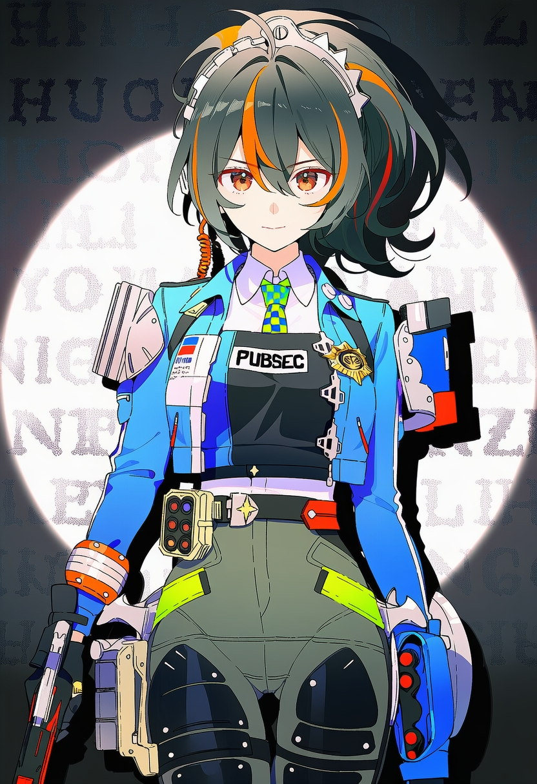

# 色彩光影 / 光线形态与光学效果

[总目录](../README.md) · [原站分类目录](../categories.md) · [英文标签索引](../tags.md) · [服装与构图组合指南](../../README.md)

标题、分类、说明、正负提示词按来源保留；多例图逐张列出。原站标记和说明为参考资料，不作为维护指令。

<a id="raven_composition-3936"></a>

## 泛光

ID：`raven_composition-3936`；分类：色彩光影 / 光线形态与光学效果；来源标记：`safe`。

来源说明：

> 很亮的区域向周围溢出柔光。

正向提示词：

```text
bloom
```


[在线例图](https://assets.quicktagcloud.com/images/raven_composition/raven_composition-3936.jpg?v=bb930d9596f0c840)


[在线例图](https://assets.quicktagcloud.com/images/raven_composition/raven_composition-3936-02.jpg?v=bb930d9596f0c840)

<a id="raven_composition-3937"></a>

## 聚光灯

ID：`raven_composition-3937`；分类：色彩光影 / 光线形态与光学效果；来源标记：`safe`。

来源说明：

> 一束集中的光只照亮目标区域。

正向提示词：

```text
spotlight
```


[在线例图](https://assets.quicktagcloud.com/images/raven_composition/raven_composition-3937.jpg?v=092fa7174380c580)



[在线例图](https://assets.quicktagcloud.com/images/raven_composition/raven_composition-3937-02.jpg?v=092fa7174380c580)

<a id="raven_composition-3938"></a>

## 光束 / 光线

ID：`raven_composition-3938`；分类：色彩光影 / 光线形态与光学效果；来源标记：`safe`。

来源说明：

> 能明显看到一束束传播中的光。

正向提示词：

```text
light_rays
```


[在线例图](https://assets.quicktagcloud.com/images/raven_composition/raven_composition-3938.jpg?v=b175f59a74741859)


[在线例图](https://assets.quicktagcloud.com/images/raven_composition/raven_composition-3938-02.jpg?v=b175f59a74741859)

<a id="raven_composition-3939"></a>

## 阳光束

ID：`raven_composition-3939`；分类：色彩光影 / 光线形态与光学效果；来源标记：`safe`。

来源说明：

> 从太阳方向射入、清晰可见的光束。

正向提示词：

```text
sunbeam
```


[在线例图](https://assets.quicktagcloud.com/images/raven_composition/raven_composition-3939.jpg?v=444761b19457f987)


[在线例图](https://assets.quicktagcloud.com/images/raven_composition/raven_composition-3939-02.jpg?v=444761b19457f987)

<a id="raven_composition-3940"></a>

## 昏暗照明

ID：`raven_composition-3940`；分类：色彩光影 / 光线形态与光学效果；来源标记：`safe`。

来源说明：

> 有光但很弱，场景没有完全黑掉。

正向提示词：

```text
dim_lighting
```


[在线例图](https://assets.quicktagcloud.com/images/raven_composition/raven_composition-3940.jpg?v=4fc67261ea88ee36)


[在线例图](https://assets.quicktagcloud.com/images/raven_composition/raven_composition-3940-02.jpg?v=4fc67261ea88ee36)

<a id="raven_composition-3941"></a>

## 月光

ID：`raven_composition-3941`；分类：色彩光影 / 光线形态与光学效果；来源标记：`safe`。

来源说明：

> 场景主要由月亮的冷光照亮。

正向提示词：

```text
moonlight
```


[在线例图](https://assets.quicktagcloud.com/images/raven_composition/raven_composition-3941.jpg?v=551ed41776817ba6)


[在线例图](https://assets.quicktagcloud.com/images/raven_composition/raven_composition-3941-02.jpg?v=551ed41776817ba6)

<a id="raven_composition-3942"></a>

## 阳光

ID：`raven_composition-3942`；分类：色彩光影 / 光线形态与光学效果；来源标记：`safe`。

来源说明：

> 场景明显被太阳光照亮。

正向提示词：

```text
sunlight
```


[在线例图](https://assets.quicktagcloud.com/images/raven_composition/raven_composition-3942.jpg?v=2cfbe14b52483ce2)


[在线例图](https://assets.quicktagcloud.com/images/raven_composition/raven_composition-3942-02.jpg?v=2cfbe14b52483ce2)

<a id="raven_composition-3943"></a>

## 缝隙光

ID：`raven_composition-3943`；分类：色彩光影 / 光线形态与光学效果；来源标记：`safe`。

来源说明：

> 黑暗环境里从门缝等小缝隙透进一条光。

正向提示词：

```text
crack_of_light
```


[在线例图](https://assets.quicktagcloud.com/images/raven_composition/raven_composition-3943.jpg?v=1a886830cb33c11f)


[在线例图](https://assets.quicktagcloud.com/images/raven_composition/raven_composition-3943-02.jpg?v=1a886830cb33c11f)

<a id="raven_composition-3944"></a>

## 斑驳阳光

ID：`raven_composition-3944`；分类：色彩光影 / 光线形态与光学效果；来源标记：`safe`。

来源说明：

> 阳光被树叶等遮挡后形成碎片状明暗光斑。

正向提示词：

```text
dappled_sunlight
```


[在线例图](https://assets.quicktagcloud.com/images/raven_composition/raven_composition-3944.jpg?v=5ad4ad87b8103eb0)


[在线例图](https://assets.quicktagcloud.com/images/raven_composition/raven_composition-3944-02.jpg?v=5ad4ad87b8103eb0)

<a id="raven_composition-3945"></a>

## 焦散光纹

ID：`raven_composition-3945`；分类：色彩光影 / 光线形态与光学效果；来源标记：`safe`。

来源说明：

> 光穿过水或透明物后，在表面形成波纹状亮斑。

正向提示词：

```text
caustics
```


[在线例图](https://assets.quicktagcloud.com/images/raven_composition/raven_composition-3945.jpg?v=78b3965ad2447d80)


[在线例图](https://assets.quicktagcloud.com/images/raven_composition/raven_composition-3945-02.jpg?v=78b3965ad2447d80)

<a id="raven_composition-3946"></a>

## 折射

ID：`raven_composition-3946`；分类：色彩光影 / 光线形态与光学效果；来源标记：`safe`。

来源说明：

> 光穿过玻璃、水等后方向改变，产生折弯或镜片感。

正向提示词：

```text
refraction
```


[在线例图](https://assets.quicktagcloud.com/images/raven_composition/raven_composition-3946.jpg?v=235c4321cbe68e9a)


[在线例图](https://assets.quicktagcloud.com/images/raven_composition/raven_composition-3946-02.jpg?v=235c4321cbe68e9a)

<a id="raven_composition-3947"></a>

## 明暗对照

ID：`raven_composition-3947`；分类：色彩光影 / 光线形态与光学效果；来源标记：`safe`。

来源说明：

> 用很强的亮暗反差塑造戏剧化体积和氛围。

正向提示词：

```text
chiaroscuro
```


[在线例图](https://assets.quicktagcloud.com/images/raven_composition/raven_composition-3947.jpg?v=128055de7cfcd232)


[在线例图](https://assets.quicktagcloud.com/images/raven_composition/raven_composition-3947-02.jpg?v=128055de7cfcd232)

<a id="raven_composition-3948"></a>

## 枪口火光

ID：`raven_composition-3948`；分类：色彩光影 / 光线形态与光学效果；来源标记：`safe`。

来源说明：

> 开火瞬间枪口爆出的短暂强光。

正向提示词：

```text
muzzle_flash
```


[在线例图](https://assets.quicktagcloud.com/images/raven_composition/raven_composition-3948.jpg?v=0854d48ab5f2d307)


[在线例图](https://assets.quicktagcloud.com/images/raven_composition/raven_composition-3948-02.jpg?v=0854d48ab5f2d307)

<a id="raven_composition-3949"></a>

## 次表面散射

ID：`raven_composition-3949`；分类：色彩光影 / 光线形态与光学效果；来源标记：`safe`。

来源说明：

> 光进入皮肤等半透明材质后在内部散开，让薄处和边缘透出柔和的亮色。

正向提示词：

```text
subsurface_scattering
```


[在线例图](https://assets.quicktagcloud.com/images/raven_composition/raven_composition-3949.jpg?v=7de022d612d28909)


[在线例图](https://assets.quicktagcloud.com/images/raven_composition/raven_composition-3949-02.jpg?v=7de022d612d28909)

<a id="raven_composition-3950"></a>

## 紫外线光

ID：`raven_composition-3950`；分类：色彩光影 / 光线形态与光学效果；来源标记：`safe`。

来源说明：

> 画面表现紫外线照明，常带紫蓝色或荧光发亮的感觉。

正向提示词：

```text
ultraviolet_light
```


[在线例图](https://assets.quicktagcloud.com/images/raven_composition/raven_composition-3950.jpg?v=239e6ba8b3a08283)


[在线例图](https://assets.quicktagcloud.com/images/raven_composition/raven_composition-3950-02.jpg?v=239e6ba8b3a08283)
