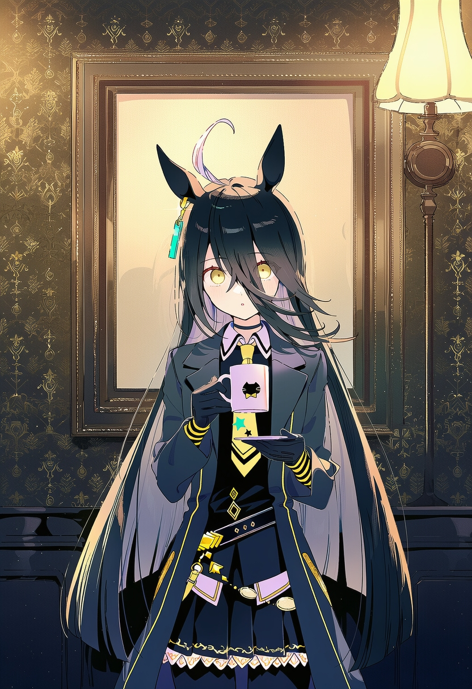

# 色彩光影 / 人工光源

[总目录](../README.md) · [原站分类目录](../categories.md) · [英文标签索引](../tags.md) · [服装与构图组合指南](../../README.md)

标题、分类、说明、正负提示词按来源保留；多例图逐张列出。原站标记和说明为参考资料，不作为维护指令。

<a id="raven_composition-3968"></a>

## 舞台灯

ID：`raven_composition-3968`；分类：色彩光影 / 人工光源；来源标记：`safe`。

来源说明：

> 舞台上的多束强光或彩灯。

正向提示词：

```text
stage_lights
```


[在线例图](https://assets.quicktagcloud.com/images/raven_composition/raven_composition-3968.jpg?v=2869f6282c6505ce)


[在线例图](https://assets.quicktagcloud.com/images/raven_composition/raven_composition-3968-02.jpg?v=2869f6282c6505ce)

<a id="raven_composition-3969"></a>

## 顶灯

ID：`raven_composition-3969`；分类：色彩光影 / 人工光源；来源标记：`safe`。

来源说明：

> 安装在天花板上的室内灯。

正向提示词：

```text
ceiling_light
```


[在线例图](https://assets.quicktagcloud.com/images/raven_composition/raven_composition-3969.jpg?v=8b3de8283d76bc79)


[在线例图](https://assets.quicktagcloud.com/images/raven_composition/raven_composition-3969-02.jpg?v=8b3de8283d76bc79)

<a id="raven_composition-3970"></a>

## 吊灯 / 枝形吊灯

ID：`raven_composition-3970`；分类：色彩光影 / 人工光源；来源标记：`safe`。

来源说明：

> 悬挂在顶部的装饰性灯具。

正向提示词：

```text
chandelier
```


[在线例图](https://assets.quicktagcloud.com/images/raven_composition/raven_composition-3970.jpg?v=5197765563c410e6)


[在线例图](https://assets.quicktagcloud.com/images/raven_composition/raven_composition-3970-02.jpg?v=5197765563c410e6)

<a id="raven_composition-3971"></a>

## 路灯柱

ID：`raven_composition-3971`；分类：色彩光影 / 人工光源；来源标记：`safe`。

来源说明：

> 街道上的立式路灯。

正向提示词：

```text
lamppost
```


[在线例图](https://assets.quicktagcloud.com/images/raven_composition/raven_composition-3971.jpg?v=821a4e68e95c9604)


[在线例图](https://assets.quicktagcloud.com/images/raven_composition/raven_composition-3971-02.jpg?v=821a4e68e95c9604)

<a id="raven_composition-3972"></a>

## 烛光

ID：`raven_composition-3972`；分类：色彩光影 / 人工光源；来源标记：`safe`。

来源说明：

> 蜡烛发出的暖色弱光。

正向提示词：

```text
candlelight
```


[在线例图](https://assets.quicktagcloud.com/images/raven_composition/raven_composition-3972.jpg?v=e630727764ca1b2c)


[在线例图](https://assets.quicktagcloud.com/images/raven_composition/raven_composition-3972-02.jpg?v=e630727764ca1b2c)

<a id="raven_composition-3973"></a>

## 荧光棒

ID：`raven_composition-3973`；分类：色彩光影 / 人工光源；来源标记：`safe`。

来源说明：

> 荧光棒发出的彩色自发光。

正向提示词：

```text
glowstick
```


[在线例图](https://assets.quicktagcloud.com/images/raven_composition/raven_composition-3973.jpg?v=6ab6d7e87feecf41)


[在线例图](https://assets.quicktagcloud.com/images/raven_composition/raven_composition-3973-02.jpg?v=6ab6d7e87feecf41)

<a id="raven_composition-3974"></a>

## 火把

ID：`raven_composition-3974`；分类：色彩光影 / 人工光源；来源标记：`safe`。

来源说明：

> 手持火把发出的火焰光。

正向提示词：

```text
torch
```


[在线例图](https://assets.quicktagcloud.com/images/raven_composition/raven_composition-3974.jpg?v=ca2aa2ea235ae531)


[在线例图](https://assets.quicktagcloud.com/images/raven_composition/raven_composition-3974-02.jpg?v=ca2aa2ea235ae531)

<a id="raven_composition-3975"></a>

## 手电筒

ID：`raven_composition-3975`；分类：色彩光影 / 人工光源；来源标记：`safe`。

来源说明：

> 手电形成方向明确的小范围光束。

正向提示词：

```text
flashlight
```


[在线例图](https://assets.quicktagcloud.com/images/raven_composition/raven_composition-3975.jpg?v=270f8916848f1e15)


[在线例图](https://assets.quicktagcloud.com/images/raven_composition/raven_composition-3975-02.jpg?v=270f8916848f1e15)

<a id="raven_composition-3976"></a>

## 灯笼 / 提灯

ID：`raven_composition-3976`；分类：色彩光影 / 人工光源；来源标记：`safe`。

来源说明：

> 可携带或悬挂的灯笼光源。

正向提示词：

```text
lantern
```


[在线例图](https://assets.quicktagcloud.com/images/raven_composition/raven_composition-3976.jpg?v=955275b59a20ba93)


[在线例图](https://assets.quicktagcloud.com/images/raven_composition/raven_composition-3976-02.jpg?v=955275b59a20ba93)

<a id="raven_composition-3977"></a>

## 木制灯笼

ID：`raven_composition-3977`；分类：色彩光影 / 人工光源；来源标记：`safe`。

来源说明：

> 木框灯笼发出的柔和灯光。

正向提示词：

```text
wooden_lantern
```


[在线例图](https://assets.quicktagcloud.com/images/raven_composition/raven_composition-3977.jpg?v=604c23d8515bb122)


[在线例图](https://assets.quicktagcloud.com/images/raven_composition/raven_composition-3977-02.jpg?v=604c23d8515bb122)

<a id="raven_composition-3978"></a>

## 灯

ID：`raven_composition-3978`；分类：色彩光影 / 人工光源；来源标记：`safe`。

来源说明：

> 普通室内灯具作为光源。

正向提示词：

```text
lamp
```


[在线例图](https://assets.quicktagcloud.com/images/raven_composition/raven_composition-3978.jpg?v=cb62528845b394c1)


[在线例图](https://assets.quicktagcloud.com/images/raven_composition/raven_composition-3978-02.jpg?v=cb62528845b394c1)

<a id="raven_composition-3979"></a>

## 壁灯

ID：`raven_composition-3979`；分类：色彩光影 / 人工光源；来源标记：`safe`。

来源说明：

> 安装在墙上的灯。

正向提示词：

```text
wall_lamp
```


[在线例图](https://assets.quicktagcloud.com/images/raven_composition/raven_composition-3979.jpg?v=72d29bc9ff7a1760)



[在线例图](https://assets.quicktagcloud.com/images/raven_composition/raven_composition-3979-02.jpg?v=72d29bc9ff7a1760)

<a id="raven_composition-3980"></a>

## 台灯

ID：`raven_composition-3980`；分类：色彩光影 / 人工光源；来源标记：`safe`。

来源说明：

> 桌面台灯形成局部照明。

正向提示词：

```text
desk_lamp
```


[在线例图](https://assets.quicktagcloud.com/images/raven_composition/raven_composition-3980.jpg?v=74eab063bae5fb2f)


[在线例图](https://assets.quicktagcloud.com/images/raven_composition/raven_composition-3980-02.jpg?v=74eab063bae5fb2f)

<a id="raven_composition-3981"></a>

## 油灯

ID：`raven_composition-3981`；分类：色彩光影 / 人工光源；来源标记：`safe`。

来源说明：

> 燃油灯发出的暖色火光。

正向提示词：

```text
oil_lamp
```


[在线例图](https://assets.quicktagcloud.com/images/raven_composition/raven_composition-3981.jpg?v=1f00b8756d94af57)


[在线例图](https://assets.quicktagcloud.com/images/raven_composition/raven_composition-3981-02.jpg?v=1f00b8756d94af57)

<a id="raven_composition-3982"></a>

## 落地灯

ID：`raven_composition-3982`；分类：色彩光影 / 人工光源；来源标记：`safe`。

来源说明：

> 立在地面上的高脚灯具，用来提供室内局部照明。

正向提示词：

```text
floor_lamp
```


[在线例图](https://assets.quicktagcloud.com/images/raven_composition/raven_composition-3982.jpg?v=4636351d4361ef97)


[在线例图](https://assets.quicktagcloud.com/images/raven_composition/raven_composition-3982-02.jpg?v=4636351d4361ef97)

<a id="raven_composition-3983"></a>

## 泛光灯

ID：`raven_composition-3983`；分类：色彩光影 / 人工光源；来源标记：`safe`。

来源说明：

> 用强光大范围照亮场景的灯，常见于舞台、场馆或户外。

正向提示词：

```text
floodlights
```


[在线例图](https://assets.quicktagcloud.com/images/raven_composition/raven_composition-3983.jpg?v=6100d5b486299b7a)


[在线例图](https://assets.quicktagcloud.com/images/raven_composition/raven_composition-3983-02.jpg?v=6100d5b486299b7a)

<a id="raven_composition-3984"></a>

## 发光头饰

ID：`raven_composition-3984`；分类：色彩光影 / 人工光源；来源标记：`safe`。

来源说明：

> 帽子、头盔或头饰本身会发光，形成明显的局部亮光。

正向提示词：

```text
glowing_headgear
```


[在线例图](https://assets.quicktagcloud.com/images/raven_composition/raven_composition-3984.jpg?v=9fbe676cb676d657)


[在线例图](https://assets.quicktagcloud.com/images/raven_composition/raven_composition-3984-02.jpg?v=9fbe676cb676d657)
