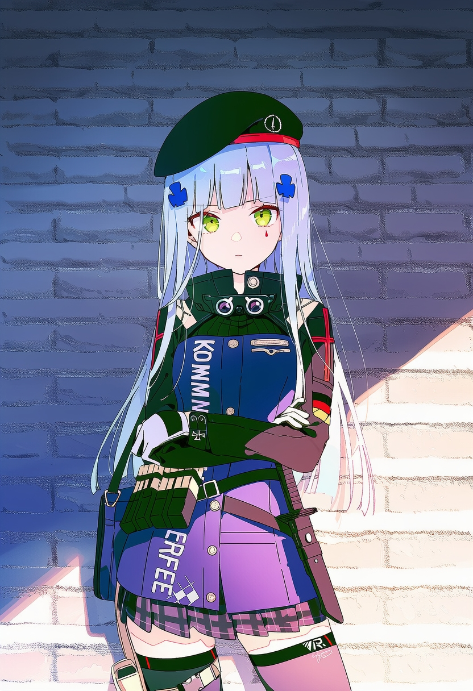
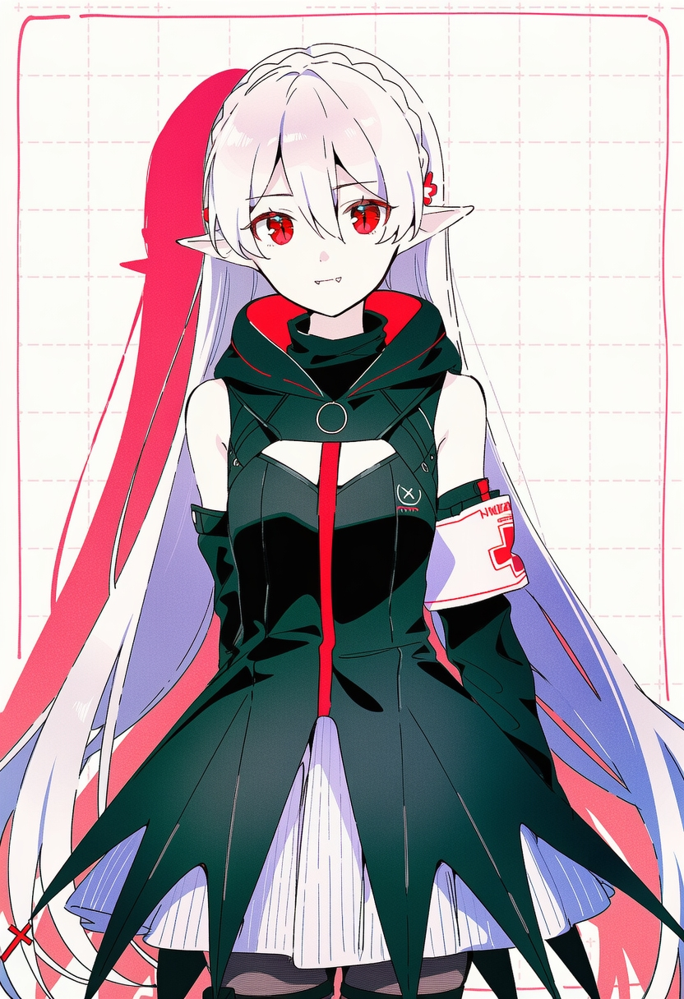

# 色彩光影 / 阴影与暗部

[总目录](../README.md) · [原站分类目录](../categories.md) · [英文标签索引](../tags.md) · [服装与构图组合指南](../../README.md)

标题、分类、说明、正负提示词按来源保留；多例图逐张列出。原站标记和说明为参考资料，不作为维护指令。

<a id="raven_composition-3985"></a>

## 阴凉 / 遮光

ID：`raven_composition-3985`；分类：色彩光影 / 阴影与暗部；来源标记：`safe`。

来源说明：

> 主体处在被挡住直射光的阴影区域。

正向提示词：

```text
shade
```


[在线例图](https://assets.quicktagcloud.com/images/raven_composition/raven_composition-3985.jpg?v=7529cb06662ed8a9)



[在线例图](https://assets.quicktagcloud.com/images/raven_composition/raven_composition-3985-02.jpg?v=7529cb06662ed8a9)

<a id="raven_composition-3986"></a>

## 树荫

ID：`raven_composition-3986`；分类：色彩光影 / 阴影与暗部；来源标记：`safe`。

来源说明：

> 树冠遮光形成的大块阴影。

正向提示词：

```text
tree_shade
```


[在线例图](https://assets.quicktagcloud.com/images/raven_composition/raven_composition-3986.jpg?v=98f35f0c635d3314)


[在线例图](https://assets.quicktagcloud.com/images/raven_composition/raven_composition-3986-02.jpg?v=98f35f0c635d3314)

<a id="raven_composition-3987"></a>

## 阴影

ID：`raven_composition-3987`；分类：色彩光影 / 阴影与暗部；来源标记：`safe`。

来源说明：

> 物体挡光后形成明确的暗部或投影。

正向提示词：

```text
shadow
```


[在线例图](https://assets.quicktagcloud.com/images/raven_composition/raven_composition-3987.jpg?v=b0b08e14b5ed3c5b)


[在线例图](https://assets.quicktagcloud.com/images/raven_composition/raven_composition-3987-02.jpg?v=b0b08e14b5ed3c5b)

<a id="raven_composition-3988"></a>

## 彩色阴影

ID：`raven_composition-3988`；分类：色彩光影 / 阴影与暗部；来源标记：`safe`。

来源说明：

> 阴影不是普通灰黑，而带明显颜色。

正向提示词：

```text
colored_shadow
```


[在线例图](https://assets.quicktagcloud.com/images/raven_composition/raven_composition-3988.jpg?v=374e6c9e73fbb288)



[在线例图](https://assets.quicktagcloud.com/images/raven_composition/raven_composition-3988-02.jpg?v=374e6c9e73fbb288)

<a id="raven_composition-3989"></a>

## 窗影

ID：`raven_composition-3989`；分类：色彩光影 / 阴影与暗部；来源标记：`safe`。

来源说明：

> 窗框或窗格投下的规则阴影。

正向提示词：

```text
window_shadow
```


[在线例图](https://assets.quicktagcloud.com/images/raven_composition/raven_composition-3989.jpg?v=1338d7247139a1f3)


[在线例图](https://assets.quicktagcloud.com/images/raven_composition/raven_composition-3989-02.jpg?v=1338d7247139a1f3)

<a id="raven_composition-3990"></a>

## 黑暗

ID：`raven_composition-3990`；分类：色彩光影 / 阴影与暗部；来源标记：`safe`。

来源说明：

> 环境几乎没有光，大片区域接近全黑。

正向提示词：

```text
darkness
```


[在线例图](https://assets.quicktagcloud.com/images/raven_composition/raven_composition-3990.jpg?v=e7c3718d63824f16)


[在线例图](https://assets.quicktagcloud.com/images/raven_composition/raven_composition-3990-02.jpg?v=e7c3718d63824f16)

<a id="raven_composition-3991"></a>

## 剪影

ID：`raven_composition-3991`；分类：色彩光影 / 阴影与暗部；来源标记：`safe`。

来源说明：

> 对象整体很暗，只靠外轮廓辨认。

正向提示词：

```text
silhouette
```


[在线例图](https://assets.quicktagcloud.com/images/raven_composition/raven_composition-3991.jpg?v=e5fb95592bde1714)


[在线例图](https://assets.quicktagcloud.com/images/raven_composition/raven_composition-3991-02.jpg?v=e5fb95592bde1714)

<a id="raven_composition-3992"></a>

## 透视剪影

ID：`raven_composition-3992`；分类：色彩光影 / 阴影与暗部；来源标记：`safe`。

来源说明：

> 黑暗剪影里还能隐约看到内部细节或后方图像。

正向提示词：

```text
see-through_silhouette
```


[在线例图](https://assets.quicktagcloud.com/images/raven_composition/raven_composition-3992.jpg?v=def082423456b448)


[在线例图](https://assets.quicktagcloud.com/images/raven_composition/raven_composition-3992-02.jpg?v=def082423456b448)
