# 视角构图 / 镜头视角

[总目录](../README.md) · [原站分类目录](../categories.md) · [英文标签索引](../tags.md) · [服装与构图组合指南](../../README.md)

标题、分类、说明、正负提示词按来源保留；多例图逐张列出。原站标记和说明为参考资料，不作为维护指令。

<a id="raven_composition-3993"></a>

## 荷兰角/倾斜构图

ID：`raven_composition-3993`；分类：视角构图 / 镜头视角；来源标记：`safe`。

来源说明：

> 镜头歪着拍，整个画面斜向一边。

正向提示词：

```text
dutch_angle
```

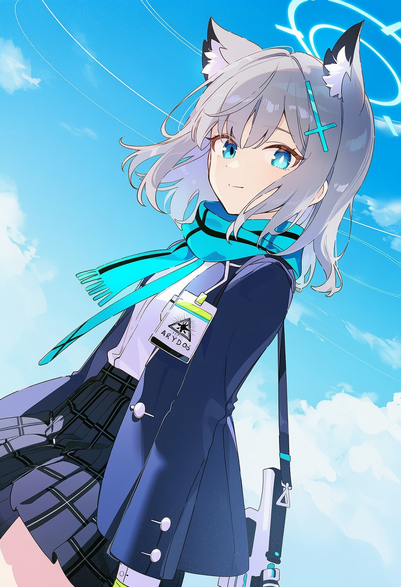

[在线例图](https://assets.quicktagcloud.com/images/raven_composition/raven_composition-3993.jpg?v=570b82922c2ec1bf)

<a id="raven_composition-3994"></a>

## 俯视/俯拍

ID：`raven_composition-3994`；分类：视角构图 / 镜头视角；来源标记：`safe`。

来源说明：

> 镜头从角色头顶上方往下拍。

正向提示词：

```text
from_above
```


[在线例图](https://assets.quicktagcloud.com/images/raven_composition/raven_composition-3994.jpg?v=6ff9280ba5439656)

<a id="raven_composition-3995"></a>

## 背面视角

ID：`raven_composition-3995`；分类：视角构图 / 镜头视角；来源标记：`safe`。

来源说明：

> 镜头在角色身后，拍她的后背。

正向提示词：

```text
from_behind
```


[在线例图](https://assets.quicktagcloud.com/images/raven_composition/raven_composition-3995.jpg?v=e220832fb8517de3)

<a id="raven_composition-3996"></a>

## 仰视/仰拍

ID：`raven_composition-3996`；分类：视角构图 / 镜头视角；来源标记：`safe`。

来源说明：

> 镜头从角色脚边下方往上拍。

正向提示词：

```text
from_below
```


[在线例图](https://assets.quicktagcloud.com/images/raven_composition/raven_composition-3996.jpg?v=cca1d64ebcc0d24f)

<a id="raven_composition-3997"></a>

## 侧面视角

ID：`raven_composition-3997`；分类：视角构图 / 镜头视角；来源标记：`safe`。

来源说明：

> 镜头从角色正侧面拍过去。

正向提示词：

```text
from_side
```

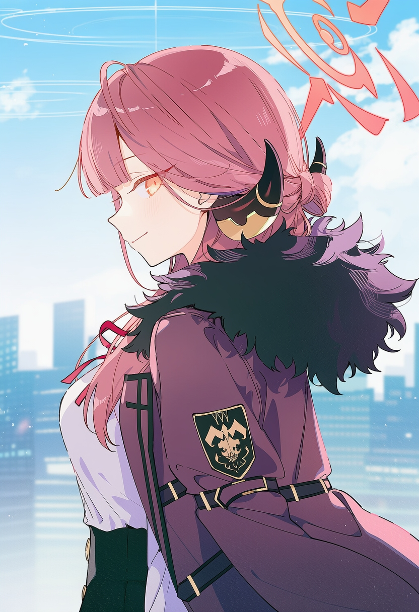

[在线例图](https://assets.quicktagcloud.com/images/raven_composition/raven_composition-3997.jpg?v=adeb1d809f888f64)

<a id="raven_composition-3998"></a>

## 正面直拍

ID：`raven_composition-3998`；分类：视角构图 / 镜头视角；来源标记：`safe`。

来源说明：

> 镜头正对角色脸平视拍摄。

正向提示词：

```text
straight-on
```

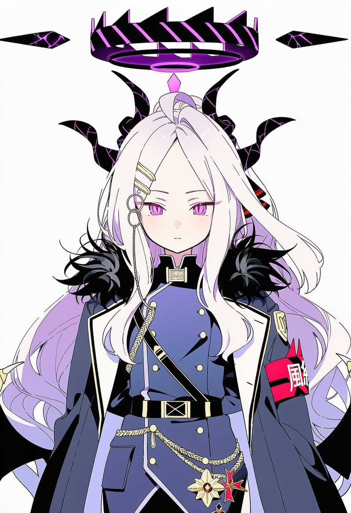

[在线例图](https://assets.quicktagcloud.com/images/raven_composition/raven_composition-3998.jpg?v=6e6987767c74dba6)

<a id="raven_composition-3999"></a>

## 横躺构图

ID：`raven_composition-3999`；分类：视角构图 / 镜头视角；来源标记：`safe`。

来源说明：

> 角色或整个画面横向水平摆放。

正向提示词：

```text
sideways
```

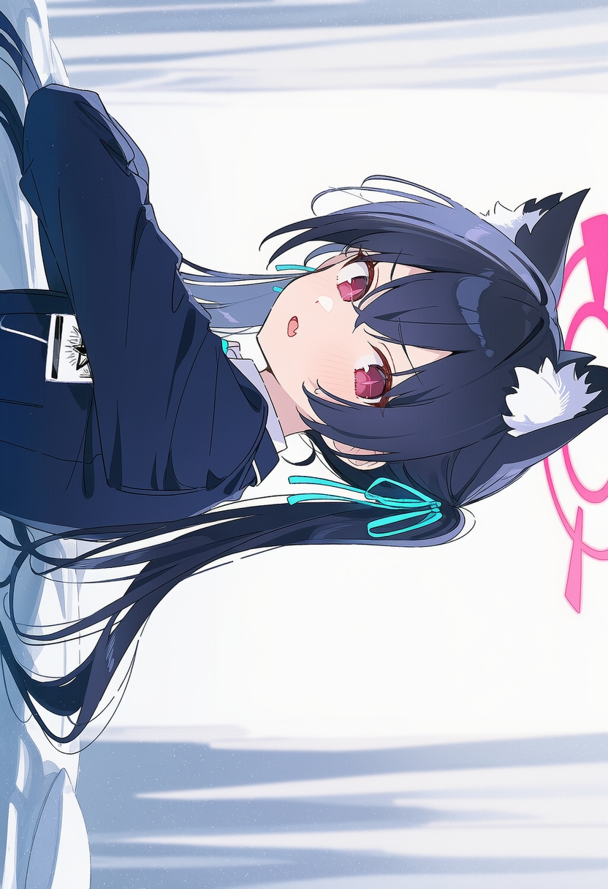

[在线例图](https://assets.quicktagcloud.com/images/raven_composition/raven_composition-3999.jpg?v=88b49ae2bcd67d0e)

<a id="raven_composition-4000"></a>

## 颠倒/倒立

ID：`raven_composition-4000`；分类：视角构图 / 镜头视角；来源标记：`safe`。

来源说明：

> 画面上下完全倒过来拍。

正向提示词：

```text
upside-down
```

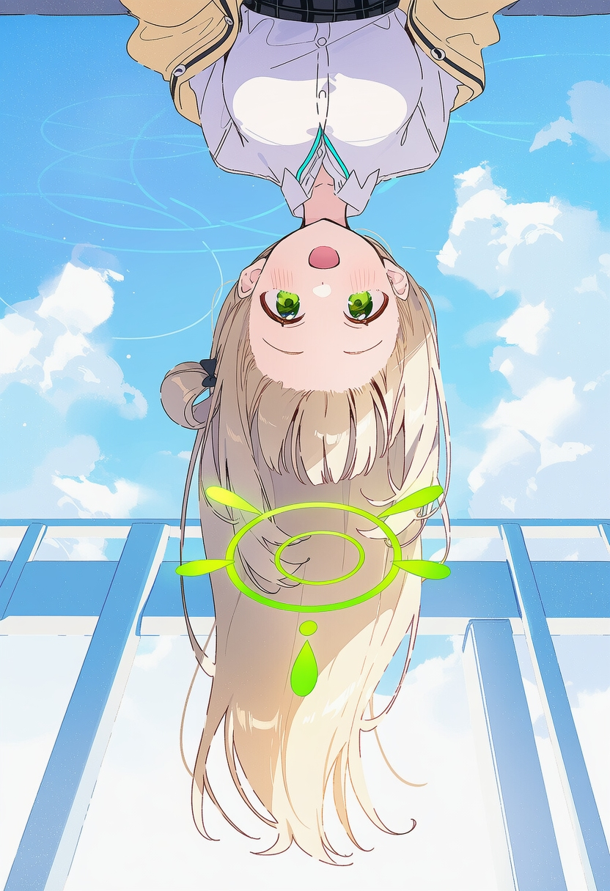

[在线例图](https://assets.quicktagcloud.com/images/raven_composition/raven_composition-4000.jpg?v=6a03c646d73126cc)

<a id="raven_composition-4001"></a>

## 侧脸

ID：`raven_composition-4001`；分类：视角构图 / 镜头视角；来源标记：`safe`。

来源说明：

> 只拍角色的侧面轮廓。

正向提示词：

```text
profile
```


[在线例图](https://assets.quicktagcloud.com/images/raven_composition/raven_composition-4001.jpg?v=256905b6b011d8e6)

<a id="raven_composition-4002"></a>

## 多人侧脸

ID：`raven_composition-4002`；分类：视角构图 / 镜头视角；来源标记：`safe`。

来源说明：

> 多个角色并排一起拍侧面。

正向提示词：

```text
group_profile
```


[在线例图](https://assets.quicktagcloud.com/images/raven_composition/raven_composition-4002.jpg?v=15c6e72e3a1b7f8b)

<a id="raven_composition-4003"></a>

## 第一人称视角

ID：`raven_composition-4003`；分类：视角构图 / 镜头视角；来源标记：`safe`。

来源说明：

> 画面里通常会出现观察者身体的一部分。

正向提示词：

```text
pov
```


[在线例图](https://assets.quicktagcloud.com/images/raven_composition/raven_composition-4003.jpg?v=5fcad6b4c476e282)

<a id="raven_composition-4004"></a>

## 女性视角

ID：`raven_composition-4004`；分类：视角构图 / 镜头视角；来源标记：`safe`。

来源说明：

> 画面的观察者是一名女性

正向提示词：

```text
female_pov
```


[在线例图](https://assets.quicktagcloud.com/images/raven_composition/raven_composition-4004.jpg?v=c1174156729a891f)

<a id="raven_composition-4005"></a>

## 第一人称双手

ID：`raven_composition-4005`；分类：视角构图 / 镜头视角；来源标记：`safe`。

来源说明：

> 画面中有观察者的双手

正向提示词：

```text
pov_hands
```


[在线例图](https://assets.quicktagcloud.com/images/raven_composition/raven_composition-4005.jpg?v=b73ae4b8f2ee1c9f)

<a id="raven_composition-4006"></a>

## 第一人称腿部

ID：`raven_composition-4006`；分类：视角构图 / 镜头视角；来源标记：`safe`。

来源说明：

> 画面中有观察者的双腿

正向提示词：

```text
pov_legs
```


[在线例图](https://assets.quicktagcloud.com/images/raven_composition/raven_composition-4006.jpg?v=96036044aa084341)

<a id="raven_composition-4007"></a>

## 第一人称胯下

ID：`raven_composition-4007`；分类：视角构图 / 镜头视角；来源标记：`safe`。

来源说明：

> 画面中有观察者的跨

正向提示词：

```text
pov_crotch
```


[在线例图](https://assets.quicktagcloud.com/images/raven_composition/raven_composition-4007.jpg?v=27184725bec2a90b)

<a id="raven_composition-4008"></a>

## 第一人称胸口

ID：`raven_composition-4008`；分类：视角构图 / 镜头视角；来源标记：`safe`。

来源说明：

> 画面中有观察者的胸口

正向提示词：

```text
pov_breasts
```


[在线例图](https://assets.quicktagcloud.com/images/raven_composition/raven_composition-4008.jpg?v=c0b0487058582eba)

<a id="raven_composition-4009"></a>

## 第一人称影子

ID：`raven_composition-4009`；分类：视角构图 / 镜头视角；来源标记：`safe`。

来源说明：

> 画面中是观察者的影子

正向提示词：

```text
pov_shadow
```

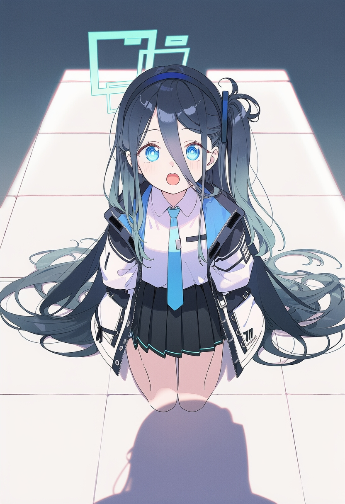

[在线例图](https://assets.quicktagcloud.com/images/raven_composition/raven_composition-4009.jpg?v=cbe1afb011bb18c3)

<a id="raven_composition-4010"></a>

## 穿衣影子梗

ID：`raven_composition-4010`；分类：视角构图 / 镜头视角；来源标记：`safe`。

来源说明：

> 添加衣服描述词可以做出衣服脱光的效果

正向提示词：

```text
dressed_shadow_(meme)
```

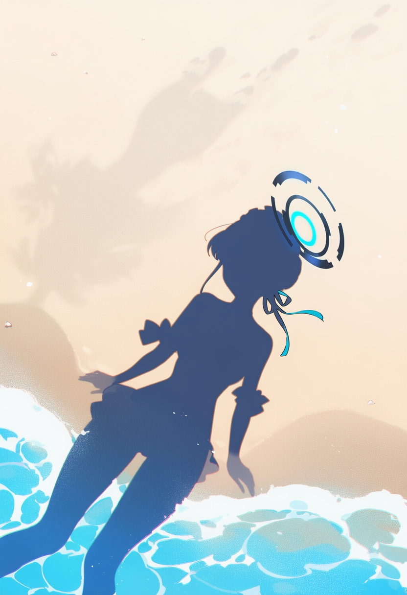

[在线例图](https://assets.quicktagcloud.com/images/raven_composition/raven_composition-4010.jpg?v=47c986f34e52b5f6)

<a id="raven_composition-4011"></a>

## 眼镜视角

ID：`raven_composition-4011`；分类：视角构图 / 镜头视角；来源标记：`safe`。

来源说明：

> 透过观察者的眼镜镜片看出去

正向提示词：

```text
eyewear_view
```

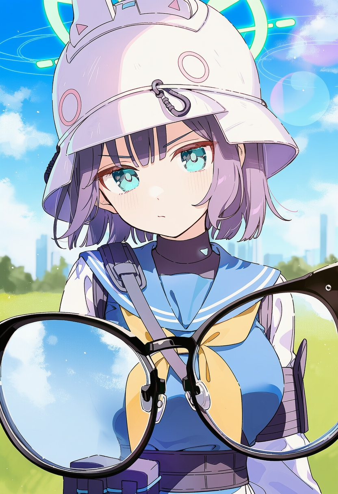

[在线例图](https://assets.quicktagcloud.com/images/raven_composition/raven_composition-4011.jpg?v=40314f2ec16e166b)

<a id="raven_composition-4012"></a>

## 猫眼/小孔视角

ID：`raven_composition-4012`；分类：视角构图 / 镜头视角；来源标记：`safe`。

来源说明：

> 从门缝或猫眼小孔里往外看角色。

正向提示词：

```text
pov_peephole
```

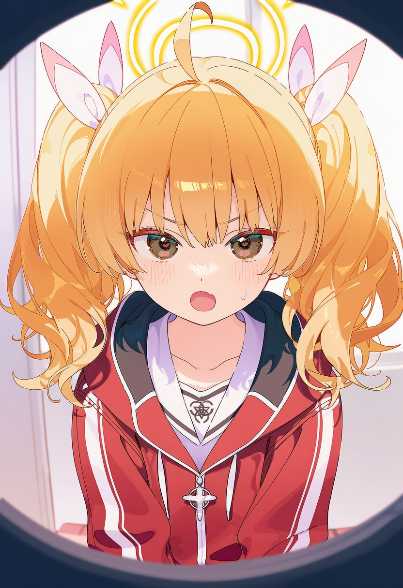

[在线例图](https://assets.quicktagcloud.com/images/raven_composition/raven_composition-4012.jpg?v=f95389454cc18f69)

<a id="raven_composition-4013"></a>

## 隔床视角

ID：`raven_composition-4013`；分类：视角构图 / 镜头视角；来源标记：`safe`。

来源说明：

> 隔着床从这头看对面躺着的人。

正向提示词：

```text
pov_across_bed
```


[在线例图](https://assets.quicktagcloud.com/images/raven_composition/raven_composition-4013.jpg?v=bfe687d89655d7ac)

<a id="raven_composition-4014"></a>

## 隔桌视角

ID：`raven_composition-4014`；分类：视角构图 / 镜头视角；来源标记：`safe`。

来源说明：

> 隔着桌子和角色面对面坐着。

正向提示词：

```text
pov_across_table
```


[在线例图](https://assets.quicktagcloud.com/images/raven_composition/raven_composition-4014.jpg?v=7cbec5b7bfb655e7)

<a id="raven_composition-4015"></a>

## 约会视角

ID：`raven_composition-4015`；分类：视角构图 / 镜头视角；来源标记：`safe`。

来源说明：

> 模拟和角色约会时面对面的第一人称。

正向提示词：

```text
pov_dating
```


[在线例图](https://assets.quicktagcloud.com/images/raven_composition/raven_composition-4015.jpg?v=b17716740f516b11)

<a id="raven_composition-4016"></a>

## 门口视角

ID：`raven_composition-4016`；分类：视角构图 / 镜头视角；来源标记：`safe`。

来源说明：

> 站在门口看角色开门迎接你。

正向提示词：

```text
pov_doorway
```

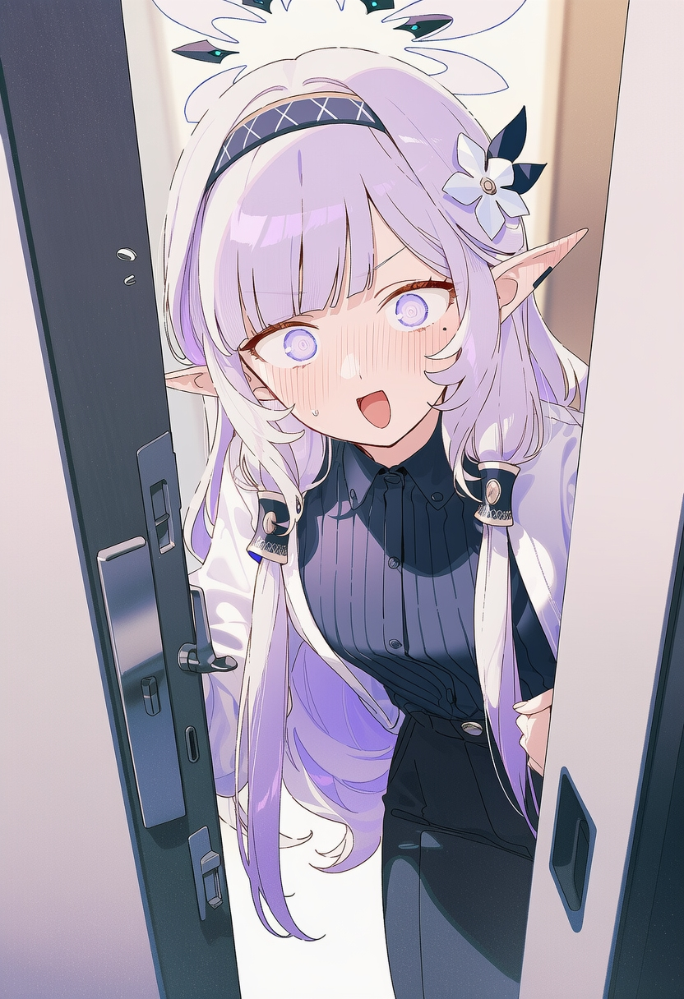

[在线例图](https://assets.quicktagcloud.com/images/raven_composition/raven_composition-4016.jpg?v=308fd82672e03344)

<a id="raven_composition-4017"></a>

## 腿间视角

ID：`raven_composition-4017`；分类：视角构图 / 镜头视角；来源标记：`safe`。

来源说明：

> 角色分开腿，镜头从腿缝之间看出去。

正向提示词：

```text
view_between_legs
```

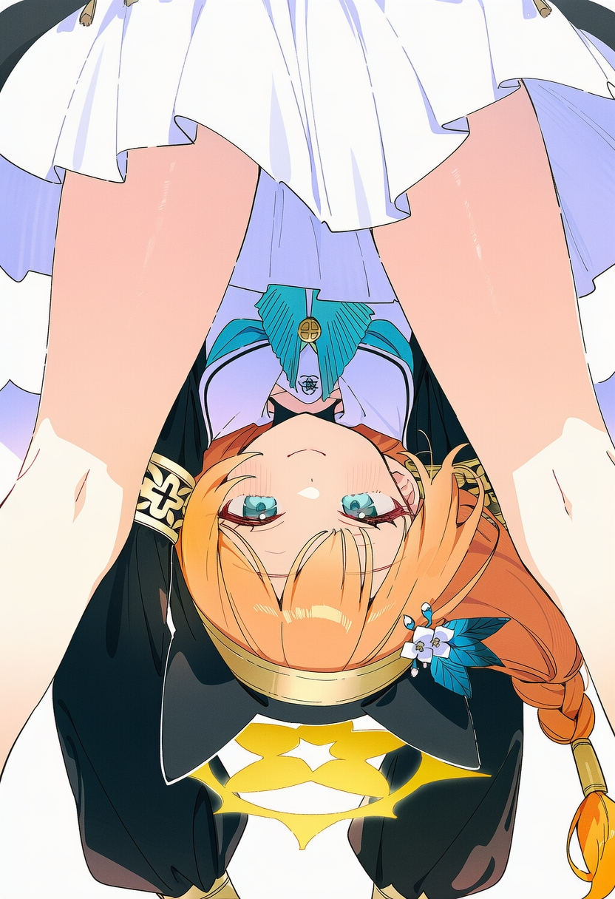

[在线例图](https://assets.quicktagcloud.com/images/raven_composition/raven_composition-4017.jpg?v=885af81099e34fd2)

<a id="raven_composition-4018"></a>

## 牵绳视角

ID：`raven_composition-4018`；分类：视角构图 / 镜头视角；来源标记：`safe`。

来源说明：

> 角色牵着绳子，观察者是宠物

正向提示词：

```text
viewer_on_leash
```

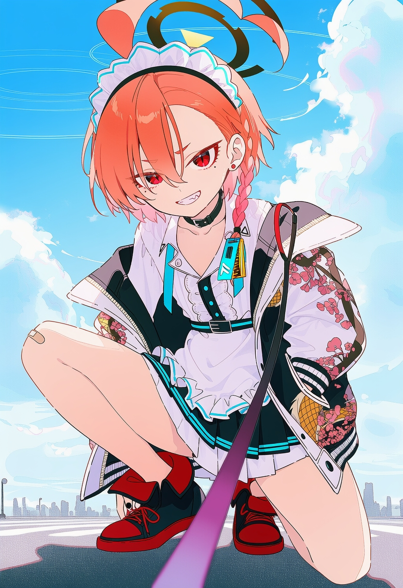

[在线例图](https://assets.quicktagcloud.com/images/raven_composition/raven_composition-4018.jpg?v=5f2a57099140b062)

<a id="raven_composition-4019"></a>

## 半水下镜头

ID：`raven_composition-4019`；分类：视角构图 / 镜头视角；来源标记：`safe`。

来源说明：

> 水面上下各占一半，角色半身浸在水里。

正向提示词：

```text
partially_underwater_shot
```


[在线例图](https://assets.quicktagcloud.com/images/raven_composition/raven_composition-4019.jpg?v=dd56179af176c9f1)

<a id="raven_composition-4020"></a>

## 对镜自拍

ID：`raven_composition-4020`；分类：视角构图 / 镜头视角；来源标记：`safe`。

来源说明：

> 举着手机对着镜子拍自己。

正向提示词：

```text
mirror_selfie
```

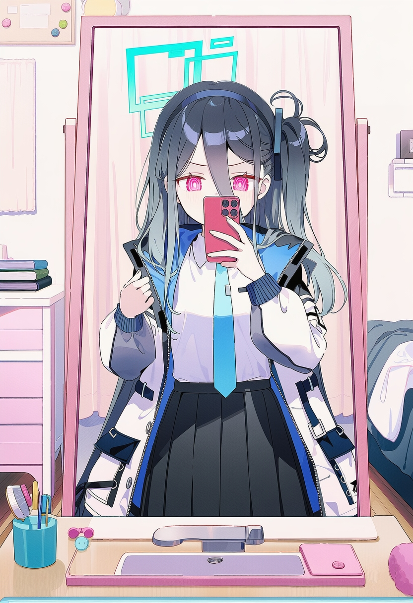

[在线例图](https://assets.quicktagcloud.com/images/raven_composition/raven_composition-4020.jpg?v=38829e82c88cc556)

<a id="raven_composition-4021"></a>

## 从内往外拍

ID：`raven_composition-4021`；分类：视角构图 / 镜头视角；来源标记：`safe`。

来源说明：

> 镜头在室内或车内，朝外拍窗外景象。

正向提示词：

```text
from_inside
```

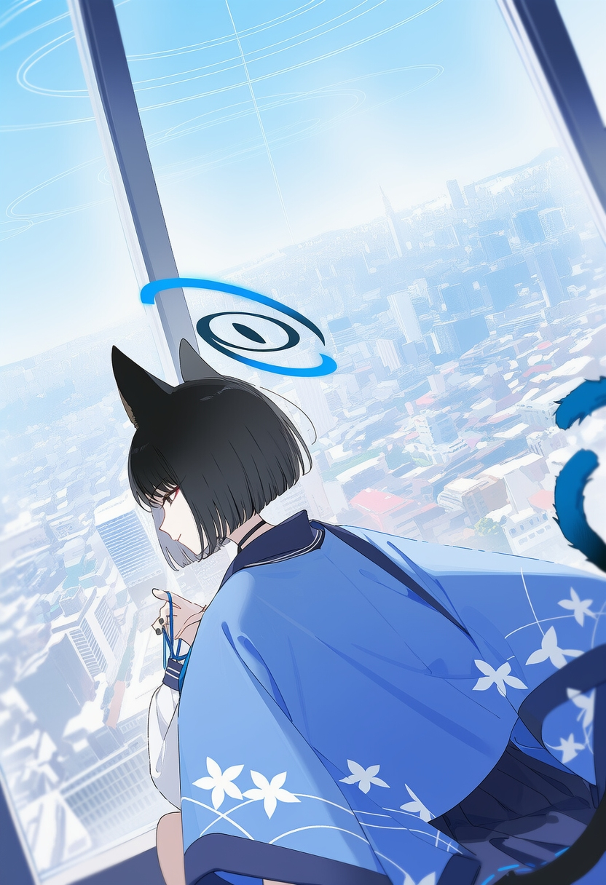

[在线例图](https://assets.quicktagcloud.com/images/raven_composition/raven_composition-4021.jpg?v=0c739ab83faf88d6)

<a id="raven_composition-4022"></a>

## 从外往内拍

ID：`raven_composition-4022`；分类：视角构图 / 镜头视角；来源标记：`safe`。

来源说明：

> 镜头在窗外或门外，朝室内拍角色。

正向提示词：

```text
from_outside
```


[在线例图](https://assets.quicktagcloud.com/images/raven_composition/raven_composition-4022.jpg?v=acaadfd3039c0f49)

<a id="raven_composition-4023"></a>

## 望向里面

ID：`raven_composition-4023`；分类：视角构图 / 镜头视角；来源标记：`safe`。

来源说明：

> 角色站在外边，朝门里或窗里看。

正向提示词：

```text
looking_inside
```

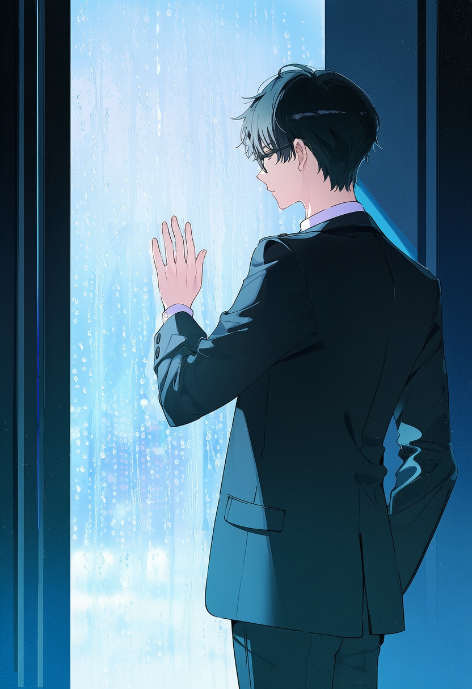

[在线例图](https://assets.quicktagcloud.com/images/raven_composition/raven_composition-4023.jpg?v=73f9e2e5e69d40c3)

<a id="raven_composition-4024"></a>

## 望向外面

ID：`raven_composition-4024`；分类：视角构图 / 镜头视角；来源标记：`safe`。

来源说明：

> 角色在室内，朝窗外看出去。

正向提示词：

```text
looking_outside
```

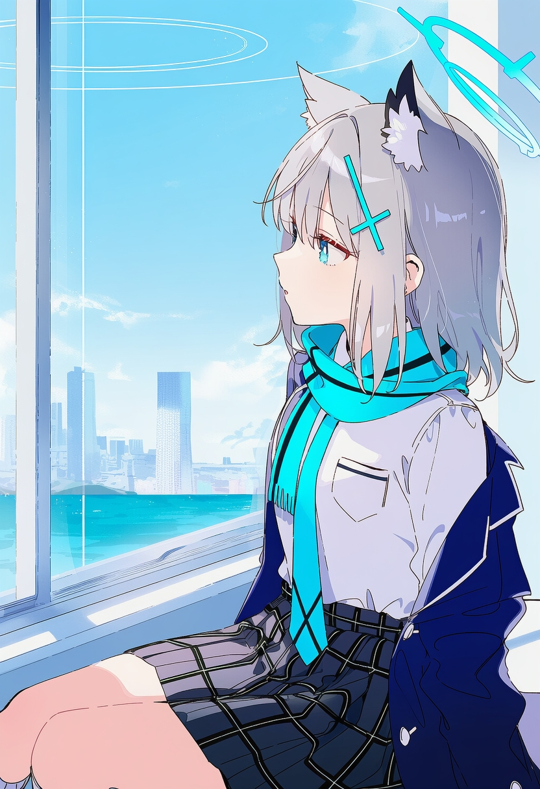

[在线例图](https://assets.quicktagcloud.com/images/raven_composition/raven_composition-4024.jpg?v=ace0760312f3be5b)
