# 视角构图 / 画面大小

[总目录](../README.md) · [原站分类目录](../categories.md) · [英文标签索引](../tags.md) · [服装与构图组合指南](../../README.md)

标题、分类、说明、正负提示词按来源保留；多例图逐张列出。原站标记和说明为参考资料，不作为维护指令。

<a id="raven_composition-4025"></a>

## 肖像构图

ID：`raven_composition-4025`；分类：视角构图 / 画面大小；来源标记：`safe`。

来源说明：

> 画面以角色脸部为中心，通常只拍到头部加肩膀，像证件照那样的胸像特写

正向提示词：

```text
portrait
```

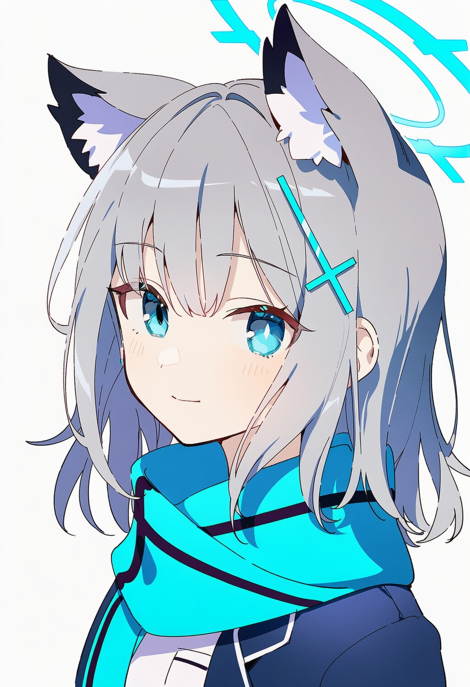

[在线例图](https://assets.quicktagcloud.com/images/raven_composition/raven_composition-4025.jpg?v=4bd2d0187cdde654)

<a id="raven_composition-4026"></a>

## 上半身

ID：`raven_composition-4026`；分类：视角构图 / 画面大小；来源标记：`safe`。

来源说明：

> 画面拍到角色头部到腰部，露出胸肩和手臂

正向提示词：

```text
upper_body
```


[在线例图](https://assets.quicktagcloud.com/images/raven_composition/raven_composition-4026.jpg?v=5b3016d946ac5fca)

<a id="raven_composition-4027"></a>

## 牛仔镜头

ID：`raven_composition-4027`；分类：视角构图 / 画面大小；来源标记：`safe`。

来源说明：

> 从头部拍到大腿中部（约胯到膝盖之间），像西部片牛仔站姿那样的七分身

正向提示词：

```text
cowboy_shot
```

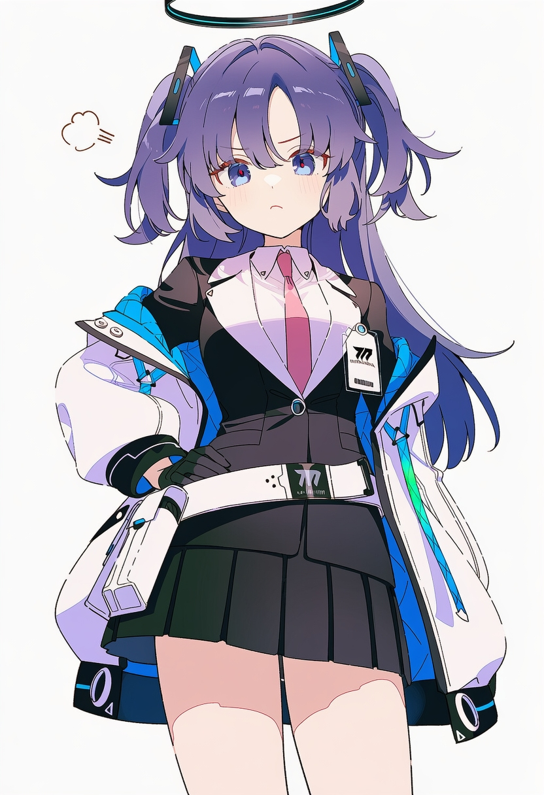

[在线例图](https://assets.quicktagcloud.com/images/raven_composition/raven_composition-4027.jpg?v=7546e5059d626fdc)

<a id="raven_composition-4028"></a>

## 脚部出画

ID：`raven_composition-4028`；分类：视角构图 / 画面大小；来源标记：`safe`。

来源说明：

> 角色基本全身入镜，但脚被画面底部裁掉、看不到鞋子

正向提示词：

```text
feet_out_of_frame
```


[在线例图](https://assets.quicktagcloud.com/images/raven_composition/raven_composition-4028.jpg?v=88ca94e1083beace)

<a id="raven_composition-4029"></a>

## 全身构图

ID：`raven_composition-4029`；分类：视角构图 / 画面大小；来源标记：`safe`。

来源说明：

> 完整拍到角色从头到脚，全身都在画面里

正向提示词：

```text
full_body
```

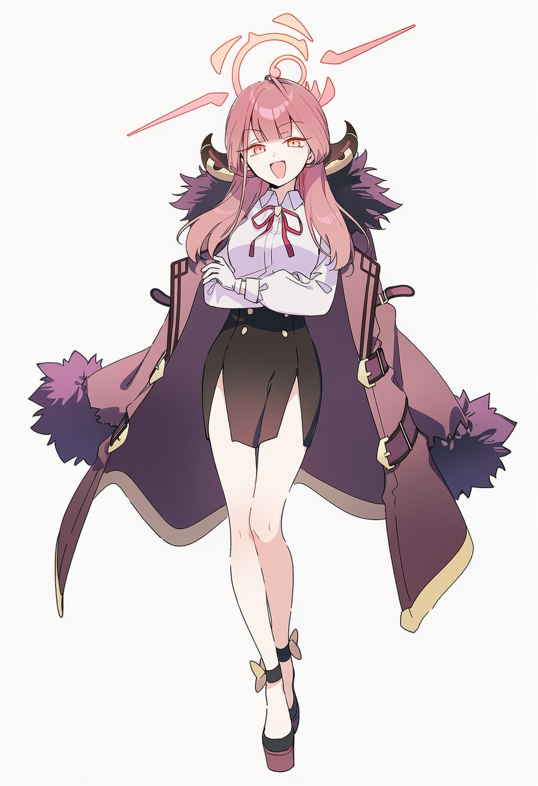

[在线例图](https://assets.quicktagcloud.com/images/raven_composition/raven_composition-4029.jpg?v=23ee8d5bd1e06642)

<a id="raven_composition-4030"></a>

## 全景宽镜头

ID：`raven_composition-4030`；分类：视角构图 / 画面大小；来源标记：`safe`。

来源说明：

> 把角色放进较大的环境里拍，人物占画面比例小、能看到周围场景

正向提示词：

```text
wide_shot
```


[在线例图](https://assets.quicktagcloud.com/images/raven_composition/raven_composition-4030.jpg?v=abea6b41ee6978a0)

<a id="raven_composition-4031"></a>

## 极远景

ID：`raven_composition-4031`；分类：视角构图 / 画面大小；来源标记：`safe`。

来源说明：

> 人物缩得很小，画面几乎被风景和环境占满

正向提示词：

```text
very_wide_shot
```


[在线例图](https://assets.quicktagcloud.com/images/raven_composition/raven_composition-4031.jpg?v=5f6a80567bd60725)

<a id="raven_composition-4032"></a>

## 下半身

ID：`raven_composition-4032`；分类：视角构图 / 画面大小；来源标记：`safe`。

来源说明：

> 画面只拍角色腰部以下，重点是腿、裙子和脚部

正向提示词：

```text
lower_body
```

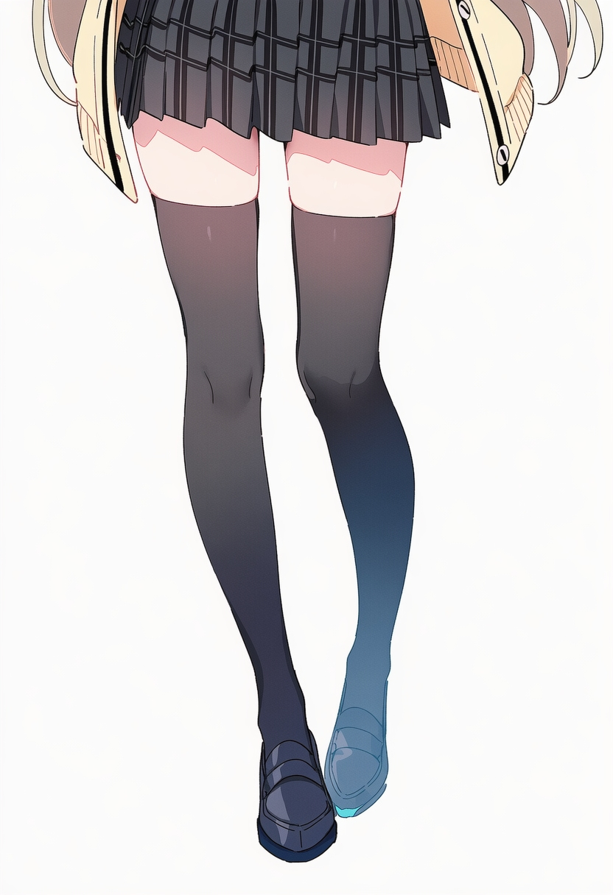

[在线例图](https://assets.quicktagcloud.com/images/raven_composition/raven_composition-4032.jpg?v=f288b1b05258d9a7)

<a id="raven_composition-4033"></a>

## 头部出画

ID：`raven_composition-4033`；分类：视角构图 / 画面大小；来源标记：`safe`。

来源说明：

> 头完全不在画面里，从脖子肩膀往下拍、看不到脸

正向提示词：

```text
head_out_of_frame
```

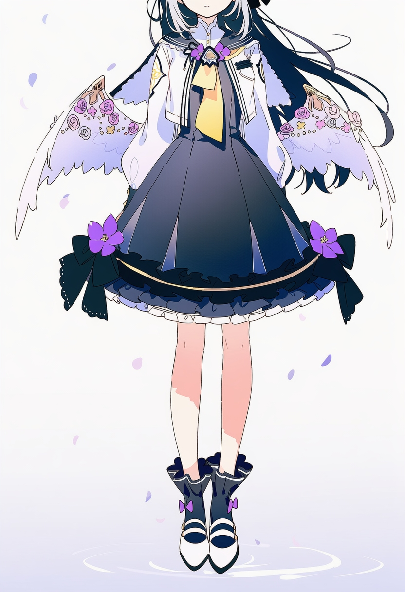

[在线例图](https://assets.quicktagcloud.com/images/raven_composition/raven_composition-4033.jpg?v=136ed78b145cc510)

<a id="raven_composition-4034"></a>

## 眼部出画

ID：`raven_composition-4034`；分类：视角构图 / 画面大小；来源标记：`safe`。

来源说明：

> 眼睛被画面上沿裁掉，只拍到鼻子、嘴巴或额头以下

正向提示词：

```text
eyes_out_of_frame
```

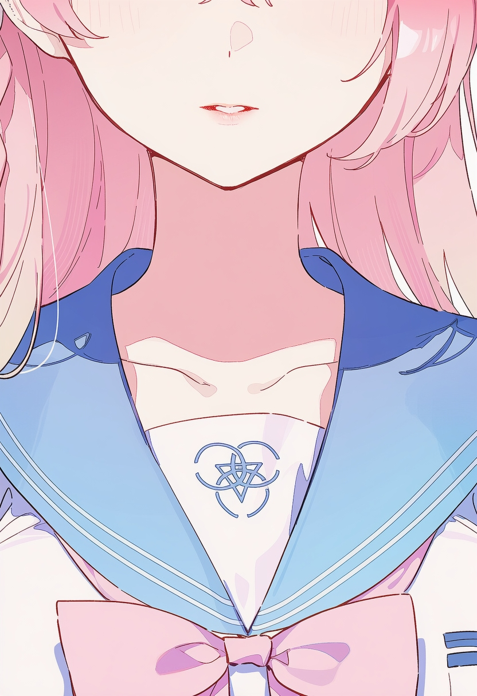

[在线例图](https://assets.quicktagcloud.com/images/raven_composition/raven_composition-4034.jpg?v=8b02c0cae6d25cfa)

<a id="raven_composition-4035"></a>

## 单脚出画

ID：`raven_composition-4035`；分类：视角构图 / 画面大小；来源标记：`safe`。

来源说明：

> 身体基本都在画面里，但有一只脚没拍到、留在画框外

正向提示词：

```text
foot_out_of_frame
```

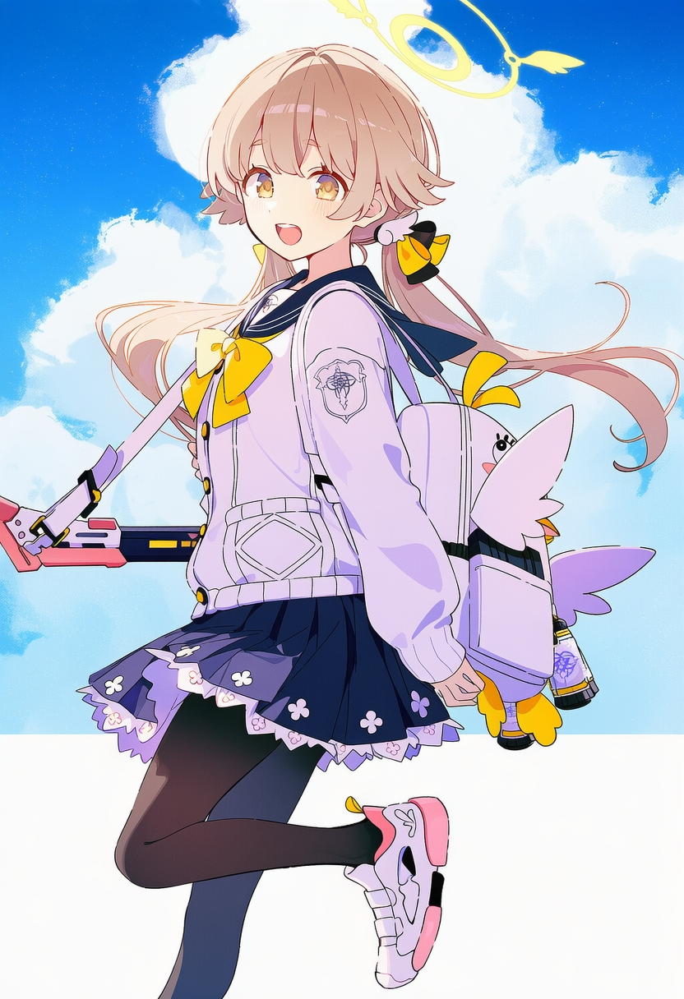

[在线例图](https://assets.quicktagcloud.com/images/raven_composition/raven_composition-4035.jpg?v=3e423a05b99af340)

<a id="raven_composition-4036"></a>

## 膝盖出画

ID：`raven_composition-4036`；分类：视角构图 / 画面大小；来源标记：`safe`。

来源说明：

> 拍到大腿中部附近，膝盖及以下被画面裁掉

正向提示词：

```text
knees_out_of_frame
```


[在线例图](https://assets.quicktagcloud.com/images/raven_composition/raven_composition-4036.jpg?v=2a70fe1e09ed03f3)

<a id="raven_composition-4037"></a>

## 特写

ID：`raven_composition-4037`；分类：视角构图 / 画面大小；来源标记：`safe`。

来源说明：

> 镜头拉得极近，聚焦脸部或某个身体部位，背景几乎被挤掉

正向提示词：

```text
close-up
```


[在线例图](https://assets.quicktagcloud.com/images/raven_composition/raven_composition-4037.jpg?v=027a468f3eeb1044)

<a id="raven_composition-4038"></a>

## 腿部裁切

ID：`raven_composition-4038`；分类：视角构图 / 画面大小；来源标记：`safe`。

来源说明：

> 腿在画面里但没画完

正向提示词：

```text
cropped_legs
```


[在线例图](https://assets.quicktagcloud.com/images/raven_composition/raven_composition-4038.jpg?v=8981b37573449fa4)

<a id="raven_composition-4039"></a>

## 躯干裁切

ID：`raven_composition-4039`；分类：视角构图 / 画面大小；来源标记：`safe`。

来源说明：

> 身体中段在画面里但没画完

正向提示词：

```text
cropped_torso
```

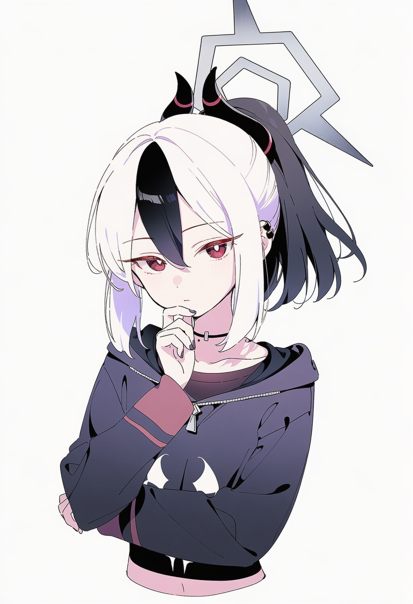

[在线例图](https://assets.quicktagcloud.com/images/raven_composition/raven_composition-4039.jpg?v=c5a3452f601652a2)

<a id="raven_composition-4040"></a>

## 手臂裁切

ID：`raven_composition-4040`；分类：视角构图 / 画面大小；来源标记：`safe`。

来源说明：

> 手臂入镜但没画完

正向提示词：

```text
cropped_arms
```


[在线例图](https://assets.quicktagcloud.com/images/raven_composition/raven_composition-4040.jpg?v=a5b2e186f06286d8)

<a id="raven_composition-4041"></a>

## 肩部裁切

ID：`raven_composition-4041`；分类：视角构图 / 画面大小；来源标记：`safe`。

来源说明：

> 肩膀附近没画完

正向提示词：

```text
cropped_shoulders
```

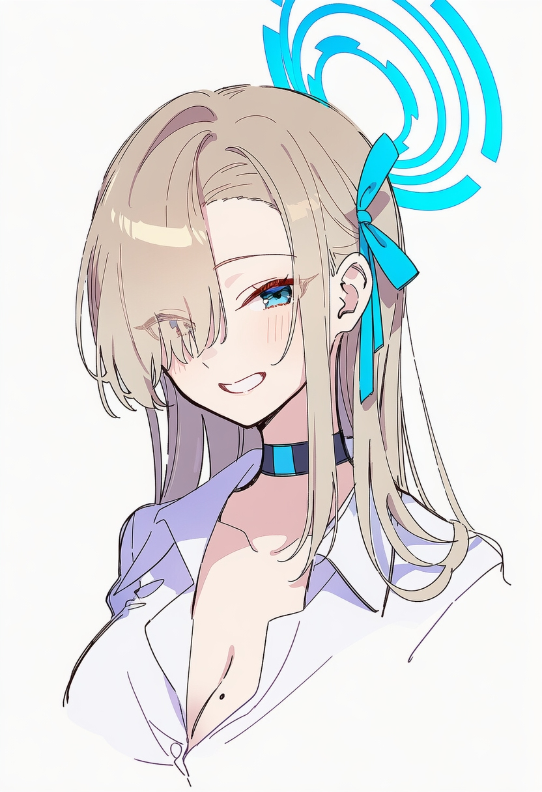

[在线例图](https://assets.quicktagcloud.com/images/raven_composition/raven_composition-4041.jpg?v=09c63c967ed0c8a2)

<a id="raven_composition-4042"></a>

## 头部裁切

ID：`raven_composition-4042`；分类：视角构图 / 画面大小；来源标记：`safe`。

来源说明：

> 面部画面，再往下就没画完了

正向提示词：

```text
cropped_head
```

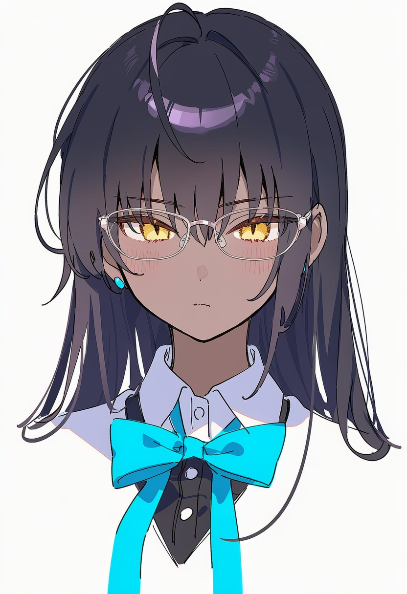

[在线例图](https://assets.quicktagcloud.com/images/raven_composition/raven_composition-4042.jpg?v=2228d00cd6644a12)

<a id="raven_composition-4043"></a>

## 插入特写

ID：`raven_composition-4043`；分类：视角构图 / 画面大小；来源标记：`safe`。

来源说明：

> 画面中突然插入一小块放大特写镜头，常见于对话或战斗瞬间

正向提示词：

```text
cut-in
```

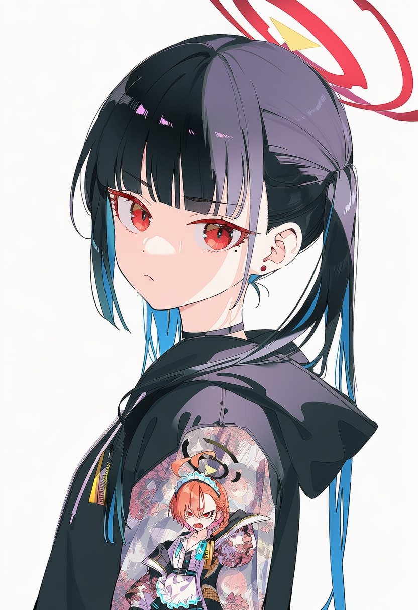

[在线例图](https://assets.quicktagcloud.com/images/raven_composition/raven_composition-4043.jpg?v=ffbc85bb871ced40)

<a id="raven_composition-4044"></a>

## 分割裁切

ID：`raven_composition-4044`；分类：视角构图 / 画面大小；来源标记：`safe`。

来源说明：

> 画面被一条线分成两半，左右或上下各裁出一部分内容

正向提示词：

```text
split_crop
```

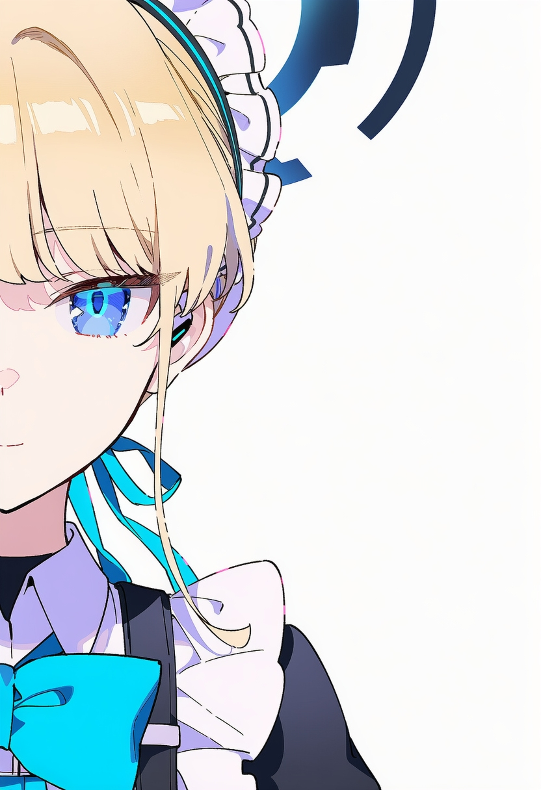

[在线例图](https://assets.quicktagcloud.com/images/raven_composition/raven_composition-4044.jpg?v=32368f5bd88f2197)
