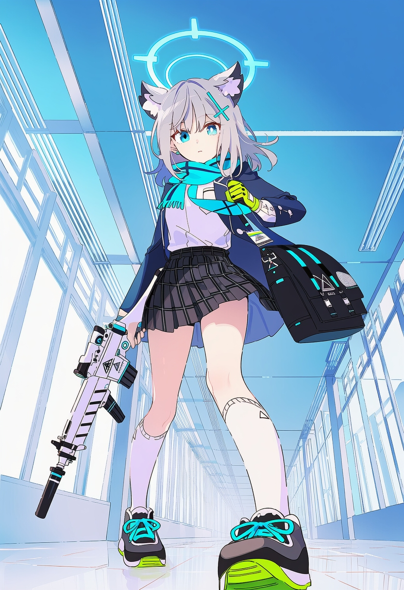
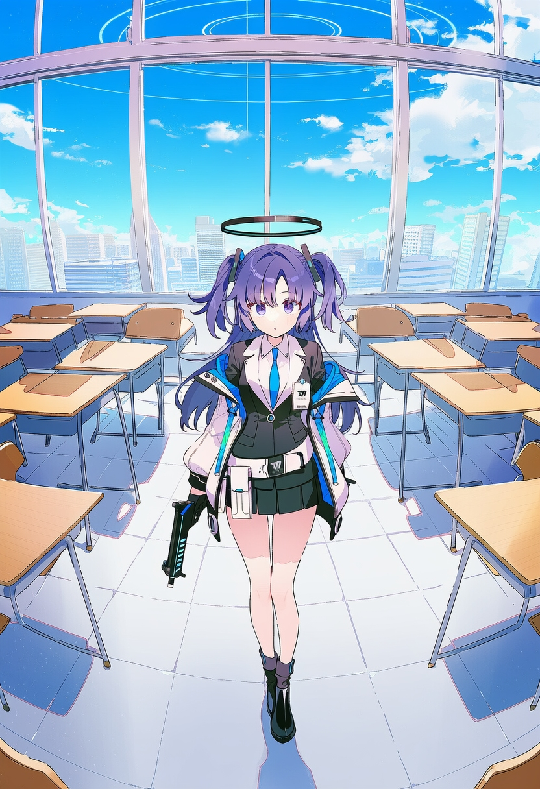
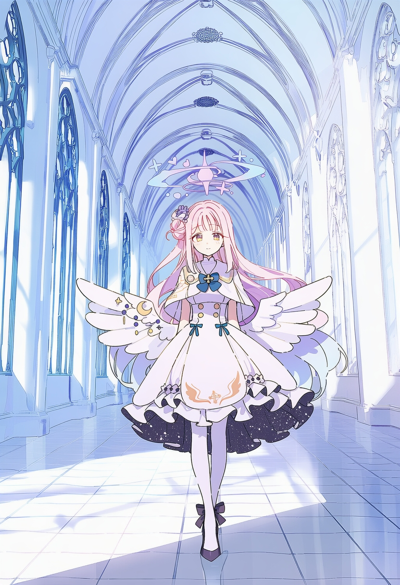
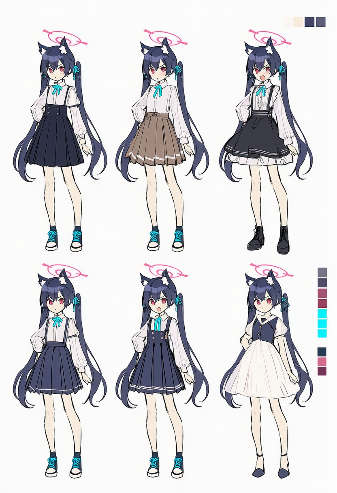

# 视角构图 / 透视深度

[总目录](../README.md) · [原站分类目录](../categories.md) · [英文标签索引](../tags.md) · [服装与构图组合指南](../../README.md)

标题、分类、说明、正负提示词按来源保留；多例图逐张列出。原站标记和说明为参考资料，不作为维护指令。

<a id="raven_composition-4045"></a>

## 透视

ID：`raven_composition-4045`；分类：视角构图 / 透视深度；来源标记：`safe`。

来源说明：

> 运用透视原理营造空间纵深感，近大远小、线条向远方汇聚

正向提示词：

```text
perspective
```



[在线例图](https://assets.quicktagcloud.com/images/raven_composition/raven_composition-4045.jpg?v=e20b3cf1a7e4d029)

<a id="raven_composition-4046"></a>

## 透视缩短

ID：`raven_composition-4046`；分类：视角构图 / 透视深度；来源标记：`safe`。

来源说明：

> 近大远小的透视缩短，靠近镜头的部位被放大夸张

正向提示词：

```text
foreshortening
```


[在线例图](https://assets.quicktagcloud.com/images/raven_composition/raven_composition-4046.jpg?v=9b3a97bcacccf6d8)

<a id="raven_composition-4047"></a>

## 鱼眼镜头

ID：`raven_composition-4047`；分类：视角构图 / 透视深度；来源标记：`safe`。

来源说明：

> 鱼眼镜头造成的边缘球面畸变，视野极广且画面弯曲

正向提示词：

```text
fisheye
```



[在线例图](https://assets.quicktagcloud.com/images/raven_composition/raven_composition-4047.jpg?v=164d35afc7df0c91)

<a id="raven_composition-4048"></a>

## 消失点

ID：`raven_composition-4048`；分类：视角构图 / 透视深度；来源标记：`safe`。

来源说明：

> 平行线条向远方汇聚于一点，营造强烈的深度延伸感

正向提示词：

```text
vanishing_point
```



[在线例图](https://assets.quicktagcloud.com/images/raven_composition/raven_composition-4048.jpg?v=7fb184c18168fb42)

<a id="raven_composition-4049"></a>

## 强制透视

ID：`raven_composition-4049`；分类：视角构图 / 透视深度；来源标记：`safe`。

来源说明：

> 利用近大远小的错觉制造大小对比，前景物体看似触碰远方景物

正向提示词：

```text
forced_perspective
```


[在线例图](https://assets.quicktagcloud.com/images/raven_composition/raven_composition-4049.jpg?v=390bd8be8b838222)

<a id="raven_composition-4050"></a>

## 空气透视

ID：`raven_composition-4050`；分类：视角构图 / 透视深度；来源标记：`safe`。

来源说明：

> 远景因雾气空气呈现偏蓝偏灰的朦胧感，拉开空间距离

正向提示词：

```text
atmospheric_perspective
```


[在线例图](https://assets.quicktagcloud.com/images/raven_composition/raven_composition-4050.jpg?v=759140465ffba116)

<a id="raven_composition-4051"></a>

## 多版本展示

ID：`raven_composition-4051`；分类：视角构图 / 透视深度；来源标记：`safe`。

来源说明：

> 同一角色的不同服装、表情或姿态并排排列展示

正向提示词：

```text
variations
```



[在线例图](https://assets.quicktagcloud.com/images/raven_composition/raven_composition-4051.jpg?v=a86f40b68f63576c)

<a id="raven_composition-4052"></a>

## 景深

ID：`raven_composition-4052`；分类：视角构图 / 透视深度；来源标记：`safe`。

来源说明：

> 通过清晰对焦范围控制画面层次，突出对焦主体

正向提示词：

```text
depth_of_field
```


[在线例图](https://assets.quicktagcloud.com/images/raven_composition/raven_composition-4052.jpg?v=9df5b32451ddc9a5)

<a id="raven_composition-4053"></a>

## 焦外光斑

ID：`raven_composition-4053`；分类：视角构图 / 透视深度；来源标记：`safe`。

来源说明：

> 背景失焦形成的圆润光斑虚化效果

正向提示词：

```text
bokeh
```


[在线例图](https://assets.quicktagcloud.com/images/raven_composition/raven_composition-4053.jpg?v=affe05bfefb560f8)

<a id="raven_composition-4054"></a>

## 前景虚化

ID：`raven_composition-4054`；分类：视角构图 / 透视深度；来源标记：`safe`。

来源说明：

> 画面前景物体失焦模糊，增加前后景深层次感

正向提示词：

```text
blurry_foreground
```


[在线例图](https://assets.quicktagcloud.com/images/raven_composition/raven_composition-4054.jpg?v=d3581e34598c1526)

<a id="raven_composition-4055"></a>

## 背景虚化

ID：`raven_composition-4055`；分类：视角构图 / 透视深度；来源标记：`safe`。

来源说明：

> 背景模糊失焦，将视觉焦点集中到前方人物主体

正向提示词：

```text
blurry_background
```


[在线例图](https://assets.quicktagcloud.com/images/raven_composition/raven_composition-4055.jpg?v=2df307dd2775ab14)
