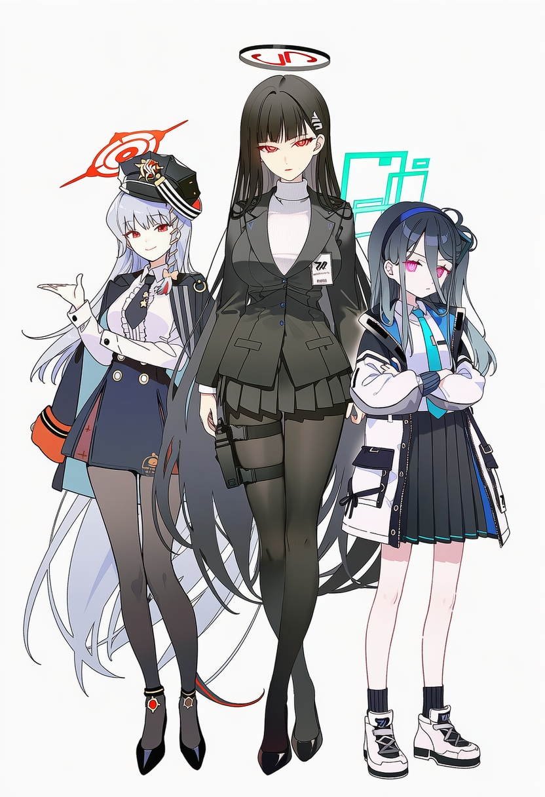
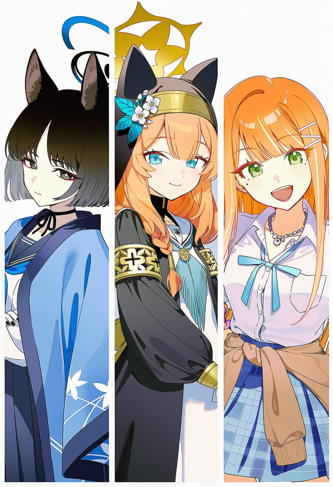
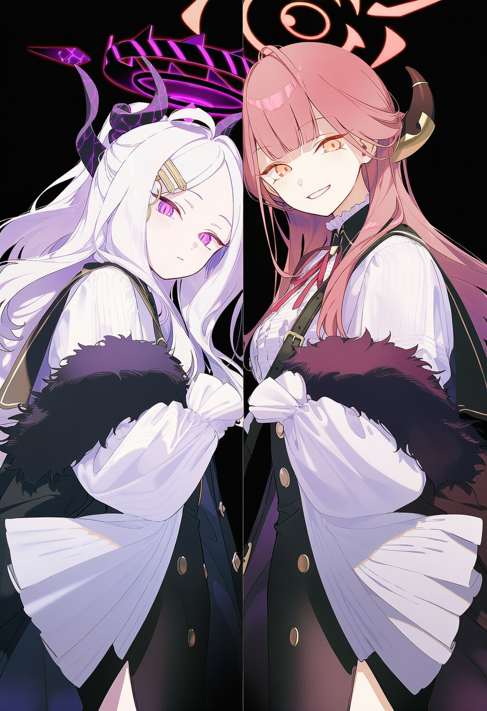
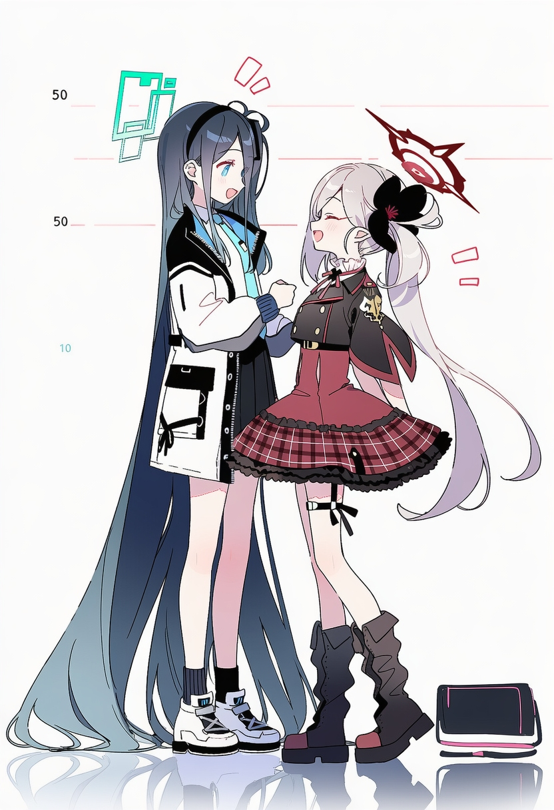
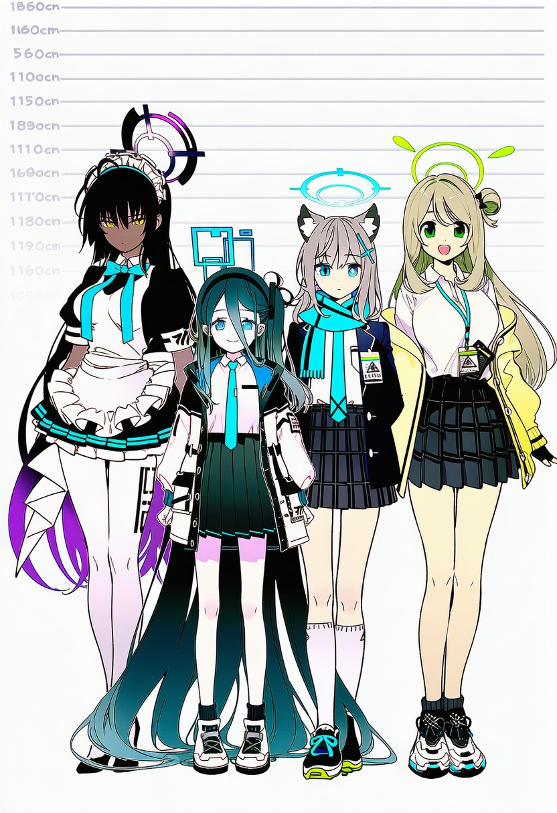
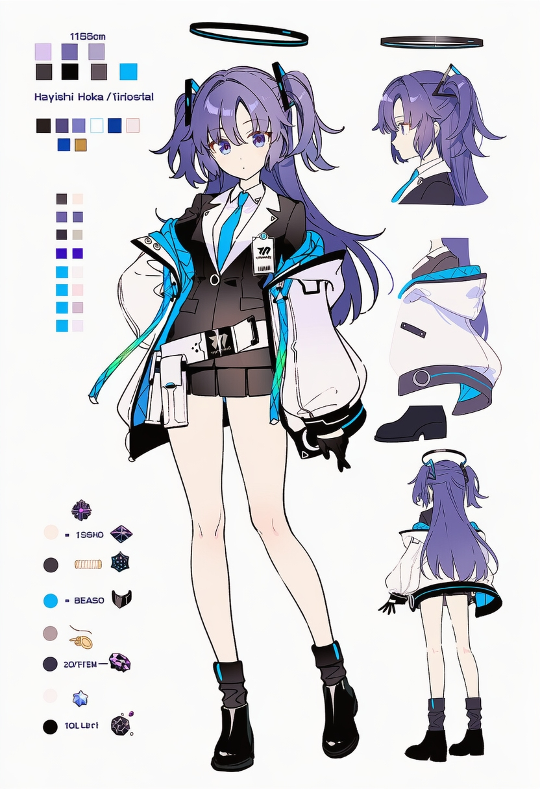
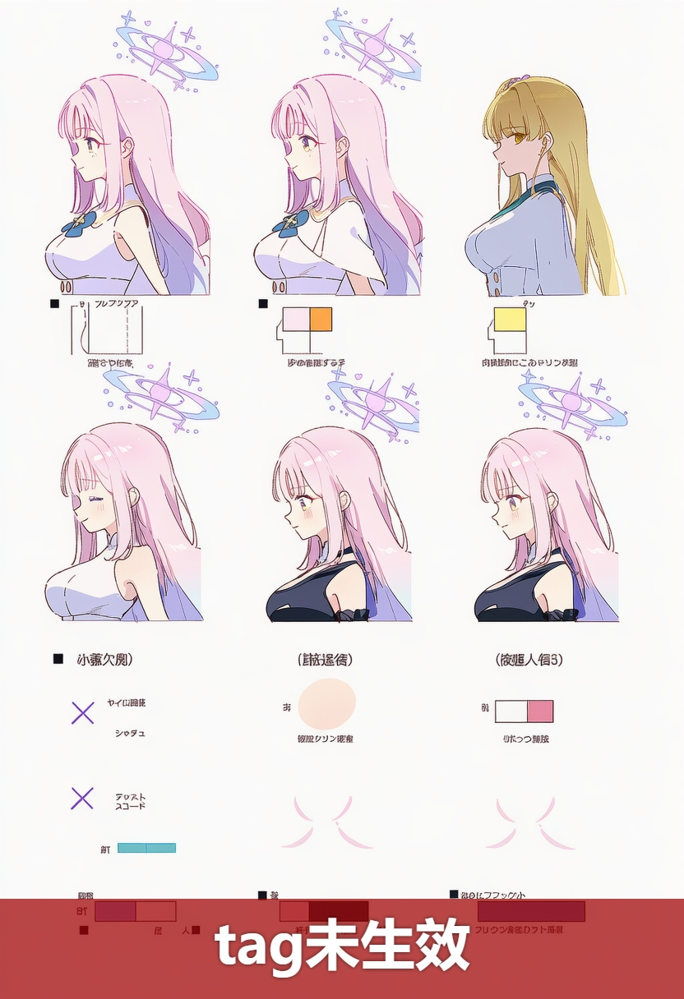
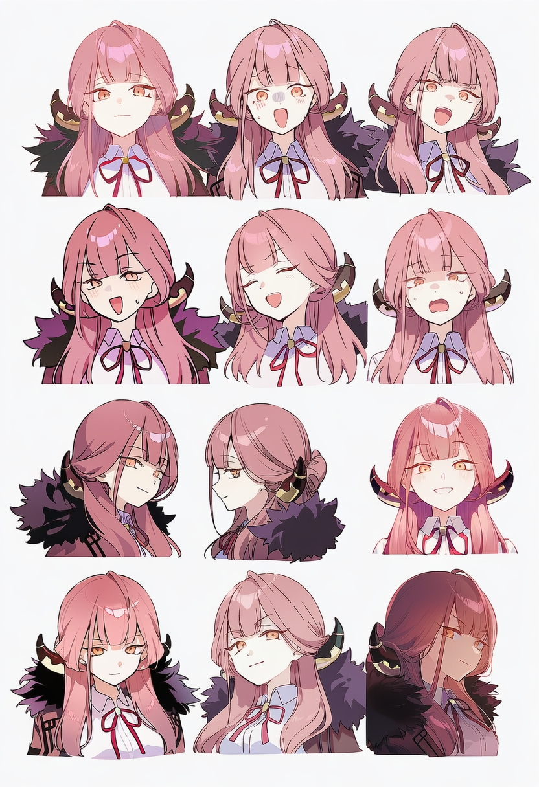

# 视角构图 / 布局风格

[总目录](../README.md) · [原站分类目录](../categories.md) · [英文标签索引](../tags.md) · [服装与构图组合指南](../../README.md)

标题、分类、说明、正负提示词按来源保留；多例图逐张列出。原站标记和说明为参考资料，不作为维护指令。

<a id="raven_composition-4056"></a>

## 列队排列

ID：`raven_composition-4056`；分类：视角构图 / 布局风格；来源标记：`safe`。

来源说明：

> 多个角色横向排成一排，正面朝向观众

正向提示词：

```text
lineup
```



[在线例图](https://assets.quicktagcloud.com/images/raven_composition/raven_composition-4056.jpg?v=1d09aae5813f623e)

<a id="raven_composition-4057"></a>

## 竖列排列

ID：`raven_composition-4057`；分类：视角构图 / 布局风格；来源标记：`safe`。

来源说明：

> 多个角色竖排成一列，通常只露脸或上半身

正向提示词：

```text
column_lineup
```



[在线例图](https://assets.quicktagcloud.com/images/raven_composition/raven_composition-4057.jpg?v=78da673f7e986a3c)

<a id="raven_composition-4058"></a>

## 围成圆圈

ID：`raven_composition-4058`；分类：视角构图 / 布局风格；来源标记：`safe`。

来源说明：

> 多个角色围成一个圆圈，互相朝向圆心

正向提示词：

```text
circle_formation
```


[在线例图](https://assets.quicktagcloud.com/images/raven_composition/raven_composition-4058.jpg?v=a71d3acc8e28d3ce)

<a id="raven_composition-4059"></a>

## 并排站立

ID：`raven_composition-4059`；分类：视角构图 / 布局风格；来源标记：`safe`。

来源说明：

> 两个角色肩并肩并排站在一起

正向提示词：

```text
side-by-side
```


[在线例图](https://assets.quicktagcloud.com/images/raven_composition/raven_composition-4059.jpg?v=a3a44c9a7297b3cf)

<a id="raven_composition-4060"></a>

## 对立两侧

ID：`raven_composition-4060`；分类：视角构图 / 布局风格；来源标记：`safe`。

来源说明：

> 两个角色分别站在画面左右两侧，面对面相对

正向提示词：

```text
opposing_sides
```


[在线例图](https://assets.quicktagcloud.com/images/raven_composition/raven_composition-4060.jpg?v=ce6bcbc5b9897e2d)

<a id="raven_composition-4061"></a>

## 对称构图

ID：`raven_composition-4061`；分类：视角构图 / 布局风格；来源标记：`safe`。

来源说明：

> 两个角色沿中轴线左右对称站位，姿势呈镜像

正向提示词：

```text
symmetry
```



[在线例图](https://assets.quicktagcloud.com/images/raven_composition/raven_composition-4061.jpg?v=91c2685ac712e92b)

<a id="raven_composition-4062"></a>

## 旋转对称

ID：`raven_composition-4062`；分类：视角构图 / 布局风格；来源标记：`safe`。

来源说明：

> 两个角色绕画面中心旋转180度后重合，呈旋转对称

正向提示词：

```text
rotational_symmetry
```


[在线例图](https://assets.quicktagcloud.com/images/raven_composition/raven_composition-4062.jpg?v=3e257ef9e3e259d4)

<a id="raven_composition-4063"></a>

## 极端对比

ID：`raven_composition-4063`；分类：视角构图 / 布局风格；来源标记：`safe`。

来源说明：

> 两个角色在外观、气质、色调上形成强烈反差

正向提示词：

```text
polar_opposites
```


[在线例图](https://assets.quicktagcloud.com/images/raven_composition/raven_composition-4063.jpg?v=0eb6995539556db4)

<a id="raven_composition-4064"></a>

## 留白构图

ID：`raven_composition-4064`；分类：视角构图 / 布局风格；来源标记：`safe`。

来源说明：

> 画面留出大量空白，角色只占一小部分

正向提示词：

```text
negative_space
```


[在线例图](https://assets.quicktagcloud.com/images/raven_composition/raven_composition-4064.jpg?v=d4715bf954d82643)

<a id="raven_composition-4065"></a>

## 分屏画面

ID：`raven_composition-4065`；分类：视角构图 / 布局风格；来源标记：`safe`。

来源说明：

> 画面被分割成左右两屏，各自独立展示一个场景

正向提示词：

```text
split_screen
```


[在线例图](https://assets.quicktagcloud.com/images/raven_composition/raven_composition-4065.jpg?v=8e53f5e110c7f81d)

<a id="raven_composition-4066"></a>

## 主题分割

ID：`raven_composition-4066`；分类：视角构图 / 布局风格；来源标记：`safe`。

来源说明：

> 画面左右两半呈现截然不同的主题或氛围

正向提示词：

```text
split_theme
```


[在线例图](https://assets.quicktagcloud.com/images/raven_composition/raven_composition-4066.jpg?v=7678b66a7762e66e)

<a id="raven_composition-4067"></a>

## 前后对比

ID：`raven_composition-4067`；分类：视角构图 / 布局风格；来源标记：`safe`。

来源说明：

> 同一角色变化前后的状态并排展示

正向提示词：

```text
before_and_after
```


[在线例图](https://assets.quicktagcloud.com/images/raven_composition/raven_composition-4067.jpg?v=140533296a8f9561)

<a id="raven_composition-4068"></a>

## 对比展示

ID：`raven_composition-4068`；分类：视角构图 / 布局风格；来源标记：`safe`。

来源说明：

> 两个角色并排放置进行直观对比

正向提示词：

```text
comparison
```


[在线例图](https://assets.quicktagcloud.com/images/raven_composition/raven_composition-4068.jpg?v=301635f12efbf50c)

<a id="raven_composition-4069"></a>

## 年龄对比

ID：`raven_composition-4069`；分类：视角构图 / 布局风格；来源标记：`safe`。

来源说明：

> 展示同一角色不同年龄段的样子并排对照

正向提示词：

```text
age_comparison
```


[在线例图](https://assets.quicktagcloud.com/images/raven_composition/raven_composition-4069.jpg?v=e708fedb129f5141)

<a id="raven_composition-4070"></a>

## 体型对比

ID：`raven_composition-4070`；分类：视角构图 / 布局风格；来源标记：`safe`。

来源说明：

> 两个角色并排放置，突出身高或体型差异

正向提示词：

```text
size_comparison
```



[在线例图](https://assets.quicktagcloud.com/images/raven_composition/raven_composition-4070.jpg?v=f1202bf7178743d9)

<a id="raven_composition-4071"></a>

## 身高图

ID：`raven_composition-4071`；分类：视角构图 / 布局风格；来源标记：`safe`。

来源说明：

> 多个角色全身排列成一张身高对照表

正向提示词：

```text
height_chart
```



[在线例图](https://assets.quicktagcloud.com/images/raven_composition/raven_composition-4071.jpg?v=4640e6af972910ce)

<a id="raven_composition-4072"></a>

## 参考设定图

ID：`raven_composition-4072`；分类：视角构图 / 布局风格；来源标记：`safe`。

来源说明：

> 单个角色的多角度、多视图设定参考图

正向提示词：

```text
reference_sheet
```



[在线例图](https://assets.quicktagcloud.com/images/raven_composition/raven_composition-4072.jpg?v=ad941c7ee26e1d7a)

<a id="raven_composition-4073"></a>

## 胸像参考图

ID：`raven_composition-4073`；分类：视角构图 / 布局风格；来源标记：`safe`。

来源说明：

> 单个角色胸部以上的多角度参考图

正向提示词：

```text
bust_chart
```



[在线例图](https://assets.quicktagcloud.com/images/raven_composition/raven_composition-4073.jpg?v=892a256004299023)

<a id="raven_composition-4074"></a>

## 多视图

ID：`raven_composition-4074`；分类：视角构图 / 布局风格；来源标记：`safe`。

来源说明：

> 同一角色从正面、侧面、背面等多个角度展示

正向提示词：

```text
multiple_views
```



[在线例图](https://assets.quicktagcloud.com/images/raven_composition/raven_composition-4074.jpg?v=dc5f58efda4792d6)

<a id="raven_composition-4075"></a>

## 集体合影

ID：`raven_composition-4075`；分类：视角构图 / 布局风格；来源标记：`safe`。

来源说明：

> 一群角色聚在一起拍合影

正向提示词：

```text
group_picture
```


[在线例图](https://assets.quicktagcloud.com/images/raven_composition/raven_composition-4075.jpg?v=04fb60e81b92ea39)

<a id="raven_composition-4076"></a>

## 全员登场

ID：`raven_composition-4076`；分类：视角构图 / 布局风格；来源标记：`safe`。

来源说明：

> 作品中所有角色全部出现在画面中

正向提示词：

```text
everyone
```


[在线例图](https://assets.quicktagcloud.com/images/raven_composition/raven_composition-4076.jpg?v=2b3a936f11716fd5)

<a id="raven_composition-4077"></a>

## 全员大集合

ID：`raven_composition-4077`；分类：视角构图 / 布局风格；来源标记：`safe`。

来源说明：

> 几乎所有角色都登场的超大型集合图

正向提示词：

```text
absolutely_everyone
```


[在线例图](https://assets.quicktagcloud.com/images/raven_composition/raven_composition-4077.jpg?v=12424d4aaff5982a)

<a id="raven_composition-4078"></a>

## 立绘

ID：`raven_composition-4078`；分类：视角构图 / 布局风格；来源标记：`safe`。

来源说明：

> 单个角色全身正面站立的标准立绘

正向提示词：

```text
tachi-e
```


[在线例图](https://assets.quicktagcloud.com/images/raven_composition/raven_composition-4078.jpg?v=1a04a5ac2c9d5e56)
