# 身体部位

[总目录](../README.md) · [原站分类目录](../categories.md) · [英文标签索引](../tags.md) · [服装与构图组合指南](../../README.md)

标题、分类、说明、正负提示词按来源保留；多例图逐张列出。原站标记和说明为参考资料，不作为维护指令。

<a id="raven_composition-4079"></a>

## 头翼

ID：`raven_composition-4079`；分类：身体部位；来源标记：`safe`。

来源说明：

> 头部两侧或头顶长出的翅膀（常见于天使、恶魔、鸟人等角色）。

正向提示词：

```text
head_wings
```


[在线例图](https://assets.quicktagcloud.com/images/raven_composition/raven_composition-4079.jpg?v=5e50545e198aeda4)

<a id="raven_composition-4080"></a>

## 角

ID：`raven_composition-4080`；分类：身体部位；来源标记：`safe`。

来源说明：

> 头上的角（恶魔、龙、牛角等）。

正向提示词：

```text
horns
```

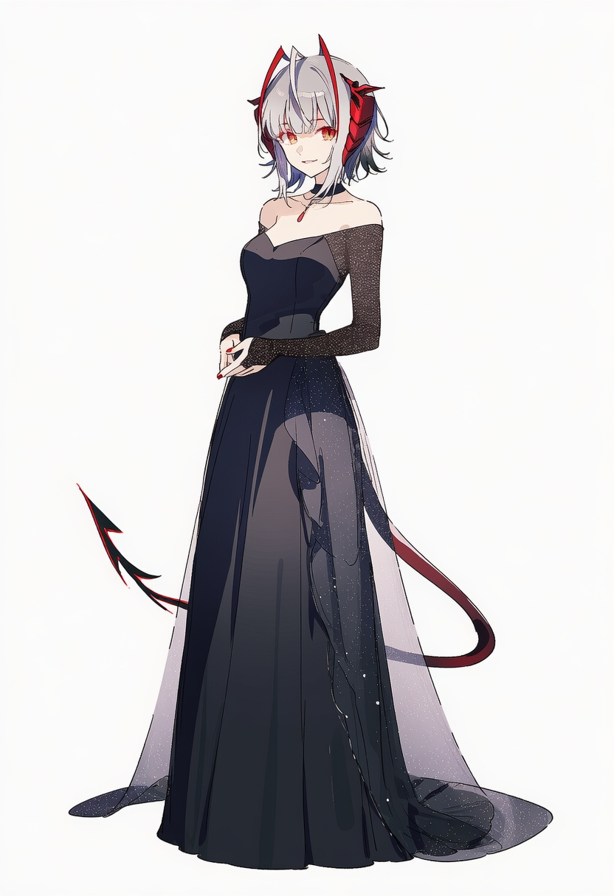

[在线例图](https://assets.quicktagcloud.com/images/raven_composition/raven_composition-4080.jpg?v=a107a17f1a0957e9)

<a id="raven_composition-4081"></a>

## 长发

ID：`raven_composition-4081`；分类：身体部位；来源标记：`safe`。

来源说明：

> 长度超过肩膀的长头发，没有单独tag，多作为描述一部分出现。

正向提示词：

```text
long_hair
```


[在线例图](https://assets.quicktagcloud.com/images/raven_composition/raven_composition-4081.jpg?v=6dd572d6cfc52eac)

<a id="raven_composition-4082"></a>

## 额头

ID：`raven_composition-4082`；分类：身体部位；来源标记：`safe`。

来源说明：

> 前额部位。

正向提示词：

```text
forehead
```


[在线例图](https://assets.quicktagcloud.com/images/raven_composition/raven_composition-4082.jpg?v=c341c933186813f5)

<a id="raven_composition-4083"></a>

## 眉毛

ID：`raven_composition-4083`；分类：身体部位；来源标记：`safe`。

来源说明：

> 眉毛。常与颜色或形状组合（如 thick_eyebrows）。

正向提示词：

```text
eyebrows
```

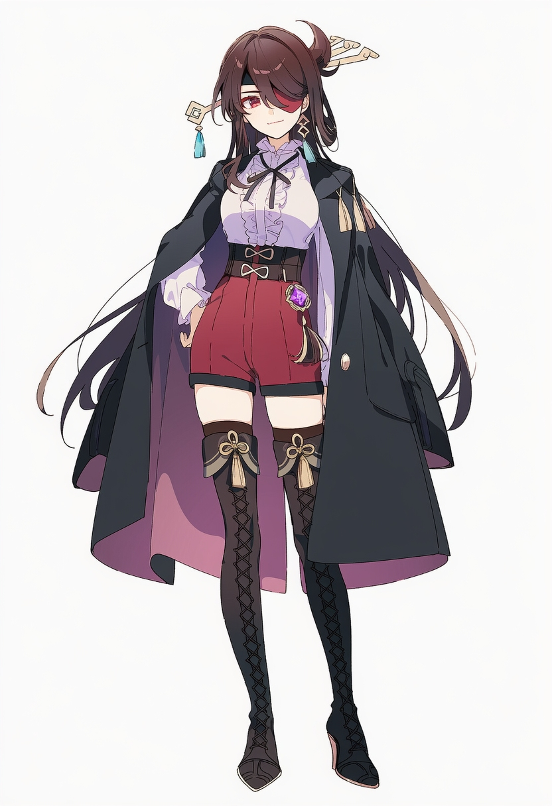

[在线例图](https://assets.quicktagcloud.com/images/raven_composition/raven_composition-4083.jpg?v=1618ee81b33c844b)

<a id="raven_composition-4084"></a>

## 蓝眼睛

ID：`raven_composition-4084`；分类：身体部位；来源标记：`safe`。

来源说明：

> 蓝色眼睛。眼睛本身没有独立常用tag，几乎都用颜色+eyes组合（如 blue_eyes、red_eyes）。

正向提示词：

```text
blue_eyes
```

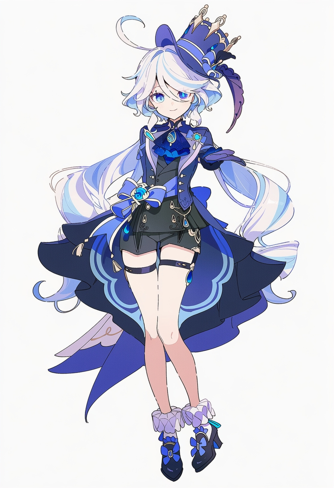

[在线例图](https://assets.quicktagcloud.com/images/raven_composition/raven_composition-4084.jpg?v=ecac83515e571d3c)

<a id="raven_composition-4085"></a>

## 尖耳朵

ID：`raven_composition-4085`；分类：身体部位；来源标记：`safe`。

来源说明：

> 尖尖的耳朵（精灵、妖精、兽耳等）。耳朵没有单独tag，多作为描述的一部分出现。

正向提示词：

```text
pointy_ears
```

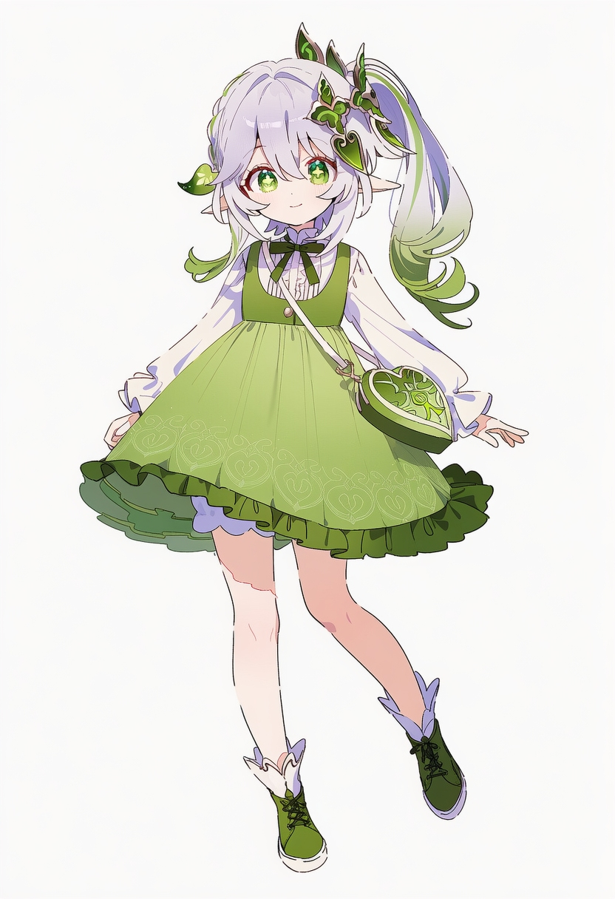

[在线例图](https://assets.quicktagcloud.com/images/raven_composition/raven_composition-4085.jpg?v=55dd7d8741a15cca)

<a id="raven_composition-4086"></a>

## 鼻子

ID：`raven_composition-4086`；分类：身体部位；来源标记：`safe`。

来源说明：

> 鼻子。单独出现较少，多用于强调或特殊形状。

正向提示词：

```text
nose
```

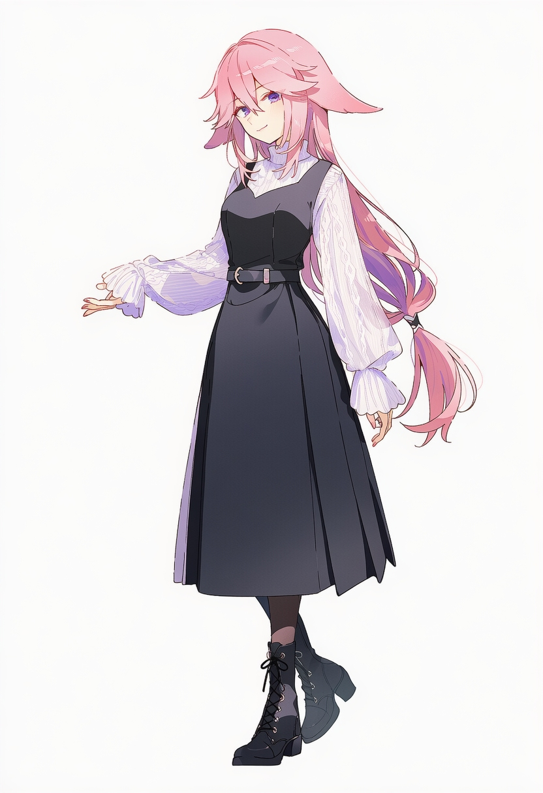

[在线例图](https://assets.quicktagcloud.com/images/raven_composition/raven_composition-4086.jpg?v=8f25717d4337e722)

<a id="raven_composition-4087"></a>

## 闭嘴

ID：`raven_composition-4087`；分类：身体部位；来源标记：`safe`。

来源说明：

> 嘴巴闭合的状态。嘴巴没有单独tag，多作为描述的一部分出现。

正向提示词：

```text
closed_mouth
```

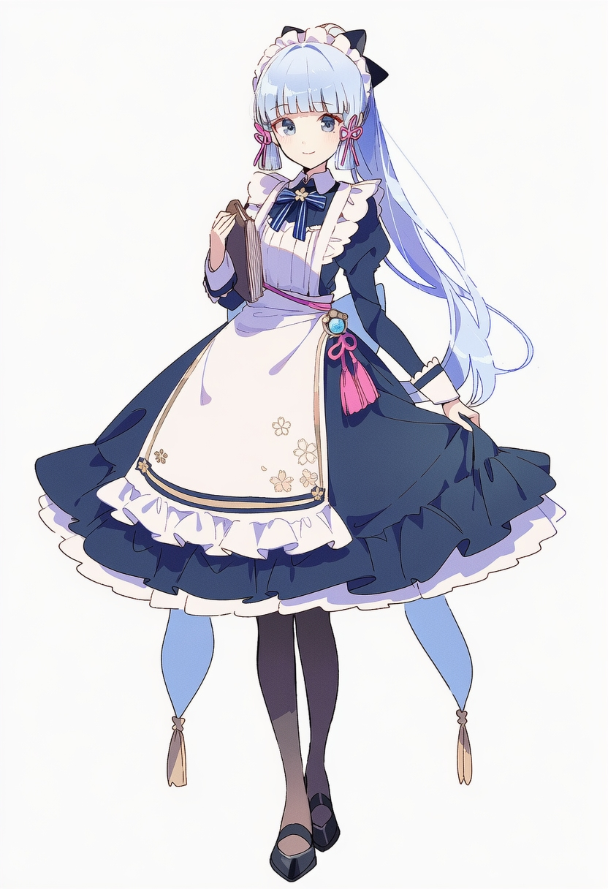

[在线例图](https://assets.quicktagcloud.com/images/raven_composition/raven_composition-4087.jpg?v=4038c71cdb823bf4)

<a id="raven_composition-4088"></a>

## 嘴唇

ID：`raven_composition-4088`；分类：身体部位；来源标记：`safe`。

来源说明：

> 嘴唇。常与颜色或状态组合（如 plump_lips）。

正向提示词：

```text
lips
```

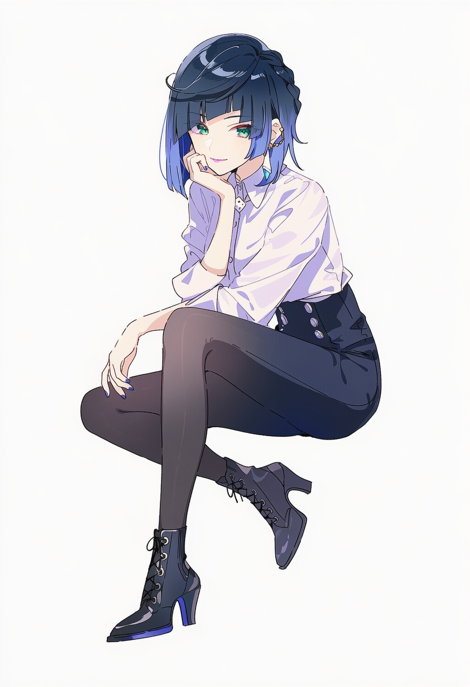

[在线例图](https://assets.quicktagcloud.com/images/raven_composition/raven_composition-4088.jpg?v=f01456f012e55a39)

<a id="raven_composition-4089"></a>

## 牙齿

ID：`raven_composition-4089`；分类：身体部位；来源标记：`safe`。

来源说明：

> 露出的牙齿。

正向提示词：

```text
teeth
```


[在线例图](https://assets.quicktagcloud.com/images/raven_composition/raven_composition-4089.jpg?v=8d51a3b17b49790a)

<a id="raven_composition-4090"></a>

## 尖牙/獠牙

ID：`raven_composition-4090`；分类：身体部位；来源标记：`safe`。

来源说明：

> 尖尖的犬齿或獠牙（吸血鬼、兽人常见）。

正向提示词：

```text
fangs
```

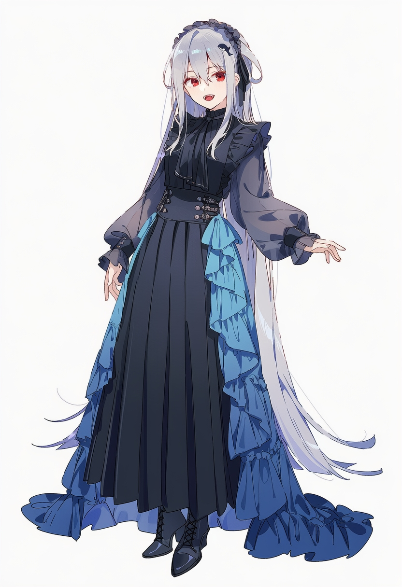

[在线例图](https://assets.quicktagcloud.com/images/raven_composition/raven_composition-4090.jpg?v=16e04e51fa023b81)

<a id="raven_composition-4091"></a>

## 舌头

ID：`raven_composition-4091`；分类：身体部位；来源标记：`safe`。

来源说明：

> 伸出或可见的舌头。

正向提示词：

```text
tongue
```

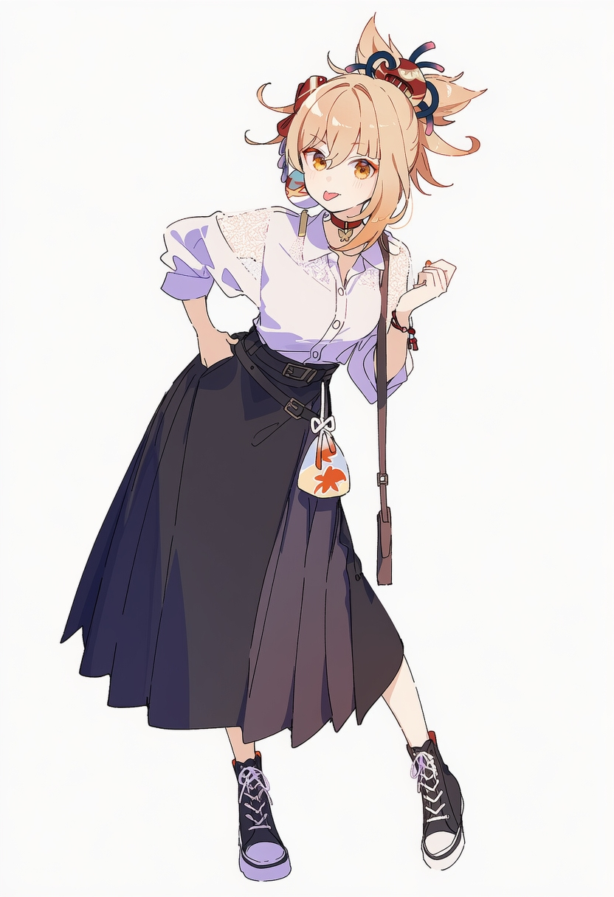

[在线例图](https://assets.quicktagcloud.com/images/raven_composition/raven_composition-4091.jpg?v=e7b0e16f6b516f6e)

<a id="raven_composition-4092"></a>

## 悬雍垂/小舌头

ID：`raven_composition-4092`；分类：身体部位；来源标记：`safe`。

来源说明：

> 张大嘴时可见的小舌头（口腔内部细节）。

正向提示词：

```text
uvula
```


[在线例图](https://assets.quicktagcloud.com/images/raven_composition/raven_composition-4092.jpg?v=04240cda06224521)

<a id="raven_composition-4093"></a>

## 鼓起的脸颊

ID：`raven_composition-4093`；分类：身体部位；来源标记：`safe`。

来源说明：

> 脸颊鼓起来的样子（吃东西或撒娇时）。脸颊没有单独tag，多作为描述的一部分出现。

正向提示词：

```text
puffy_cheeks
```


[在线例图](https://assets.quicktagcloud.com/images/raven_composition/raven_composition-4093.jpg?v=c2bb7e18645a06bc)

<a id="raven_composition-4094"></a>

## 颈带/颈饰丝带

ID：`raven_composition-4094`；分类：身体部位；来源标记：`safe`。

来源说明：

> 系在脖子上的丝带或领结。颈部没有单独tag，多作为描述的一部分出现。

正向提示词：

```text
neck_ribbon
```


[在线例图](https://assets.quicktagcloud.com/images/raven_composition/raven_composition-4094.jpg?v=279e341eb089e764)

<a id="raven_composition-4095"></a>

## 后颈

ID：`raven_composition-4095`；分类：身体部位；来源标记：`safe`。

来源说明：

> 脖子后面的部位（从后视角可见）。

正向提示词：

```text
nape
```

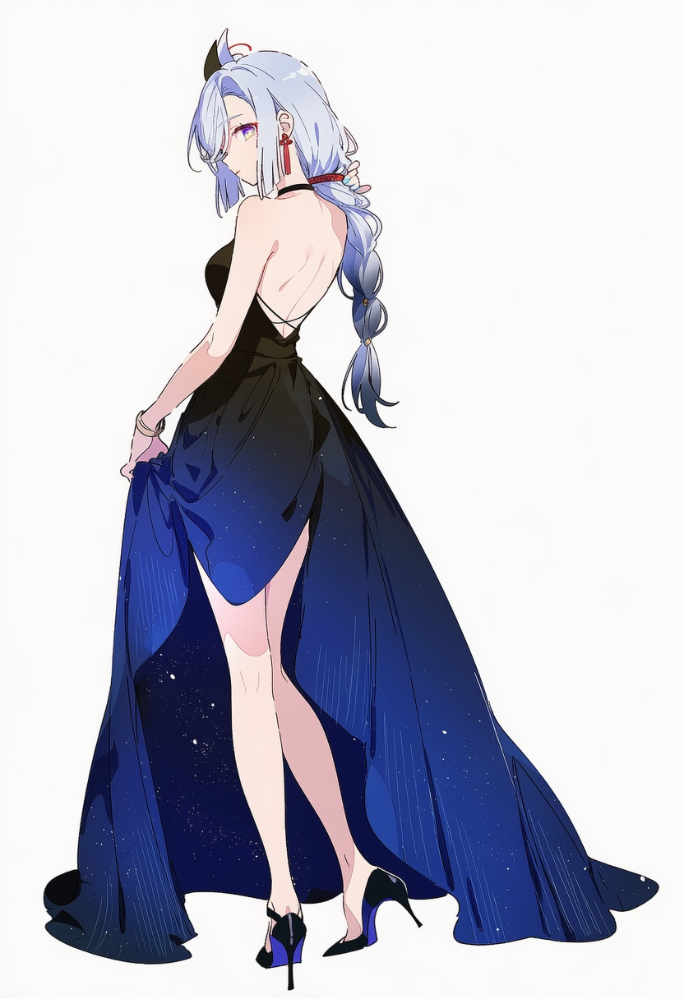

[在线例图](https://assets.quicktagcloud.com/images/raven_composition/raven_composition-4095.jpg?v=7a30460084ed044f)

<a id="raven_composition-4096"></a>

## 小胡子/八字胡

ID：`raven_composition-4096`；分类：身体部位；来源标记：`safe`。

来源说明：

> 上唇上方的胡子。

正向提示词：

```text
moustache
```

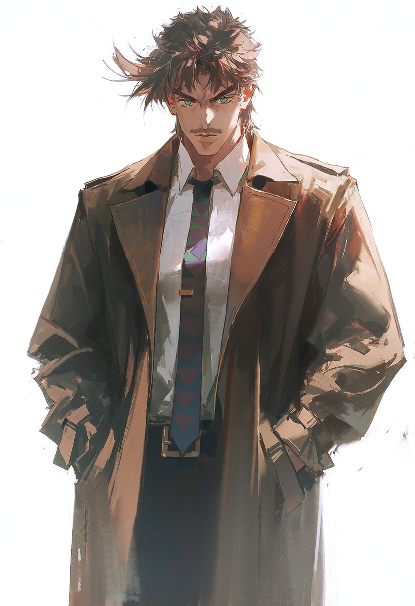

[在线例图](https://assets.quicktagcloud.com/images/raven_composition/raven_composition-4096.jpg?v=d63e1b7cfe642bc1)

<a id="raven_composition-4097"></a>

## 胡须/络腮胡

ID：`raven_composition-4097`；分类：身体部位；来源标记：`safe`。

来源说明：

> 下巴或脸颊的胡须。

正向提示词：

```text
beard
```

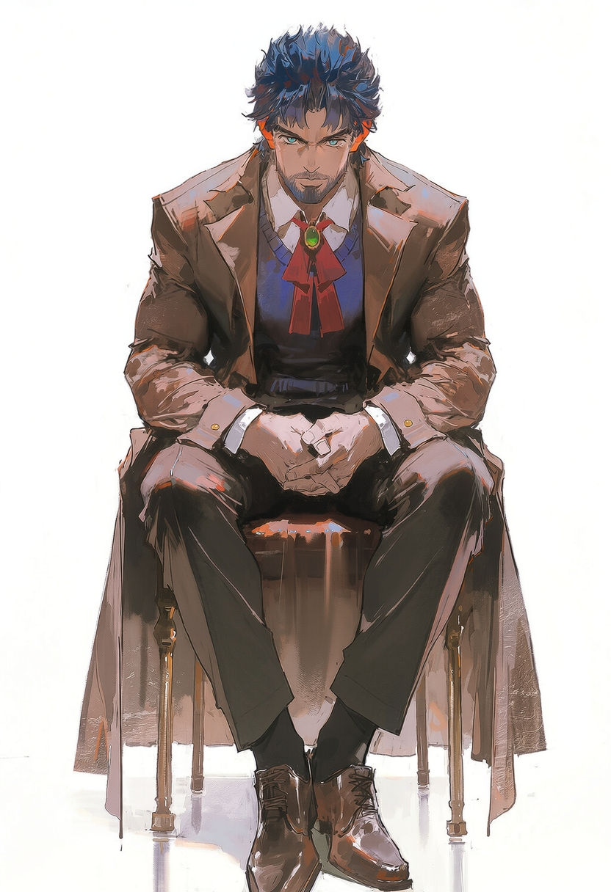

[在线例图](https://assets.quicktagcloud.com/images/raven_composition/raven_composition-4097.jpg?v=9d5879897283afcc)

<a id="raven_composition-4098"></a>

## 鬓角

ID：`raven_composition-4098`；分类：身体部位；来源标记：`safe`。

来源说明：

> 脸颊两侧的鬓角毛发。

正向提示词：

```text
sideburns
```

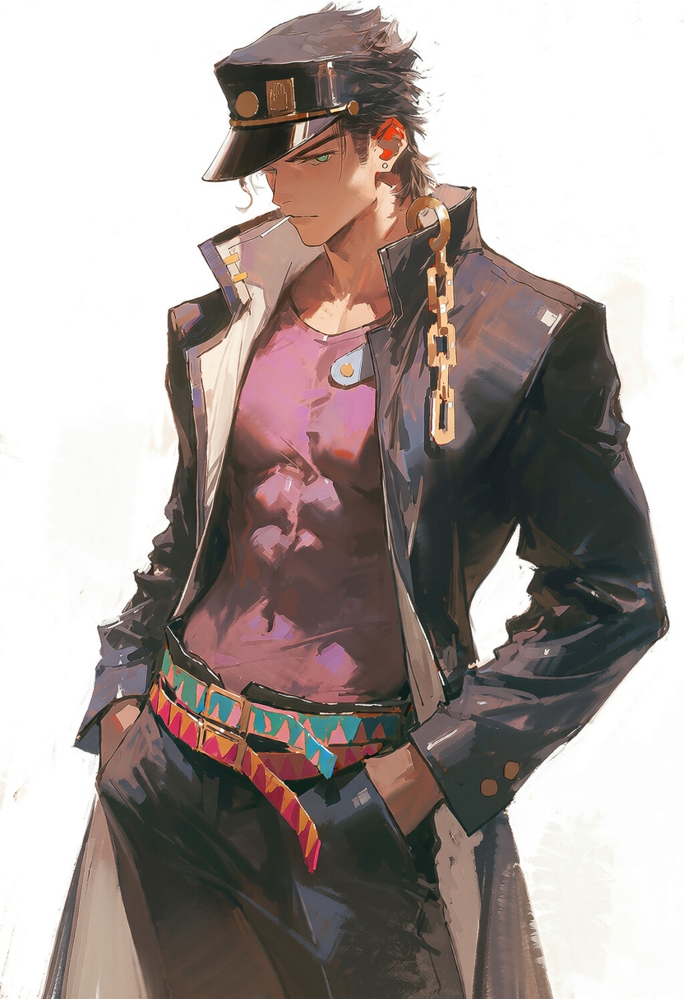

[在线例图](https://assets.quicktagcloud.com/images/raven_composition/raven_composition-4098.jpg?v=7f542f1e3a7661e6)

<a id="raven_composition-4099"></a>

## 裸肩

ID：`raven_composition-4099`；分类：身体部位；来源标记：`safe`。

来源说明：

> 肩膀裸露（无袖或露肩服装）。

正向提示词：

```text
bare_shoulders
```

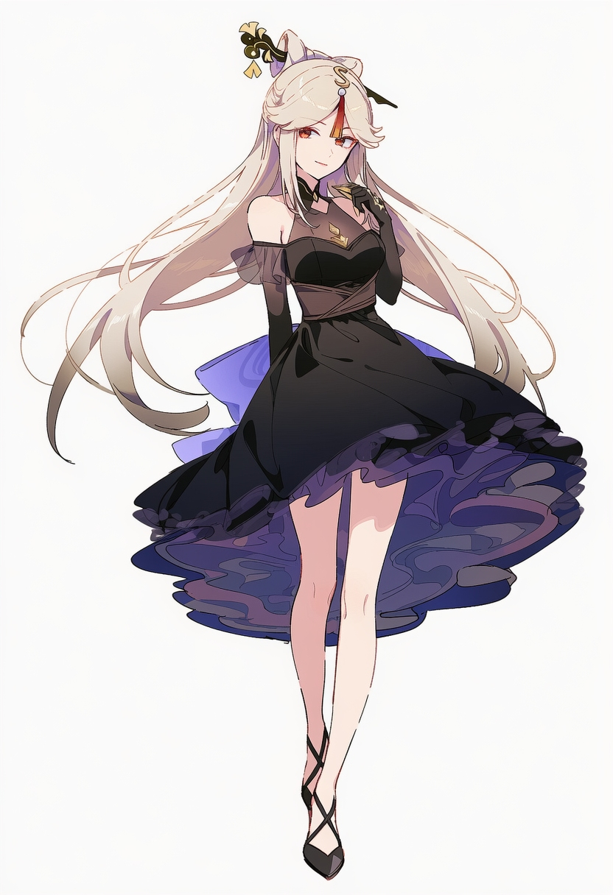

[在线例图](https://assets.quicktagcloud.com/images/raven_composition/raven_composition-4099.jpg?v=e3566904a1c14bcf)

<a id="raven_composition-4100"></a>

## 锁骨

ID：`raven_composition-4100`；分类：身体部位；来源标记：`safe`。

来源说明：

> 锁骨部位清晰可见。

正向提示词：

```text
collarbone
```

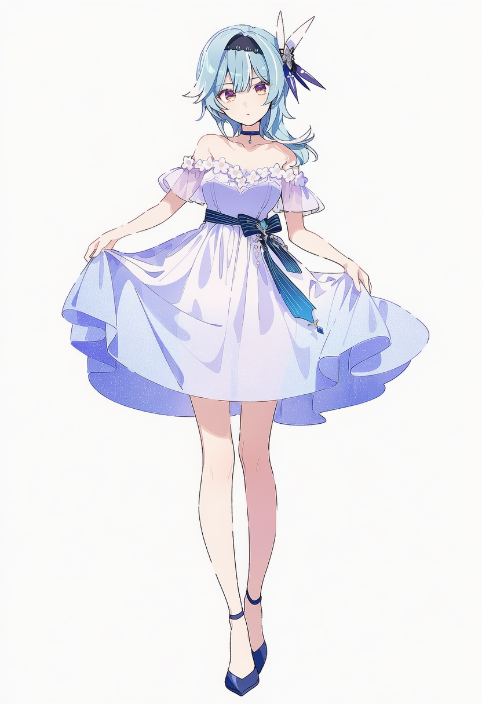

[在线例图](https://assets.quicktagcloud.com/images/raven_composition/raven_composition-4100.jpg?v=dbc13cd0ac48ffe1)

<a id="raven_composition-4101"></a>

## 肩胛骨

ID：`raven_composition-4101`；分类：身体部位；来源标记：`safe`。

来源说明：

> 后背的肩胛骨（多从后视角）。

正向提示词：

```text
shoulder_blades
```

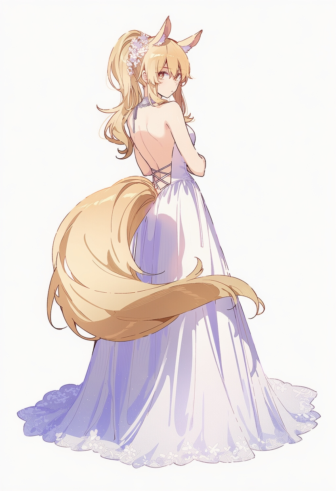

[在线例图](https://assets.quicktagcloud.com/images/raven_composition/raven_composition-4101.jpg?v=5cc2a8a045877154)

<a id="raven_composition-4102"></a>

## 胸部

ID：`raven_composition-4102`；分类：身体部位；来源标记：`safe`。

来源说明：

> 女性胸部。常与大小组合（如 large_breasts）。

正向提示词：

```text
breasts
```

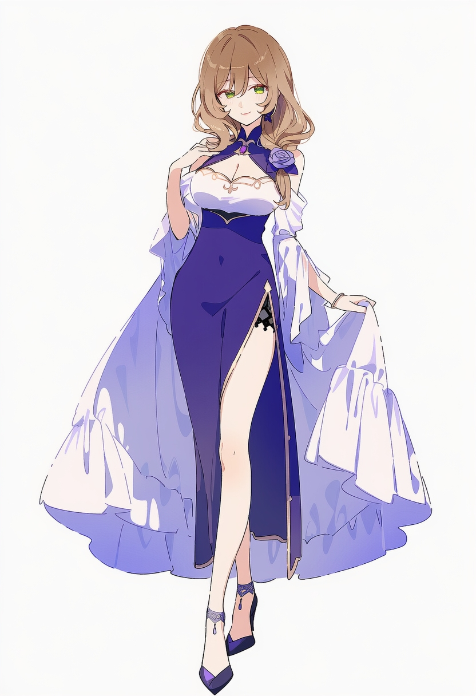

[在线例图](https://assets.quicktagcloud.com/images/raven_composition/raven_composition-4102.jpg?v=3281f4a678fec552)

<a id="raven_composition-4103"></a>

## 乳沟

ID：`raven_composition-4103`；分类：身体部位；来源标记：`safe`。

来源说明：

> 胸部之间的沟壑。

正向提示词：

```text
cleavage
```

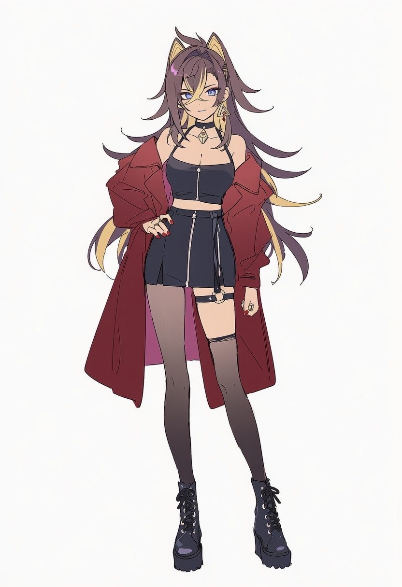

[在线例图](https://assets.quicktagcloud.com/images/raven_composition/raven_composition-4103.jpg?v=0f08509d338f3d5e)

<a id="raven_composition-4104"></a>

## 胸肌

ID：`raven_composition-4104`；分类：身体部位；来源标记：`safe`。

来源说明：

> 男性或肌肉型角色的胸肌。

正向提示词：

```text
pectorals
```

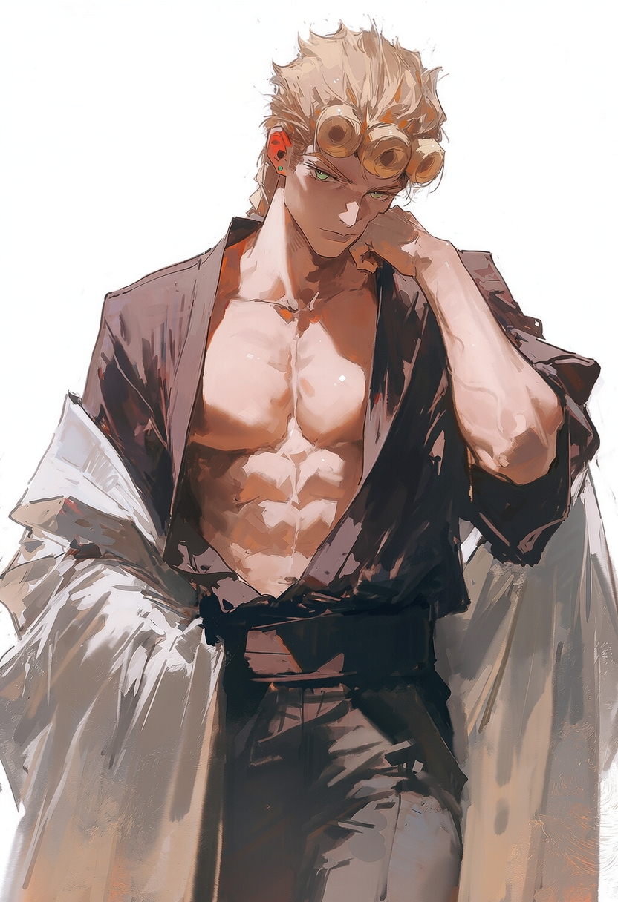

[在线例图](https://assets.quicktagcloud.com/images/raven_composition/raven_composition-4104.jpg?v=bee2ca73927a2f5b)

<a id="raven_composition-4105"></a>

## 肌肉发达

ID：`raven_composition-4105`；分类：身体部位；来源标记：`safe`。

来源说明：

> 整体肌肉明显的身材。

正向提示词：

```text
muscular
```

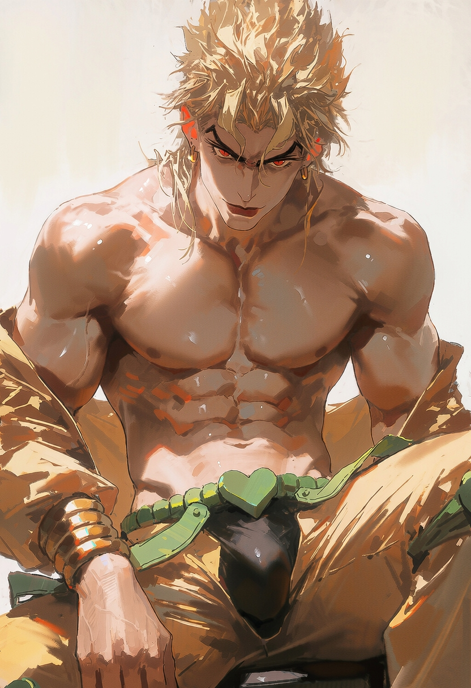

[在线例图](https://assets.quicktagcloud.com/images/raven_composition/raven_composition-4105.jpg?v=4fdf503be83923c8)

<a id="raven_composition-4106"></a>

## 肋骨

ID：`raven_composition-4106`；分类：身体部位；来源标记：`safe`。

来源说明：

> 肋骨轮廓可见（偏瘦或特定姿势）。

正向提示词：

```text
ribs
```


[在线例图](https://assets.quicktagcloud.com/images/raven_composition/raven_composition-4106.jpg?v=04ff9b0b6eb8ab28)

<a id="raven_composition-4107"></a>

## 腋下

ID：`raven_composition-4107`；分类：身体部位；来源标记：`safe`。

来源说明：

> 腋下部位（举手或特定姿势时可见）。

正向提示词：

```text
armpits
```

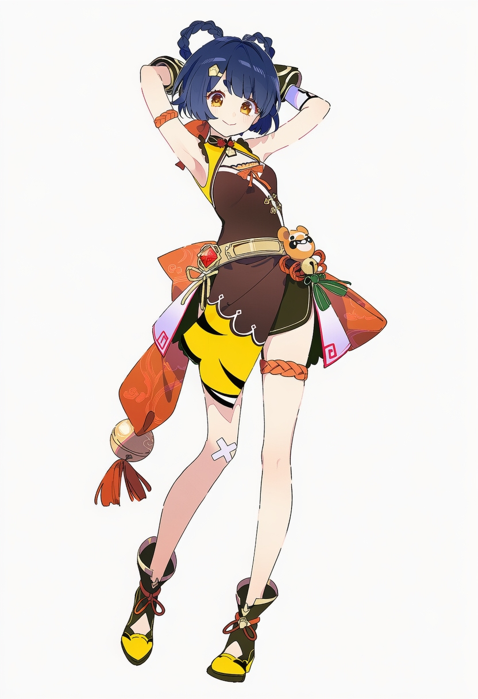

[在线例图](https://assets.quicktagcloud.com/images/raven_composition/raven_composition-4107.jpg?v=501c76f3d4aa2dd7)

<a id="raven_composition-4108"></a>

## 裸臂

ID：`raven_composition-4108`；分类：身体部位；来源标记：`safe`。

来源说明：

> 手臂没有被衣物覆盖。

正向提示词：

```text
bare_arms
```

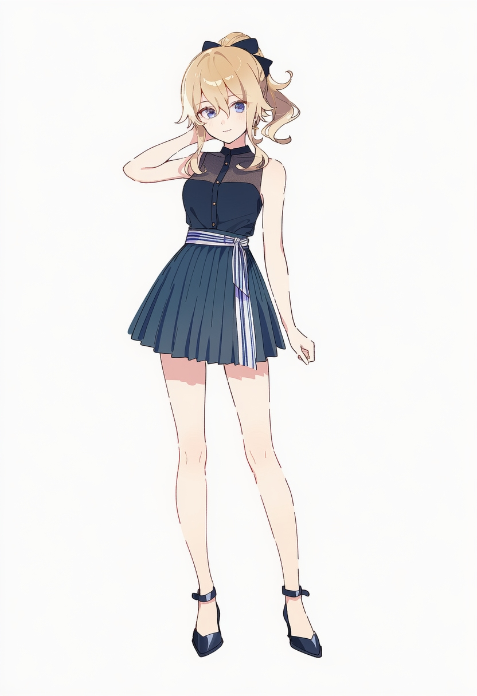

[在线例图](https://assets.quicktagcloud.com/images/raven_composition/raven_composition-4108.jpg?v=380eda0efdcc56c6)

<a id="raven_composition-4109"></a>

## 肱二头肌

ID：`raven_composition-4109`；分类：身体部位；来源标记：`safe`。

来源说明：

> 上臂的肌肉（尤其是弯曲时）。

正向提示词：

```text
biceps
```

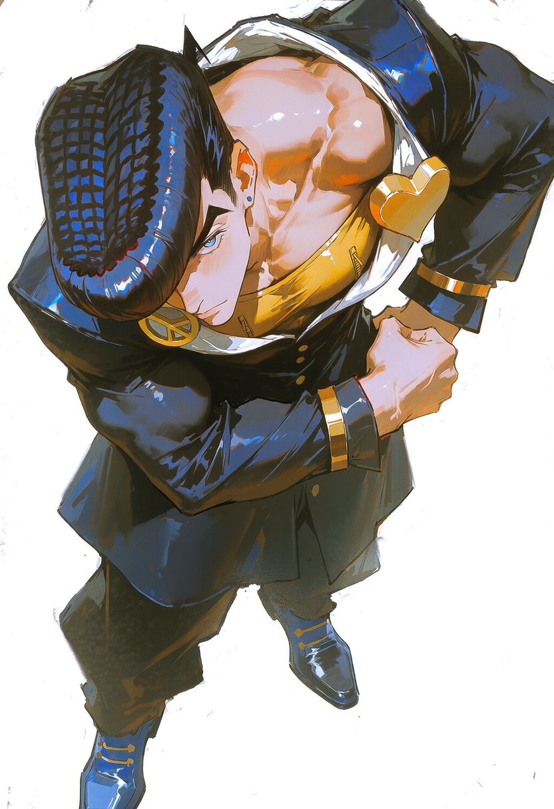

[在线例图](https://assets.quicktagcloud.com/images/raven_composition/raven_composition-4109.jpg?v=d6a854f69f30e0ab)

<a id="raven_composition-4110"></a>

## 袖子过腕

ID：`raven_composition-4110`；分类：身体部位；来源标记：`safe`。

来源说明：

> 袖子长度超过手腕（过长袖）。手腕没有单独tag，多作为描述的一部分出现。

正向提示词：

```text
sleeves_past_wrists
```

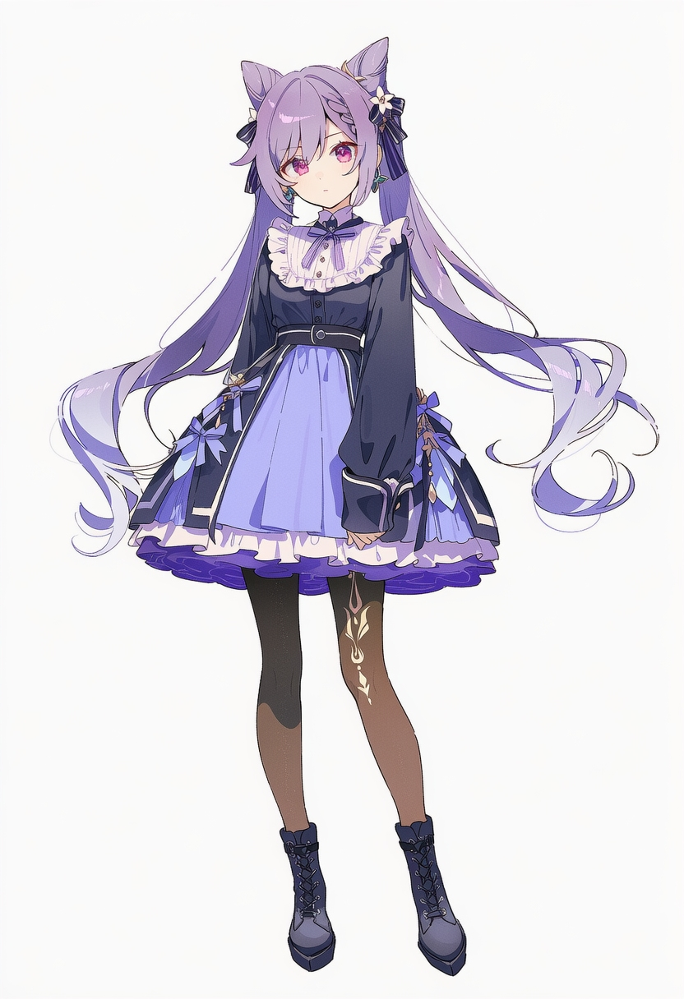

[在线例图](https://assets.quicktagcloud.com/images/raven_composition/raven_composition-4110.jpg?v=7de1989013da12bd)

<a id="raven_composition-4111"></a>

## 手肘撑桌

ID：`raven_composition-4111`；分类：身体部位；来源标记：`safe`。

来源说明：

> 手肘放在桌子上的姿势。手肘没有单独tag，多作为描述的一部分出现。

正向提示词：

```text
elbows_on_table
```


[在线例图](https://assets.quicktagcloud.com/images/raven_composition/raven_composition-4111.jpg?v=19f330356c32042a)

<a id="raven_composition-4112"></a>

## 举手

ID：`raven_composition-4112`；分类：身体部位；来源标记：`safe`。

来源说明：

> 双手举起的姿势。手没有单独tag，多作为描述的一部分出现。

正向提示词：

```text
hands_up
```


[在线例图](https://assets.quicktagcloud.com/images/raven_composition/raven_composition-4112.jpg?v=a31130a0b43768a6)

<a id="raven_composition-4113"></a>

## 手掌

ID：`raven_composition-4113`；分类：身体部位；来源标记：`safe`。

来源说明：

> 手心朝向观众或可见。

正向提示词：

```text
palms
```


[在线例图](https://assets.quicktagcloud.com/images/raven_composition/raven_composition-4113.jpg?v=1ec4b223e0ab2a41)

<a id="raven_composition-4114"></a>

## 食指并拢

ID：`raven_composition-4114`；分类：身体部位；来源标记：`safe`。

来源说明：

> 两根食指尖碰在一起的手势。手指没有单独tag，多作为描述的一部分出现。

正向提示词：

```text
index_fingers_together
```

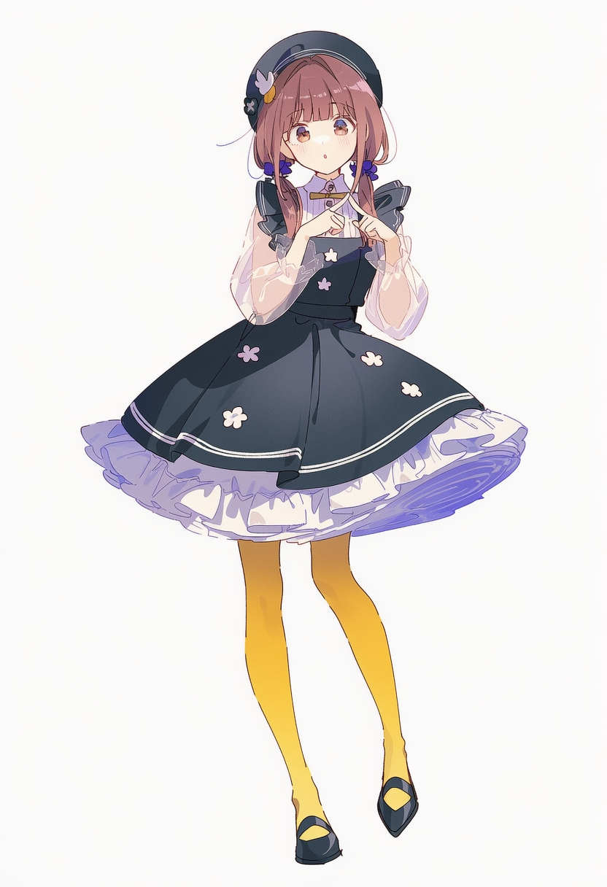

[在线例图](https://assets.quicktagcloud.com/images/raven_composition/raven_composition-4114.jpg?v=cea5fac00fc82627)

<a id="raven_composition-4115"></a>

## 指甲

ID：`raven_composition-4115`；分类：身体部位；来源标记：`safe`。

来源说明：

> 可见的手指甲。

正向提示词：

```text
fingernails
```

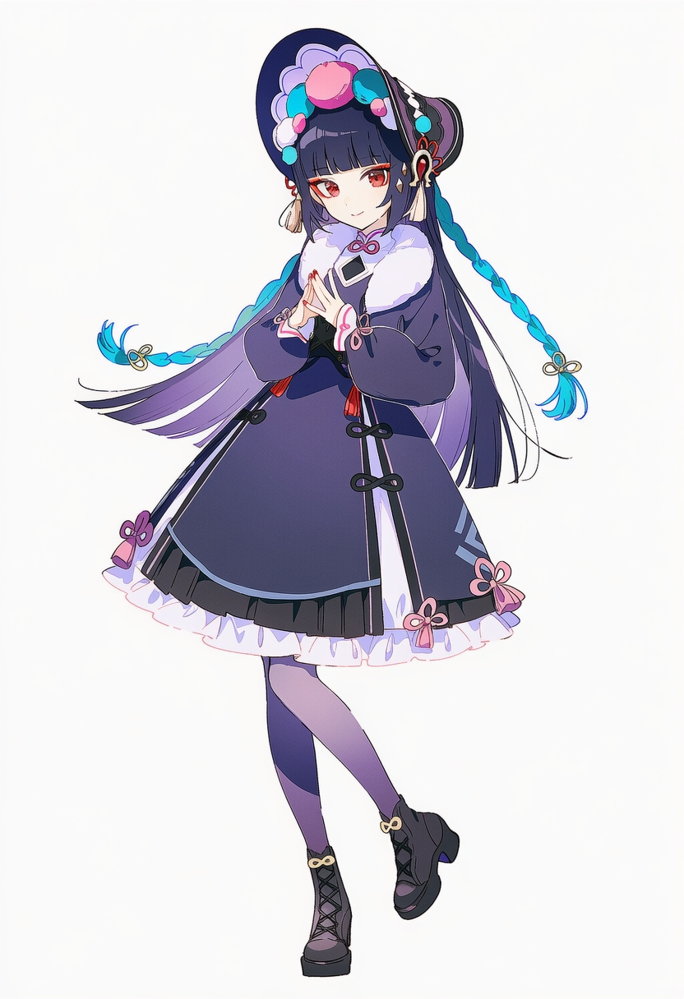

[在线例图](https://assets.quicktagcloud.com/images/raven_composition/raven_composition-4115.jpg?v=e7fa1497923e3b9c)

<a id="raven_composition-4116"></a>

## 黑指甲

ID：`raven_composition-4116`；分类：身体部位；来源标记：`safe`。

来源说明：

> 涂成黑色的指甲。

正向提示词：

```text
black_nails
```

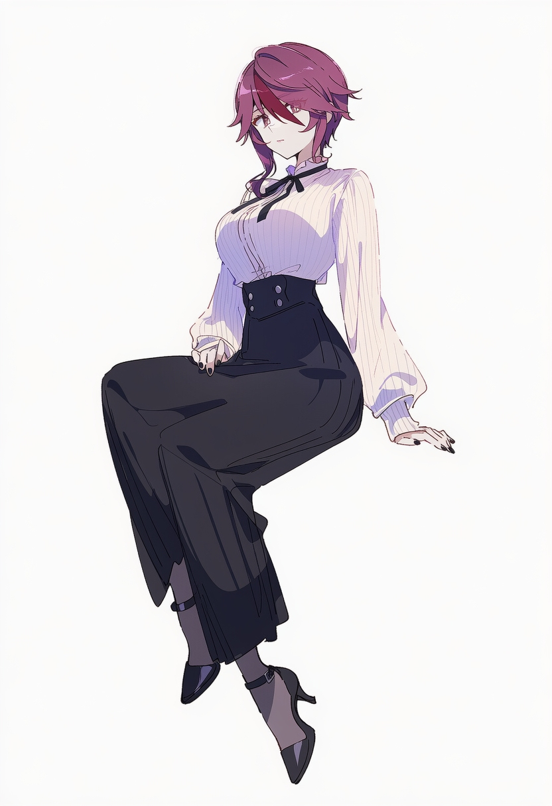

[在线例图](https://assets.quicktagcloud.com/images/raven_composition/raven_composition-4116.jpg?v=2d242afd560dc46e)

<a id="raven_composition-4117"></a>

## 指甲油

ID：`raven_composition-4117`；分类：身体部位；来源标记：`safe`。

来源说明：

> 涂了指甲油的指甲（可指定颜色）。

正向提示词：

```text
nail_polish
```

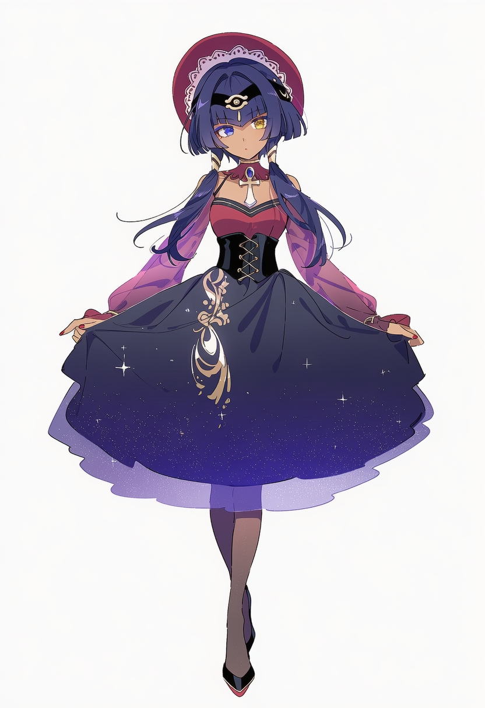

[在线例图](https://assets.quicktagcloud.com/images/raven_composition/raven_composition-4117.jpg?v=91ef4a12c68b287e)

<a id="raven_composition-4118"></a>

## 腹部/胃部

ID：`raven_composition-4118`；分类：身体部位；来源标记：`safe`。

来源说明：

> 肚子正面（较中性描述）。

正向提示词：

```text
stomach
```

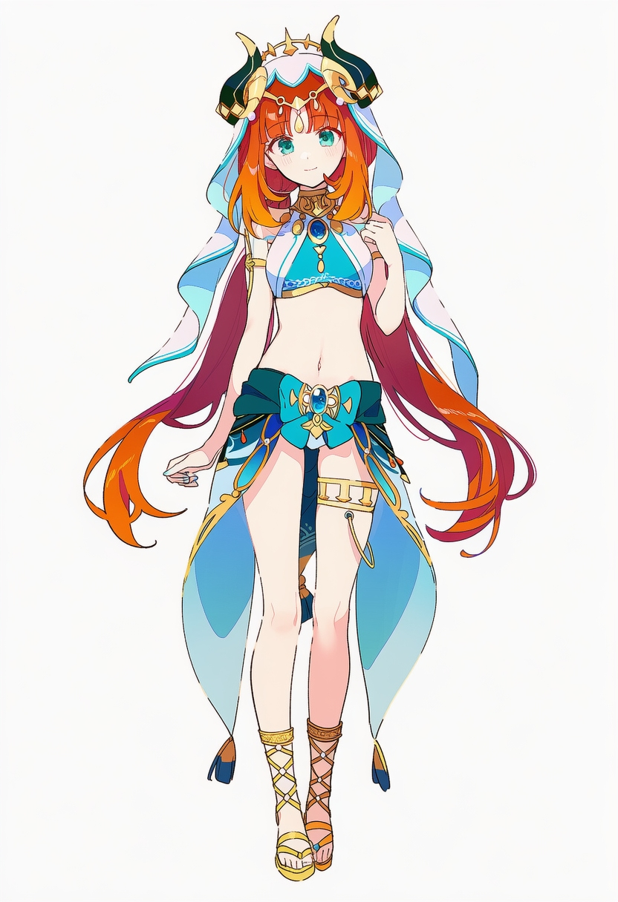

[在线例图](https://assets.quicktagcloud.com/images/raven_composition/raven_composition-4118.jpg?v=014a11c48fe89b77)

<a id="raven_composition-4119"></a>

## 肚子

ID：`raven_composition-4119`；分类：身体部位；来源标记：`safe`。

来源说明：

> 腹部（常指圆润或露出的肚子）。通常指小肚子/小腹，可搭配其他tag生成胖胖的小肚子。

正向提示词：

```text
belly
```

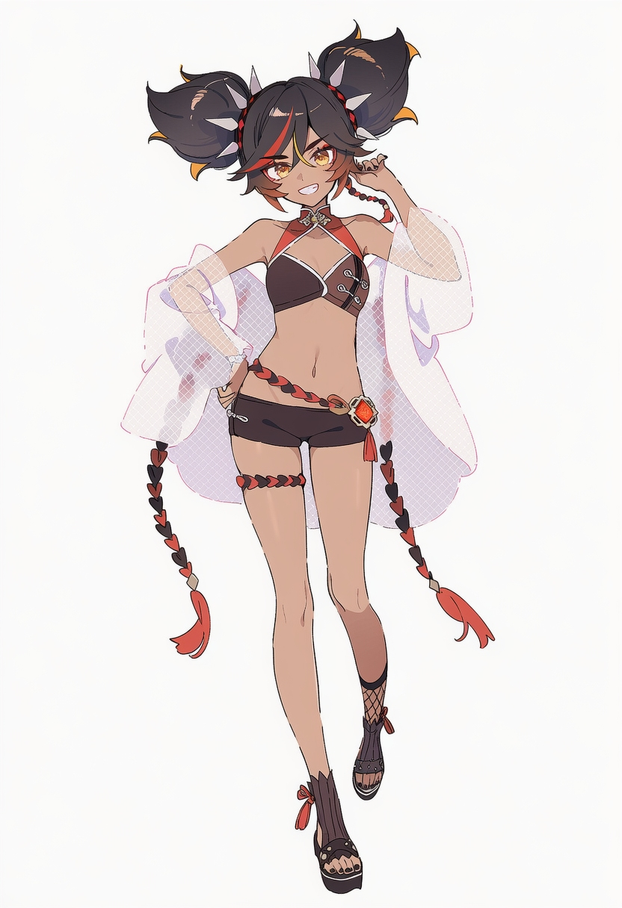

[在线例图](https://assets.quicktagcloud.com/images/raven_composition/raven_composition-4119.jpg?v=6376f7a41d5d40f2)

<a id="raven_composition-4120"></a>

## 露腰/腰部

ID：`raven_composition-4120`；分类：身体部位；来源标记：`safe`。

来源说明：

> 腰部露出的部位（短上衣常见）。

正向提示词：

```text
midriff
```

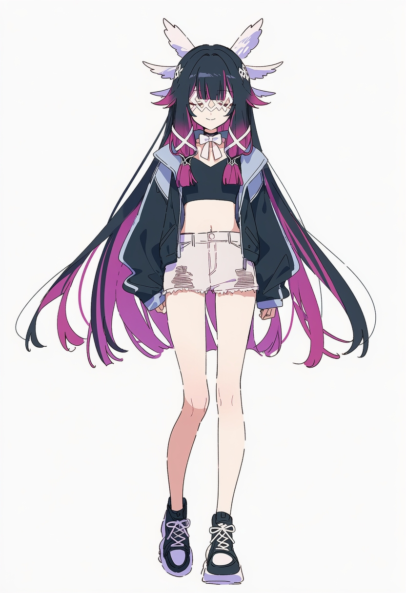

[在线例图](https://assets.quicktagcloud.com/images/raven_composition/raven_composition-4120.jpg?v=046280519470e71f)

<a id="raven_composition-4121"></a>

## 腹肌

ID：`raven_composition-4121`；分类：身体部位；来源标记：`safe`。

来源说明：

> 清晰的腹部肌肉线条。

正向提示词：

```text
abs
```

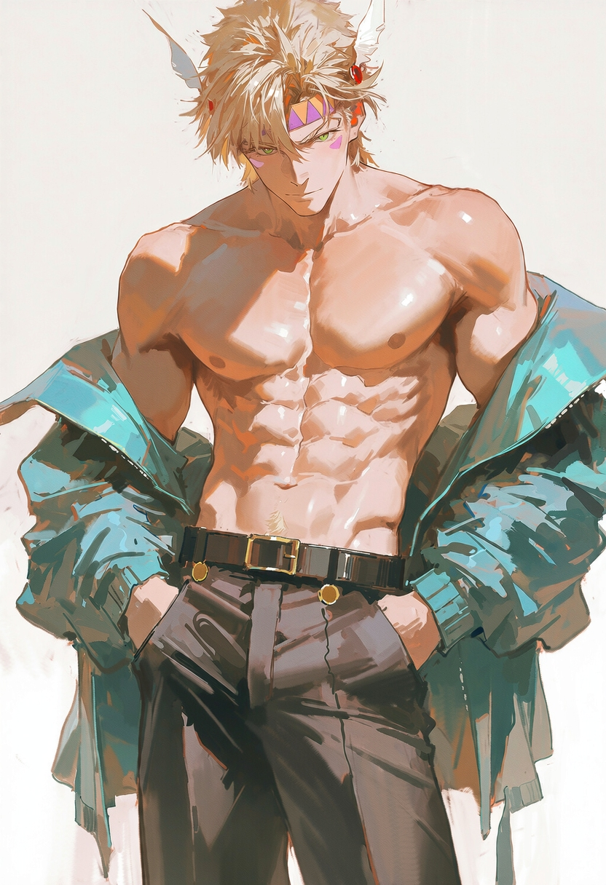

[在线例图](https://assets.quicktagcloud.com/images/raven_composition/raven_composition-4121.jpg?v=6735f575d610291a)

<a id="raven_composition-4122"></a>

## 肚脐

ID：`raven_composition-4122`；分类：身体部位；来源标记：`safe`。

来源说明：

> 肚脐眼可见。

正向提示词：

```text
navel
```

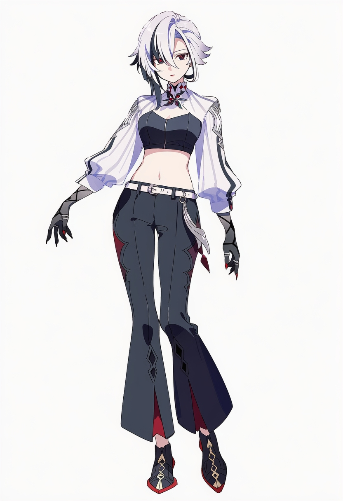

[在线例图](https://assets.quicktagcloud.com/images/raven_composition/raven_composition-4122.jpg?v=492bdffb5a4ba1be)

<a id="raven_composition-4123"></a>

## 腰围裙

ID：`raven_composition-4123`；分类：身体部位；来源标记：`safe`。

来源说明：

> 系在腰间的围裙。腰部没有单独tag，多作为描述的一部分出现。

正向提示词：

```text
waist_apron
```

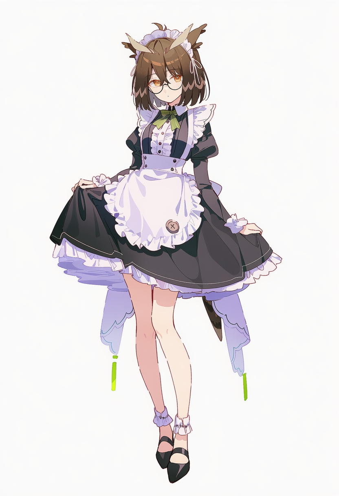

[在线例图](https://assets.quicktagcloud.com/images/raven_composition/raven_composition-4123.jpg?v=1aac1125aeea606a)

<a id="raven_composition-4124"></a>

## 宽臀

ID：`raven_composition-4124`；分类：身体部位；来源标记：`safe`。

来源说明：

> 臀部较宽的体型。臀部没有单独tag，多作为描述的一部分出现。

正向提示词：

```text
wide_hips
```

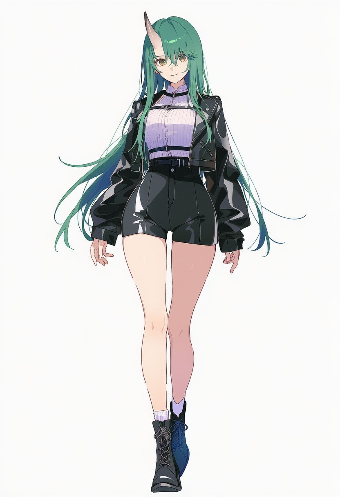

[在线例图](https://assets.quicktagcloud.com/images/raven_composition/raven_composition-4124.jpg?v=2f9885a2f0947c95)

<a id="raven_composition-4125"></a>

## 腹斜肌

ID：`raven_composition-4125`；分类：身体部位；来源标记：`safe`。

来源说明：

> 侧面腹部的肌肉线条。

正向提示词：

```text
obliques
```

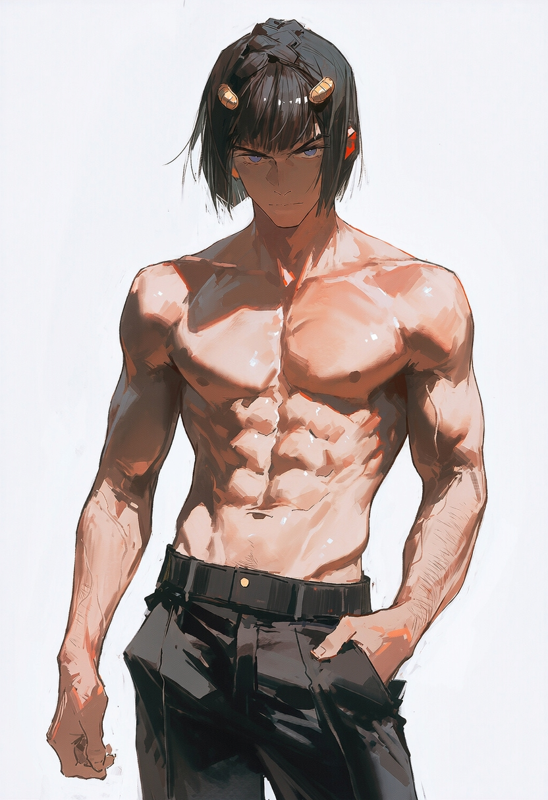

[在线例图](https://assets.quicktagcloud.com/images/raven_composition/raven_composition-4125.jpg?v=5ef974dd13e3fb89)

<a id="raven_composition-4126"></a>

## 胯部/腹股沟

ID：`raven_composition-4126`；分类：身体部位；来源标记：`safe`。

来源说明：

> 大腿根部与下腹部交界处。

正向提示词：

```text
groin
```

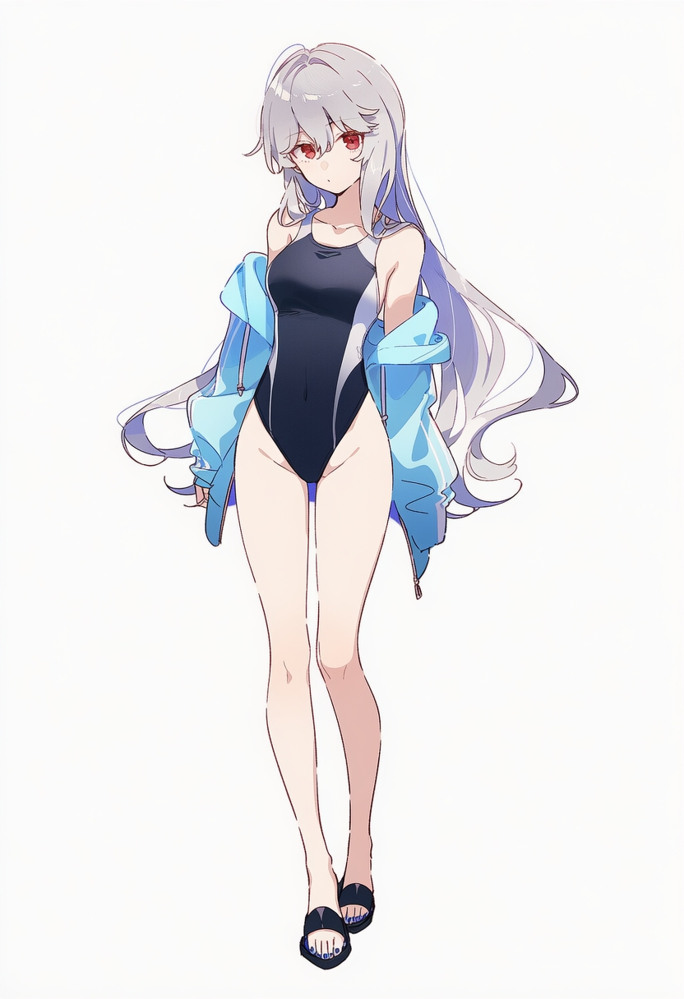

[在线例图](https://assets.quicktagcloud.com/images/raven_composition/raven_composition-4126.jpg?v=8fcb08796117d2da)

<a id="raven_composition-4127"></a>

## 臀部

ID：`raven_composition-4127`；分类：身体部位；来源标记：`safe`。

来源说明：

> 屁股。常用tag。

正向提示词：

```text
ass
```

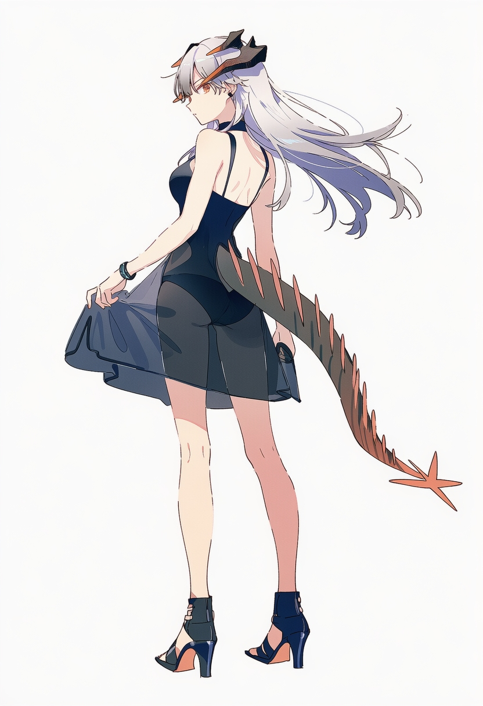

[在线例图](https://assets.quicktagcloud.com/images/raven_composition/raven_composition-4127.jpg?v=7ed30c29301da58a)

<a id="raven_composition-4128"></a>

## 腿

ID：`raven_composition-4128`；分类：身体部位；来源标记：`safe`。

来源说明：

> 腿部整体。

正向提示词：

```text
legs
```

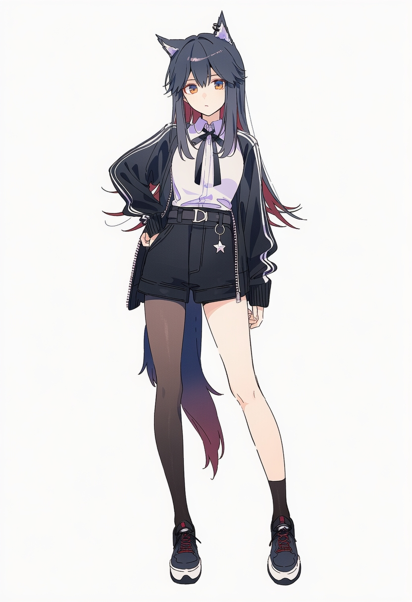

[在线例图](https://assets.quicktagcloud.com/images/raven_composition/raven_composition-4128.jpg?v=b1098860322a4118)

<a id="raven_composition-4129"></a>

## 大腿

ID：`raven_composition-4129`；分类：身体部位；来源标记：`safe`。

来源说明：

> 大腿部位（常强调粗细）。

正向提示词：

```text
thighs
```

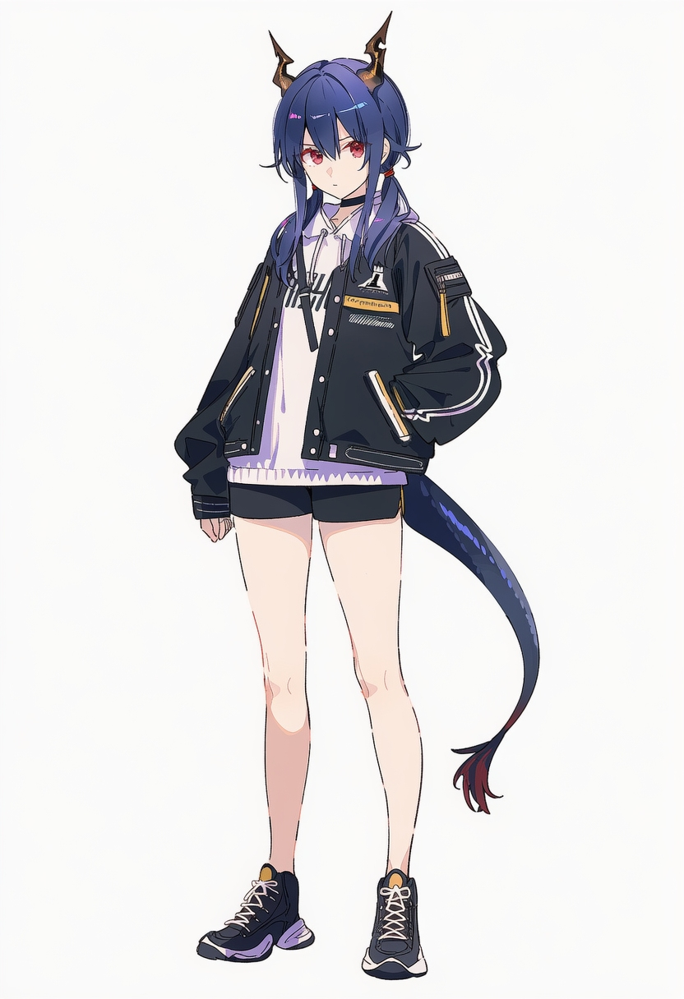

[在线例图](https://assets.quicktagcloud.com/images/raven_composition/raven_composition-4129.jpg?v=e5671ed450528098)

<a id="raven_composition-4130"></a>

## 膝盖

ID：`raven_composition-4130`；分类：身体部位；来源标记：`safe`。

来源说明：

> 膝盖部位。

正向提示词：

```text
knees
```

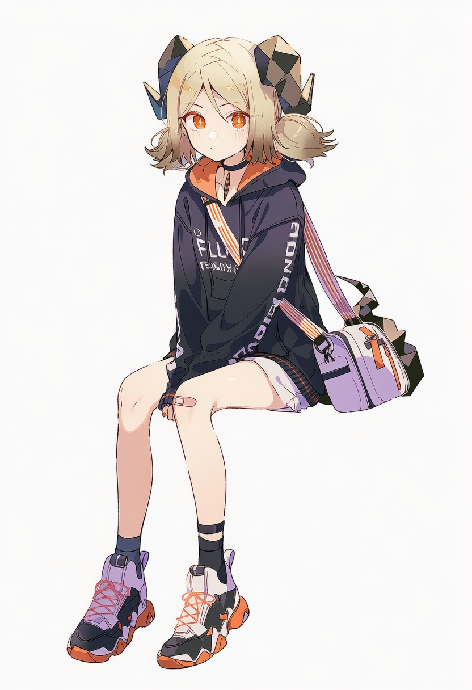

[在线例图](https://assets.quicktagcloud.com/images/raven_composition/raven_composition-4130.jpg?v=6e32ac4577179a80)

<a id="raven_composition-4131"></a>

## 小腿

ID：`raven_composition-4131`；分类：身体部位；来源标记：`safe`。

来源说明：

> 小腿部位。

正向提示词：

```text
calves
```

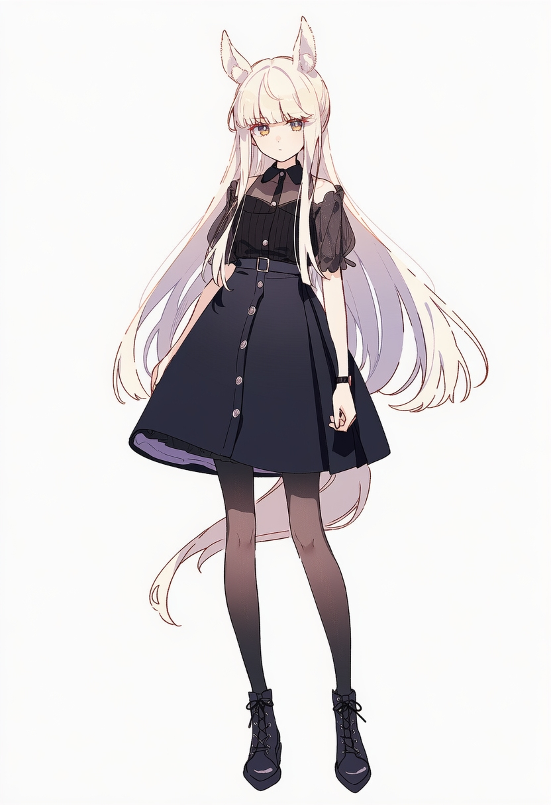

[在线例图](https://assets.quicktagcloud.com/images/raven_composition/raven_composition-4131.jpg?v=6e9385d42c482d2c)

<a id="raven_composition-4132"></a>

## 脚

ID：`raven_composition-4132`；分类：身体部位；来源标记：`safe`。

来源说明：

> 脚部整体。

正向提示词：

```text
feet
```


[在线例图](https://assets.quicktagcloud.com/images/raven_composition/raven_composition-4132.jpg?v=ddaeaea697cce6e3)

<a id="raven_composition-4133"></a>

## 赤脚

ID：`raven_composition-4133`；分类：身体部位；来源标记：`safe`。

来源说明：

> 没穿鞋的脚。

正向提示词：

```text
barefoot
```


[在线例图](https://assets.quicktagcloud.com/images/raven_composition/raven_composition-4133.jpg?v=d6ea9c80d7d84b28)

<a id="raven_composition-4134"></a>

## 脚趾

ID：`raven_composition-4134`；分类：身体部位；来源标记：`safe`。

来源说明：

> 脚趾可见。

正向提示词：

```text
toes
```

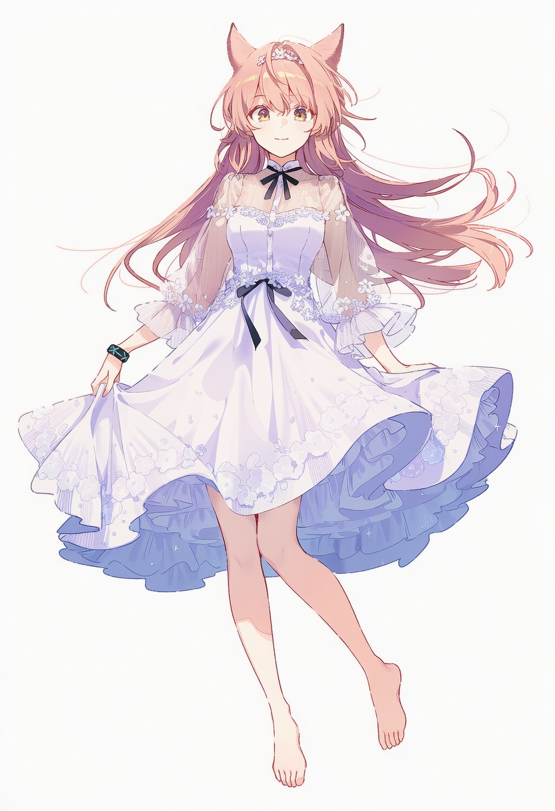

[在线例图](https://assets.quicktagcloud.com/images/raven_composition/raven_composition-4134.jpg?v=60129e66f990a116)

<a id="raven_composition-4135"></a>

## 脚底

ID：`raven_composition-4135`；分类：身体部位；来源标记：`safe`。

来源说明：

> 脚掌底部朝向观众。

正向提示词：

```text
soles
```

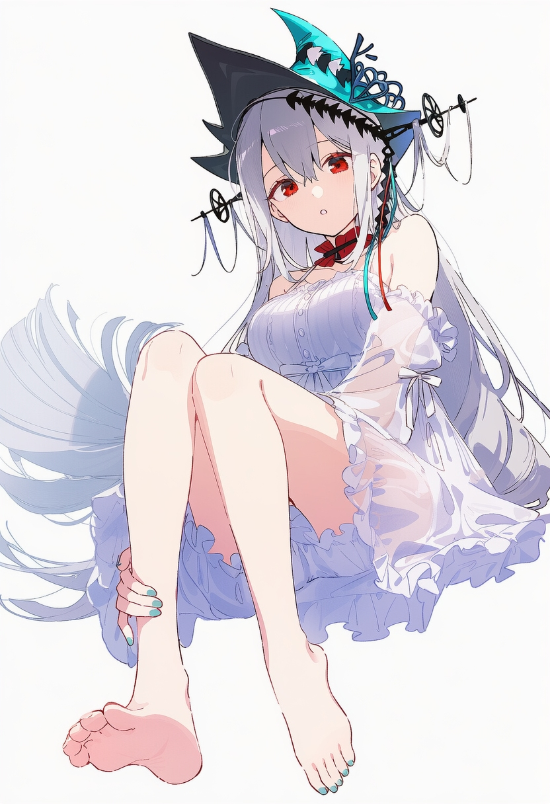

[在线例图](https://assets.quicktagcloud.com/images/raven_composition/raven_composition-4135.jpg?v=57b53484b040256c)

<a id="raven_composition-4136"></a>

## 脚踝交叉

ID：`raven_composition-4136`；分类：身体部位；来源标记：`safe`。

来源说明：

> 两脚脚踝交叉的姿势。脚踝没有单独tag，多作为描述的一部分出现。

正向提示词：

```text
crossed_ankles
```

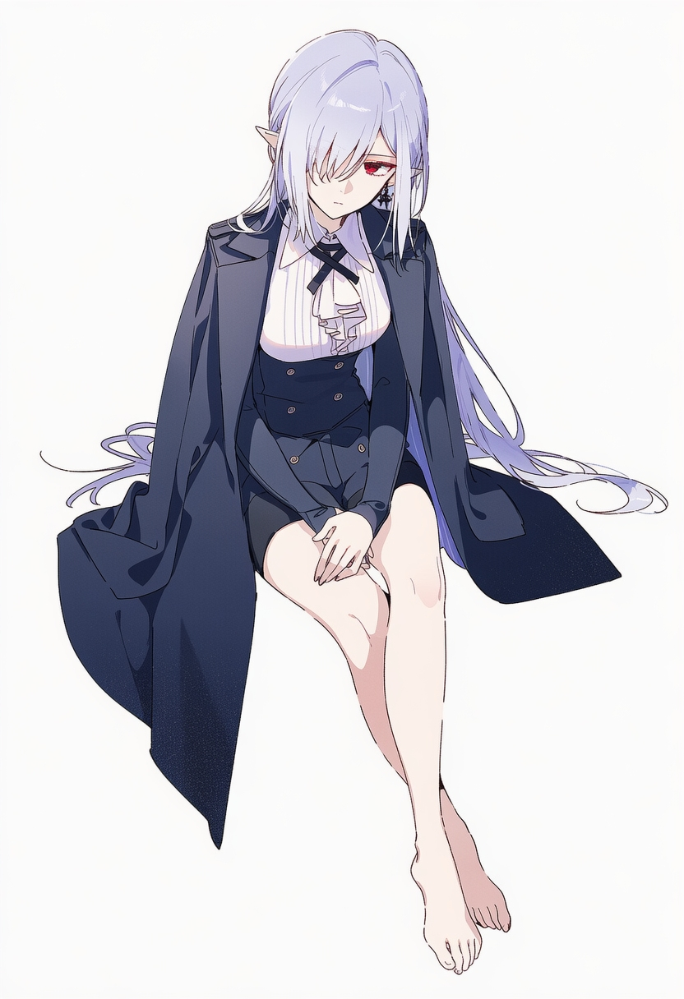

[在线例图](https://assets.quicktagcloud.com/images/raven_composition/raven_composition-4136.jpg?v=0d9f036170c578f6)

<a id="raven_composition-4137"></a>

## 光滑皮肤/油光皮肤

ID：`raven_composition-4137`；分类：身体部位；来源标记：`safe`。

来源说明：

> 皮肤有光泽或湿润反光的效果。皮肤没有单独tag，多作为描述的一部分出现。

正向提示词：

```text
shiny_skin
```


[在线例图](https://assets.quicktagcloud.com/images/raven_composition/raven_composition-4137.jpg?v=f219bee6c972e67d)

<a id="raven_composition-4138"></a>

## 翅膀

ID：`raven_composition-4138`；分类：身体部位；来源标记：`safe`。

来源说明：

> 背部的翅膀（天使、恶魔、鸟人等）。

正向提示词：

```text
wings
```

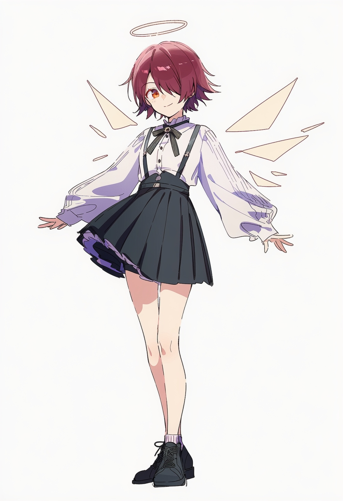

[在线例图](https://assets.quicktagcloud.com/images/raven_composition/raven_composition-4138.jpg?v=fb416df53c4dc8d8)

<a id="raven_composition-4139"></a>

## 尾巴

ID：`raven_composition-4139`；分类：身体部位；来源标记：`safe`。

来源说明：

> 尾巴（兽人、恶魔、龙等）。

正向提示词：

```text
tail
```

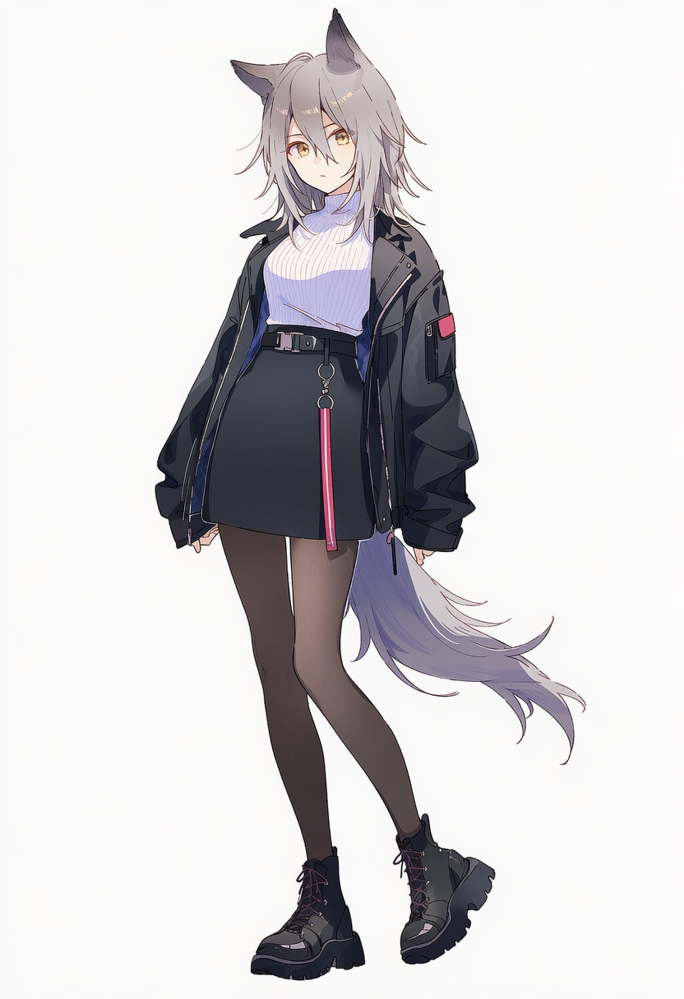

[在线例图](https://assets.quicktagcloud.com/images/raven_composition/raven_composition-4139.jpg?v=6bf6fe841ebaa4a2)
