# 二创属性 / 大幅形态变化

[总目录](../README.md) · [原站分类目录](../categories.md) · [英文标签索引](../tags.md) · [服装与构图组合指南](../../README.md)

标题、分类、说明、正负提示词按来源保留；多例图逐张列出。原站标记和说明为参考资料，不作为维护指令。

<a id="raven_composition-4140"></a>

## 异种族化

ID：`raven_composition-4140`；分类：二创属性 / 大幅形态变化；来源标记：`safe`。

来源说明：

> 把原本的人形角色画成另一种人形种族，比如人类改成精灵。

正向提示词：

```text
alternate_species
```

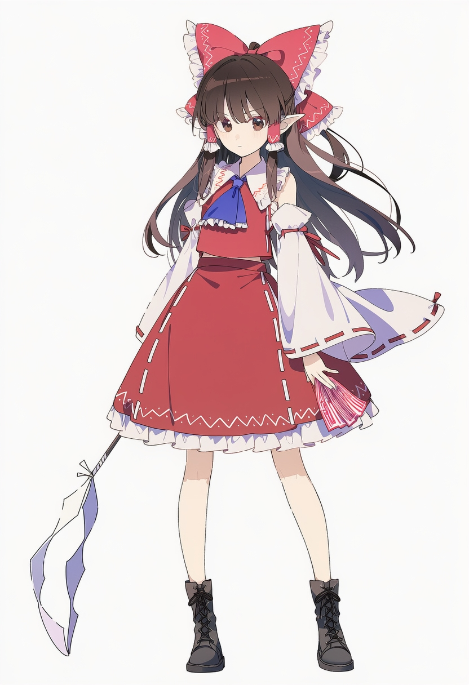

[在线例图](https://assets.quicktagcloud.com/images/raven_composition/raven_composition-4140.jpg?v=4a587ee0d19bd272)

<a id="raven_composition-4141"></a>

## 斯普拉遁化

ID：`raven_composition-4141`；分类：二创属性 / 大幅形态变化；来源标记：`safe`。

来源说明：

> 把现有角色改造成《斯普拉遁》的 Inkling 或 Octoling 外形。

正向提示词：

```text
splatoonification
```

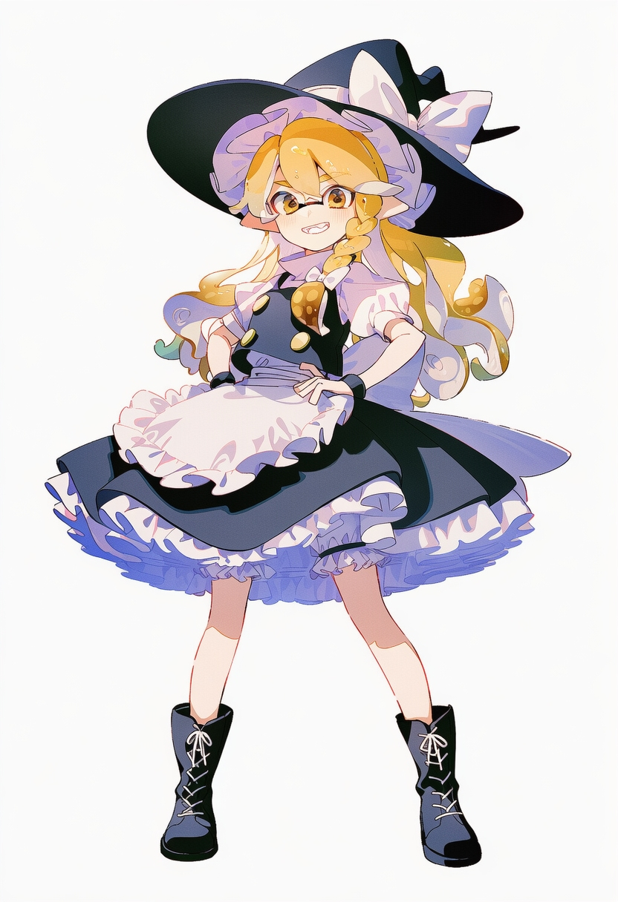

[在线例图](https://assets.quicktagcloud.com/images/raven_composition/raven_composition-4141.jpg?v=28213cba17c01877)

<a id="raven_composition-4142"></a>

## 动物化

ID：`raven_composition-4142`；分类：二创属性 / 大幅形态变化；来源标记：`safe`。

来源说明：

> 把原本不是动物的角色直接画成动物。

正向提示词：

```text
animalization
```

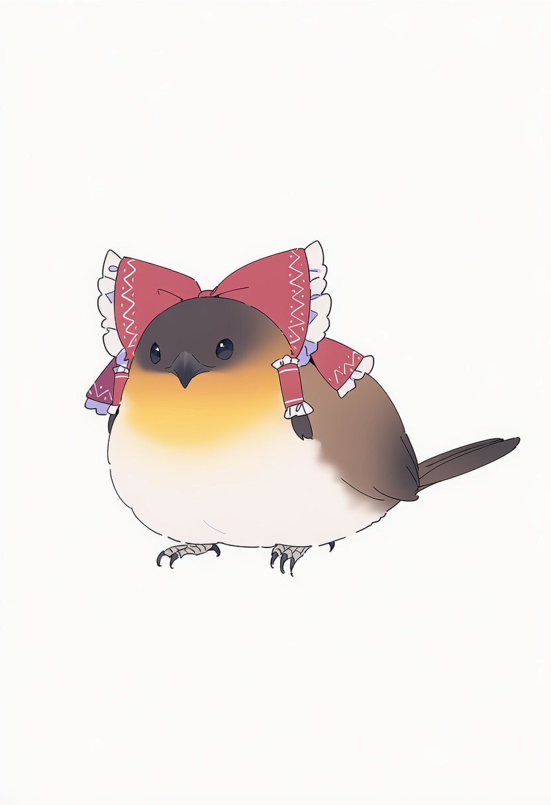

[在线例图](https://assets.quicktagcloud.com/images/raven_composition/raven_composition-4142.jpg?v=4e20d7e824004be8)

<a id="raven_composition-4143"></a>

## 宝可梦化

ID：`raven_composition-4143`；分类：二创属性 / 大幅形态变化；来源标记：`safe`。

来源说明：

> 把角色变成宝可梦。

正向提示词：

```text
pokefication
```

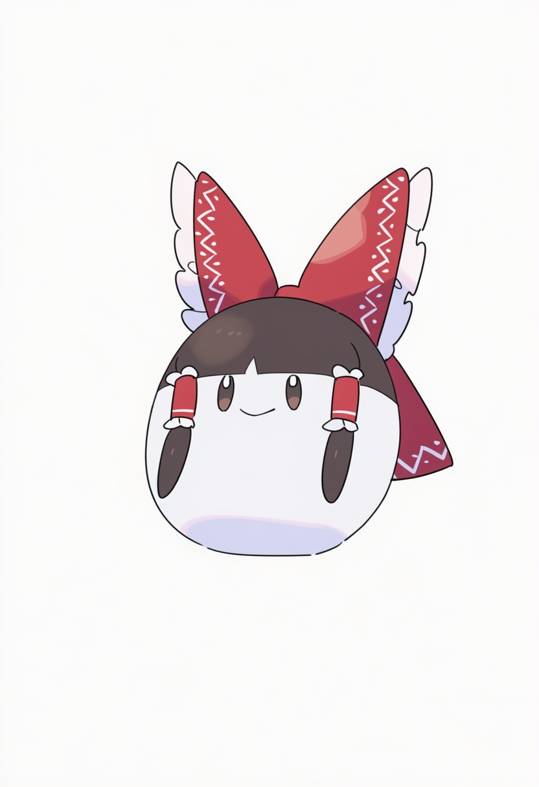

[在线例图](https://assets.quicktagcloud.com/images/raven_composition/raven_composition-4143.jpg?v=84a0613d68e67170)

<a id="raven_composition-4144"></a>

## 食物化

ID：`raven_composition-4144`；分类：二创属性 / 大幅形态变化；来源标记：`safe`。

来源说明：

> 把角色变成有生命的食物。

正向提示词：

```text
foodification
```

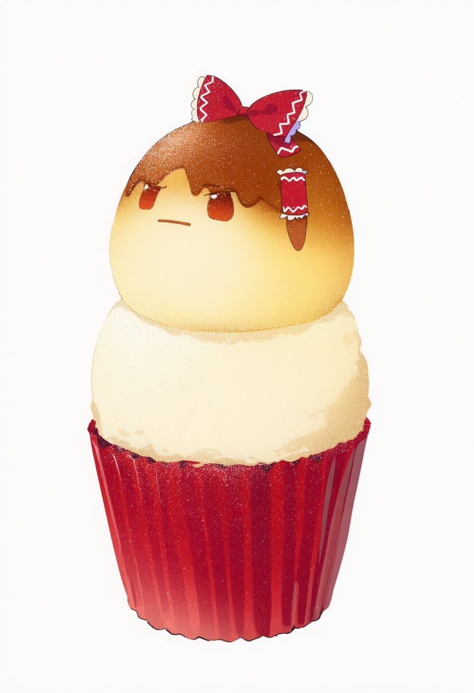

[在线例图](https://assets.quicktagcloud.com/images/raven_composition/raven_composition-4144.jpg?v=46882e01faf91258)

<a id="raven_composition-4145"></a>

## 兽人化

ID：`raven_composition-4145`；分类：二创属性 / 大幅形态变化；来源标记：`safe`。

来源说明：

> 把原本非 furry 的人形角色改成兽人。

正向提示词：

```text
furrification
```

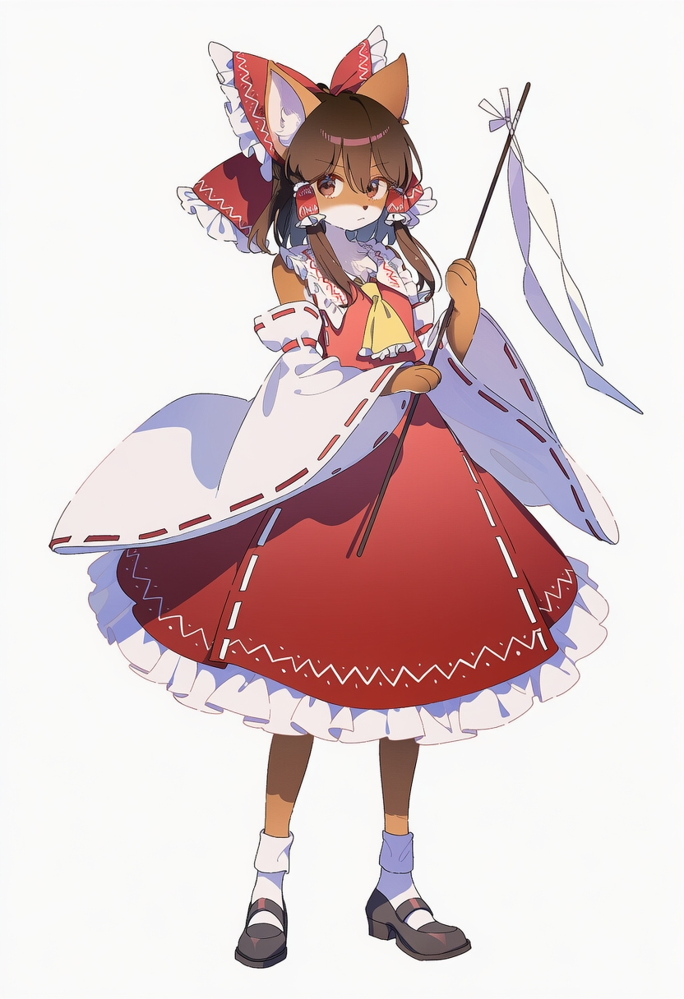

[在线例图](https://assets.quicktagcloud.com/images/raven_composition/raven_composition-4145.jpg?v=556eb168e3b2d4b6)

<a id="raven_composition-4146"></a>

## 人类化

ID：`raven_composition-4146`；分类：二创属性 / 大幅形态变化；来源标记：`safe`。

来源说明：

> 把本来已经是人形但非普通人类的角色改成普通人类。

正向提示词：

```text
humanization
```

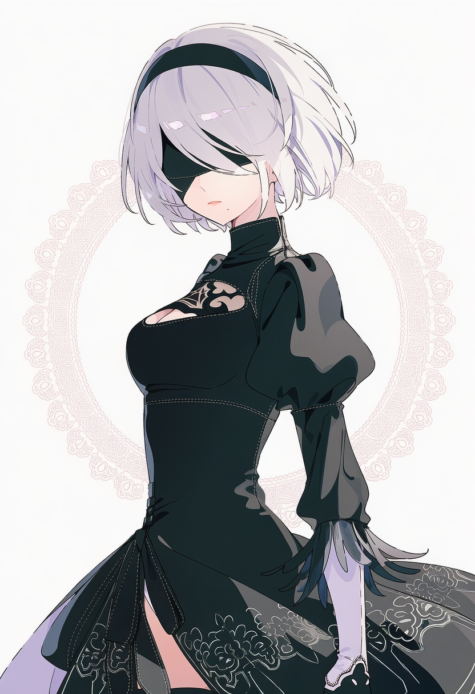

[在线例图](https://assets.quicktagcloud.com/images/raven_composition/raven_composition-4146.jpg?v=8d785558fd918a84)

<a id="raven_composition-4147"></a>

## 兽耳化

ID：`raven_composition-4147`；分类：二创属性 / 大幅形态变化；来源标记：`safe`。

来源说明：

> 给原本没有动物特征的角色加上兽耳或尾巴。

正向提示词：

```text
kemonomimi_mode
```

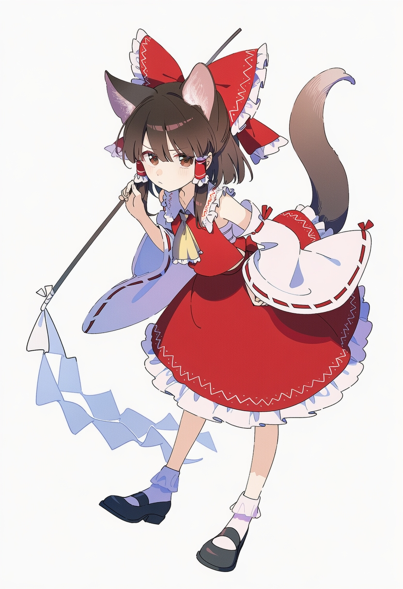

[在线例图](https://assets.quicktagcloud.com/images/raven_composition/raven_composition-4147.jpg?v=d1cbecabd127a8b4)

<a id="raven_composition-4148"></a>

## 机械化

ID：`raven_composition-4148`；分类：二创属性 / 大幅形态变化；来源标记：`safe`。

来源说明：

> 把角色改造成机甲、机器人、赛博格等机械生命。

正向提示词：

```text
mechanization
```

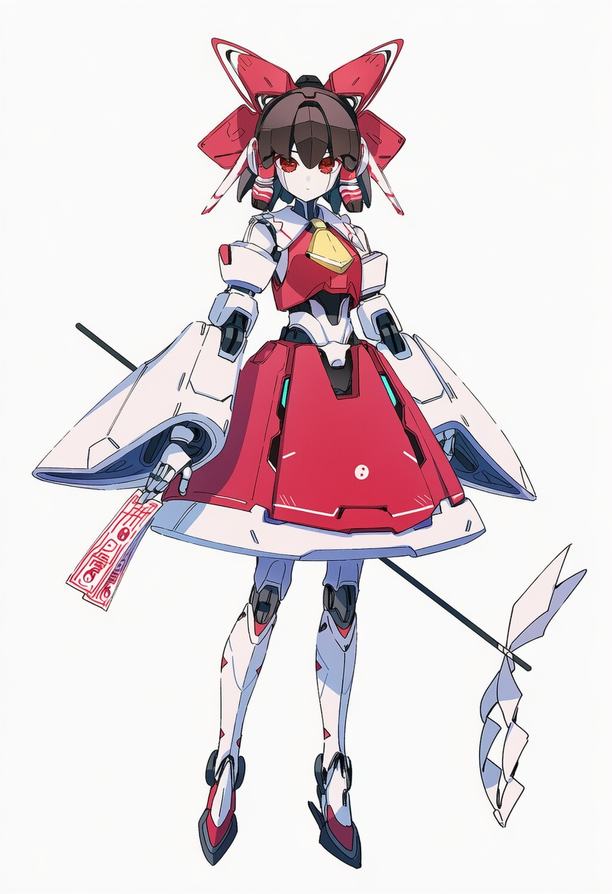

[在线例图](https://assets.quicktagcloud.com/images/raven_composition/raven_composition-4148.jpg?v=3cba74db933ea2d3)

<a id="raven_composition-4149"></a>

## 魔物化

ID：`raven_composition-4149`；分类：二创属性 / 大幅形态变化；来源标记：`safe`。

来源说明：

> 把普通人类角色改成魔物娘、史莱姆、人鱼等怪物形态。

正向提示词：

```text
monsterification
```

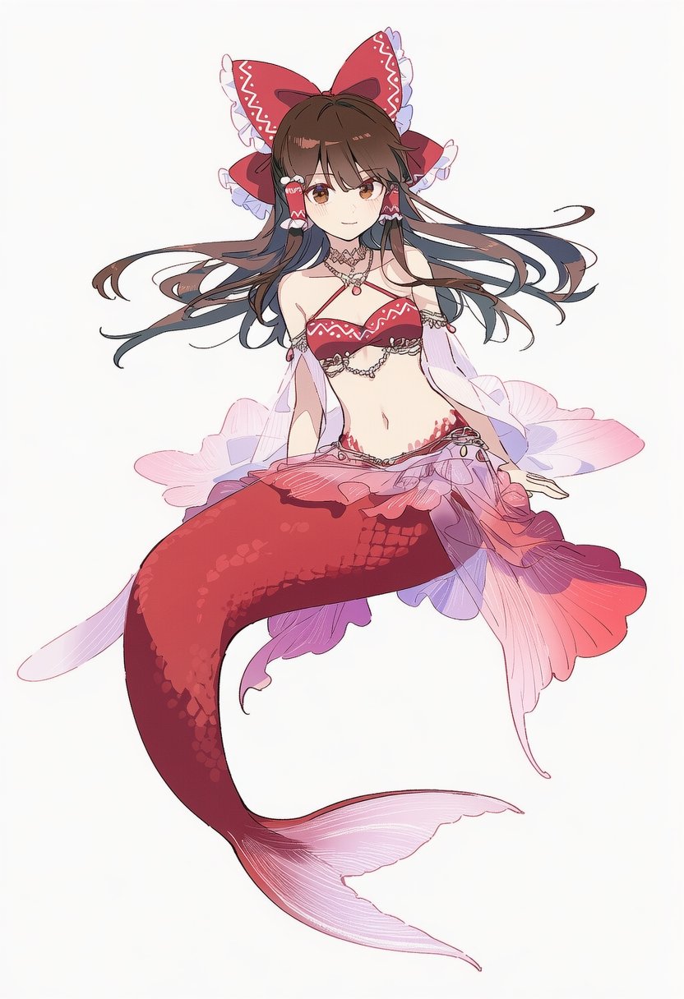

[在线例图](https://assets.quicktagcloud.com/images/raven_composition/raven_composition-4149.jpg?v=fba718dc37d2b5a3)

<a id="raven_composition-4150"></a>

## 物品化

ID：`raven_composition-4150`；分类：二创属性 / 大幅形态变化；来源标记：`safe`。

来源说明：

> 把角色直接变成没有生命的物品。

正向提示词：

```text
objectification
```

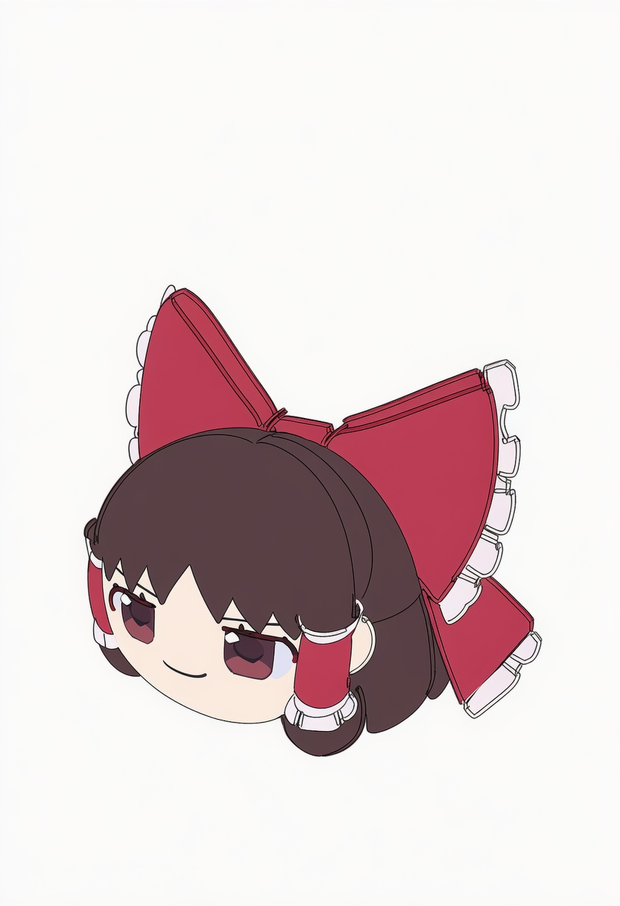

[在线例图](https://assets.quicktagcloud.com/images/raven_composition/raven_composition-4150.jpg?v=8d73785867f066e8)

<a id="raven_composition-4151"></a>

## 拟人化

ID：`raven_composition-4151`；分类：二创属性 / 大幅形态变化；来源标记：`safe`。

来源说明：

> 把非人实体、动物、物品或载具画成人类或类人形。

正向提示词：

```text
personification
```

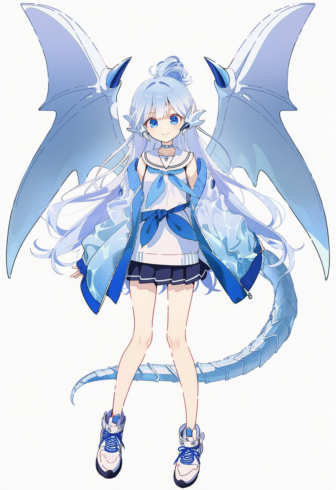

[在线例图](https://assets.quicktagcloud.com/images/raven_composition/raven_composition-4151.jpg?v=5bab76d6b6a7ff37)

<a id="raven_composition-4152"></a>

## 僵尸化

ID：`raven_composition-4152`；分类：二创属性 / 大幅形态变化；来源标记：`safe`。

来源说明：

> 把原本不是僵尸的角色画成僵尸或正在变成僵尸。

正向提示词：

```text
zombification
```

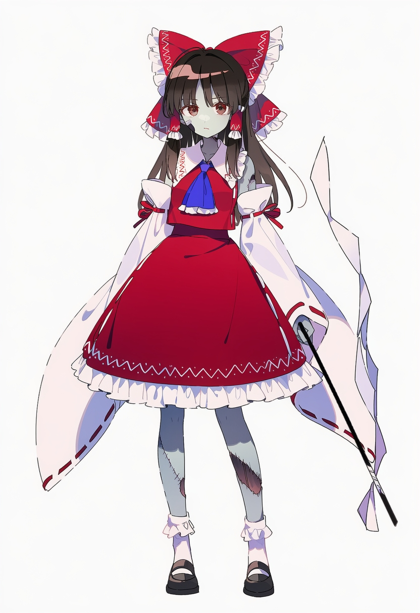

[在线例图](https://assets.quicktagcloud.com/images/raven_composition/raven_composition-4152.jpg?v=a4bac30807e2c851)
