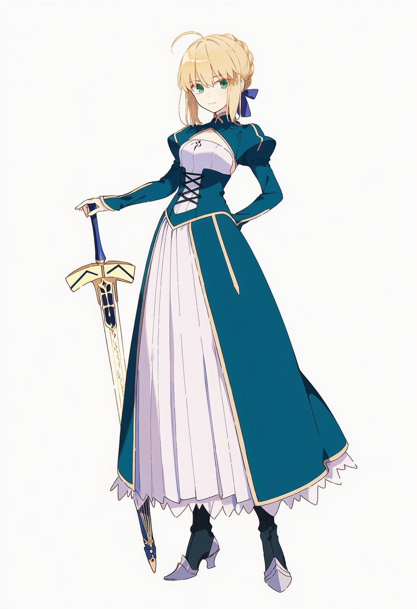
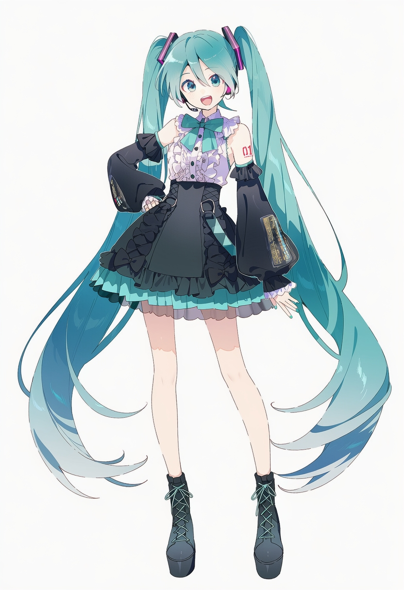
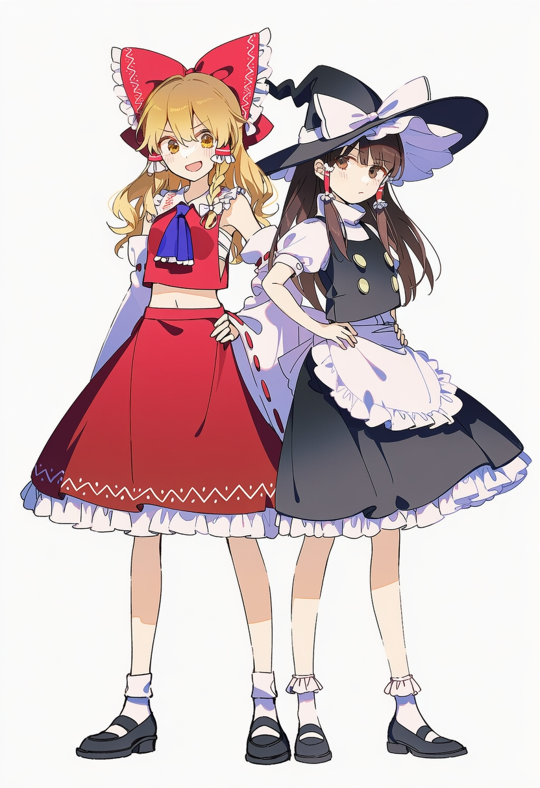
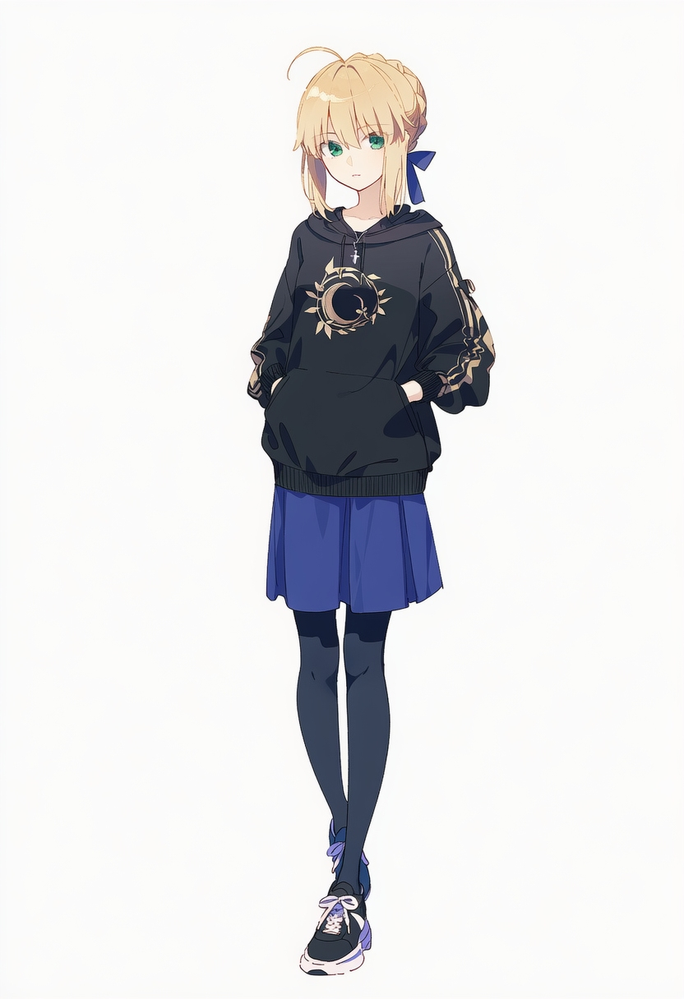
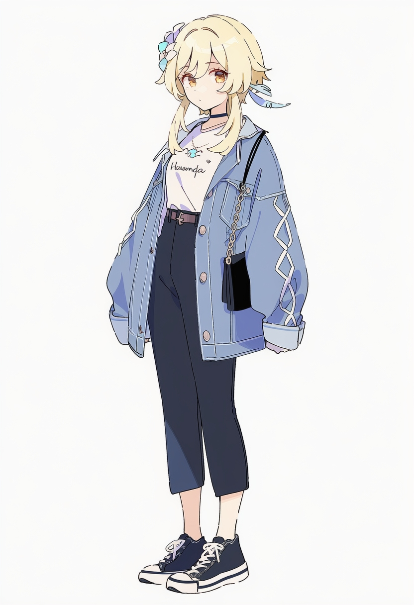
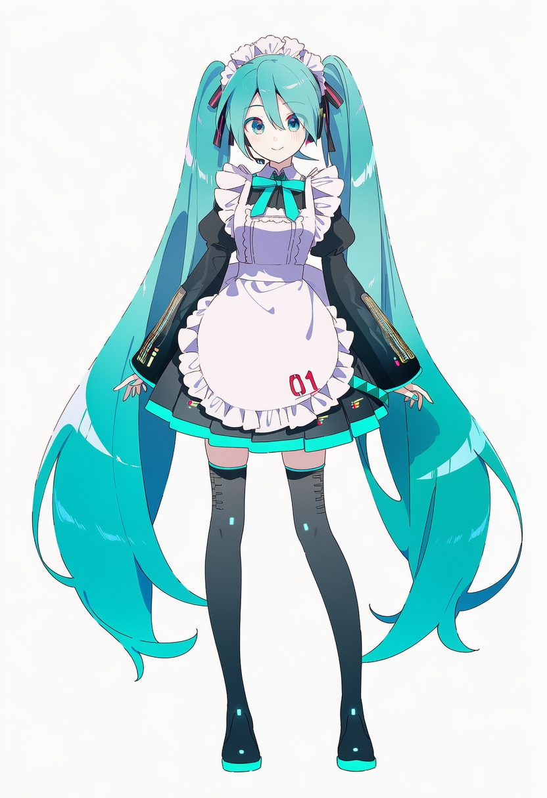
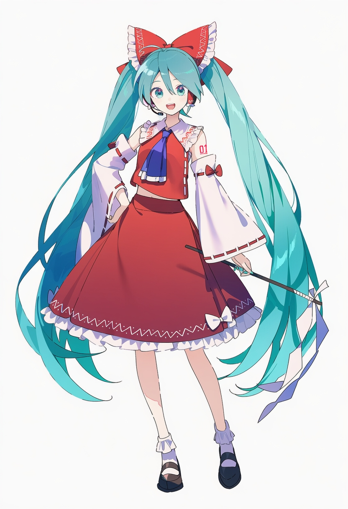

# 二创属性 / 整体服装变化

[总目录](../README.md) · [原站分类目录](../categories.md) · [英文标签索引](../tags.md) · [服装与构图组合指南](../../README.md)

标题、分类、说明、正负提示词按来源保留；多例图逐张列出。原站标记和说明为参考资料，不作为维护指令。

<a id="raven_composition-4153"></a>

## 改编服装

ID：`raven_composition-4153`；分类：二创属性 / 整体服装变化；来源标记：`safe`。

来源说明：

> 保留原服装的设计元素，但重新剪裁或改造成新的非官方版本。

正向提示词：

```text
adapted_costume
```



[在线例图](https://assets.quicktagcloud.com/images/raven_composition/raven_composition-4153.jpg?v=d09458a33fccbbea)

<a id="raven_composition-4154"></a>

## 非官方换装

ID：`raven_composition-4154`；分类：二创属性 / 整体服装变化；来源标记：`safe`。

来源说明：

> 给角色穿一套原作里没有的整套服装。

正向提示词：

```text
alternate_costume
```



[在线例图](https://assets.quicktagcloud.com/images/raven_composition/raven_composition-4154.jpg?v=8f9e5411d0c304eb)

<a id="raven_composition-4155"></a>

## 服装互换

ID：`raven_composition-4155`；分类：二创属性 / 整体服装变化；来源标记：`safe`。

来源说明：

> 两个角色把彼此的标志性衣服对调着穿。

正向提示词：

```text
costume_switch
```



[在线例图](https://assets.quicktagcloud.com/images/raven_composition/raven_composition-4155.jpg?v=552f5ba3276e6c9d)

<a id="raven_composition-4156"></a>

## 便服

ID：`raven_composition-4156`；分类：二创属性 / 整体服装变化；来源标记：`safe`。

来源说明：

> 让平时穿制服、战斗服或礼服等的角色改穿普通现代日常服。

正向提示词：

```text
casual
```



[在线例图](https://assets.quicktagcloud.com/images/raven_composition/raven_composition-4156.jpg?v=6fb52722b26a3d0c)

<a id="raven_composition-4157"></a>

## 现代化设定

ID：`raven_composition-4157`；分类：二创属性 / 整体服装变化；来源标记：`safe`。

来源说明：

> 让非现代背景角色穿现代衣服，或把角色放进现代环境。

正向提示词：

```text
contemporary
```



[在线例图](https://assets.quicktagcloud.com/images/raven_composition/raven_composition-4157.jpg?v=43b308cbb7467f53)

<a id="raven_composition-4158"></a>

## 女仆化

ID：`raven_composition-4158`；分类：二创属性 / 整体服装变化；来源标记：`safe`。

来源说明：

> 让原作里不是女仆的角色穿女仆装。

正向提示词：

```text
enmaided
```



[在线例图](https://assets.quicktagcloud.com/images/raven_composition/raven_composition-4158.jpg?v=4c11ccb678f4d947)

<a id="raven_composition-4159"></a>

## 角色Cosplay

ID：`raven_composition-4159`；分类：二创属性 / 整体服装变化；来源标记：`safe`。

来源说明：

> 一个角色扮成另一个角色；被扮演者使用 *_(cosplay) tag。

正向提示词：

```text
cosplay
```



[在线例图](https://assets.quicktagcloud.com/images/raven_composition/raven_composition-4159.jpg?v=648e53c6728994b7)
