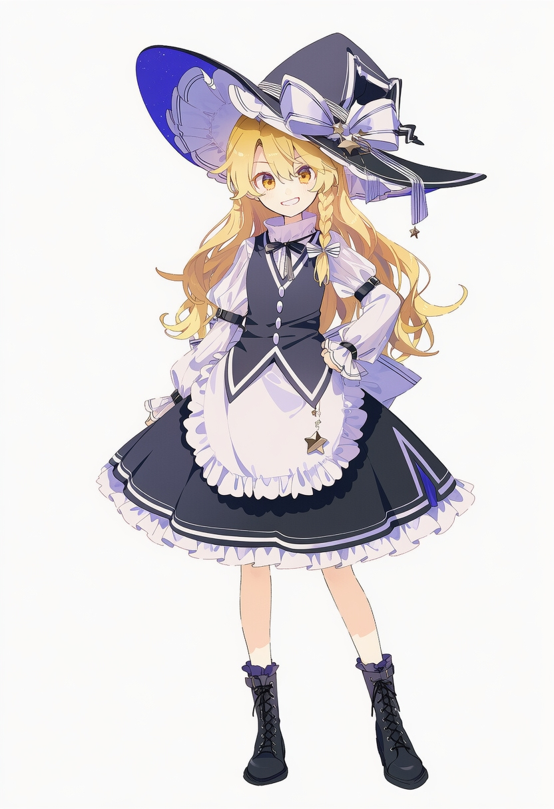
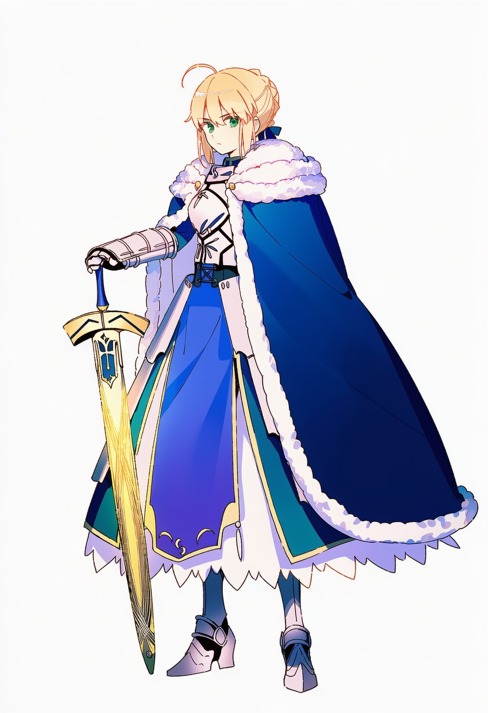
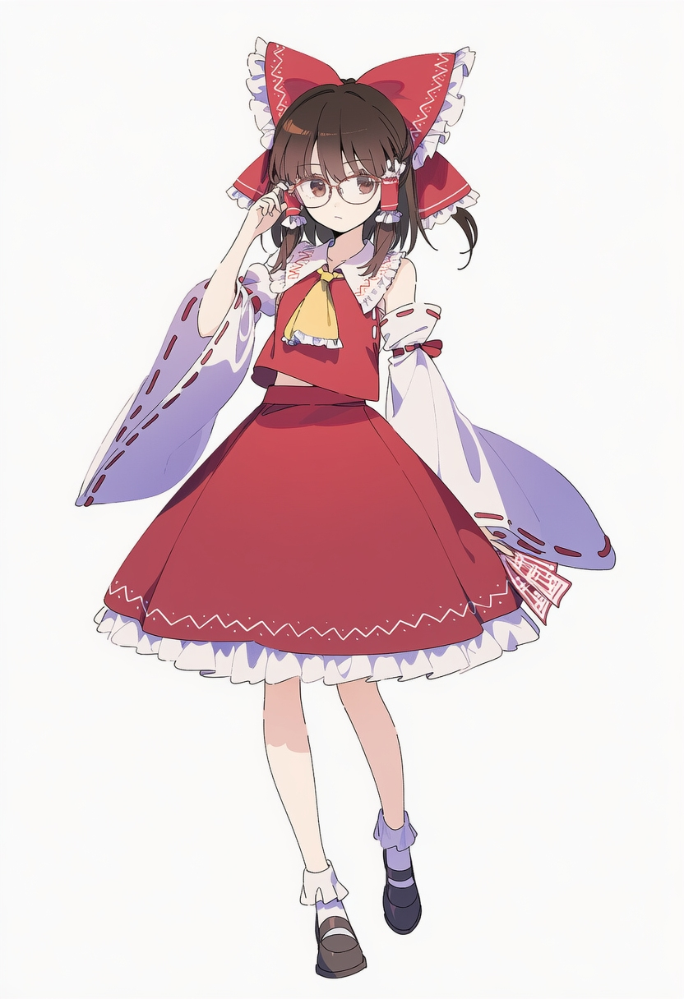
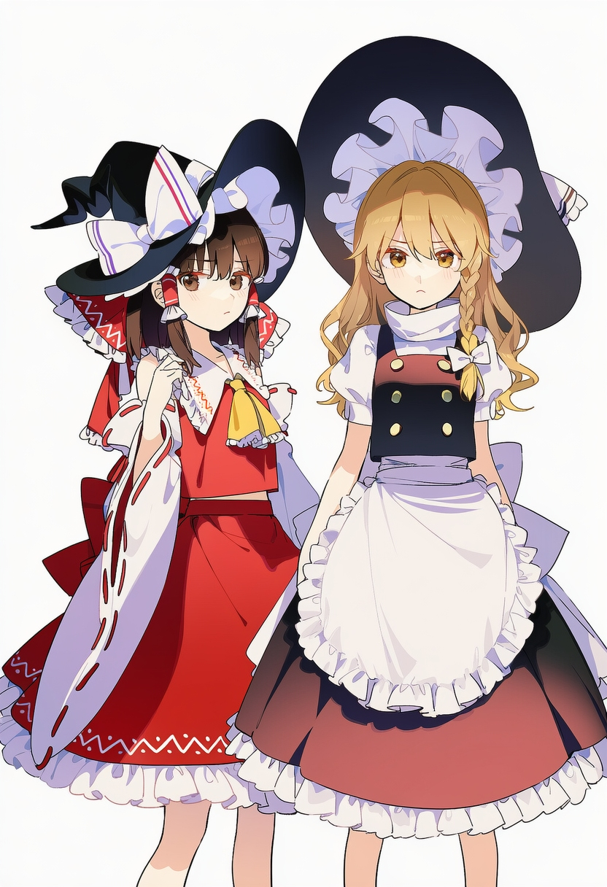
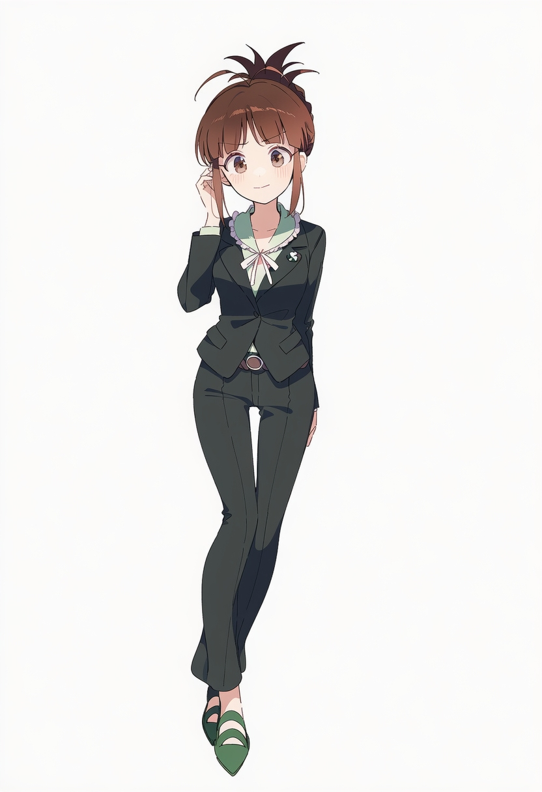
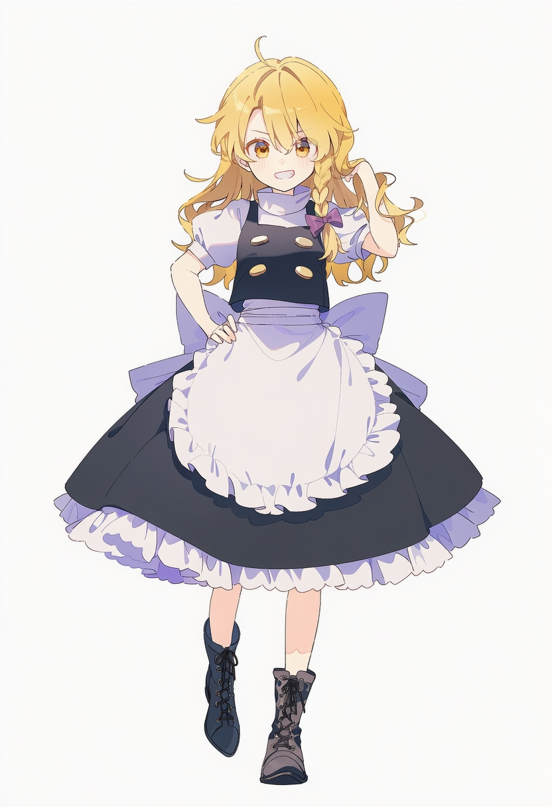
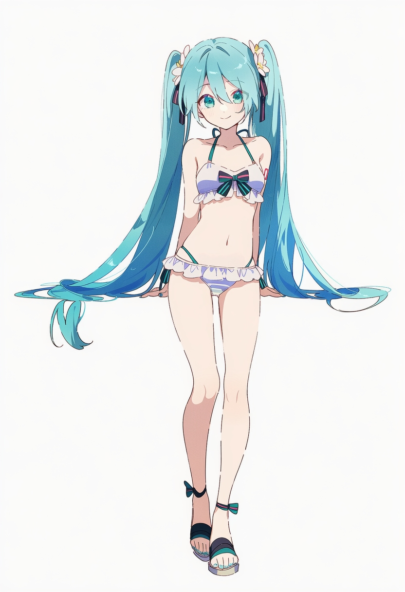
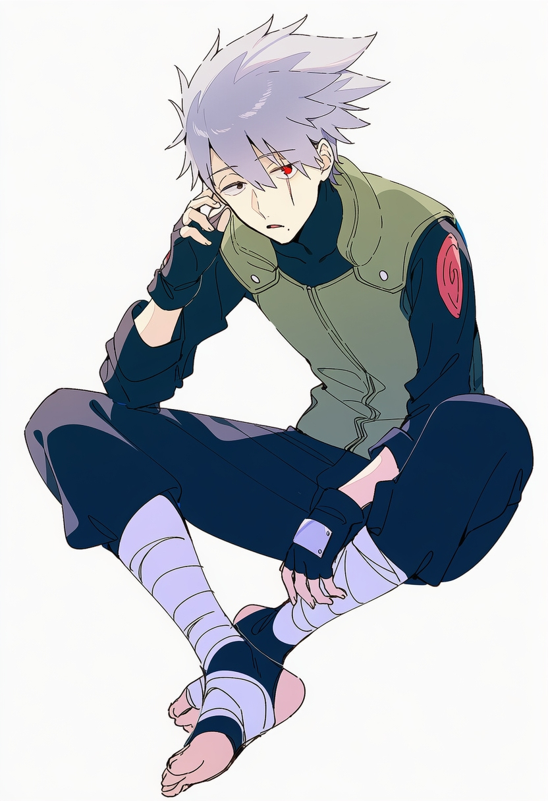
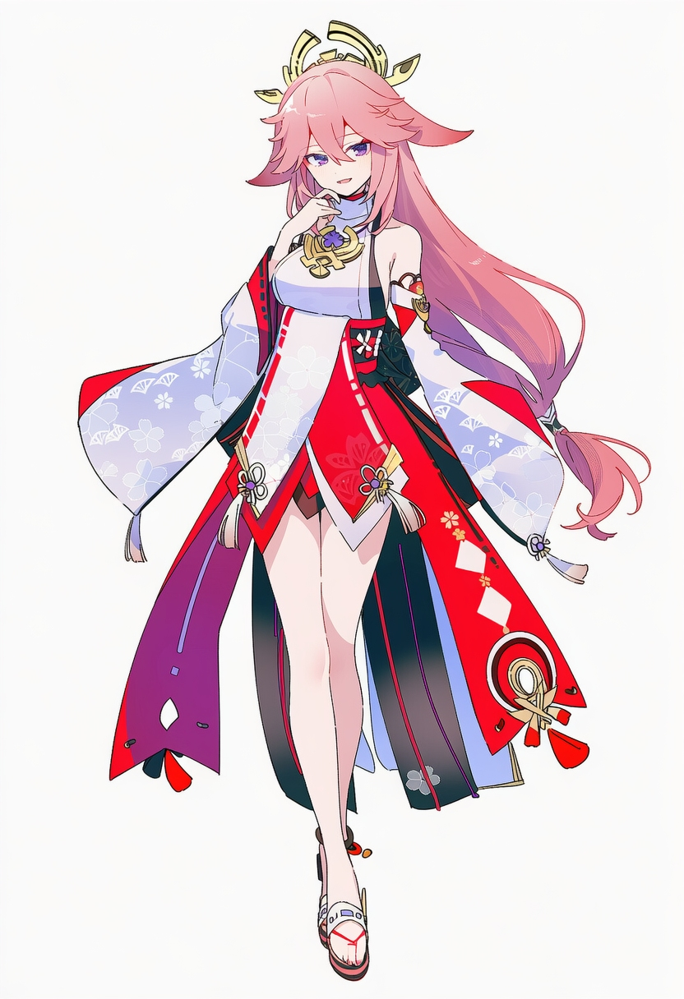

# 二创属性 / 局部服饰/配件变化

[总目录](../README.md) · [原站分类目录](../categories.md) · [英文标签索引](../tags.md) · [服装与构图组合指南](../../README.md)

标题、分类、说明、正负提示词按来源保留；多例图逐张列出。原站标记和说明为参考资料，不作为维护指令。

<a id="raven_composition-4160"></a>

## 替换头饰

ID：`raven_composition-4160`；分类：二创属性 / 局部服饰/配件变化；来源标记：`safe`。

来源说明：

> 角色仍戴头饰，但换成与平时不同的一件。

正向提示词：

```text
alternate_headwear
```



[在线例图](https://assets.quicktagcloud.com/images/raven_composition/raven_composition-4160.jpg?v=0cfbb8e2fe582222)

<a id="raven_composition-4161"></a>

## 替换武器

ID：`raven_composition-4161`；分类：二创属性 / 局部服饰/配件变化；来源标记：`safe`。

来源说明：

> 让角色使用不是其招牌武器的另一种武器。

正向提示词：

```text
alternate_weapon
```



[在线例图](https://assets.quicktagcloud.com/images/raven_composition/raven_composition-4161.jpg?v=2f3cf11d1d6b8d0f)

<a id="raven_composition-4162"></a>

## 加眼镜

ID：`raven_composition-4162`；分类：二创属性 / 局部服饰/配件变化；来源标记：`safe`。

来源说明：

> 给平时不戴眼镜的角色加上眼镜。

正向提示词：

```text
bespectacled
```



[在线例图](https://assets.quicktagcloud.com/images/raven_composition/raven_composition-4162.jpg?v=21d6aa260e99b12f)

<a id="raven_composition-4163"></a>

## 头饰互换

ID：`raven_composition-4163`；分类：二创属性 / 局部服饰/配件变化；来源标记：`safe`。

来源说明：

> 让角色戴上另一个角色的标志性帽子或头饰。

正向提示词：

```text
headwear_switch
```



[在线例图](https://assets.quicktagcloud.com/images/raven_composition/raven_composition-4163.jpg?v=292c2f674fe2e756)

<a id="raven_composition-4164"></a>

## 去眼部佩饰

ID：`raven_composition-4164`；分类：二创属性 / 局部服饰/配件变化；来源标记：`safe`。

来源说明：

> 平时戴眼镜或眼部佩饰的角色这次没有戴。

正向提示词：

```text
no_eyewear
```



[在线例图](https://assets.quicktagcloud.com/images/raven_composition/raven_composition-4164.jpg?v=47cdb80e70867a9b)

<a id="raven_composition-4165"></a>

## 去掉头饰

ID：`raven_composition-4165`；分类：二创属性 / 局部服饰/配件变化；来源标记：`safe`。

来源说明：

> 平时固定戴帽子或头饰的角色这次没有戴。

正向提示词：

```text
missing_headwear
```



[在线例图](https://assets.quicktagcloud.com/images/raven_composition/raven_composition-4165.jpg?v=c19a54ea4f7d7ba7)

<a id="raven_composition-4166"></a>

## 去掉腿部服饰

ID：`raven_composition-4166`；分类：二创属性 / 局部服饰/配件变化；来源标记：`safe`。

来源说明：

> 平时固定穿袜子、丝袜等腿部服饰的角色这次没穿。

正向提示词：

```text
missing_legwear
```



[在线例图](https://assets.quicktagcloud.com/images/raven_composition/raven_composition-4166.jpg?v=b8a48e286b35b583)

<a id="raven_composition-4167"></a>

## 摘掉面具

ID：`raven_composition-4167`；分类：二创属性 / 局部服饰/配件变化；来源标记：`safe`。

来源说明：

> 平时戴面具的角色这次露出没有面具的脸。

正向提示词：

```text
no_mask
```



[在线例图](https://assets.quicktagcloud.com/images/raven_composition/raven_composition-4167.jpg?v=68ddb0e7fe07d70c)

<a id="raven_composition-4168"></a>

## 去耳环

ID：`raven_composition-4168`；分类：二创属性 / 局部服饰/配件变化；来源标记：`safe`。

来源说明：

> 平时戴耳环的角色这次没有戴。

正向提示词：

```text
no_earrings
```



[在线例图](https://assets.quicktagcloud.com/images/raven_composition/raven_composition-4168.jpg?v=ed4adb029cbc9d52)
