# 二创属性 / 身体特征变化

[总目录](../README.md) · [原站分类目录](../categories.md) · [英文标签索引](../tags.md) · [服装与构图组合指南](../../README.md)

标题、分类、说明、正负提示词按来源保留；多例图逐张列出。原站标记和说明为参考资料，不作为维护指令。

<a id="raven_composition-4169"></a>

## 胸部尺寸变化（旧泛称）

ID：`raven_composition-4169`；分类：二创属性 / 身体特征变化；来源标记：`safe`。

来源说明：

> 旧的泛称：胸部大小和原设不同；现在更适合用 larger 或 smaller 的具体标签。

正向提示词：

```text
alternate_breast_size
```

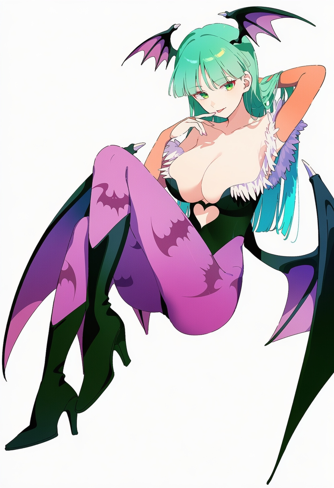

[在线例图](https://assets.quicktagcloud.com/images/raven_composition/raven_composition-4169.jpg?v=d03a52fb002902d7)

<a id="raven_composition-4170"></a>

## 胸部变大

ID：`raven_composition-4170`；分类：二创属性 / 身体特征变化；来源标记：`safe`。

来源说明：

> 把角色胸部画得明显比原设更大。

正向提示词：

```text
alternate_breast_size_(larger)
```

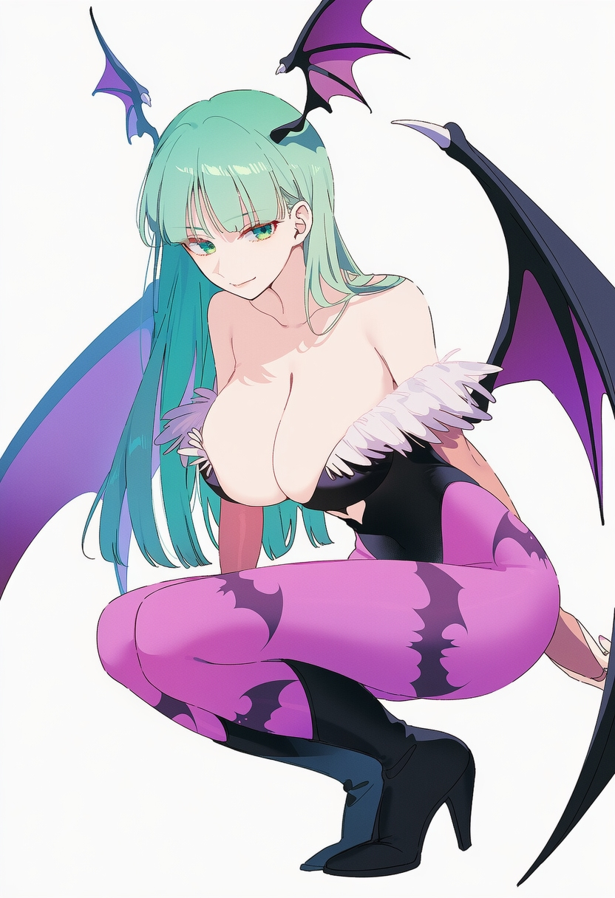

[在线例图](https://assets.quicktagcloud.com/images/raven_composition/raven_composition-4170.jpg?v=711de89f015bf992)

<a id="raven_composition-4171"></a>

## 胸部变小

ID：`raven_composition-4171`；分类：二创属性 / 身体特征变化；来源标记：`safe`。

来源说明：

> 把角色胸部画得明显比原设更小。

正向提示词：

```text
alternate_breast_size_(smaller)
```

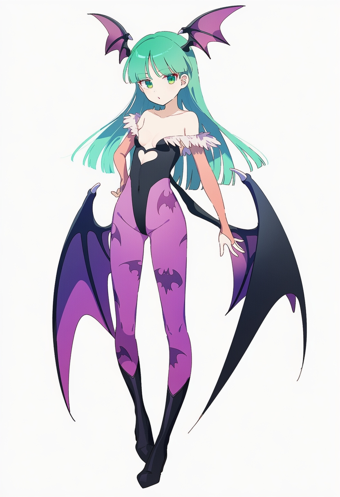

[在线例图](https://assets.quicktagcloud.com/images/raven_composition/raven_composition-4171.jpg?v=eb6a74f0a8b23f69)

<a id="raven_composition-4172"></a>

## 臀部变大

ID：`raven_composition-4172`；分类：二创属性 / 身体特征变化；来源标记：`safe`。

来源说明：

> 把角色臀部画得明显比原设更大。

正向提示词：

```text
alternate_ass_size_(larger)
```

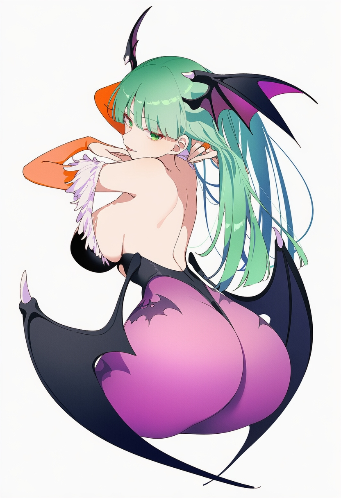

[在线例图](https://assets.quicktagcloud.com/images/raven_composition/raven_composition-4172.jpg?v=2dba4d88ebf2bef3)

<a id="raven_composition-4173"></a>

## 体型变化（泛称）

ID：`raven_composition-4173`；分类：二创属性 / 身体特征变化；来源标记：`safe`。

来源说明：

> 泛指体型和原设不一样；Danbooru 本身把它视为较模糊的标签。

正向提示词：

```text
alternate_body_size
```

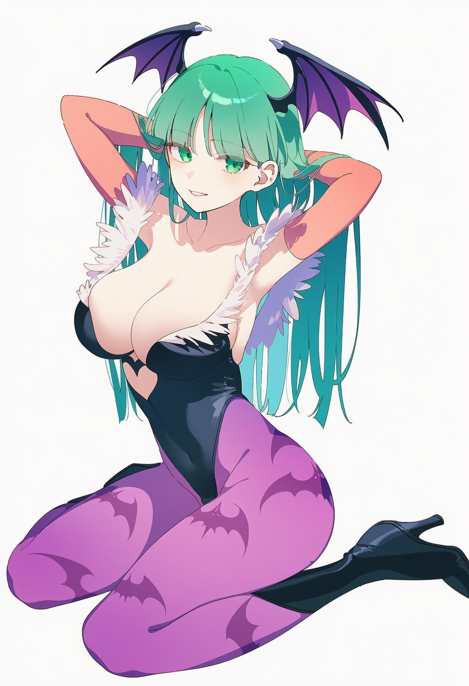

[在线例图](https://assets.quicktagcloud.com/images/raven_composition/raven_composition-4173.jpg?v=554e255045c60790)

<a id="raven_composition-4174"></a>

## 翅膀变化

ID：`raven_composition-4174`；分类：二创属性 / 身体特征变化；来源标记：`safe`。

来源说明：

> 角色本来有翅膀，但这次翅膀的样式或形态和平时不同。

正向提示词：

```text
alternate_wings
```

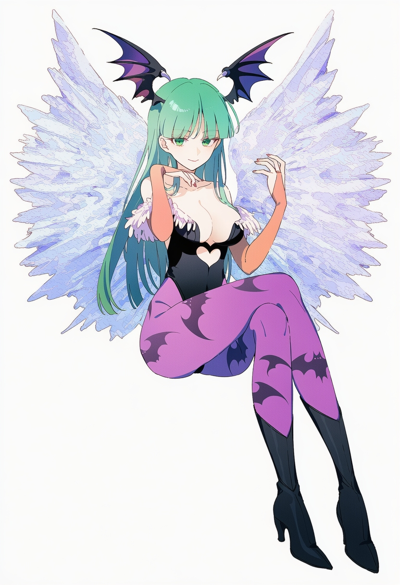

[在线例图](https://assets.quicktagcloud.com/images/raven_composition/raven_composition-4174.jpg?v=2c48c639922d2df3)

<a id="raven_composition-4175"></a>

## 肤色变化

ID：`raven_composition-4175`；分类：二创属性 / 身体特征变化；来源标记：`safe`。

来源说明：

> 把角色皮肤颜色改成与原设不同的颜色。

正向提示词：

```text
alternate_skin_color
```

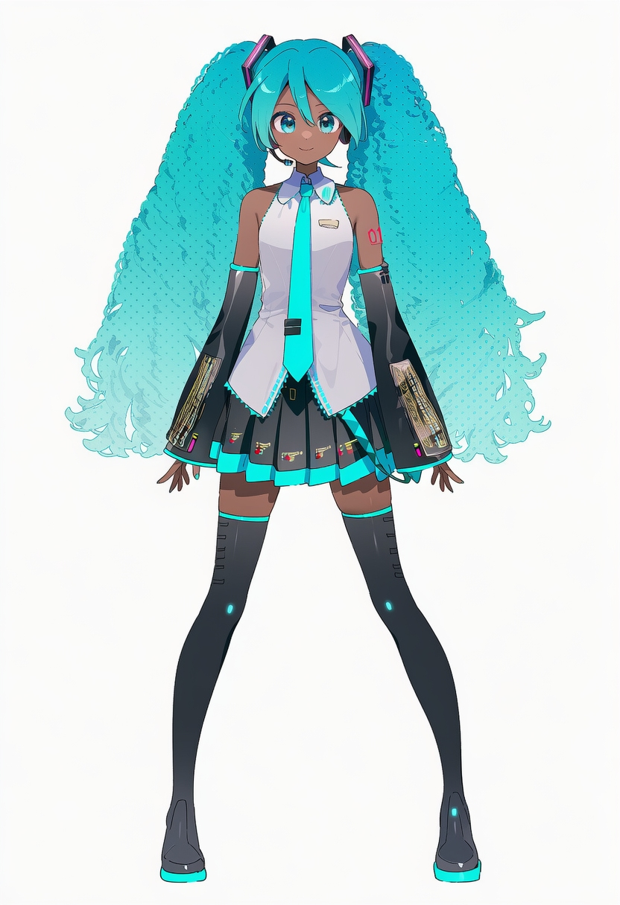

[在线例图](https://assets.quicktagcloud.com/images/raven_composition/raven_composition-4175.jpg?v=90e3d4da70cd2705)

<a id="raven_composition-4176"></a>

## 比原设更胖

ID：`raven_composition-4176`；分类：二创属性 / 身体特征变化；来源标记：`safe`。

来源说明：

> 把角色画得比原设更胖。

正向提示词：

```text
fatter_than_canon
```

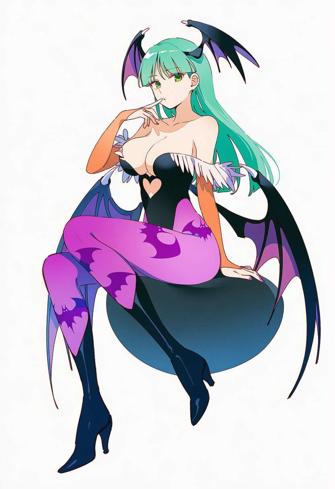

[在线例图](https://assets.quicktagcloud.com/images/raven_composition/raven_composition-4176.jpg?v=642e293581f6d4fb)

<a id="raven_composition-4177"></a>

## 比原设更壮

ID：`raven_composition-4177`；分类：二创属性 / 身体特征变化；来源标记：`safe`。

来源说明：

> 把角色画得比原设更有肌肉。

正向提示词：

```text
more_muscular_than_canon
```

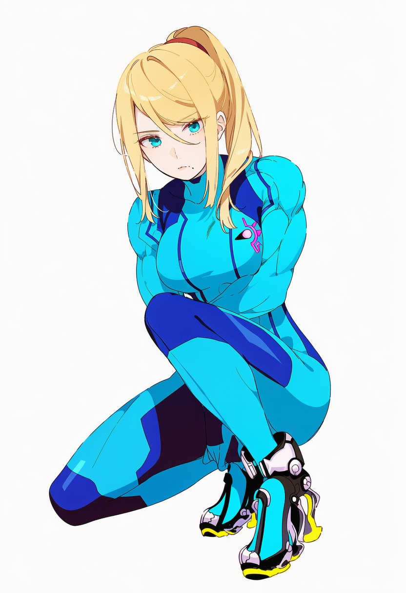

[在线例图](https://assets.quicktagcloud.com/images/raven_composition/raven_composition-4177.jpg?v=39a42670c8fb22a1)

<a id="raven_composition-4178"></a>

## 去兽耳

ID：`raven_composition-4178`；分类：二创属性 / 身体特征变化；来源标记：`safe`。

来源说明：

> 平时有兽耳的角色这次没有兽耳。

正向提示词：

```text
no_animal_ears
```

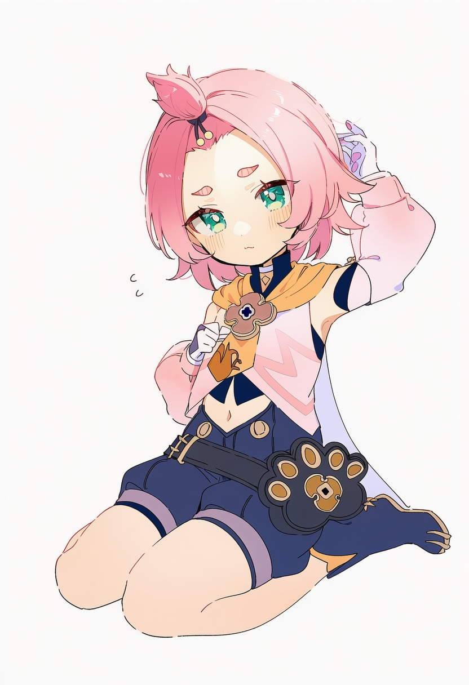

[在线例图](https://assets.quicktagcloud.com/images/raven_composition/raven_composition-4178.jpg?v=e87e58cc5c6db4be)

<a id="raven_composition-4179"></a>

## 去角

ID：`raven_composition-4179`；分类：二创属性 / 身体特征变化；来源标记：`safe`。

来源说明：

> 平时有角的角色这次没有角。

正向提示词：

```text
no_horns
```

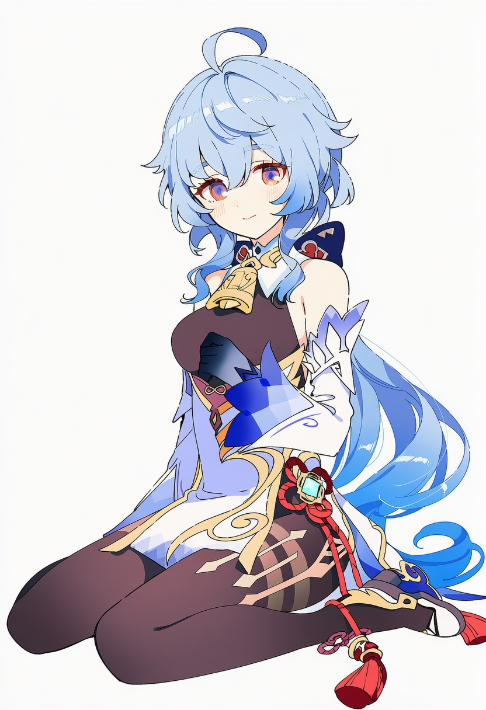

[在线例图](https://assets.quicktagcloud.com/images/raven_composition/raven_composition-4179.jpg?v=4916fbae6e6751d6)

<a id="raven_composition-4180"></a>

## 去尾巴

ID：`raven_composition-4180`；分类：二创属性 / 身体特征变化；来源标记：`safe`。

来源说明：

> 平时有尾巴的角色这次没有尾巴。

正向提示词：

```text
missing_tail
```

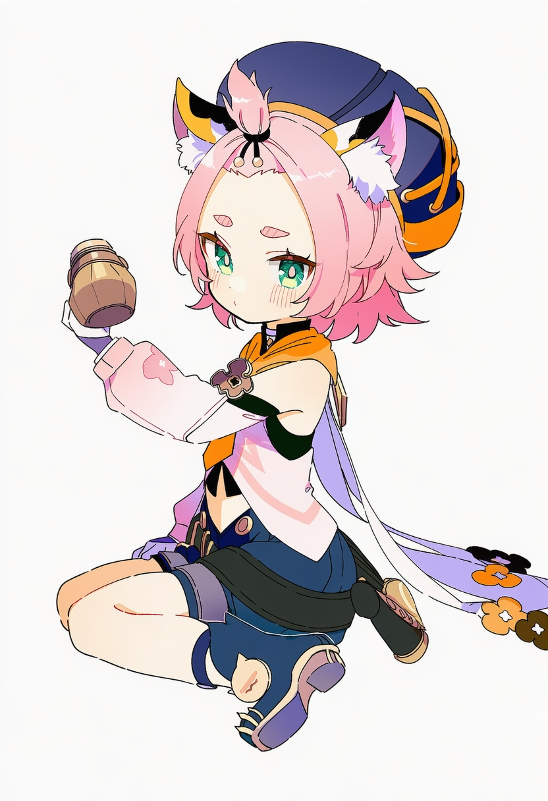

[在线例图](https://assets.quicktagcloud.com/images/raven_composition/raven_composition-4180.jpg?v=6d4260609f7d7be6)

<a id="raven_composition-4181"></a>

## 去翅膀

ID：`raven_composition-4181`；分类：二创属性 / 身体特征变化；来源标记：`safe`。

来源说明：

> 平时有翅膀的角色这次没有翅膀。

正向提示词：

```text
missing_wings
```

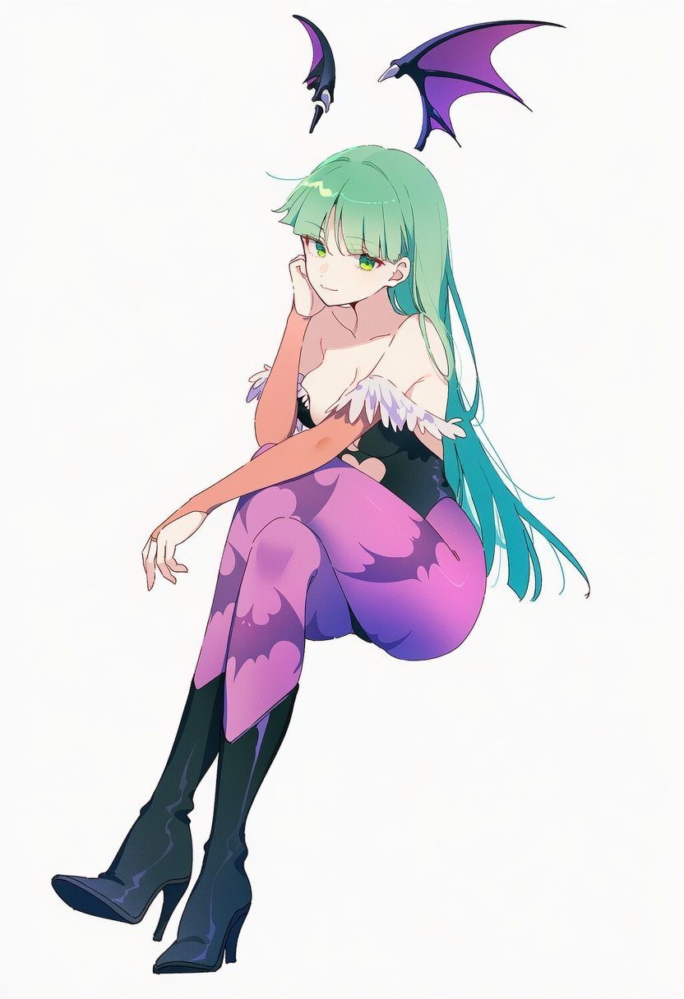

[在线例图](https://assets.quicktagcloud.com/images/raven_composition/raven_composition-4181.jpg?v=4664baec8d185c36)

<a id="raven_composition-4182"></a>

## 比原设更高

ID：`raven_composition-4182`；分类：二创属性 / 身体特征变化；来源标记：`safe`。

来源说明：

> 把角色画得比原设更高。

正向提示词：

```text
taller_than_canon
```

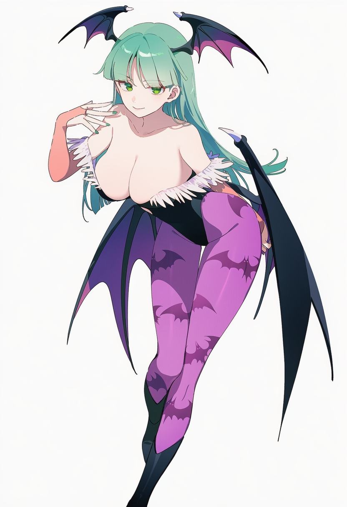

[在线例图](https://assets.quicktagcloud.com/images/raven_composition/raven_composition-4182.jpg?v=c8a90c647d2da412)
