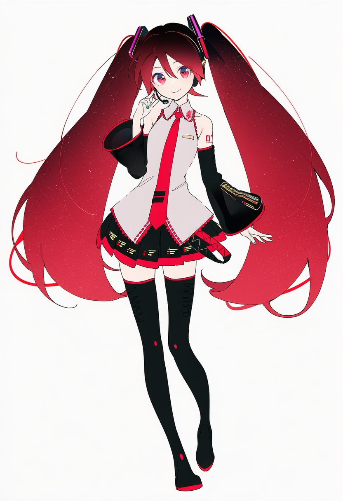
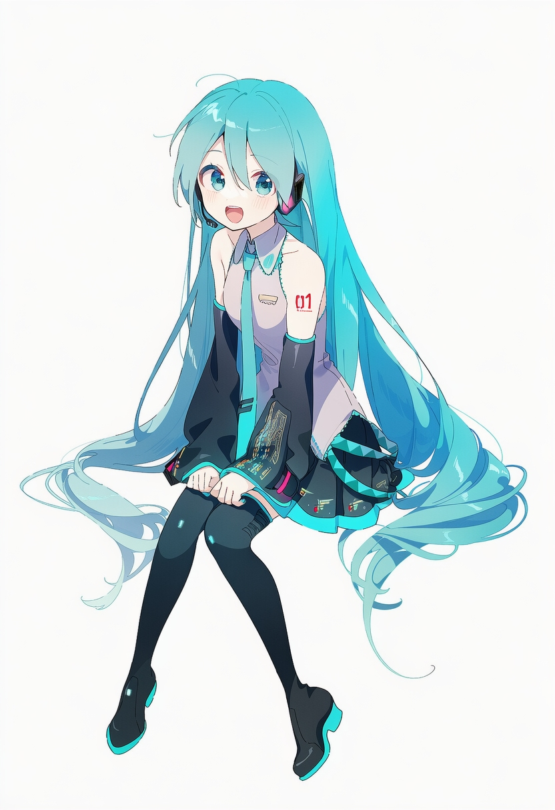
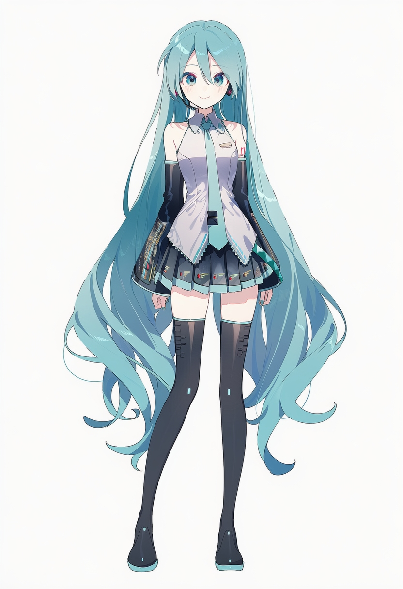
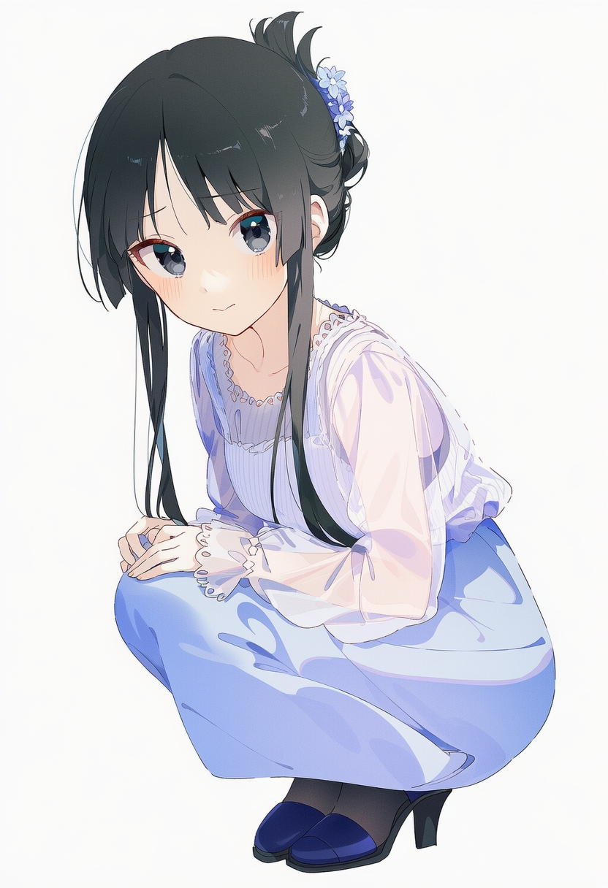
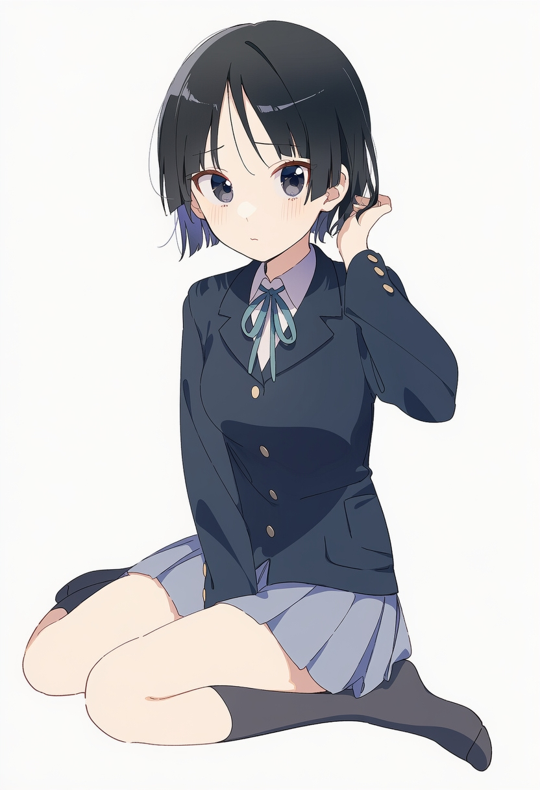
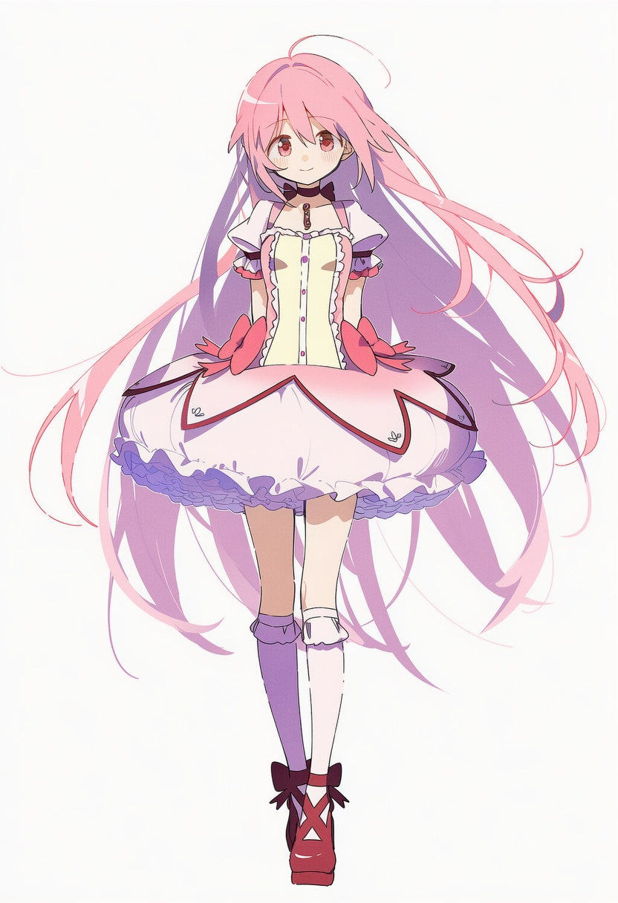

# 二创属性 / 头发变化

[总目录](../README.md) · [原站分类目录](../categories.md) · [英文标签索引](../tags.md) · [服装与构图组合指南](../../README.md)

标题、分类、说明、正负提示词按来源保留；多例图逐张列出。原站标记和说明为参考资料，不作为维护指令。

<a id="raven_composition-4183"></a>

## 发色变化

ID：`raven_composition-4183`；分类：二创属性 / 头发变化；来源标记：`safe`。

来源说明：

> 把角色头发改成与原设不同的颜色。

正向提示词：

```text
alternate_hair_color
```



[在线例图](https://assets.quicktagcloud.com/images/raven_composition/raven_composition-4183.jpg?v=241fca25e16f30af)

<a id="raven_composition-4184"></a>

## 发型变化

ID：`raven_composition-4184`；分类：二创属性 / 头发变化；来源标记：`safe`。

来源说明：

> 把角色换成与平时不同的发型。

正向提示词：

```text
alternate_hairstyle
```



[在线例图](https://assets.quicktagcloud.com/images/raven_composition/raven_composition-4184.jpg?v=861938d9a01b9e8f)

<a id="raven_composition-4185"></a>

## 散发

ID：`raven_composition-4185`；分类：二创属性 / 头发变化；来源标记：`safe`。

来源说明：

> 平时扎着头发的角色把头发放下来。

正向提示词：

```text
hair_down
```



[在线例图](https://assets.quicktagcloud.com/images/raven_composition/raven_composition-4185.jpg?v=7330cb55070868f5)

<a id="raven_composition-4186"></a>

## 扎发/盘发

ID：`raven_composition-4186`；分类：二创属性 / 头发变化；来源标记：`safe`。

来源说明：

> 平时披着头发的角色把头发扎起来或盘起来。

正向提示词：

```text
hair_up
```



[在线例图](https://assets.quicktagcloud.com/images/raven_composition/raven_composition-4186.jpg?v=f045618f6cacf92e)

<a id="raven_composition-4187"></a>

## 头发变短

ID：`raven_composition-4187`；分类：二创属性 / 头发变化；来源标记：`safe`。

来源说明：

> 把角色头发画得比原设更短。

正向提示词：

```text
alternate_hair_length_(shorter)
```



[在线例图](https://assets.quicktagcloud.com/images/raven_composition/raven_composition-4187.jpg?v=faba11df7423f472)

<a id="raven_composition-4188"></a>

## 头发变长

ID：`raven_composition-4188`；分类：二创属性 / 头发变化；来源标记：`safe`。

来源说明：

> 把角色头发画得比原设更长。

正向提示词：

```text
alternate_hair_length_(longer)
```



[在线例图](https://assets.quicktagcloud.com/images/raven_composition/raven_composition-4188.jpg?v=3c33f09329e14aa1)
