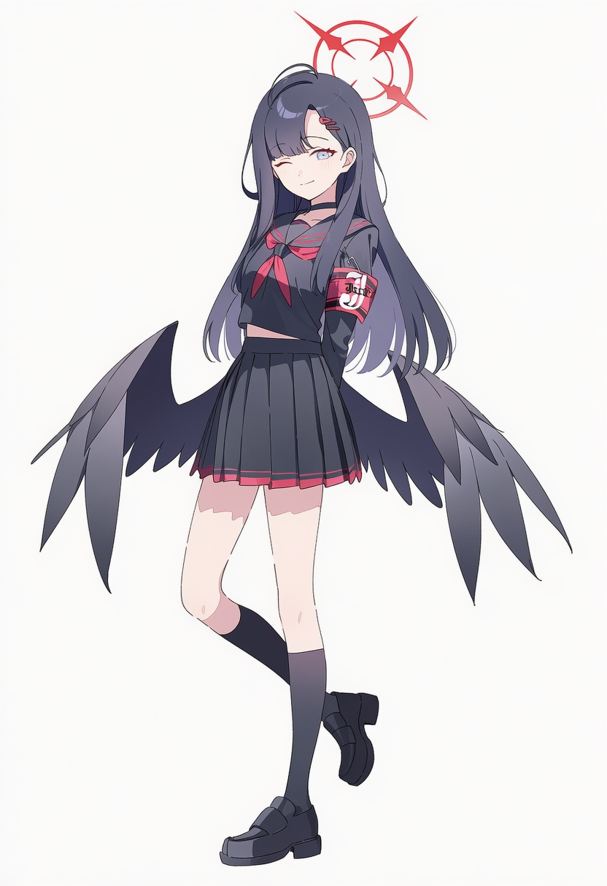

# 二创属性 / 眼睛变化

[总目录](../README.md) · [原站分类目录](../categories.md) · [英文标签索引](../tags.md) · [服装与构图组合指南](../../README.md)

标题、分类、说明、正负提示词按来源保留；多例图逐张列出。原站标记和说明为参考资料，不作为维护指令。

<a id="raven_composition-4189"></a>

## 瞳色变化

ID：`raven_composition-4189`；分类：二创属性 / 眼睛变化；来源标记：`safe`。

来源说明：

> 把角色眼睛颜色改成原作里没有的颜色。

正向提示词：

```text
alternate_eye_color
```


[在线例图](https://assets.quicktagcloud.com/images/raven_composition/raven_composition-4189.jpg?v=47e1f18edd685a7c)

<a id="raven_composition-4190"></a>

## 反常睁眼

ID：`raven_composition-4190`；分类：二创属性 / 眼睛变化；来源标记：`safe`。

来源说明：

> 平时总是闭着某只或全部眼睛的角色这次睁开了。

正向提示词：

```text
unusually_open_eyes
```



[在线例图](https://assets.quicktagcloud.com/images/raven_composition/raven_composition-4190.jpg?v=e93b179089f50414)
