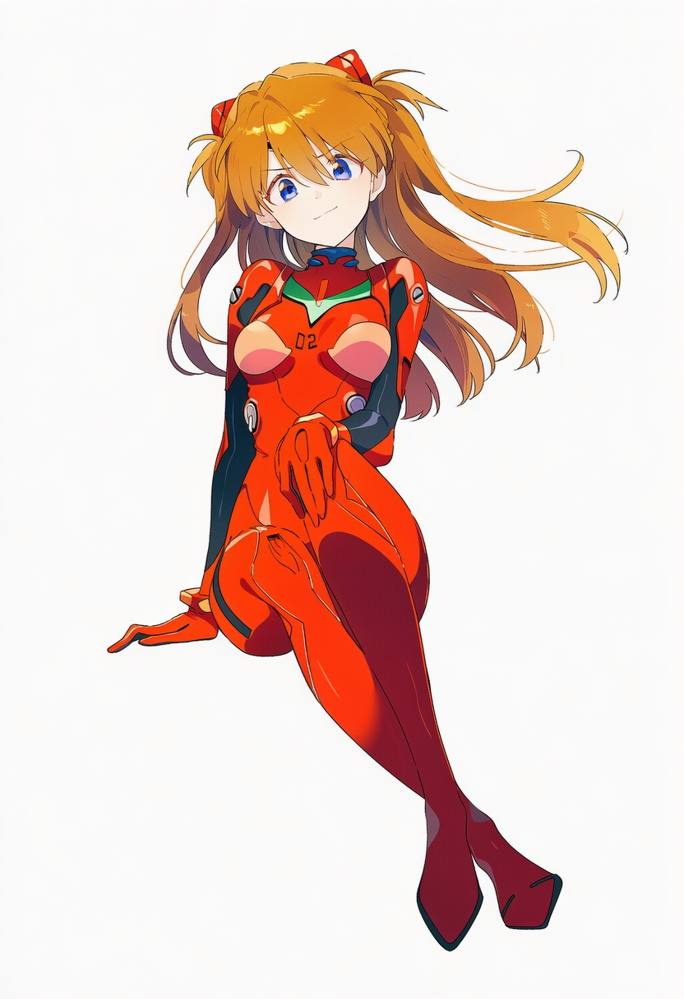
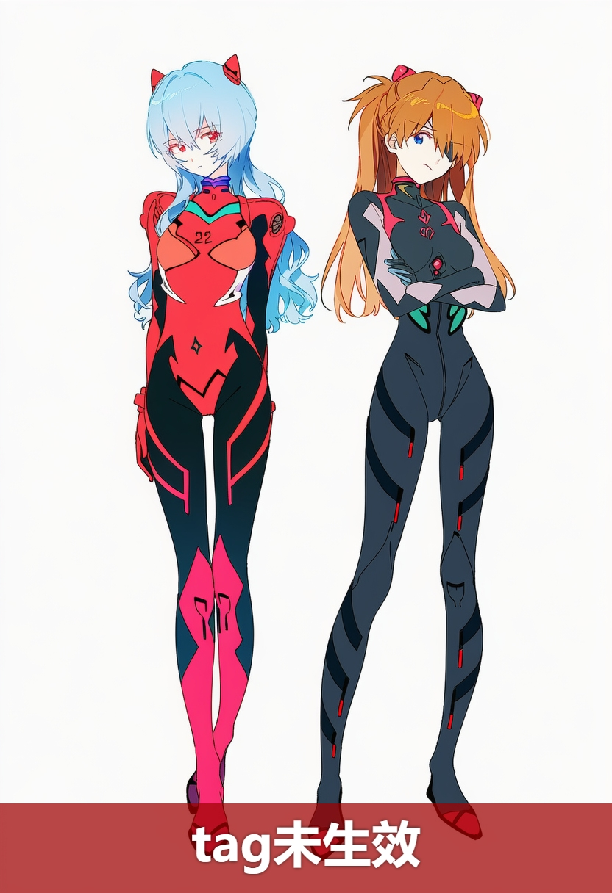
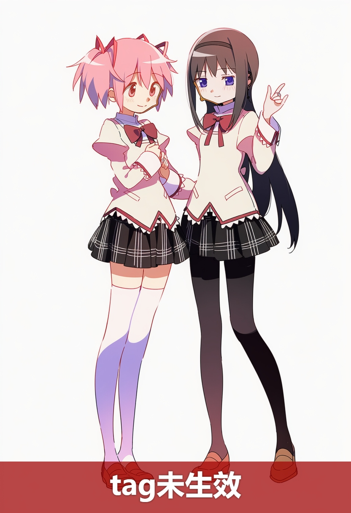
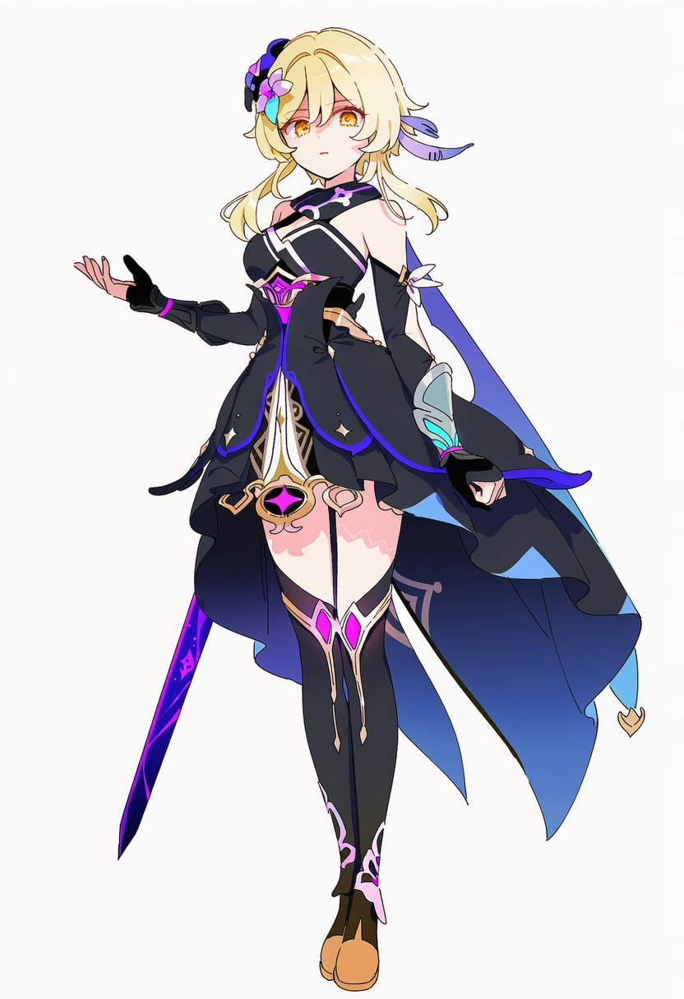
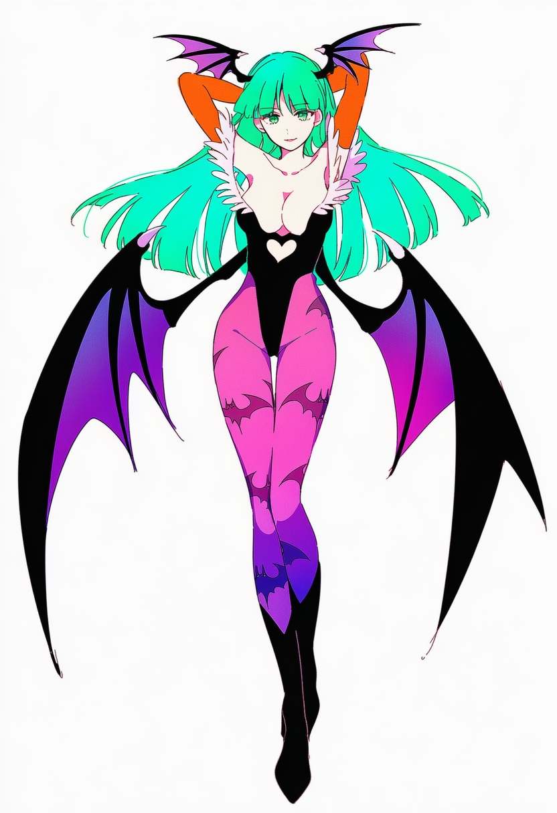

# 二创属性 / 性格/角色变化

[总目录](../README.md) · [原站分类目录](../categories.md) · [英文标签索引](../tags.md) · [服装与构图组合指南](../../README.md)

标题、分类、说明、正负提示词按来源保留；多例图逐张列出。原站标记和说明为参考资料，不作为维护指令。

<a id="raven_composition-4191"></a>

## 角色OOC

ID：`raven_composition-4191`；分类：二创属性 / 性格/角色变化；来源标记：`safe`。

来源说明：

> 角色做出明显不像平时会做的事。

正向提示词：

```text
out_of_character
```



[在线例图](https://assets.quicktagcloud.com/images/raven_composition/raven_composition-4191.jpg?v=f8aa03a434669bbf)

<a id="raven_composition-4192"></a>

## 性格互换

ID：`raven_composition-4192`；分类：二创属性 / 性格/角色变化；来源标记：`safe`。

来源说明：

> 两个角色把彼此的性格对调。

正向提示词：

```text
personality_switch
```



[在线例图](https://assets.quicktagcloud.com/images/raven_composition/raven_composition-4192.jpg?v=be3411be8e2e3534)

<a id="raven_composition-4193"></a>

## 角色定位互换

ID：`raven_composition-4193`；分类：二创属性 / 性格/角色变化；来源标记：`safe`。

来源说明：

> 两个角色交换平时的身份、职责或关系位置。

正向提示词：

```text
role_reversal
```



[在线例图](https://assets.quicktagcloud.com/images/raven_composition/raven_composition-4193.jpg?v=3d9eac494b35b839)

<a id="raven_composition-4194"></a>

## 黑化版本

ID：`raven_composition-4194`；分类：二创属性 / 性格/角色变化；来源标记：`safe`。

来源说明：

> 把角色画成更阴暗、邪恶的另一版本，并让外观也有区别。

正向提示词：

```text
dark_persona
```



[在线例图](https://assets.quicktagcloud.com/images/raven_composition/raven_composition-4194.jpg?v=44d7353142d66444)

<a id="raven_composition-4195"></a>

## 善化版本

ID：`raven_composition-4195`；分类：二创属性 / 性格/角色变化；来源标记：`safe`。

来源说明：

> 把角色画成更光明、善良的另一版本，并让外观也有区别。

正向提示词：

```text
light_persona
```



[在线例图](https://assets.quicktagcloud.com/images/raven_composition/raven_composition-4195.jpg?v=66f53e2fea62ffde)
