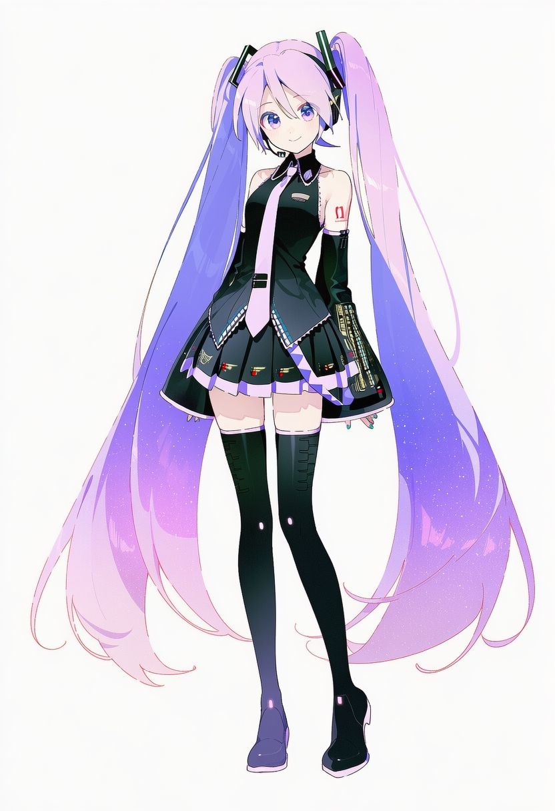
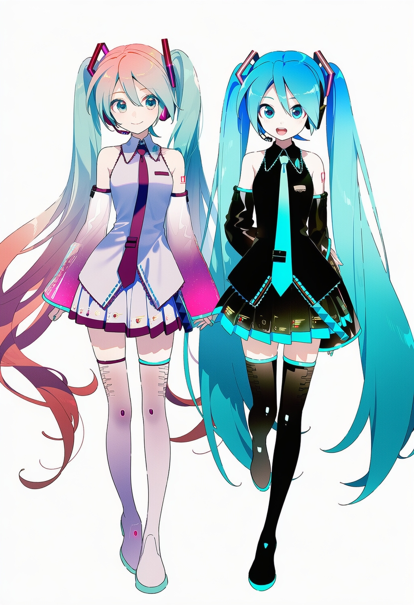

# 二创属性 / 整体配色变化

[总目录](../README.md) · [原站分类目录](../categories.md) · [英文标签索引](../tags.md) · [服装与构图组合指南](../../README.md)

标题、分类、说明、正负提示词按来源保留；多例图逐张列出。原站标记和说明为参考资料，不作为维护指令。

<a id="raven_composition-4196"></a>

## 异色

ID：`raven_composition-4196`；分类：二创属性 / 整体配色变化；来源标记：`safe`。

来源说明：

> 角色服装或整体外观改成非官方的另一套颜色。

正向提示词：

```text
alternate_color
```



[在线例图](https://assets.quicktagcloud.com/images/raven_composition/raven_composition-4196.jpg?v=1360e401775b149b)

<a id="raven_composition-4197"></a>

## 调色板变体

ID：`raven_composition-4197`；分类：二创属性 / 整体配色变化；来源标记：`safe`。

来源说明：

> 同一角色或物体做出几乎只差颜色的多个版本。

正向提示词：

```text
palette_swap
```



[在线例图](https://assets.quicktagcloud.com/images/raven_composition/raven_composition-4197.jpg?v=8e50713558bf07bb)
