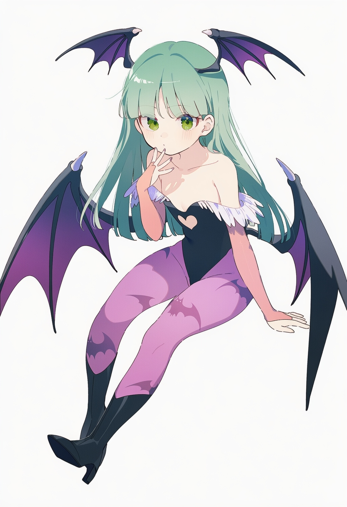

# 二创属性 / 年龄变化

[总目录](../README.md) · [原站分类目录](../categories.md) · [英文标签索引](../tags.md) · [服装与构图组合指南](../../README.md)

标题、分类、说明、正负提示词按来源保留；多例图逐张列出。原站标记和说明为参考资料，不作为维护指令。

<a id="raven_composition-4198"></a>

## 幼化/变年轻

ID：`raven_composition-4198`；分类：二创属性 / 年龄变化；来源标记：`safe`。

来源说明：

> 把角色画得比平时更年轻。

正向提示词：

```text
aged_down
```



[在线例图](https://assets.quicktagcloud.com/images/raven_composition/raven_composition-4198.jpg?v=c3dcf1087ac5511a)

<a id="raven_composition-4199"></a>

## 年长化

ID：`raven_composition-4199`；分类：二创属性 / 年龄变化；来源标记：`safe`。

来源说明：

> 把角色画得比平时更年长。

正向提示词：

```text
aged_up
```


[在线例图](https://assets.quicktagcloud.com/images/raven_composition/raven_composition-4199.jpg?v=76420d5a90aed58d)
