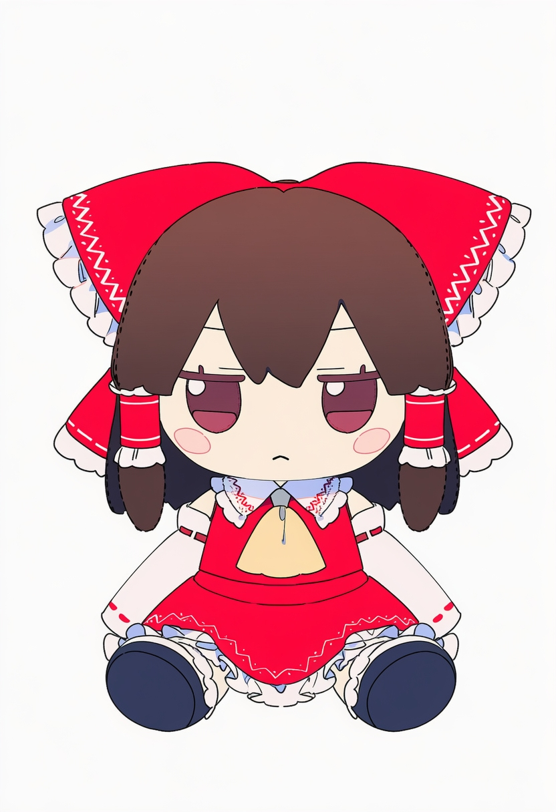
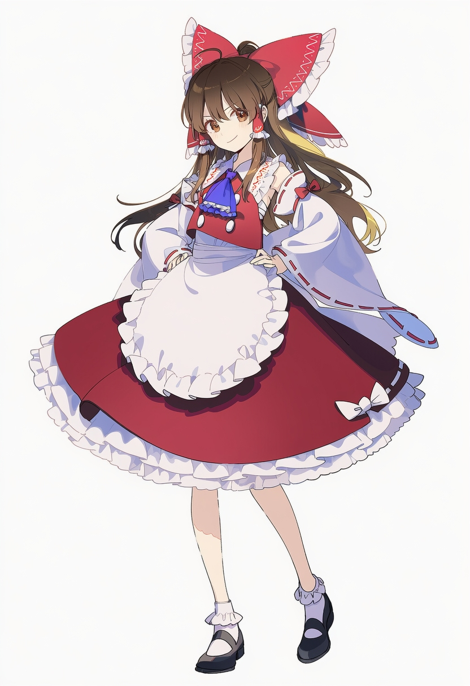
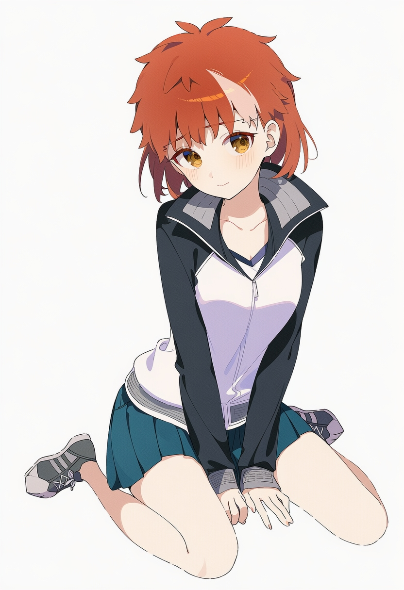
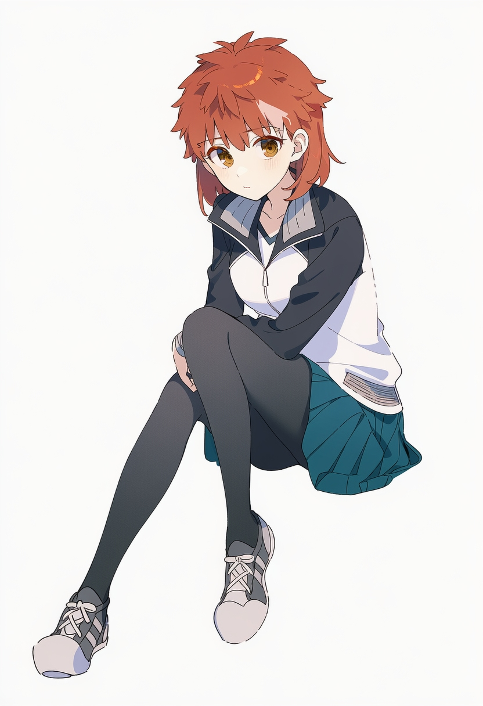
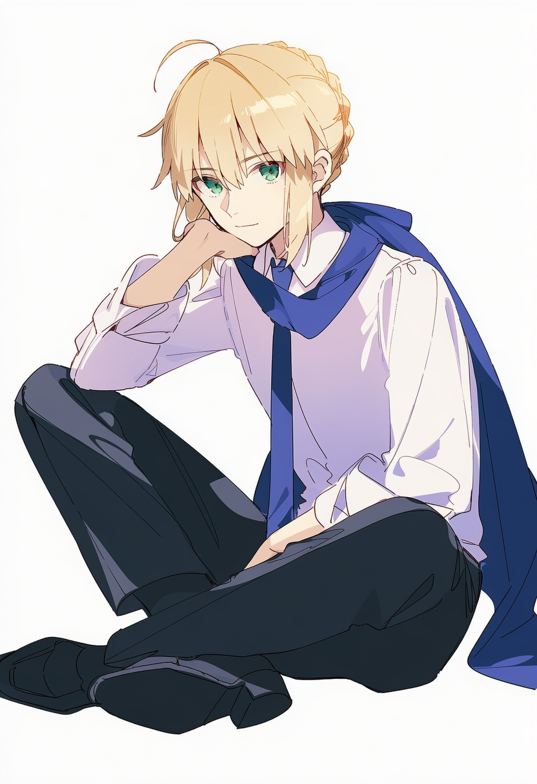
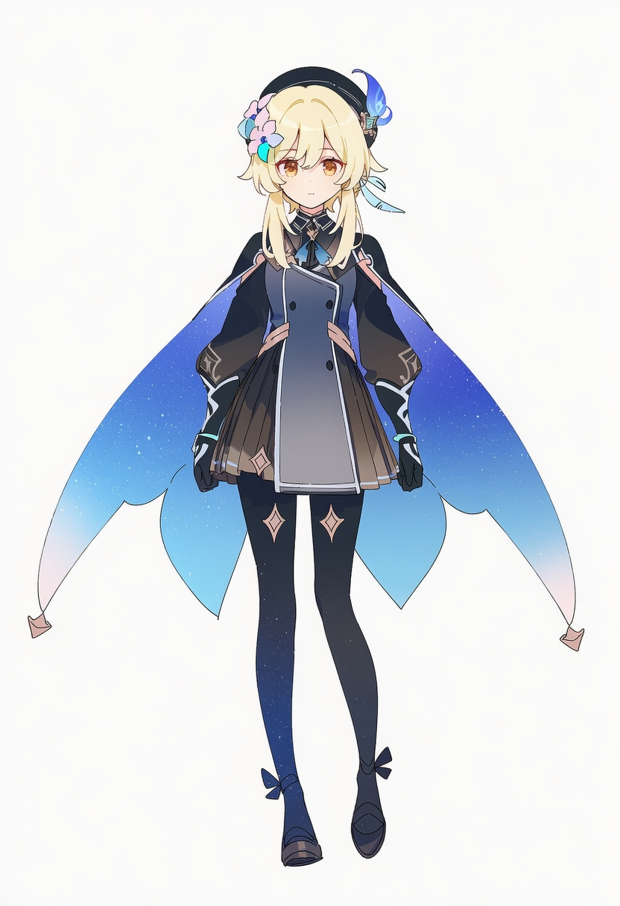
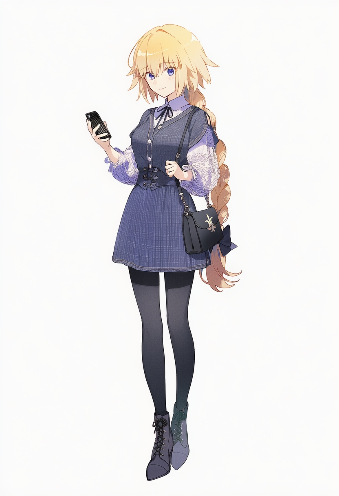

# 二创属性 / 其他设定变化

[总目录](../README.md) · [原站分类目录](../categories.md) · [英文标签索引](../tags.md) · [服装与构图组合指南](../../README.md)

标题、分类、说明、正负提示词按来源保留；多例图逐张列出。原站标记和说明为参考资料，不作为维护指令。

<a id="raven_composition-4200"></a>

## 角色人偶化

ID：`raven_composition-4200`；分类：二创属性 / 其他设定变化；来源标记：`safe`。

来源说明：

> 把人类角色做成人偶或娃娃形态。

正向提示词：

```text
character_doll
```



[在线例图](https://assets.quicktagcloud.com/images/raven_composition/raven_composition-4200.jpg?v=d5ac582cb22e038f)

<a id="raven_composition-4201"></a>

## 角色融合

ID：`raven_composition-4201`；分类：二创属性 / 其他设定变化；来源标记：`safe`。

来源说明：

> 把两个或更多角色的特征合成一个新角色。

正向提示词：

```text
fusion
```



[在线例图](https://assets.quicktagcloud.com/images/raven_composition/raven_composition-4201.jpg?v=51ae2e8c27e5f6be)

<a id="raven_composition-4202"></a>

## 性转

ID：`raven_composition-4202`；分类：二创属性 / 其他设定变化；来源标记：`safe`。

来源说明：

> 把角色画成与原本不同的性别。

正向提示词：

```text
genderswap
```



[在线例图](https://assets.quicktagcloud.com/images/raven_composition/raven_composition-4202.jpg?v=15d0e4f3b6066d28)

<a id="raven_composition-4203"></a>

## 男转女

ID：`raven_composition-4203`；分类：二创属性 / 其他设定变化；来源标记：`safe`。

来源说明：

> 把原本男性角色画成女性。

正向提示词：

```text
genderswap_(mtf)
```



[在线例图](https://assets.quicktagcloud.com/images/raven_composition/raven_composition-4203.jpg?v=ed18b71b084c19b6)

<a id="raven_composition-4204"></a>

## 女转男

ID：`raven_composition-4204`；分类：二创属性 / 其他设定变化；来源标记：`safe`。

来源说明：

> 把原本女性角色画成男性。

正向提示词：

```text
genderswap_(ftm)
```



[在线例图](https://assets.quicktagcloud.com/images/raven_composition/raven_composition-4204.jpg?v=3b7edba58c642cb6)

<a id="raven_composition-4205"></a>

## 平行世界设定

ID：`raven_composition-4205`；分类：二创属性 / 其他设定变化；来源标记：`safe`。

来源说明：

> 把角色放到与原作不同的世界观或人生设定里。

正向提示词：

```text
alternate_universe
```



[在线例图](https://assets.quicktagcloud.com/images/raven_composition/raven_composition-4205.jpg?v=06177e230c2eab0a)

<a id="raven_composition-4206"></a>

## 时代错位

ID：`raven_composition-4206`；分类：二创属性 / 其他设定变化；来源标记：`safe`。

来源说明：

> 画面出现不属于作品时代的东西，比如古代角色拿智能手机。

正向提示词：

```text
anachronism
```



[在线例图](https://assets.quicktagcloud.com/images/raven_composition/raven_composition-4206.jpg?v=5fb447b45c534549)
