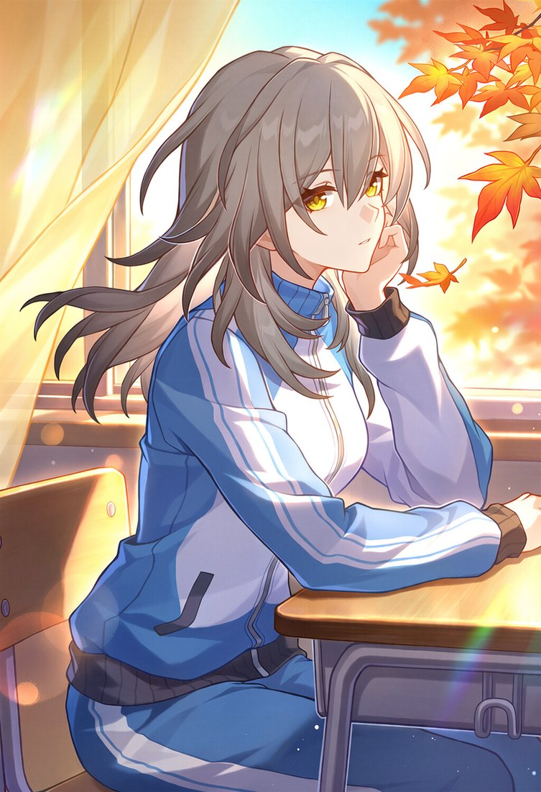
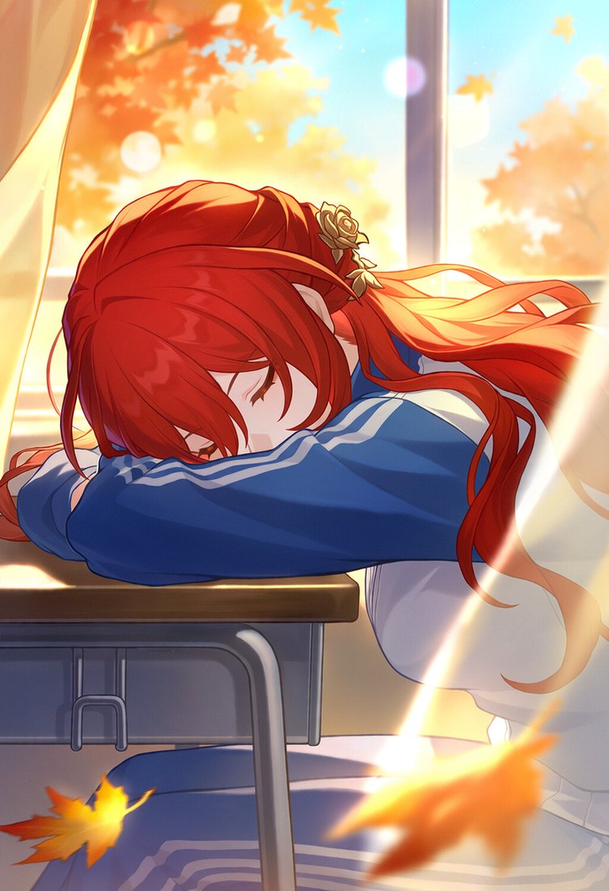
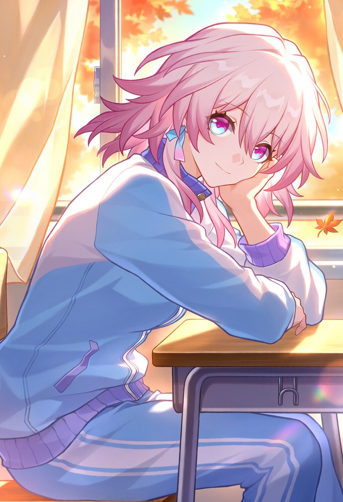
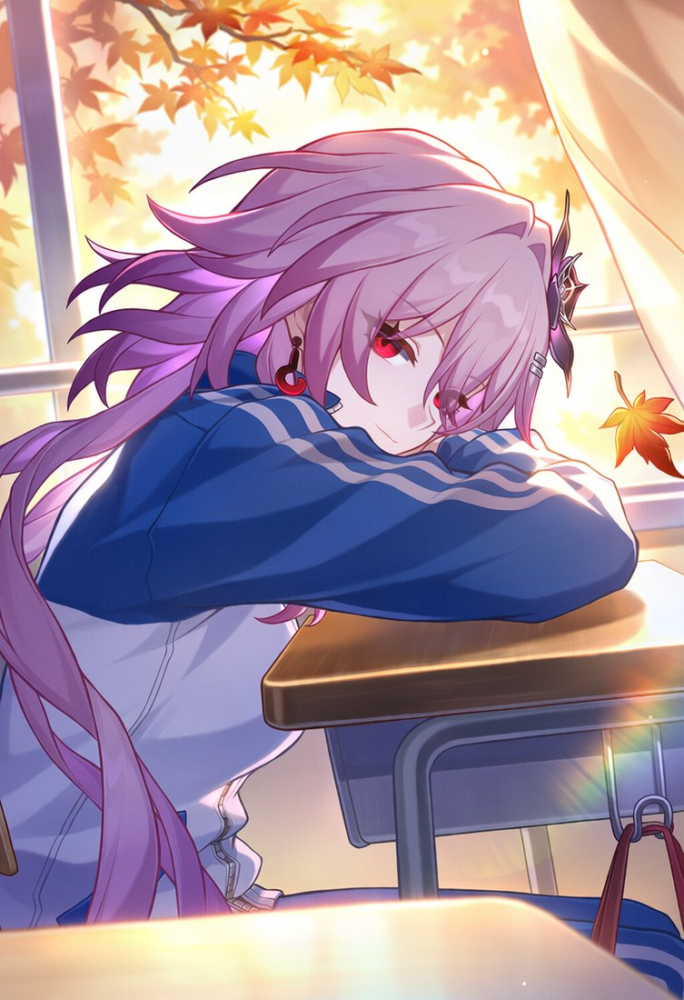
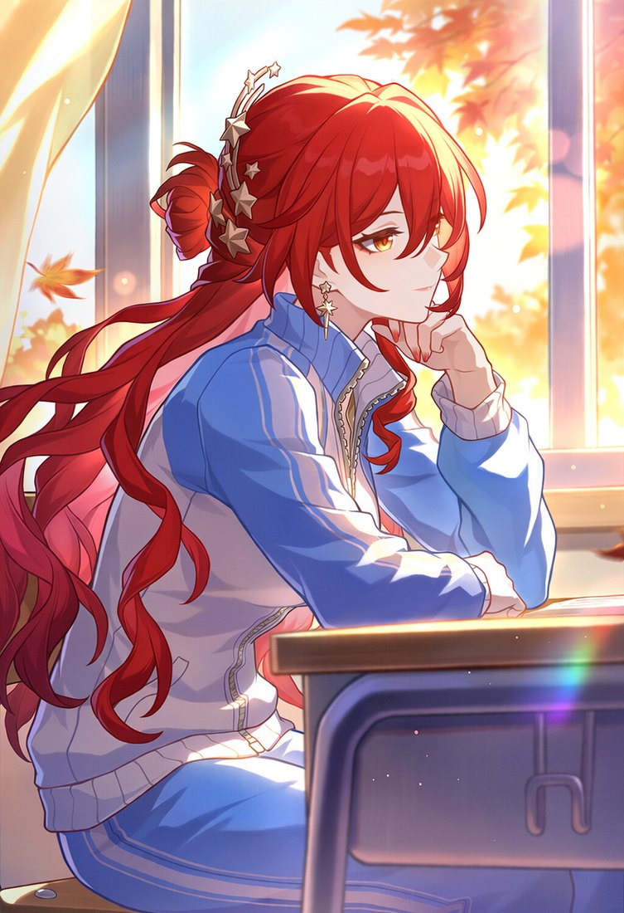

# 秋季课堂 / 星穹列车

[总目录](../README.md) · [原站分类目录](../categories.md) · [英文标签索引](../tags.md) · [服装与构图组合指南](../../README.md)

标题、分类、说明、正负提示词按来源保留；多例图逐张列出。原站标记和说明为参考资料，不作为维护指令。

<a id="raven_composition-4209"></a>

## 星

ID：`raven_composition-4209`；分类：秋季课堂 / 星穹列车；来源标记：`safe`。

正向提示词：

```text
2::high detail,best quality,masterpiece,amazing quality,very aesthetic,absurdres::, 1girl,2::solo::, 1.5::stelle_(honkai:_star_rail)::,1.2::track_suit,track_pants,alternate_costume,blue_white_track_suit::,1.3::cowboy shot,sitting,on_chair::,-2.5::simple_background::,classroom,from_side,2::autumn leaves::,windows,from indoors,curtains,||head on hand|head on own arms|sleeping| ||,honkai:_star_rail,official_art,official_style,detailed_background,0.8::thick_lineart,thick_outlines::,1.1::colored_lineart::,colorful,1.4::backlighting::,1.3::bloom::,1.25::depth_of_field::,1.15::lens_flare::,1.2::bokeh::,1.3::painterly::,1.35::blurry_background::,1.4::pastel_colors::,1.2::gradient::,soft_lighting,soft_glow
```

负向提示词：

```text
4::artist name,extra characters,extra fingers,logo,watermark, signature,artist collaboration,deformed,what,Picture frames, photos, posters::,{username},{watermark},{{extra character}},{{{{bad anatomy}}}},{bad feet},bad hands,{{{bad proportions}}},{blurry},cloned face,cropped,{{{deformed}}},{{{disfigured}}},error,{{{extra arms}}},{extra digit},{{{extra legs}}},extra limbs,{{extra limbs}},{fewer digits},{{{fused fingers}}},gross proportions,ink eyes,ink hair,jpeg artifacts,{{{{long neck}}}},low quality,{malformed limbs},{{missing arms}},{missing fingers},{{missing legs}},{{{more than 2 nipples}}},mutated hands,{{{mutation}}},normal quality,owres,{{poorly drawn face}},{{poorly drawn hands}},reen eyes,signature,text,{{too many fingers}},{{{ugly}}},username,uta,watermark,worst quality,{{{more than 2 legs}}}
```



[在线例图](https://assets.quicktagcloud.com/images/raven_composition/raven_composition-4209.jpg?v=ff21e563cd1be800) · [原图](https://assets.quicktagcloud.com/originals/raven_composition/raven_composition-4209.png?v=ff21e563cd1be800)

<a id="raven_composition-4210"></a>

## 姬子

ID：`raven_composition-4210`；分类：秋季课堂 / 星穹列车；来源标记：`safe`。

正向提示词：

```text
2::high detail,best quality,masterpiece,amazing quality,very aesthetic,absurdres::, 1girl,2::solo::, 1.5::himeko_(honkai:_star_rail)::,1.2::track_suit,track_pants,alternate_costume,blue_white_track_suit::,1.3::cowboy shot,sitting,on_chair::,-2.5::simple_background::,classroom,from_side,2::autumn leaves::,windows,from indoors,curtains,||head on hand|head on own arms|sleeping| ||,honkai:_star_rail,official_art,official_style,detailed_background,0.8::thick_lineart,thick_outlines::,1.1::colored_lineart::,colorful,1.4::backlighting::,1.3::bloom::,1.25::depth_of_field::,1.15::lens_flare::,1.2::bokeh::,1.3::painterly::,1.35::blurry_background::,1.4::pastel_colors::,1.2::gradient::,soft_lighting,soft_glow
```

负向提示词：

```text
4::artist name,extra characters,extra fingers,logo,watermark, signature,artist collaboration,deformed,what,Picture frames, photos, posters::,{username},{watermark},{{extra character}},{{{{bad anatomy}}}},{bad feet},bad hands,{{{bad proportions}}},{blurry},cloned face,cropped,{{{deformed}}},{{{disfigured}}},error,{{{extra arms}}},{extra digit},{{{extra legs}}},extra limbs,{{extra limbs}},{fewer digits},{{{fused fingers}}},gross proportions,ink eyes,ink hair,jpeg artifacts,{{{{long neck}}}},low quality,{malformed limbs},{{missing arms}},{missing fingers},{{missing legs}},{{{more than 2 nipples}}},mutated hands,{{{mutation}}},normal quality,owres,{{poorly drawn face}},{{poorly drawn hands}},reen eyes,signature,text,{{too many fingers}},{{{ugly}}},username,uta,watermark,worst quality,{{{more than 2 legs}}}
```



[在线例图](https://assets.quicktagcloud.com/images/raven_composition/raven_composition-4210.jpg?v=cfd4079a9af3848d) · [原图](https://assets.quicktagcloud.com/originals/raven_composition/raven_composition-4210.png?v=cfd4079a9af3848d)

<a id="raven_composition-4211"></a>

## 三月七

ID：`raven_composition-4211`；分类：秋季课堂 / 星穹列车；来源标记：`safe`。

正向提示词：

```text
2::high detail,best quality,masterpiece,amazing quality,very aesthetic,absurdres::, 1girl,2::solo::, 1.5::march_7th_(honkai:_star_rail)::,1.2::track_suit,track_pants,alternate_costume,blue_white_track_suit::,1.3::cowboy shot,sitting,on_chair::,-2.5::simple_background::,classroom,from_side,2::autumn leaves::,windows,from indoors,curtains,||head on hand|head on own arms|sleeping| ||,honkai:_star_rail,official_art,official_style,detailed_background,0.8::thick_lineart,thick_outlines::,1.1::colored_lineart::,colorful,1.4::backlighting::,1.3::bloom::,1.25::depth_of_field::,1.15::lens_flare::,1.2::bokeh::,1.3::painterly::,1.35::blurry_background::,1.4::pastel_colors::,1.2::gradient::,soft_lighting,soft_glow
```

负向提示词：

```text
4::artist name,extra characters,extra fingers,logo,watermark, signature,artist collaboration,deformed,what,Picture frames, photos, posters::,{username},{watermark},{{extra character}},{{{{bad anatomy}}}},{bad feet},bad hands,{{{bad proportions}}},{blurry},cloned face,cropped,{{{deformed}}},{{{disfigured}}},error,{{{extra arms}}},{extra digit},{{{extra legs}}},extra limbs,{{extra limbs}},{fewer digits},{{{fused fingers}}},gross proportions,ink eyes,ink hair,jpeg artifacts,{{{{long neck}}}},low quality,{malformed limbs},{{missing arms}},{missing fingers},{{missing legs}},{{{more than 2 nipples}}},mutated hands,{{{mutation}}},normal quality,owres,{{poorly drawn face}},{{poorly drawn hands}},reen eyes,signature,text,{{too many fingers}},{{{ugly}}},username,uta,watermark,worst quality,{{{more than 2 legs}}}
```



[在线例图](https://assets.quicktagcloud.com/images/raven_composition/raven_composition-4211.jpg?v=f9f26dde7036790c) · [原图](https://assets.quicktagcloud.com/originals/raven_composition/raven_composition-4211.png?v=f9f26dde7036790c)

<a id="raven_composition-4212"></a>

## 长夜月

ID：`raven_composition-4212`；分类：秋季课堂 / 星穹列车；来源标记：`safe`。

正向提示词：

```text
2::high detail,best quality,masterpiece,amazing quality,very aesthetic,absurdres::, 1girl,2::solo::, 1.5::evernight_(honkai:_star_rail)::,1.2::track_suit,track_pants,alternate_costume,blue_white_track_suit::,1.3::cowboy shot,sitting,on_chair::,-2.5::simple_background::,classroom,from_side,2::autumn leaves::,windows,from indoors,curtains,||head on hand|head on own arms|sleeping| ||,honkai:_star_rail,official_art,official_style,detailed_background,0.8::thick_lineart,thick_outlines::,1.1::colored_lineart::,colorful,1.4::backlighting::,1.3::bloom::,1.25::depth_of_field::,1.15::lens_flare::,1.2::bokeh::,1.3::painterly::,1.35::blurry_background::,1.4::pastel_colors::,1.2::gradient::,soft_lighting,soft_glow
```

负向提示词：

```text
4::artist name,extra characters,extra fingers,logo,watermark, signature,artist collaboration,deformed,what,Picture frames, photos, posters::,{username},{watermark},{{extra character}},{{{{bad anatomy}}}},{bad feet},bad hands,{{{bad proportions}}},{blurry},cloned face,cropped,{{{deformed}}},{{{disfigured}}},error,{{{extra arms}}},{extra digit},{{{extra legs}}},extra limbs,{{extra limbs}},{fewer digits},{{{fused fingers}}},gross proportions,ink eyes,ink hair,jpeg artifacts,{{{{long neck}}}},low quality,{malformed limbs},{{missing arms}},{missing fingers},{{missing legs}},{{{more than 2 nipples}}},mutated hands,{{{mutation}}},normal quality,owres,{{poorly drawn face}},{{poorly drawn hands}},reen eyes,signature,text,{{too many fingers}},{{{ugly}}},username,uta,watermark,worst quality,{{{more than 2 legs}}}
```



[在线例图](https://assets.quicktagcloud.com/images/raven_composition/raven_composition-4212.jpg?v=15ae0762650b1a29) · [原图](https://assets.quicktagcloud.com/originals/raven_composition/raven_composition-4212.png?v=15ae0762650b1a29)

<a id="raven_composition-4213"></a>

## 姬子·启行

ID：`raven_composition-4213`；分类：秋季课堂 / 星穹列车；来源标记：`safe`。

正向提示词：

```text
2::high detail,best quality,masterpiece,amazing quality,very aesthetic,absurdres::, 1girl,2::solo::, 1.5::himeko_(nova)_(honkai:_star_rail)::,1.2::track_suit,track_pants,alternate_costume,blue_white_track_suit::,1.3::cowboy shot,sitting,on_chair::,-2.5::simple_background::,classroom,from_side,2::autumn leaves::,windows,from indoors,curtains,||head on hand|head on own arms|sleeping| ||,honkai:_star_rail,official_art,official_style,detailed_background,0.8::thick_lineart,thick_outlines::,1.1::colored_lineart::,colorful,1.4::backlighting::,1.3::bloom::,1.25::depth_of_field::,1.15::lens_flare::,1.2::bokeh::,1.3::painterly::,1.35::blurry_background::,1.4::pastel_colors::,1.2::gradient::,soft_lighting,soft_glow
```

负向提示词：

```text
4::artist name,extra characters,extra fingers,logo,watermark, signature,artist collaboration,deformed,what,Picture frames, photos, posters::,{username},{watermark},{{extra character}},{{{{bad anatomy}}}},{bad feet},bad hands,{{{bad proportions}}},{blurry},cloned face,cropped,{{{deformed}}},{{{disfigured}}},error,{{{extra arms}}},{extra digit},{{{extra legs}}},extra limbs,{{extra limbs}},{fewer digits},{{{fused fingers}}},gross proportions,ink eyes,ink hair,jpeg artifacts,{{{{long neck}}}},low quality,{malformed limbs},{{missing arms}},{missing fingers},{{missing legs}},{{{more than 2 nipples}}},mutated hands,{{{mutation}}},normal quality,owres,{{poorly drawn face}},{{poorly drawn hands}},reen eyes,signature,text,{{too many fingers}},{{{ugly}}},username,uta,watermark,worst quality,{{{more than 2 legs}}}
```



[在线例图](https://assets.quicktagcloud.com/images/raven_composition/raven_composition-4213.jpg?v=dde91c580d2b9e28) · [原图](https://assets.quicktagcloud.com/originals/raven_composition/raven_composition-4213.png?v=dde91c580d2b9e28)
