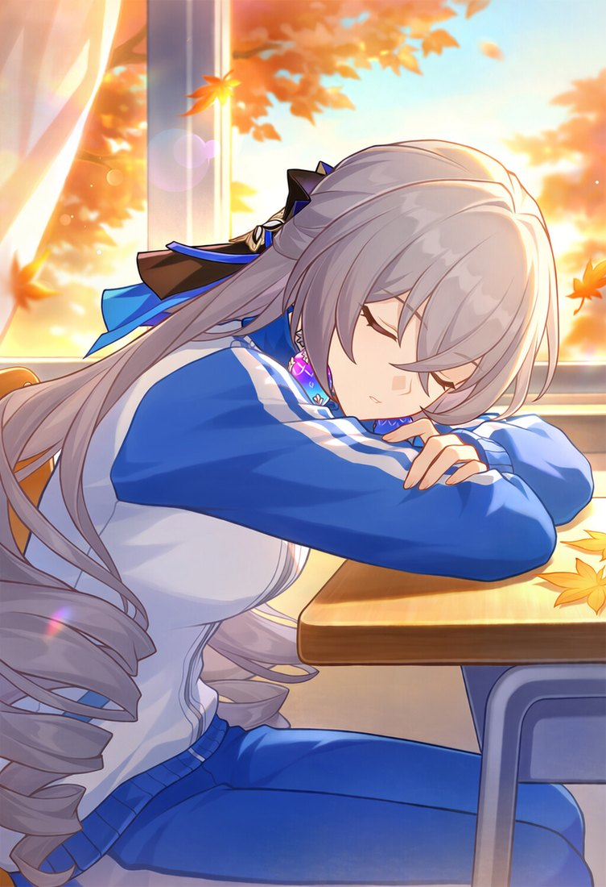
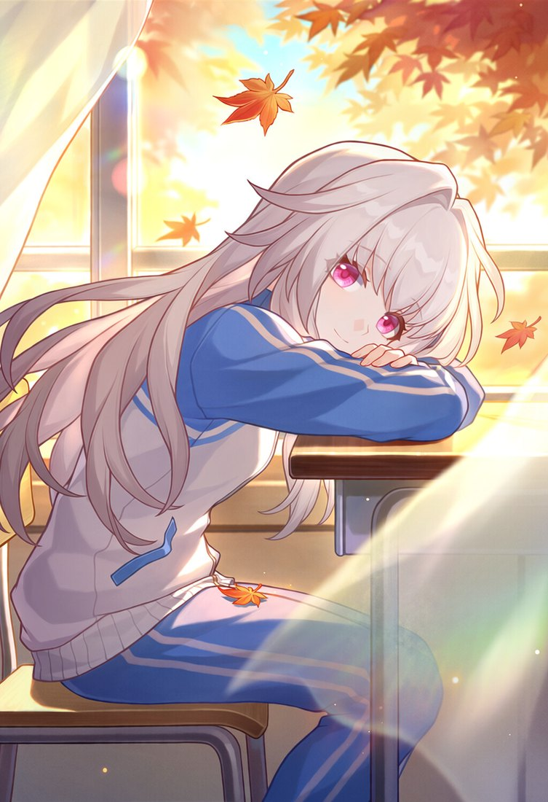
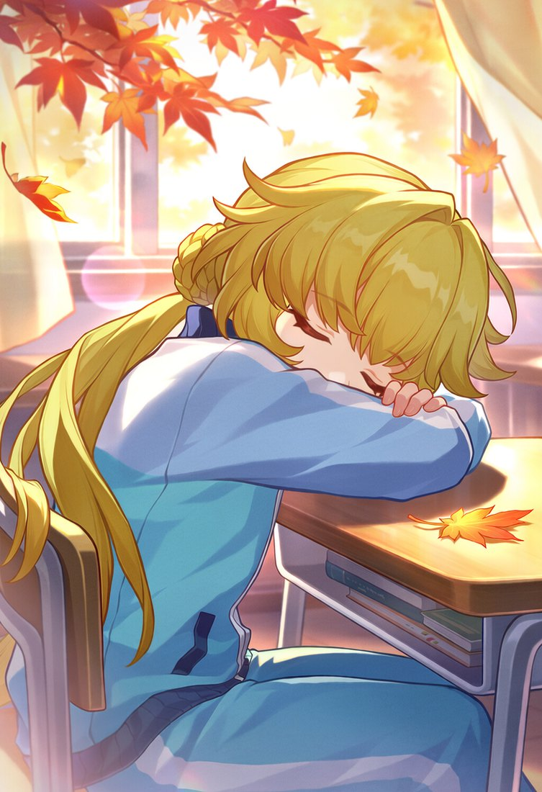
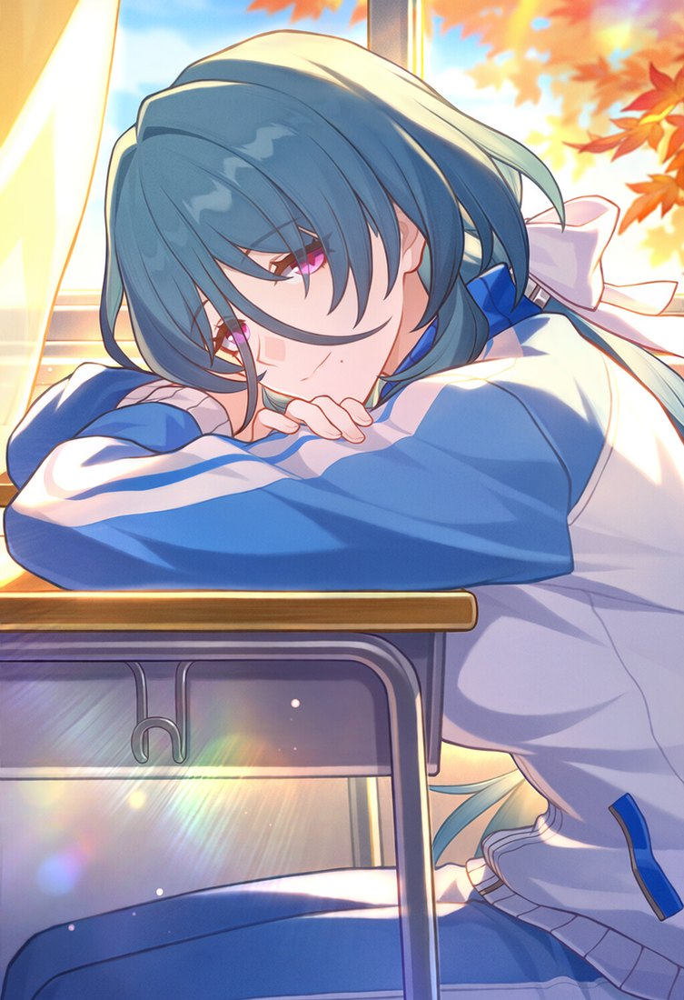
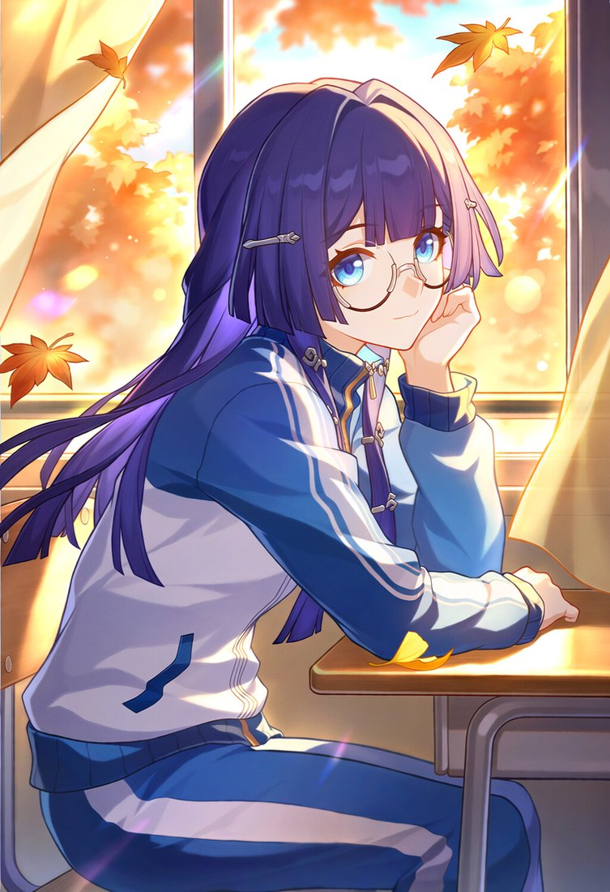
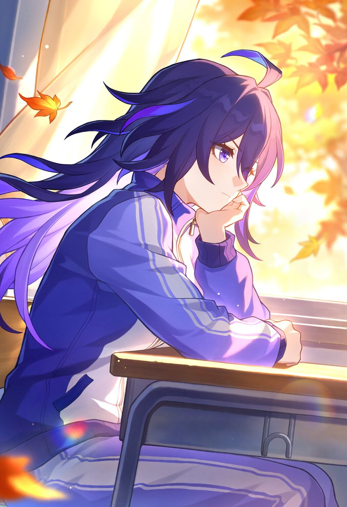
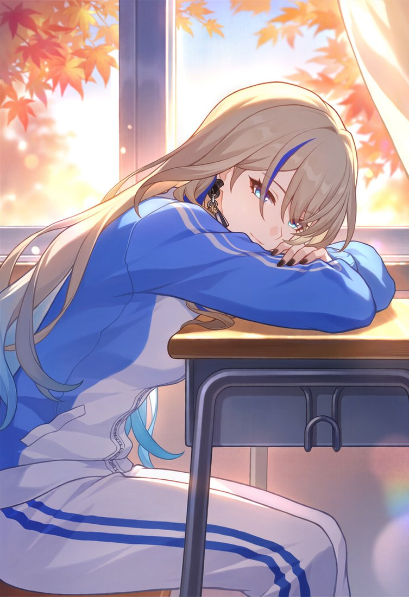
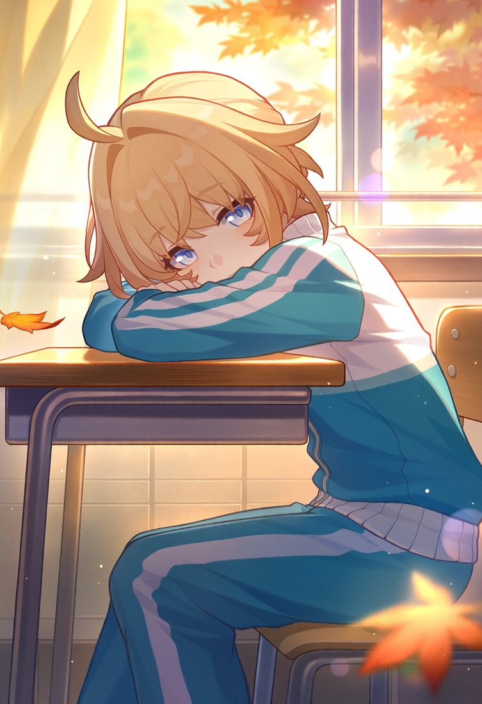

# 秋季课堂 / 贝洛伯格

[总目录](../README.md) · [原站分类目录](../categories.md) · [英文标签索引](../tags.md) · [服装与构图组合指南](../../README.md)

标题、分类、说明、正负提示词按来源保留；多例图逐张列出。原站标记和说明为参考资料，不作为维护指令。

<a id="raven_composition-4260"></a>

## 布洛妮娅·兰德

ID：`raven_composition-4260`；分类：秋季课堂 / 贝洛伯格；来源标记：`safe`。

正向提示词：

```text
2::high detail,best quality,masterpiece,amazing quality,very aesthetic,absurdres::, 1girl,2::solo::, 1.5::bronya_rand::,1.2::track_suit,track_pants,alternate_costume,blue_white_track_suit::,1.3::cowboy shot,sitting,on_chair::,-2.5::simple_background::,classroom,from_side,2::autumn leaves::,windows,from indoors,curtains,||head on hand|head on own arms|sleeping| ||,honkai:_star_rail,official_art,official_style,detailed_background,0.8::thick_lineart,thick_outlines::,1.1::colored_lineart::,colorful,1.4::backlighting::,1.3::bloom::,1.25::depth_of_field::,1.15::lens_flare::,1.2::bokeh::,1.3::painterly::,1.35::blurry_background::,1.4::pastel_colors::,1.2::gradient::,soft_lighting,soft_glow
```

负向提示词：

```text
4::artist name,extra characters,extra fingers,logo,watermark, signature,artist collaboration,deformed,what,Picture frames, photos, posters::,{username},{watermark},{{extra character}},{{{{bad anatomy}}}},{bad feet},bad hands,{{{bad proportions}}},{blurry},cloned face,cropped,{{{deformed}}},{{{disfigured}}},error,{{{extra arms}}},{extra digit},{{{extra legs}}},extra limbs,{{extra limbs}},{fewer digits},{{{fused fingers}}},gross proportions,ink eyes,ink hair,jpeg artifacts,{{{{long neck}}}},low quality,{malformed limbs},{{missing arms}},{missing fingers},{{missing legs}},{{{more than 2 nipples}}},mutated hands,{{{mutation}}},normal quality,owres,{{poorly drawn face}},{{poorly drawn hands}},reen eyes,signature,text,{{too many fingers}},{{{ugly}}},username,uta,watermark,worst quality,{{{more than 2 legs}}}
```



[在线例图](https://assets.quicktagcloud.com/images/raven_composition/raven_composition-4260.jpg?v=66c354058f526570) · [原图](https://assets.quicktagcloud.com/originals/raven_composition/raven_composition-4260.png?v=66c354058f526570)

<a id="raven_composition-4261"></a>

## 克拉拉

ID：`raven_composition-4261`；分类：秋季课堂 / 贝洛伯格；来源标记：`safe`。

正向提示词：

```text
2::high detail,best quality,masterpiece,amazing quality,very aesthetic,absurdres::, 1girl,2::solo::, 1.5::clara_(honkai:_star_rail)::,1.2::track_suit,track_pants,alternate_costume,blue_white_track_suit::,1.3::cowboy shot,sitting,on_chair::,-2.5::simple_background::,classroom,from_side,2::autumn leaves::,windows,from indoors,curtains,||head on hand|head on own arms|sleeping| ||,honkai:_star_rail,official_art,official_style,detailed_background,0.8::thick_lineart,thick_outlines::,1.1::colored_lineart::,colorful,1.4::backlighting::,1.3::bloom::,1.25::depth_of_field::,1.15::lens_flare::,1.2::bokeh::,1.3::painterly::,1.35::blurry_background::,1.4::pastel_colors::,1.2::gradient::,soft_lighting,soft_glow
```

负向提示词：

```text
4::artist name,extra characters,extra fingers,logo,watermark, signature,artist collaboration,deformed,what,Picture frames, photos, posters::,{username},{watermark},{{extra character}},{{{{bad anatomy}}}},{bad feet},bad hands,{{{bad proportions}}},{blurry},cloned face,cropped,{{{deformed}}},{{{disfigured}}},error,{{{extra arms}}},{extra digit},{{{extra legs}}},extra limbs,{{extra limbs}},{fewer digits},{{{fused fingers}}},gross proportions,ink eyes,ink hair,jpeg artifacts,{{{{long neck}}}},low quality,{malformed limbs},{{missing arms}},{missing fingers},{{missing legs}},{{{more than 2 nipples}}},mutated hands,{{{mutation}}},normal quality,owres,{{poorly drawn face}},{{poorly drawn hands}},reen eyes,signature,text,{{too many fingers}},{{{ugly}}},username,uta,watermark,worst quality,{{{more than 2 legs}}}
```



[在线例图](https://assets.quicktagcloud.com/images/raven_composition/raven_composition-4261.jpg?v=8d36c3a084381ad5) · [原图](https://assets.quicktagcloud.com/originals/raven_composition/raven_composition-4261.png?v=8d36c3a084381ad5)

<a id="raven_composition-4262"></a>

## 虎克

ID：`raven_composition-4262`；分类：秋季课堂 / 贝洛伯格；来源标记：`safe`。

正向提示词：

```text
2::high detail,best quality,masterpiece,amazing quality,very aesthetic,absurdres::, 1girl,2::solo::, 1.5::hook_(honkai:_star_rail)::,1.2::track_suit,track_pants,alternate_costume,blue_white_track_suit::,1.3::cowboy shot,sitting,on_chair::,-2.5::simple_background::,classroom,from_side,2::autumn leaves::,windows,from indoors,curtains,||head on hand|head on own arms|sleeping| ||,honkai:_star_rail,official_art,official_style,detailed_background,0.8::thick_lineart,thick_outlines::,1.1::colored_lineart::,colorful,1.4::backlighting::,1.3::bloom::,1.25::depth_of_field::,1.15::lens_flare::,1.2::bokeh::,1.3::painterly::,1.35::blurry_background::,1.4::pastel_colors::,1.2::gradient::,soft_lighting,soft_glow
```

负向提示词：

```text
4::artist name,extra characters,extra fingers,logo,watermark, signature,artist collaboration,deformed,what,Picture frames, photos, posters::,{username},{watermark},{{extra character}},{{{{bad anatomy}}}},{bad feet},bad hands,{{{bad proportions}}},{blurry},cloned face,cropped,{{{deformed}}},{{{disfigured}}},error,{{{extra arms}}},{extra digit},{{{extra legs}}},extra limbs,{{extra limbs}},{fewer digits},{{{fused fingers}}},gross proportions,ink eyes,ink hair,jpeg artifacts,{{{{long neck}}}},low quality,{malformed limbs},{{missing arms}},{missing fingers},{{missing legs}},{{{more than 2 nipples}}},mutated hands,{{{mutation}}},normal quality,owres,{{poorly drawn face}},{{poorly drawn hands}},reen eyes,signature,text,{{too many fingers}},{{{ugly}}},username,uta,watermark,worst quality,{{{more than 2 legs}}}
```



[在线例图](https://assets.quicktagcloud.com/images/raven_composition/raven_composition-4262.jpg?v=2708ca9d0a5f9889) · [原图](https://assets.quicktagcloud.com/originals/raven_composition/raven_composition-4262.png?v=2708ca9d0a5f9889)

<a id="raven_composition-4263"></a>

## 娜塔莎

ID：`raven_composition-4263`；分类：秋季课堂 / 贝洛伯格；来源标记：`safe`。

正向提示词：

```text
2::high detail,best quality,masterpiece,amazing quality,very aesthetic,absurdres::, 1girl,2::solo::, 1.5::natasha_(honkai:_star_rail)::,1.2::track_suit,track_pants,alternate_costume,blue_white_track_suit::,1.3::cowboy shot,sitting,on_chair::,-2.5::simple_background::,classroom,from_side,2::autumn leaves::,windows,from indoors,curtains,||head on hand|head on own arms|sleeping| ||,honkai:_star_rail,official_art,official_style,detailed_background,0.8::thick_lineart,thick_outlines::,1.1::colored_lineart::,colorful,1.4::backlighting::,1.3::bloom::,1.25::depth_of_field::,1.15::lens_flare::,1.2::bokeh::,1.3::painterly::,1.35::blurry_background::,1.4::pastel_colors::,1.2::gradient::,soft_lighting,soft_glow
```

负向提示词：

```text
4::artist name,extra characters,extra fingers,logo,watermark, signature,artist collaboration,deformed,what,Picture frames, photos, posters::,{username},{watermark},{{extra character}},{{{{bad anatomy}}}},{bad feet},bad hands,{{{bad proportions}}},{blurry},cloned face,cropped,{{{deformed}}},{{{disfigured}}},error,{{{extra arms}}},{extra digit},{{{extra legs}}},extra limbs,{{extra limbs}},{fewer digits},{{{fused fingers}}},gross proportions,ink eyes,ink hair,jpeg artifacts,{{{{long neck}}}},low quality,{malformed limbs},{{missing arms}},{missing fingers},{{missing legs}},{{{more than 2 nipples}}},mutated hands,{{{mutation}}},normal quality,owres,{{poorly drawn face}},{{poorly drawn hands}},reen eyes,signature,text,{{too many fingers}},{{{ugly}}},username,uta,watermark,worst quality,{{{more than 2 legs}}}
```



[在线例图](https://assets.quicktagcloud.com/images/raven_composition/raven_composition-4263.jpg?v=8788cb10f130ac7d) · [原图](https://assets.quicktagcloud.com/originals/raven_composition/raven_composition-4263.png?v=8788cb10f130ac7d)

<a id="raven_composition-4264"></a>

## 佩拉

ID：`raven_composition-4264`；分类：秋季课堂 / 贝洛伯格；来源标记：`safe`。

正向提示词：

```text
2::high detail,best quality,masterpiece,amazing quality,very aesthetic,absurdres::, 1girl,2::solo::, 1.5::pela_(honkai:_star_rail)::,1.2::track_suit,track_pants,alternate_costume,blue_white_track_suit::,1.3::cowboy shot,sitting,on_chair::,-2.5::simple_background::,classroom,from_side,2::autumn leaves::,windows,from indoors,curtains,||head on hand|head on own arms|sleeping| ||,honkai:_star_rail,official_art,official_style,detailed_background,0.8::thick_lineart,thick_outlines::,1.1::colored_lineart::,colorful,1.4::backlighting::,1.3::bloom::,1.25::depth_of_field::,1.15::lens_flare::,1.2::bokeh::,1.3::painterly::,1.35::blurry_background::,1.4::pastel_colors::,1.2::gradient::,soft_lighting,soft_glow
```

负向提示词：

```text
4::artist name,extra characters,extra fingers,logo,watermark, signature,artist collaboration,deformed,what,Picture frames, photos, posters::,{username},{watermark},{{extra character}},{{{{bad anatomy}}}},{bad feet},bad hands,{{{bad proportions}}},{blurry},cloned face,cropped,{{{deformed}}},{{{disfigured}}},error,{{{extra arms}}},{extra digit},{{{extra legs}}},extra limbs,{{extra limbs}},{fewer digits},{{{fused fingers}}},gross proportions,ink eyes,ink hair,jpeg artifacts,{{{{long neck}}}},low quality,{malformed limbs},{{missing arms}},{missing fingers},{{missing legs}},{{{more than 2 nipples}}},mutated hands,{{{mutation}}},normal quality,owres,{{poorly drawn face}},{{poorly drawn hands}},reen eyes,signature,text,{{too many fingers}},{{{ugly}}},username,uta,watermark,worst quality,{{{more than 2 legs}}}
```



[在线例图](https://assets.quicktagcloud.com/images/raven_composition/raven_composition-4264.jpg?v=869b5fdb4a83e2e4) · [原图](https://assets.quicktagcloud.com/originals/raven_composition/raven_composition-4264.png?v=869b5fdb4a83e2e4)

<a id="raven_composition-4265"></a>

## 希儿

ID：`raven_composition-4265`；分类：秋季课堂 / 贝洛伯格；来源标记：`safe`。

正向提示词：

```text
2::high detail,best quality,masterpiece,amazing quality,very aesthetic,absurdres::, 1girl,2::solo::, 1.5::seele_(honkai:_star_rail)::,1.2::track_suit,track_pants,alternate_costume,blue_white_track_suit::,1.3::cowboy shot,sitting,on_chair::,-2.5::simple_background::,classroom,from_side,2::autumn leaves::,windows,from indoors,curtains,||head on hand|head on own arms|sleeping| ||,honkai:_star_rail,official_art,official_style,detailed_background,0.8::thick_lineart,thick_outlines::,1.1::colored_lineart::,colorful,1.4::backlighting::,1.3::bloom::,1.25::depth_of_field::,1.15::lens_flare::,1.2::bokeh::,1.3::painterly::,1.35::blurry_background::,1.4::pastel_colors::,1.2::gradient::,soft_lighting,soft_glow
```

负向提示词：

```text
4::artist name,extra characters,extra fingers,logo,watermark, signature,artist collaboration,deformed,what,Picture frames, photos, posters::,{username},{watermark},{{extra character}},{{{{bad anatomy}}}},{bad feet},bad hands,{{{bad proportions}}},{blurry},cloned face,cropped,{{{deformed}}},{{{disfigured}}},error,{{{extra arms}}},{extra digit},{{{extra legs}}},extra limbs,{{extra limbs}},{fewer digits},{{{fused fingers}}},gross proportions,ink eyes,ink hair,jpeg artifacts,{{{{long neck}}}},low quality,{malformed limbs},{{missing arms}},{missing fingers},{{missing legs}},{{{more than 2 nipples}}},mutated hands,{{{mutation}}},normal quality,owres,{{poorly drawn face}},{{poorly drawn hands}},reen eyes,signature,text,{{too many fingers}},{{{ugly}}},username,uta,watermark,worst quality,{{{more than 2 legs}}}
```



[在线例图](https://assets.quicktagcloud.com/images/raven_composition/raven_composition-4265.jpg?v=26957935b07a4491) · [原图](https://assets.quicktagcloud.com/originals/raven_composition/raven_composition-4265.png?v=26957935b07a4491)

<a id="raven_composition-4266"></a>

## 希露瓦

ID：`raven_composition-4266`；分类：秋季课堂 / 贝洛伯格；来源标记：`safe`。

正向提示词：

```text
2::high detail,best quality,masterpiece,amazing quality,very aesthetic,absurdres::, 1girl,2::solo::, 1.5::serval_landau::,1.2::track_suit,track_pants,alternate_costume,blue_white_track_suit::,1.3::cowboy shot,sitting,on_chair::,-2.5::simple_background::,classroom,from_side,2::autumn leaves::,windows,from indoors,curtains,||head on hand|head on own arms|sleeping| ||,honkai:_star_rail,official_art,official_style,detailed_background,0.8::thick_lineart,thick_outlines::,1.1::colored_lineart::,colorful,1.4::backlighting::,1.3::bloom::,1.25::depth_of_field::,1.15::lens_flare::,1.2::bokeh::,1.3::painterly::,1.35::blurry_background::,1.4::pastel_colors::,1.2::gradient::,soft_lighting,soft_glow
```

负向提示词：

```text
4::artist name,extra characters,extra fingers,logo,watermark, signature,artist collaboration,deformed,what,Picture frames, photos, posters::,{username},{watermark},{{extra character}},{{{{bad anatomy}}}},{bad feet},bad hands,{{{bad proportions}}},{blurry},cloned face,cropped,{{{deformed}}},{{{disfigured}}},error,{{{extra arms}}},{extra digit},{{{extra legs}}},extra limbs,{{extra limbs}},{fewer digits},{{{fused fingers}}},gross proportions,ink eyes,ink hair,jpeg artifacts,{{{{long neck}}}},low quality,{malformed limbs},{{missing arms}},{missing fingers},{{missing legs}},{{{more than 2 nipples}}},mutated hands,{{{mutation}}},normal quality,owres,{{poorly drawn face}},{{poorly drawn hands}},reen eyes,signature,text,{{too many fingers}},{{{ugly}}},username,uta,watermark,worst quality,{{{more than 2 legs}}}
```



[在线例图](https://assets.quicktagcloud.com/images/raven_composition/raven_composition-4266.jpg?v=08a7925a64cf94c2) · [原图](https://assets.quicktagcloud.com/originals/raven_composition/raven_composition-4266.png?v=08a7925a64cf94c2)

<a id="raven_composition-4267"></a>

## 玲可·朗道

ID：`raven_composition-4267`；分类：秋季课堂 / 贝洛伯格；来源标记：`safe`。

正向提示词：

```text
2::high detail,best quality,masterpiece,amazing quality,very aesthetic,absurdres::, 1girl,2::solo::, 1.5::lynx_landau::,1.2::track_suit,track_pants,alternate_costume,blue_white_track_suit::,1.3::cowboy shot,sitting,on_chair::,-2.5::simple_background::,classroom,from_side,2::autumn leaves::,windows,from indoors,curtains,||head on hand|head on own arms|sleeping| ||,honkai:_star_rail,official_art,official_style,detailed_background,0.8::thick_lineart,thick_outlines::,1.1::colored_lineart::,colorful,1.4::backlighting::,1.3::bloom::,1.25::depth_of_field::,1.15::lens_flare::,1.2::bokeh::,1.3::painterly::,1.35::blurry_background::,1.4::pastel_colors::,1.2::gradient::,soft_lighting,soft_glow
```

负向提示词：

```text
4::artist name,extra characters,extra fingers,logo,watermark, signature,artist collaboration,deformed,what,Picture frames, photos, posters::,{username},{watermark},{{extra character}},{{{{bad anatomy}}}},{bad feet},bad hands,{{{bad proportions}}},{blurry},cloned face,cropped,{{{deformed}}},{{{disfigured}}},error,{{{extra arms}}},{extra digit},{{{extra legs}}},extra limbs,{{extra limbs}},{fewer digits},{{{fused fingers}}},gross proportions,ink eyes,ink hair,jpeg artifacts,{{{{long neck}}}},low quality,{malformed limbs},{{missing arms}},{missing fingers},{{missing legs}},{{{more than 2 nipples}}},mutated hands,{{{mutation}}},normal quality,owres,{{poorly drawn face}},{{poorly drawn hands}},reen eyes,signature,text,{{too many fingers}},{{{ugly}}},username,uta,watermark,worst quality,{{{more than 2 legs}}}
```



[在线例图](https://assets.quicktagcloud.com/images/raven_composition/raven_composition-4267.jpg?v=ef2e31f23b444c4e) · [原图](https://assets.quicktagcloud.com/originals/raven_composition/raven_composition-4267.png?v=ef2e31f23b444c4e)
