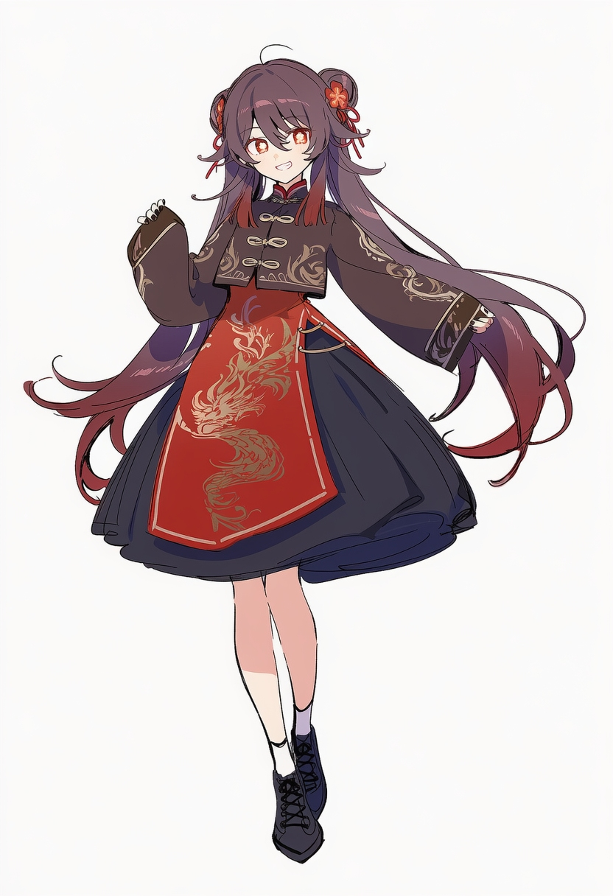

# 传统服饰 / 中国-综合

[总目录](../README.md) · [原站分类目录](../categories.md) · [英文标签索引](../tags.md) · [服装与构图组合指南](../../README.md)

标题、分类、说明、正负提示词按来源保留；多例图逐张列出。原站标记和说明为参考资料，不作为维护指令。

<a id="raven_composition-4370"></a>

## 中式服饰

ID：`raven_composition-4370`；分类：传统服饰 / 中国-综合；来源标记：`safe`。

来源说明：

> 中国民族/传统服饰的总称

正向提示词：

```text
chinese_clothes
```


[在线例图](https://assets.quicktagcloud.com/images/raven_composition/raven_composition-4370.jpg?v=b02a2b33324301bd)

<a id="raven_composition-4371"></a>

## 中国传统服饰

ID：`raven_composition-4371`；分类：传统服饰 / 中国-综合；来源标记：`safe`。

来源说明：

> 中国传统服饰（细分tag）

正向提示词：

```text
traditional_chinese_clothes
```



[在线例图](https://assets.quicktagcloud.com/images/raven_composition/raven_composition-4371.jpg?v=d04c5b585af8a2db)
