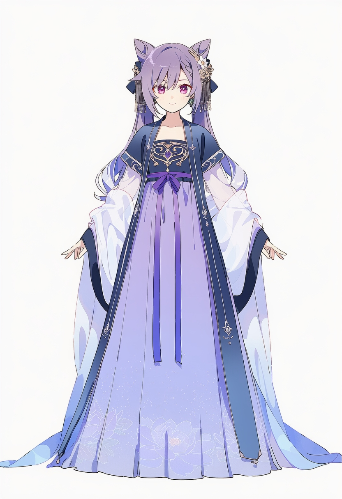
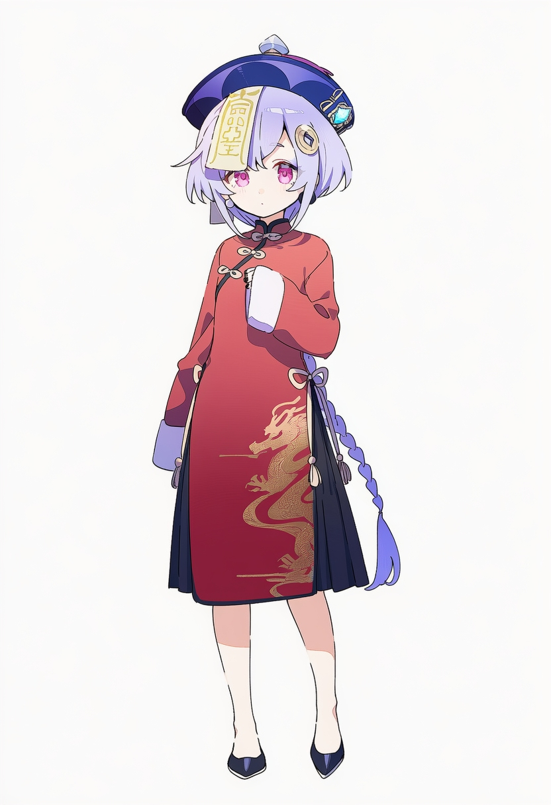

# 传统服饰 / 中国-全身

[总目录](../README.md) · [原站分类目录](../categories.md) · [英文标签索引](../tags.md) · [服装与构图组合指南](../../README.md)

标题、分类、说明、正负提示词按来源保留；多例图逐张列出。原站标记和说明为参考资料，不作为维护指令。

<a id="raven_composition-4372"></a>

## 汉服

ID：`raven_composition-4372`；分类：传统服饰 / 中国-全身；来源标记：`safe`。

来源说明：

> 汉民族传统服饰，交领右衽、宽袖长袍

正向提示词：

```text
hanfu
```



[在线例图](https://assets.quicktagcloud.com/images/raven_composition/raven_composition-4372.jpg?v=3242e583972a15d7)

<a id="raven_composition-4374"></a>

## 旗袍

ID：`raven_composition-4374`；分类：传统服饰 / 中国-全身；来源标记：`safe`。

来源说明：

> 中国女性传统服饰，立领、盘扣、紧身长裙

正向提示词：

```text
qipao
```



[在线例图](https://assets.quicktagcloud.com/images/raven_composition/raven_composition-4374.jpg?v=e38f5bea37508ab4)

<a id="raven_composition-4377"></a>

## 直裾袍

ID：`raven_composition-4377`；分类：传统服饰 / 中国-全身；来源标记：`safe`。

来源说明：

> 直裾（下摆直线）的汉服长袍

正向提示词：

```text
zhijupao
```


[在线例图](https://assets.quicktagcloud.com/images/raven_composition/raven_composition-4377.jpg?v=9e710d977e6a0f42)
