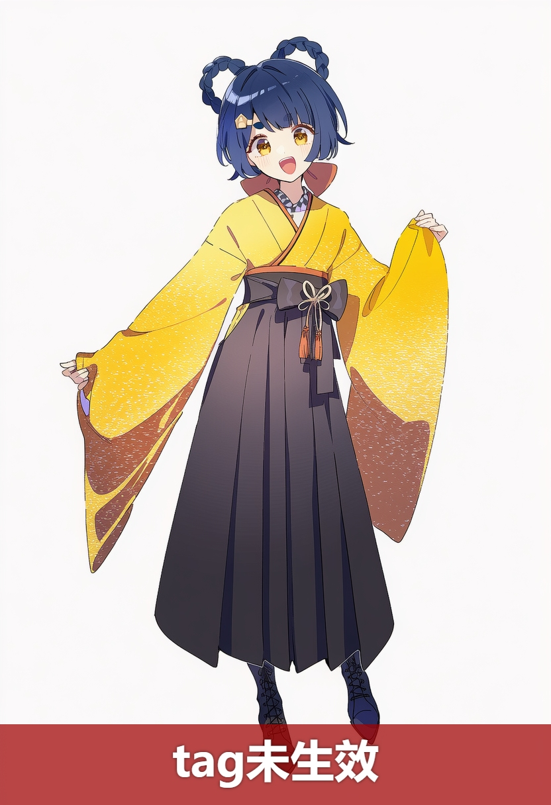
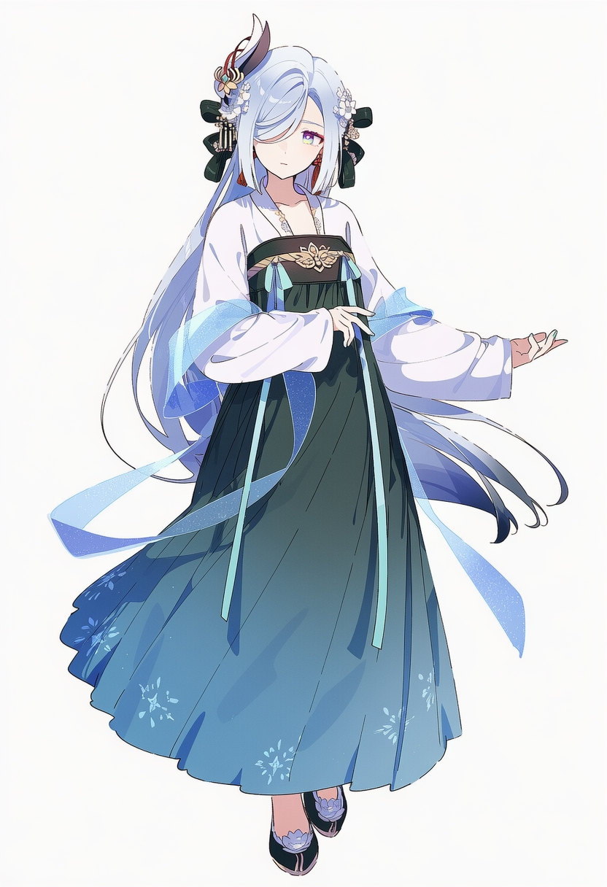
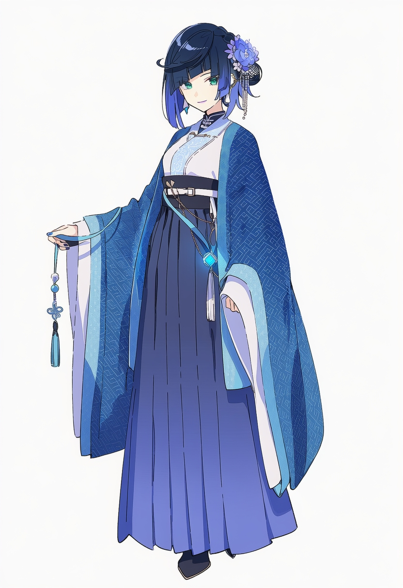
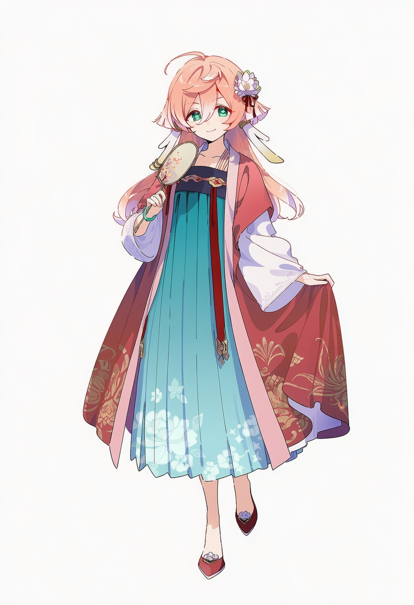
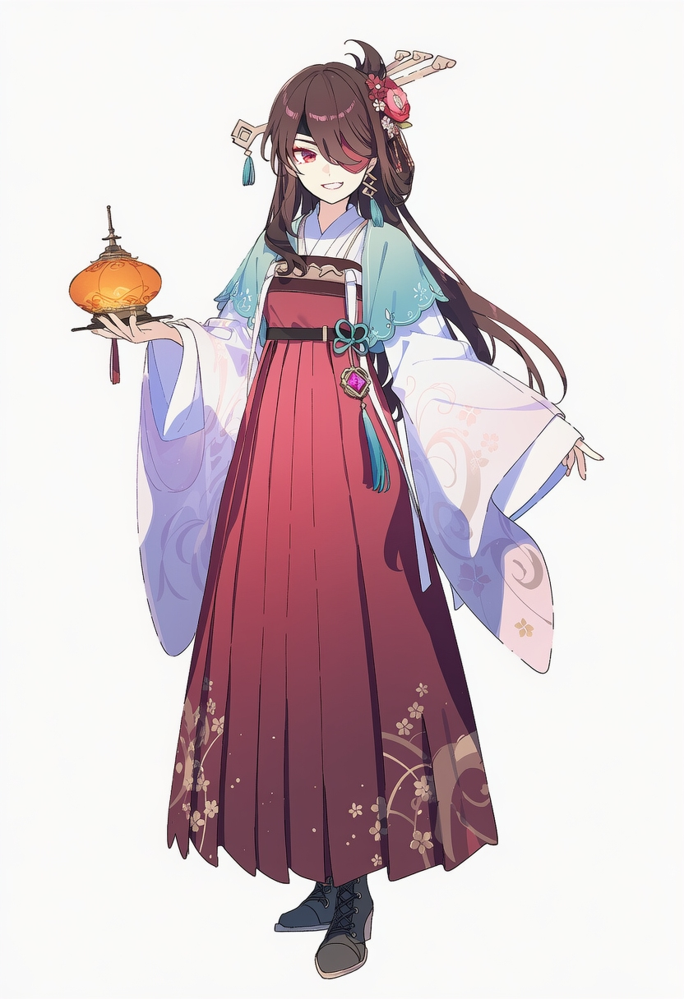
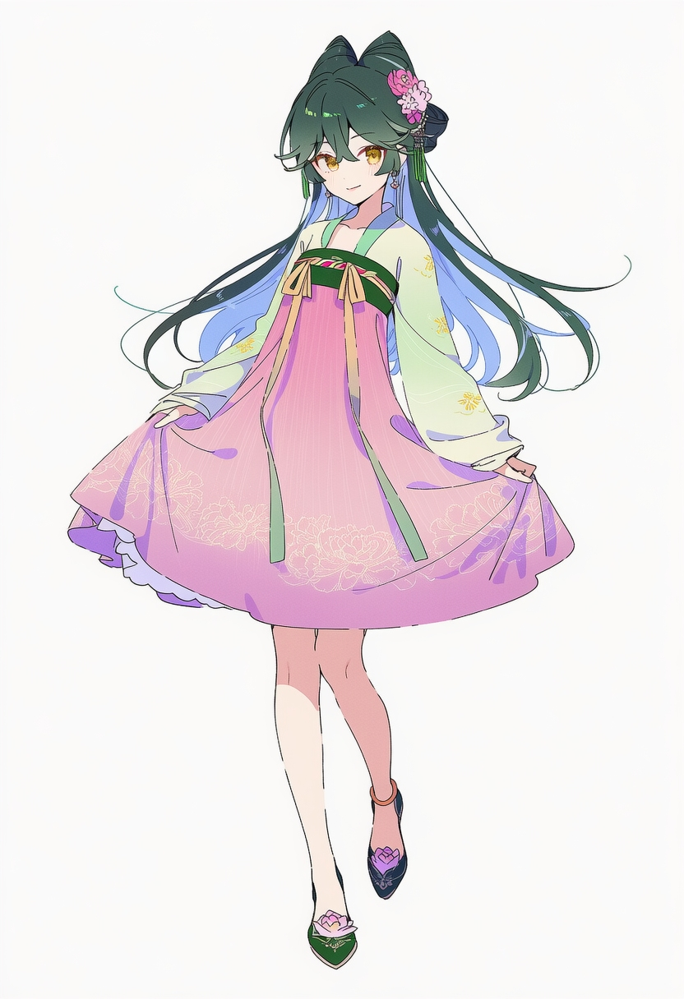
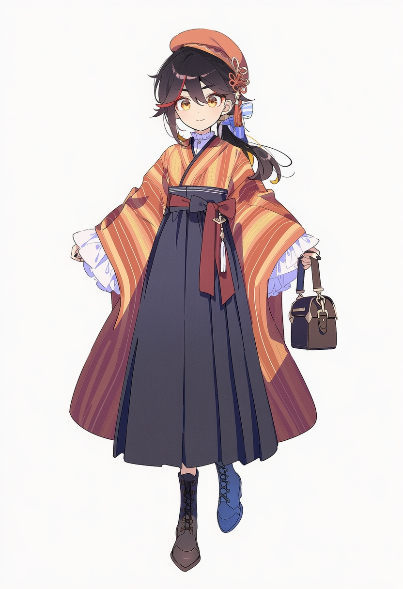

# 传统服饰 / 中国-下装

[总目录](../README.md) · [原站分类目录](../categories.md) · [英文标签索引](../tags.md) · [服装与构图组合指南](../../README.md)

标题、分类、说明、正负提示词按来源保留；多例图逐张列出。原站标记和说明为参考资料，不作为维护指令。

<a id="raven_composition-4375"></a>

## 裙褂

ID：`raven_composition-4375`；分类：传统服饰 / 中国-下装；来源标记：`safe`。

来源说明：

> 中式新娘/古典裙装

正向提示词：

```text
qungua
```



[在线例图](https://assets.quicktagcloud.com/images/raven_composition/raven_composition-4375.jpg?v=70a006c85bc1a0f9)

<a id="raven_composition-4376"></a>

## 襦裙

ID：`raven_composition-4376`；分类：传统服饰 / 中国-下装；来源标记：`safe`。

来源说明：

> 上襦下裙的汉服制式

正向提示词：

```text
ruqun
```



[在线例图](https://assets.quicktagcloud.com/images/raven_composition/raven_composition-4376.jpg?v=5abd6a4783ef8eff)

<a id="raven_composition-4378"></a>

## 袄裙

ID：`raven_composition-4378`；分类：传统服饰 / 中国-下装；来源标记：`safe`。

来源说明：

> 上袄下裙的汉服女装制式

正向提示词：

```text
aoqun
```



[在线例图](https://assets.quicktagcloud.com/images/raven_composition/raven_composition-4378.jpg?v=93ffcd06c1af9968)

<a id="raven_composition-4379"></a>

## 对襟襦裙

ID：`raven_composition-4379`；分类：传统服饰 / 中国-下装；来源标记：`safe`。

来源说明：

> 对襟式襦裙汉服

正向提示词：

```text
duijin_ruqun
```



[在线例图](https://assets.quicktagcloud.com/images/raven_composition/raven_composition-4379.jpg?v=8748b111eb90689e)

<a id="raven_composition-4380"></a>

## 交领襦裙

ID：`raven_composition-4380`；分类：传统服饰 / 中国-下装；来源标记：`safe`。

来源说明：

> 交领式襦裙汉服

正向提示词：

```text
jiaoling_ruqun
```



[在线例图](https://assets.quicktagcloud.com/images/raven_composition/raven_composition-4380.jpg?v=6199a6b14558d29f)

<a id="raven_composition-4381"></a>

## 齐胸襦裙

ID：`raven_composition-4381`；分类：传统服饰 / 中国-下装；来源标记：`safe`。

来源说明：

> 齐胸襦裙汉服（隋唐风）

正向提示词：

```text
qixiong_ruqun
```



[在线例图](https://assets.quicktagcloud.com/images/raven_composition/raven_composition-4381.jpg?v=f8c757141bf9bdf1)

<a id="raven_composition-4382"></a>

## 马面裙

ID：`raven_composition-4382`；分类：传统服饰 / 中国-下装；来源标记：`safe`。

来源说明：

> 中国传统百褶马面裙

正向提示词：

```text
mamianqun
```



[在线例图](https://assets.quicktagcloud.com/images/raven_composition/raven_composition-4382.jpg?v=e59086bee724052a)
